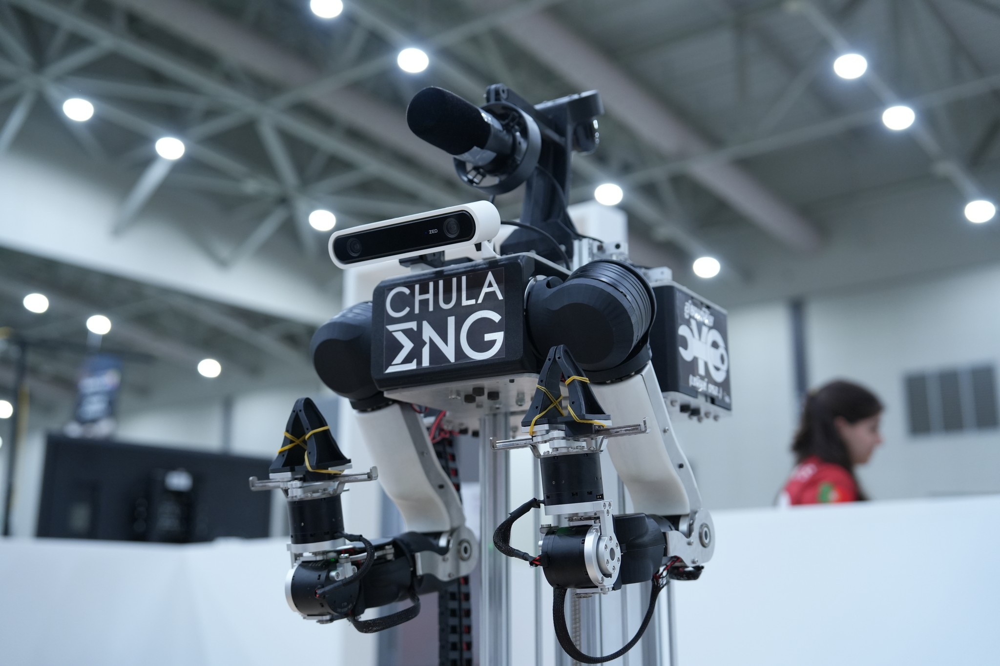

# walkie-ros



ROS 2 Jazzy software stack for the Walkie robot (EIC RoboCup 2026/2027): robot description, ros2_control hardware drivers, Gazebo, MuJoCo, and NVIDIA Isaac Sim simulation, Nav2 navigation, MoveIt manipulation for the bimanual OpenArm, perception, and the bringup that ties them together. The workspace is managed with [pixi](https://pixi.sh) and [RoboStack](https://robostack.github.io); no system ROS installation is needed.

## Documentation

**https://eic-robocup-2026.github.io/walkie-ros/**

The site is built from the [`docs/`](docs/index.md) folder, which you can also read directly on GitHub. To preview it locally:

```bash
pixi run docs    # serves http://127.0.0.1:8000
```

| Start here | |
|---|---|
| [Getting Started](docs/getting-started.md) | Prerequisites, clone, install, build, and the first simulation run |
| [Guides](docs/guides/index.md) | Simulation, navigation, manipulation, perception, the real robot, tests, Docker |
| [Migration Log](docs/migrations/index.md) | Why the workspace looks the way it does: the move to pixi, the MuJoCo model, the docs site, the RoboStack build set |
| [Troubleshooting](docs/troubleshooting.md) | Known errors and their fixes |

## Quick start

Requires Linux x86_64, [pixi](https://pixi.sh/latest/#installation), Git LFS, and SSH access to the EIC-Robocup-2026 organization. See [Getting Started](docs/getting-started.md) for details.

```bash
git clone --recurse-submodules git@github.com:EIC-Robocup-2026/walkie-ros.git
cd walkie-ros
git submodule foreach --recursive git lfs pull
pixi install
pixi run build-setup                  # build packages sequentially (or: pixi run build)
```
