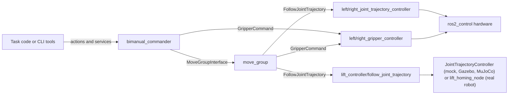

# Manipulation

Launch MoveIt and send motion goals to Walkie's two 7-joint OpenArm v10 arms,
their parallel grippers, and the vertical lift they are mounted on. MoveIt 2
plans for the arms and the lift together, and a C++ commander node exposes
MoveIt as ROS actions and services for task code.

## Launch the stack

Start the Zenoh router first (see [Middleware (Zenoh)](middleware.md)). Run
each command in its own terminal.

### In simulation or with mock hardware

Start MoveIt and the controllers for your setup:

=== "Mock hardware"

    ```bash
    pixi run ros2 launch openarm_bimanual_moveit_config moveit_demo.launch.py
    ```

    No simulator. ros2_control runs `mock_components`, so commands are echoed
    back as joint states.

=== "Gazebo, started by MoveIt"

    ```bash
    pixi run ros2 launch openarm_bimanual_moveit_config moveit_demo.launch.py hardware_type:=gazebo
    ```

    Starts its own Gazebo instance with the Bullet Featherstone physics
    engine, the ros_gz bridge, and the controllers.

=== "Gazebo, full simulation"

    ```bash
    pixi run ros2 launch robot_simulation gzsim_omnibot.launch.py
    ```

    ```bash
    pixi run ros2 launch openarm_bimanual_moveit_config moveit_only.launch.py hardware_type:=gazebo \
      point_cloud_topic:=/zed_head/zed_node/point_cloud/cloud_registered
    ```

    `gzsim_omnibot.launch.py` already spawns the arm, gripper, and lift
    controllers. The `point_cloud_topic` override is needed because Gazebo does
    not publish the filtered cloud that `moveit_only.launch.py` expects by
    default.

=== "MuJoCo"

    ```bash
    pixi run ros2 launch robot_bringup mujoco_omnibot.launch.py
    ```

    ```bash
    pixi run ros2 launch openarm_bimanual_moveit_config moveit_only.launch.py hardware_type:=mujoco
    ```

    Not tested: MoveIt has not been run with MuJoCo yet.
    `mujoco_omnibot.launch.py` starts the simulator, `robot_state_publisher`,
    and the arm, gripper, and lift controllers, so pair it with
    `moveit_only.launch.py`, which starts only `move_group` and RViz. Add
    `use_rviz:=false` to `mujoco_omnibot.launch.py` to keep only the MoveIt
    RViz window. Do not use `moveit_demo.launch.py hardware_type:=mujoco`
    here: it starts a second `robot_state_publisher` and its own spawners, and
    on its own it starts no simulator. See [Known issues](#known-issues).

When MoveIt is up, start the commander:

```bash
pixi run ros2 launch openarm_bimanual_commander_cpp commander.launch.py
```

!!! note
    In Gazebo the commander does not use simulation time. See [Known issues](#known-issues).

### On the real robot

MoveIt connects to the controllers that the bringup starts.
`real_omnibot.launch.py` already runs ros2_control and spawns the arm and
gripper controllers, so use `moveit_only.launch.py`. Do not use
`moveit_demo.launch.py hardware_type:=real_robot` on the robot: it spawns its
own `lift_controller`, which clashes with the action server of the real lift
node.

!!! warning "The arms move to zero on activation"
    When the hardware component activates, it enables all motors and commands
    every arm joint to 0 rad. Keep the space around the arms clear when you
    start `real_omnibot.launch.py`. After the arm controllers start, the
    bringup sends the arms to the home pose over 5 s.

1. Set up the CAN FD interfaces once with the device setup script (device 3,
   OpenArm USB CAN FD). See [Real Robot: Set up the devices](real-robot.md#device-setup).

    ```bash
    sudo ./scripts/setup_device/setup_all_device.sh
    ```

2. Start the parts in this order, each in its own terminal:

    ```bash
    pixi run ros2 launch robot_bringup lift_homing.launch.py
    pixi run ros2 launch robot_bringup real_omnibot.launch.py
    pixi run ros2 launch openarm_bimanual_moveit_config moveit_only.launch.py hardware_type:=real_robot
    pixi run ros2 launch openarm_bimanual_commander_cpp commander.launch.py
    ```

To run the bringup without the arms powered, pass
`use_fake_arm_hardware:=true` to `real_omnibot.launch.py`. Both arms then use
mock hardware. See [Real Robot](real-robot.md) for CAN setup, lift homing, and
the bringup switches.

??? info "How the real arms are driven"
    Each arm is a separate ros2_control hardware component,
    `openarm_left_hardware_interface` and `openarm_right_hardware_interface`.
    Both use the plugin `openarm_hardware/OpenArm_v10HW` from
    `hardware/actuator/openarm/openarm_hardware/`.

    | Item | Value |
    | --- | --- |
    | CAN interface | Left arm `can1`, right arm `can0` (`left_can_interface` and `right_can_interface` on `real_omnibot.launch.py`) |
    | Bus | CAN FD, 1 Mbit/s nominal, 5 Mbit/s data |
    | Motors | Damiao DM8009 (joints 1–2), DM4340 (joints 3–4), DM4310 (joints 5–7 and the gripper) |
    | CAN IDs | Send `0x01`–`0x07`, receive `0x11`–`0x17`; gripper `0x08` / `0x18` |
    | Control mode | MIT mode: position, velocity, gains, and a feed-forward torque |
    | Stiffness `kp` | 70, 70, 70, 60, 25, 25, 25, from `description/config/openarm/arm/v10/control_gains.yaml` |
    | Feed-forward torque | Commanded effort plus gravity compensation from a KDL model (`gravity_compensation` on, `coriolis_compensation` off by default) |

    The plugin talks to the motors through `openarm_can`
    (`hardware/actuator/openarm/openarm_can/`, a submodule of
    `enactic/openarm_can`). It is a SocketCAN library for Damiao motors over
    CAN and CAN FD.

## Send goals with the commander

The commander node (`bimanual_commander`) wraps a `MoveGroupInterface` for each
of the eight [planning groups](#planning-groups-and-named-states). Send it
goals with `ros2 action send_goal` or from task code:

```bash
pixi run ros2 action send_goal /go_to_home my_robot_interfaces/action/GoToHome \
  "{group_name: both_arms, pose_name: home}"
```

The [package README](https://github.com/EIC-Robocup-2026/walkie-ros/blob/main/manipulate/openarm_bimanual_commander_cpp/README.md)
has goal formats and example calls for each interface. Where the README and the
code disagree, the code is correct (see [Known issues](#known-issues)).

| Kind | Name | Type | Purpose |
| --- | --- | --- | --- |
| Action | `/go_to_pose` | `GoToPose` | Move an end effector to an absolute pose (Euler angles) |
| Action | `/go_to_pose_quat` | `GoToPoseQuaternion` | Same, with a quaternion |
| Action | `/go_to_pose_relative` | `GoToPoseRelative` | Move relative to the current pose |
| Action | `/go_to_home` | `GoToHome` | Move a group to an SRDF named state (`pose_name`, empty means `home`) |
| Action | `/set_joint_position` | `SetJointPosition` | Move a group to joint angles |
| Action | `/control_gripper` | `ControlGripper` | Move a gripper to a position in meters |
| Service | `/get_joint_states` | `GetJointStates` | Current joint positions of a group |
| Service | `/get_ee_pose` | `GetEEPose` | Current end-effector pose of a group |
| Service | `/toggle_gripper_collision` | `ToggleGripperCollision` | Ignore or restore collisions between a gripper and the world |
| Service | `/toggle_octomap_collision` | `std_srvs/SetBool` | Enable or disable collision checking against the octomap |
| Service | `/toggle_all_collision_checking` | `std_srvs/SetBool` | Enable or disable collision checking |
| Service | `/clear_collision_objects` | `std_srvs/Trigger` | Detach held objects and remove all world collision objects from the planning scene |
| Service | `/execute_stored_plan` | `std_srvs/Trigger` | Execute the stored `plan_only` plan of the group named in `execute_plan_group` |

Pose goals use `base_footprint` as the default frame. Cartesian paths use a
1 cm step.

??? info "Fields of the `my_robot_interfaces` definitions"
    Unless noted, results are `success` and `status`.

    | Kind | Name | Fields |
    | --- | --- | --- |
    | Message | `PoseCommand` | `x`, `y`, `z`, `roll`, `pitch`, `yaw`, `cartesian_path` |
    | Service | `GetPosition` | Request `get_position`; response `x`, `y`, `z`, `success` |
    | Service | `GetEEPose` | Request `group_name`, `frame_id`; response position, quaternion, `frame_id`, `success`, `status` |
    | Service | `GetJointStates` | Request `group_name`; response `joint_names`, `joint_positions`, `success`, `status` |
    | Service | `ToggleGripperCollision` | Request `group_name`, `enable`; response `success`, `status` |
    | Action | `GoToPose` | Goal `group_name`, position, roll/pitch/yaw, `cartesian_path`, `frame_id` |
    | Action | `GoToPoseQuaternion` | Goal `group_name`, position, quaternion, `cartesian_path`, `frame_id`; feedback `current_status` |
    | Action | `GoToPoseRelative` | Goal like `GoToPose`, plus `ee_frame` |
    | Action | `GoToHome` | Goal `group_name`, `pose_name`; result `success`; feedback `time_elapsed` |
    | Action | `SetJointPosition` | Goal `group_name`, `joint_positions` |
    | Action | `ControlGripper` | Goal `group_name`, `position`; result `success`, `status`, `grasped`, `gripper_gap` |

### Change commander parameters

```bash
pixi run ros2 param set /bimanual_commander <name> <value>
```

Most parameters take effect live. The node reads `plan_only` and
`grasp_attach_enable` only at startup, and `commander.launch.py` does not
expose them.

| Parameter | Default | Meaning |
| --- | --- | --- |
| `planner_id` | `RRTConnect` | OMPL planner for the arm groups |
| `arm_planning_time` | `5.0` | Planning time per request, in seconds |
| `plan_only` | `false` | Plan without executing. The plan is stored per group |
| `execute_plan_group` | empty | Group whose stored plan `/execute_stored_plan` runs |
| `gripper_speed` | `0.1` from the launch file (`1.0` in code) | Gripper ramp speed; `<= 0` disables the ramp |
| `grasp_scene_action` | `none` | `grasp`, `place`, or `none`, see [Grippers](#grippers) |

??? info "Planning-scene parameters"
    | Parameter | Default | Meaning |
    | --- | --- | --- |
    | `grasp_attach_enable` | `true` | Master switch for the planning-scene changes of `grasp_scene_action` |
    | `grasp_object_size` | `[0.09, 0.05, 0.16]` | Size of the attached box, in meters |
    | `finger_padding_enable`, `finger_padding` | `true`, `0.01` | Pad the finger links in collision checking |
    | `table_enable` | `false` | Add a table box to the planning scene (`table_pose`, `table_size`) |
    | `allow_gripper_vs_octomap` | `false` | Ignore collisions between the gripper links and the octomap only, for grasping inside sensed voxels |

??? info "Other executables in the package"
    | Executable | Purpose |
    | --- | --- |
    | `commander_interactive` | Interactive command-line client for the actions |
    | `commander_benchmark` | Planning and execution benchmark |
    | `pick_and_place_isaac`, `pick_and_place_isaac2` | Pick-and-place demos for Isaac Sim |
    | `save_named_constraint` | Saves a named orientation constraint to the MoveIt warehouse, so RViz can select it |

## Grippers

```bash
pixi run ros2 action send_goal /control_gripper my_robot_interfaces/action/ControlGripper \
  "{group_name: right_gripper, position: 0.044}"
```

The position is the finger travel in meters: 0 is closed and 0.044 is fully
open. After a close command, the result field `grasped` reports whether an
object is held.

To make MoveIt plan around the held object, set `grasp_scene_action` before
you send the gripper goal. The commander reads it on every gripper command.

```bash
pixi run ros2 param set /bimanual_commander grasp_scene_action grasp
```

- `grasp` attaches a box to the hand, so MoveIt plans around the held object.
- `place` detaches the box and removes it after the next motion.
- `none` (the default) leaves the planning scene unchanged.

??? info "How grasp detection works"
    After a close command (goal position at or below `grasp_close_threshold`,
    0.03), the commander checks the settled finger gap. A gap between
    `grasp_detect_min` (0.005) and `grasp_detect_max` (0.044) counts as
    "object held", and the result field `grasped` reports it.

??? info "How the grippers are controlled"
    - Each gripper is a parallel gripper with one controlled joint,
      `openarm_<side>_finger_joint1`. `openarm_<side>_finger_joint2` is
      passive.
    - The controllers are `position_controllers/GripperActionController`, with
      the action `<controller>/gripper_cmd` (`control_msgs/action/GripperCommand`).
    - The commander sends gripper goals straight to
      `/left_gripper_controller/gripper_cmd` and
      `/right_gripper_controller/gripper_cmd`, without planning. It ramps the
      command at `gripper_speed`, in position units per second (0.1 from
      `commander.launch.py`).
    - On the real robot, the gripper motor is a Damiao DM4310 on the same CAN
      bus as its arm. `openarm_hardware` maps joint 0 to 0.044 m onto motor
      0 to -1.0472 rad.

## Move the lift with the arms

Plan with a `*_lift` group (`left_arm_lift`, `right_arm_lift`,
`both_arms_lift`). These groups include `lift_joint`, so MoveIt moves the lift
and the arm in one plan. MoveIt executes lift motion through the
`lift_controller/follow_joint_trajectory` action.

On the real robot, `lift_homing_node` serves that action, not a controller.
The mock lift node (`lift_homing.launch.py mock:=true`) does not serve it, so
`*_lift` plans fail to execute, see [Troubleshooting](#troubleshooting).

??? info "Who serves the lift action in each setup"
    | Setup | Server of `lift_controller/follow_joint_trajectory` | Lift joint state |
    | --- | --- | --- |
    | Mock | `lift_controller` (JointTrajectoryController) on mock hardware | `/joint_states` from the joint state broadcaster |
    | Gazebo | `lift_controller` in `gz_ros2_control` | `/joint_states` from the joint state broadcaster |
    | MuJoCo | `lift_controller` in `mujoco_ros2_control` | `/joint_states` from the joint state broadcaster |
    | Real robot | `lift_homing_node` (`bringup/scripts/lift_homing_node.py`) | `lift/joint_states`, relayed to `/joint_states` by `real_omnibot.launch.py` |

    On the real robot, `real_omnibot.launch.py` deliberately does not spawn a
    `lift_controller`. The lift homing node owns the action server directly
    and reports success when the motor reaches the goal.

## How the parts fit together

The MoveIt configuration, the commander, and its interfaces are in
`manipulate/`. The real arms are driven by a ros2_control plugin in
`hardware/actuator/openarm/`, and the real lift by the lift homing node in
`robot_bringup`.



!!! note "Older packages"
    The single-arm packages (`left_arm_moveit_config`, `left_arm_commander_cpp`)
    and the `walkie_ik_servo` package are no longer in the repository. Some
    older documents still mention them. This page covers only the bimanual
    packages.

??? info "Packages in the manipulation stack"
    | Package | Path | Role |
    | --- | --- | --- |
    | `openarm_bimanual_moveit_config` | `manipulate/openarm_bimanual_moveit_config/` | MoveIt configuration: SRDF, kinematics, OMPL, controllers, launch files |
    | `openarm_bimanual_commander_cpp` | `manipulate/openarm_bimanual_commander_cpp/` | Commander node: actions and services on top of MoveIt |
    | `my_robot_interfaces` | `manipulate/my_robot_interfaces/` | Message, service, and action definitions used by the commander |
    | `openarm_hardware` | `hardware/actuator/openarm/openarm_hardware/` | ros2_control plugin for the real OpenArm arms |
    | `openarm_can` | `hardware/actuator/openarm/openarm_can/` (submodule) | CAN library for the Damiao motors in the arms |
    | `robot_bringup` | `bringup/scripts/lift_homing_node.py` | Real lift driver; also serves the lift trajectory action for MoveIt |

## Configure MoveIt

The MoveIt configuration is the package `openarm_bimanual_moveit_config`.
Paths in this section are relative to `manipulate/openarm_bimanual_moveit_config/`.

### Launch files and arguments

- `moveit_demo.launch.py`: all-in-one. Starts `robot_state_publisher`, the
  ros2_control backend for `hardware_type`, the controller spawners,
  `move_group`, and RViz.
- `moveit_only.launch.py`: `move_group` and RViz only. Assumes
  `robot_state_publisher`, ros2_control, and the controllers are already
  running. Use this one on the real robot, see
  [On the real robot](#on-the-real-robot).

| Argument | `moveit_demo` default | `moveit_only` default | Meaning |
| --- | --- | --- | --- |
| `hardware_type` | `mock_components` | `mock_components` | ros2_control backend: `mock_components`, `gazebo`, `mujoco`, `real_robot`, `isaac` |
| `point_cloud_topic` | `/zed_head/zed_node/point_cloud/cloud_registered` | `/zed_head/zed_node/point_cloud/cloud_registered/filtered` | Input of the octomap |
| `octomap_resolution` | `0.05` | `0.008` | Octomap voxel size, in meters |

The octomap is only enabled for `gazebo` and `real_robot`, because only Gazebo
and the real robot publish the ZED point cloud.

??? info "Other launch arguments"
    | Argument | `moveit_demo` default | `moveit_only` default | Meaning |
    | --- | --- | --- | --- |
    | `left_use_fake_arm_hardware` | `true` | `true` | Mock the left arm instead of using CAN. Only used with `real_robot` |
    | `right_use_fake_arm_hardware` | `true` | `true` | Same, for the right arm |
    | `right_joint2_fixed` | `false` | `false` | Treat `openarm_right_joint2` as fixed. It is dropped from the SRDF named states and from `right_joint_trajectory_controller` |
    | `controllers_file` | `config/ros2_controllers.yaml` | not available | ros2_control parameters for the `mock_components`, `isaac`, and `real_robot` branches |
    | `use_rviz` | not available | `true` | Start RViz |

??? info "What each `hardware_type` starts"
    `hardware_type` selects which ros2_control backend the robot description
    uses. It also sets `use_sim_time` and decides whether the launch file
    starts ros2_control itself.

    | `hardware_type` | `ros2_control` xacro value | ros2_control is run by | Sim time |
    | --- | --- | --- | --- |
    | `mock_components` (default) | `mock` | `moveit_demo.launch.py` (`ros2_control_node`) | no |
    | `gazebo` | `gazebo` | `gz_ros2_control` inside Gazebo | yes |
    | `mujoco` | `mujoco` | `mujoco_ros2_control`, started by `robot_bringup`'s `mujoco_omnibot.launch.py`, not by `moveit_demo.launch.py` | yes |
    | `real_robot` | `real_robot` | `moveit_demo.launch.py`, or `real_omnibot.launch.py` when you use `moveit_only.launch.py` | no |
    | `isaac` | `isaac` | `moveit_demo.launch.py`, but the description has no `isaac` hardware block | yes |

    With `hardware_type:=real_robot`, `moveit_demo.launch.py` builds a
    `real_robot` description in which the lift is a mock system and each arm
    is mock or real depending on `left_use_fake_arm_hardware` and
    `right_use_fake_arm_hardware`.

??? info "Octomap anchoring and sensor settings"
    The octomap is anchored to `base_link`, so the voxels move with the
    mobile base. The sensor settings are in `config/sensors_3d.yaml` (range
    1.5 m, update rate 5 Hz).

??? info "Other launch files in the package"
    | File | Purpose |
    | --- | --- |
    | `moveit_demo_with_commander.launch.py` | Variant that also starts the commander, plus fake object TFs for a pick-and-place demo with `mock_components`. Prefer `moveit_demo.launch.py` plus `commander.launch.py`, see [Known issues](#known-issues) |
    | `move_group.launch.py`, `moveit_rviz.launch.py`, `spawn_controllers.launch.py`, `static_virtual_joint_tfs.launch.py`, `setup_assistant.launch.py` | Standard files generated by the MoveIt Setup Assistant |

### Planning groups and named states

The groups are defined in `config/openarm_bimanual.srdf`:

- Arms: `left_arm`, `right_arm`, `both_arms`.
- Arms with the lift: `left_arm_lift`, `right_arm_lift`, `both_arms_lift`.
- Grippers: `left_gripper`, `right_gripper`.

??? info "Chains and joints of each group"
    | Group | Contents | Includes the lift |
    | --- | --- | --- |
    | `left_arm` | chain `lift_link` to `openarm_left_hand` | no |
    | `right_arm` | chain `lift_link` to `openarm_right_hand` | no |
    | `left_arm_lift` | chain `base_link` to `openarm_left_hand` | yes |
    | `right_arm_lift` | chain `base_link` to `openarm_right_hand` | yes |
    | `both_arms` | `left_arm` and `right_arm` | no |
    | `both_arms_lift` | `left_arm_lift` and `right_arm_lift` | yes |
    | `left_gripper` | joint `openarm_left_finger_joint1` | no |
    | `right_gripper` | joint `openarm_right_finger_joint1` | no |

Named states, for `go_to_home` and for the MoveIt RViz panel:

| State | Groups |
| --- | --- |
| `home`, `hands_up`, `standby`, `basket`, `basket_hold` | all six arm groups |
| `pre-place` | `left_arm`, `both_arms`, `left_arm_lift`, `both_arms_lift` |
| `tray` | `both_arms`, `both_arms_lift` |
| `open` (0.044), `half_closed` (0.022), `closed` (0) | `left_gripper`, `right_gripper` |

??? info "Lift heights in named states and other SRDF contents"
    In the `*_lift` variants, the lift is at 0.7435 m for every state except
    `pre-place` (0.735 m) and `basket` (0.303 m).

    The SRDF also defines a fixed virtual joint from `world` to
    `base_footprint`, the end effectors `left_ee` and `right_ee`, and the
    passive joints `openarm_left_finger_joint2` and
    `openarm_right_finger_joint2`.

### Kinematics, planners, and controllers

- **Inverse kinematics:** TRAC-IK, set in `config/kinematics.yaml`.
- **Planner:** `RRTConnect` for every arm group, set in
  `config/ompl_planning.yaml`. The commander can switch planners at runtime
  with its `planner_id` parameter.
- **Controllers:** `config/moveit_controllers.yaml` tells MoveIt which
  controller actions to use. MoveIt does not start or switch these
  controllers; the launch file or bringup must spawn them.

!!! warning
    The TRAC-IK plugin is not in the pixi environment, so pose goals fail. See [Known issues](#known-issues).

??? info "Kinematics settings"
    `config/kinematics.yaml` sets TRAC-IK
    (`trac_ik_kinematics_plugin/TRAC_IKKinematicsPlugin`) for `left_arm`,
    `right_arm`, `left_arm_lift`, and `right_arm_lift`, with a 0.05 s timeout
    and the `Distance` solve type. KDL entries are kept in the file as
    comments.

??? info "OMPL planners and collision-check density"
    `config/ompl_planning.yaml` configures the planners RRTConnect, RRT,
    RRTstar, BKPIECE, BITstar, and TRRT.

    Every arm group sets `longest_valid_segment_fraction: 0.003`. This value
    controls how densely OMPL checks for collisions along each motion segment.
    OMPL's internal default is 0.01, which can let an arm pass through thin
    obstacles between checked points. A smaller value is safer and costs more
    planning time.

??? info "Controllers and their actions"
    | Controller | Action | Joints |
    | --- | --- | --- |
    | `left_joint_trajectory_controller` | `FollowJointTrajectory`, `follow_joint_trajectory` | `openarm_left_joint1` to `openarm_left_joint7` |
    | `right_joint_trajectory_controller` | `FollowJointTrajectory`, `follow_joint_trajectory` | `openarm_right_joint1` to `openarm_right_joint7` |
    | `left_gripper_controller` | `GripperCommand`, `gripper_cmd` | `openarm_left_finger_joint1` |
    | `right_gripper_controller` | `GripperCommand`, `gripper_cmd` | `openarm_right_finger_joint1` |
    | `lift_controller` | `FollowJointTrajectory`, `follow_joint_trajectory` | `lift_joint` |

    The controller parameters come from a different file in each setup:

    | Setup | Controller parameters |
    | --- | --- |
    | Mock (`moveit_demo.launch.py`) | `manipulate/openarm_bimanual_moveit_config/config/ros2_controllers.yaml` |
    | Gazebo | `description/config/ros2_controller/sim_controllers.yaml` |
    | MuJoCo | `description/config/ros2_controller/mujoco_controllers.yaml` |
    | Real robot (`real_omnibot.launch.py`) | `description/config/ros2_controller/real_controllers.yaml` |

??? info "Execution time limits and speed scaling"
    `config/move_group.yaml` widens the execution time limits:
    `allowed_execution_duration_scaling: 2.0` and
    `allowed_goal_duration_margin: 60.0`. The real lift moves at about
    3 cm/s, and MoveIt's default allowance (planned duration × 1.2 + 0.5 s) is
    too tight for longer lift moves. Without the margin, MoveIt would cancel
    lift moves that are still in progress.

    Velocity and acceleration scaling defaults are in
    `config/joint_limits.yaml` (0.5 and 0.3). The commander overrides both to
    1.0 for the arm groups.

### Run the package tests

`test/test_srdf_urdf_contract.py` checks that every link and joint named in
the SRDF exists in the URDF, for the `mock`, `gazebo`, `real_robot`, and
`mujoco` descriptions.

```bash
pixi run test --packages-select openarm_bimanual_moveit_config
pixi run colcon test-result --verbose
```

See [Tests](testing.md) for the other suites.

## Why MuJoCo collision settings do not affect MoveIt

MoveIt and MuJoCo each keep their own collision model, built from different
files. `move_group` never reads `description/mujoco/walkie.xml`. If you change
the collision classes or excludes in `description/scripts/build_mjcf.py`,
MuJoCo simulates different contacts, but MoveIt plans exactly as before. It is
neither faster nor slower. See
[2.3 Collisions](../migrations/02-mujoco/03-collisions.md) for the MuJoCo side.

??? info "MoveIt and MuJoCo collision models compared"
    | | MoveIt (`move_group`) | MuJoCo |
    | --- | --- | --- |
    | Geometry | URDF collision meshes from `robot_description`. The OpenArm links use `description/meshes/openarm/arm/v10/collision/link*_symp.stl` | Collision geoms in `description/mujoco/walkie.xml` |
    | Pairs that are checked | All pairs, except the 315 `disable_collisions` entries in the SRDF. Planning scene objects and the octomap are added on top | Pairs allowed by the `contype` / `conaffinity` bits and not removed by `<exclude>`, written by `description/scripts/build_mjcf.py` |
    | Used for | Checking every state and motion segment while planning | Physics contacts during the simulation |

If planning is slow, change MoveIt's own settings: planning time, planning
attempts, collision mesh size, segment check density, disabled collision
pairs, and the octomap. Simplifying the `link3_symp.stl` collision mesh gives
the largest gain.

??? info "Where each planning-cost setting lives"
    - **Planning time:** commander parameter `arm_planning_time`, 5.0 s. Upper
      bound on the time spent per request. Can be changed live.
    - **Planning attempts:** `setNumPlanningAttempts` in
      `manipulate/openarm_bimanual_commander_cpp/src/commander_template.cpp`,
      10000 for arm groups and 100 for grippers. Hard-coded. More attempts mean more planning work per
      request.
    - **Collision mesh size:** `description/meshes/openarm/arm/v10/collision/`.
      `link3_symp.stl` has 72,160 triangles, `link4` 22,798, and `link5`
      15,028. The other links have fewer than 1,000. Every collision check
      against a dense mesh costs more.
    - **Segment check density:** `longest_valid_segment_fraction` in
      `config/ompl_planning.yaml`, 0.003. Smaller values add collision checks
      along every motion.
    - **Disabled pairs:** `disable_collisions` in
      `config/openarm_bimanual.srdf`, 315 pairs. Pairs that can never collide
      are skipped. Regenerate them with the Setup Assistant after model
      changes.
    - **Octomap:** `octomap_resolution` launch argument (0.05 m for
      `moveit_demo`, 0.008 m for `moveit_only`) and
      `/toggle_octomap_collision`. A finer octomap has more voxels to check.

## Known issues

| Issue | Effect | Workaround |
| --- | --- | --- |
| The TRAC-IK plugin is not in `pixi.toml` | `move_group` cannot load `trac_ik_kinematics_plugin` (set in `config/kinematics.yaml`). Pose goals and Cartesian paths fail; named states and joint goals work | `pixi add ros-jazzy-trac-ik-kinematics-plugin` (on the RoboStack channel), or switch the groups to the commented KDL entries |
| MoveIt with `hardware_type:=mujoco` is untested, and `moveit_demo.launch.py` does not start the MuJoCo simulator (`mujoco_ros2_control`) | `moveit_demo.launch.py` starts no `ros2_control_node`. The spawners have no timeout and wait forever | Start `mujoco_omnibot.launch.py` in `robot_bringup` ([MuJoCo Simulation: Run with ROS 2](simulation-mujoco.md#run-with-ros-2)), then `moveit_only.launch.py hardware_type:=mujoco`. Untested. |
| The description has no `isaac` ros2_control block | With `hardware_type:=isaac` the URDF has no hardware, so no controller starts | None in this repository |
| `moveit_demo_with_commander.launch.py` passes xacro arguments the description does not declare, and has no `right_joint2_fixed` | With `hardware_type:=real_robot` both arms stay mock, and `right_joint2_fixed` cannot be set | Use `moveit_demo.launch.py` plus `commander.launch.py` |
| `commander.launch.py` does not set `use_sim_time` | In Gazebo, `move_group` and the controllers use simulation time but the commander does not, so it can fail to get the current robot state | Add `{"use_sim_time": True}` to the commander's `parameters` in `commander.launch.py` |
| `commander.launch.py` builds the robot description from the package's `.setup_assistant` defaults | The commander's description ignores `hardware_type` and `right_joint2_fixed` | None in this repository |
| The commander README gives a 1.0 s planning time | The code uses 5.0 s (`arm_planning_time`) | Trust the code |
| `action/GoToPoseRelativeQuaternion.action` is not listed in `CMakeLists.txt` | No code is generated for it | Use `GoToPoseRelative` |

## Troubleshooting

| Symptom | Cause | Fix |
| --- | --- | --- |
| `moveit_only.launch.py` in Gazebo builds no octomap | The default `point_cloud_topic` is the filtered cloud, which only the real robot publishes | Pass `point_cloud_topic:=/zed_head/zed_node/point_cloud/cloud_registered` |
| `*_lift` plans fail to execute on the real robot | Nothing serves `lift_controller/follow_joint_trajectory`: the lift homing node is not running, or runs with `mock:=true` | Start `lift_homing.launch.py` without `mock`, or plan with `left_arm`, `right_arm`, or `both_arms` |

More fixes are collected in [Troubleshooting](../troubleshooting.md).
