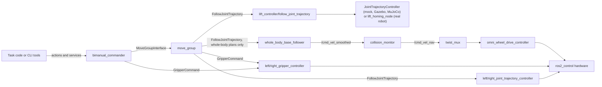

# Manipulation

Launch MoveIt and send motion goals to Walkie's two 7-joint OpenArm v10 arms,
their parallel grippers, and the vertical lift they are mounted on. MoveIt 2
plans for the arms and the lift together, and a C++ commander node exposes
MoveIt as ROS actions and services for task code.

## Launch the stack

Start the Zenoh router first (see [Middleware (Zenoh)](middleware.md)). Run
each command in its own terminal.

### In simulation or with mock hardware

Start MoveIt and the controllers for your setup:

=== "Mock hardware"

    ```bash
    pixi run ros2 launch openarm_bimanual_moveit_config moveit_demo.launch.py
    ```

    No simulator. ros2_control runs `mock_components`, so commands are echoed
    back as joint states.

=== "Gazebo, started by MoveIt"

    ```bash
    pixi run ros2 launch openarm_bimanual_moveit_config moveit_demo.launch.py hardware_type:=gazebo
    ```

    Starts its own Gazebo instance with the Bullet Featherstone physics
    engine, the ros_gz bridge, and the controllers.

=== "Gazebo, full simulation"

    ```bash
    pixi run ros2 launch robot_simulation gzsim_omnibot.launch.py
    ```

    ```bash
    pixi run ros2 launch openarm_bimanual_moveit_config moveit_only.launch.py hardware_type:=gazebo \
      point_cloud_topic:=/zed_head/zed_node/point_cloud/cloud_registered
    ```

    `gzsim_omnibot.launch.py` already spawns the arm, gripper, and lift
    controllers. The `point_cloud_topic` override is needed because Gazebo does
    not publish the filtered cloud that `moveit_only.launch.py` expects by
    default.

=== "MuJoCo"

    ```bash
    pixi run ros2 launch robot_bringup mujoco_omnibot.launch.py
    ```

    ```bash
    pixi run ros2 launch openarm_bimanual_moveit_config moveit_only.launch.py hardware_type:=mujoco
    ```

    Not tested: MoveIt has not been run with MuJoCo yet.
    `mujoco_omnibot.launch.py` starts the simulator, `robot_state_publisher`,
    and the arm, gripper, and lift controllers, so pair it with
    `moveit_only.launch.py`, which starts only `move_group` and RViz. Add
    `use_rviz:=false` to `mujoco_omnibot.launch.py` to keep only the MoveIt
    RViz window. Do not use `moveit_demo.launch.py hardware_type:=mujoco`
    here: it starts a second `robot_state_publisher` and its own spawners, and
    on its own it starts no simulator. See [Known issues](#known-issues).

When MoveIt is up, start the commander:

```bash
pixi run ros2 launch openarm_bimanual_commander_cpp commander.launch.py
```

!!! note
    In Gazebo the commander does not use simulation time. See [Known issues](#known-issues).

### On the real robot

MoveIt connects to the controllers that the bringup starts.
`real_omnibot.launch.py` already runs ros2_control and spawns the arm and
gripper controllers, so use `moveit_only.launch.py`. Do not use
`moveit_demo.launch.py hardware_type:=real_robot` on the robot: it spawns its
own `lift_controller`, which clashes with the action server of the real lift
node.

!!! warning "The arms move to zero on activation"
    When the hardware component activates, it enables all motors and commands
    every arm joint to 0 rad. Keep the space around the arms clear when you
    start `real_omnibot.launch.py`. After the arm controllers start, the
    bringup sends the arms to the home pose over 5 s.

1. Set up the CAN FD interfaces once with the device setup script (device 3,
   OpenArm USB CAN FD). See [Real Robot: Set up the devices](real-robot.md#device-setup).

    ```bash
    sudo ./scripts/setup_device/setup_all_device.sh
    ```

2. Start the parts in this order, each in its own terminal:

    ```bash
    pixi run ros2 launch robot_bringup lift_homing.launch.py
    pixi run ros2 launch robot_bringup real_omnibot.launch.py
    pixi run ros2 launch openarm_bimanual_moveit_config moveit_only.launch.py hardware_type:=real_robot
    pixi run ros2 launch openarm_bimanual_commander_cpp commander.launch.py
    ```

To run the bringup without the arms powered, pass
`use_fake_arm_hardware:=true` to `real_omnibot.launch.py`. Both arms then use
mock hardware. See [Real Robot](real-robot.md) for CAN setup, lift homing, and
the bringup switches.

??? info "How the real arms are driven"
    Each arm is a separate ros2_control hardware component,
    `openarm_left_hardware_interface` and `openarm_right_hardware_interface`.
    Both use the plugin `openarm_hardware/OpenArm_v10HW` from
    `hardware/actuator/openarm/openarm_hardware/`.

    | Item | Value |
    | --- | --- |
    | CAN interface | Left arm `can1`, right arm `can0` (`left_can_interface` and `right_can_interface` on `real_omnibot.launch.py`) |
    | Bus | CAN FD, 1 Mbit/s nominal, 5 Mbit/s data |
    | Motors | Damiao DM8009 (joints 1–2), DM4340 (joints 3–4), DM4310 (joints 5–7 and the gripper) |
    | CAN IDs | Send `0x01`–`0x07`, receive `0x11`–`0x17`; gripper `0x08` / `0x18` |
    | Control mode | MIT mode: position, velocity, gains, and a feed-forward torque |
    | Stiffness `kp` | 400, 167, 167, 120, 47, 47, 47, from `description/config/openarm/arm/v10/control_gains.yaml` |
    | Feed-forward torque | Commanded effort plus gravity compensation from a KDL model (`gravity_compensation` on, `coriolis_compensation` off by default) |

    The plugin talks to the motors through `openarm_can`
    (`hardware/actuator/openarm/openarm_can/`, a submodule of
    `enactic/openarm_can`). It is a SocketCAN library for Damiao motors over
    CAN and CAN FD.

### Move the arms in RViz

The RViz window of `moveit_demo.launch.py` and `moveit_only.launch.py` has
the **MotionPlanning** panel:

1. Choose the group to move in **Planning Group**. RViz starts on
   `both_arms_lift`.
2. Set the goal. Drag the interactive marker at a hand, pick a named state in
   **Goal State**, or set single joints in the **Joints** tab.
3. Click **Plan** to preview the motion, then **Execute**. **Plan & Execute**
   does both.

Dragging a marker solves inverse kinematics with TRAC-IK. If `move_group`
logs `The kinematics plugin (trac_ik_kinematics_plugin/TRAC_IKKinematicsPlugin)
failed to load`, the environment is older than `pixi.lock`: run
`pixi install`.

The whole-body groups `whole_body_left` and `whole_body_right` show a marker at the
base and none at the hand, because no IK solver covers the planar base joint. To
give one of them a hand target, use the
[hand target](#drag-a-hand-target-in-rviz) instead.

!!! warning "On the real robot, Execute moves the arms"
    Check the planned motion in RViz before you click **Execute**.

## Send goals with the commander

The commander node (`bimanual_commander`) wraps a `MoveGroupInterface` for each
of the eight arm and gripper
[planning groups](#planning-groups-and-named-states). Send it
goals with `ros2 action send_goal` or from task code:

```bash
pixi run ros2 action send_goal /go_to_home my_robot_interfaces/action/GoToHome \
  "{group_name: both_arms, pose_name: home}"
```

The [package README](https://github.com/EIC-Robocup-2026/walkie-ros/blob/main/manipulate/openarm_bimanual_commander_cpp/README.md)
has goal formats and example calls for each interface. Where the README and the
code disagree, the code is correct (see [Known issues](#known-issues)).

| Kind | Name | Type | Purpose |
| --- | --- | --- | --- |
| Action | `/go_to_pose` | `GoToPose` | Move an end effector to an absolute pose (Euler angles) |
| Action | `/go_to_pose_quat` | `GoToPoseQuaternion` | Same, with a quaternion |
| Action | `/go_to_pose_relative` | `GoToPoseRelative` | Move relative to the current pose |
| Action | `/go_to_home` | `GoToHome` | Move a group to an SRDF named state (`pose_name`, empty means `home`) |
| Action | `/set_joint_position` | `SetJointPosition` | Move a group to joint angles |
| Action | `/control_gripper` | `ControlGripper` | Move a gripper to a position in meters |
| Service | `/get_joint_states` | `GetJointStates` | Current joint positions of a group |
| Service | `/get_ee_pose` | `GetEEPose` | Current end-effector pose of a group |
| Service | `/toggle_gripper_collision` | `ToggleGripperCollision` | Ignore or restore collisions between a gripper and the world |
| Service | `/toggle_octomap_collision` | `std_srvs/SetBool` | Enable or disable collision checking against the octomap |
| Service | `/toggle_all_collision_checking` | `std_srvs/SetBool` | Enable or disable collision checking |
| Service | `/clear_collision_objects` | `std_srvs/Trigger` | Detach held objects and remove all world collision objects from the planning scene |
| Service | `/execute_stored_plan` | `std_srvs/Trigger` | Execute the stored `plan_only` plan of the group named in `execute_plan_group` |

Pose goals use `base_footprint` as the default frame. Cartesian paths use a
1 cm step.

??? info "Fields of the `my_robot_interfaces` definitions"
    Unless noted, results are `success` and `status`.

    | Kind | Name | Fields |
    | --- | --- | --- |
    | Message | `PoseCommand` | `x`, `y`, `z`, `roll`, `pitch`, `yaw`, `cartesian_path` |
    | Service | `GetPosition` | Request `get_position`; response `x`, `y`, `z`, `success` |
    | Service | `GetEEPose` | Request `group_name`, `frame_id`; response position, quaternion, `frame_id`, `success`, `status` |
    | Service | `GetJointStates` | Request `group_name`; response `joint_names`, `joint_positions`, `success`, `status` |
    | Service | `ToggleGripperCollision` | Request `group_name`, `enable`; response `success`, `status` |
    | Action | `GoToPose` | Goal `group_name`, position, roll/pitch/yaw, `cartesian_path`, `frame_id` |
    | Action | `GoToPoseQuaternion` | Goal `group_name`, position, quaternion, `cartesian_path`, `frame_id`; feedback `current_status` |
    | Action | `GoToPoseRelative` | Goal like `GoToPose`, plus `ee_frame` |
    | Action | `GoToHome` | Goal `group_name`, `pose_name`; result `success`; feedback `time_elapsed` |
    | Action | `SetJointPosition` | Goal `group_name`, `joint_positions` |
    | Action | `ControlGripper` | Goal `group_name`, `position`; result `success`, `status`, `grasped`, `gripper_gap` |

### Change commander parameters

```bash
pixi run ros2 param set /bimanual_commander <name> <value>
```

Most parameters take effect live. The node reads `plan_only` and
`grasp_attach_enable` only at startup. `commander.launch.py` has an argument for
`plan_only`, and none for `grasp_attach_enable`.

| Parameter | Default | Meaning |
| --- | --- | --- |
| `planner_id` | `RRTConnect` | OMPL planner for the arm groups |
| `arm_planning_time` | `5.0` | Planning time of pose goals that OMPL plans directly, in seconds: both-arm groups, and the fallback of every shorter plan below. Arm plans use all of their planning time in practice, see [Planning time and attempts](#planning-time-and-attempts) |
| `joint_goal_planning_time` | `1.0` | Planning time of the arm groups' named states, joint goals, and pose goals solved by IK first, in seconds. A named state or joint goal that fails plans again with `arm_planning_time`. A value at or above `arm_planning_time` turns the shorter plans off. Gripper groups keep 1 s |
| `ik_first_enable` | `true` | For a pose goal to a single-arm group, solve IK first and plan to the joint solution, with the pose goal as the fallback |
| `max_velocity_scaling_factor` | `0.5` from `config/joint_limits.yaml` | Velocity scaling for the arm groups, in (0, 1]. Applies to the next plan |
| `max_acceleration_scaling_factor` | `0.3` from `config/joint_limits.yaml` | Acceleration scaling for the arm groups, in (0, 1]. Applies to the next plan |
| `plan_only` | `false` | Plan without executing. The plan is stored per group |
| `execute_plan_group` | empty | Group whose stored plan `/execute_stored_plan` runs |
| `gripper_speed` | `0.1` from the launch file (`1.0` in code) | Gripper ramp speed; `<= 0` disables the ramp |
| `grasp_scene_action` | `none` | `grasp`, `place`, or `none`, see [Grippers](#grippers) |

!!! warning "The arms no longer run at full speed"
    The commander used to run every arm group at full speed (`1.0`) and ignore
    `joint_limits.yaml`. It now starts with the file's
    `default_velocity_scaling_factor` (0.5) and
    `default_acceleration_scaling_factor` (0.3), so arm moves take about twice
    as long, in simulation too. The node rejects a value outside (0, 1], and
    refuses to start with one. Write `1.0`, not `1`: the parameters are
    doubles and reject an integer.

    For full speed in one session:

    ```bash
    pixi run ros2 param set /bimanual_commander max_velocity_scaling_factor 1.0
    pixi run ros2 param set /bimanual_commander max_acceleration_scaling_factor 1.0
    ```

    To change the default, edit the two values in `config/joint_limits.yaml`.
    A plan stored with `plan_only` keeps the speed it was planned with.

??? info "Planning-scene parameters"
    | Parameter | Default | Meaning |
    | --- | --- | --- |
    | `grasp_attach_enable` | `true` | Master switch for the planning-scene changes of `grasp_scene_action` |
    | `grasp_object_size` | `[0.09, 0.05, 0.16]` | Size of the attached box, in meters |
    | `finger_padding_enable`, `finger_padding` | `true`, `0.01` | Pad the finger links in collision checking |
    | `table_enable` | `false` | Add a table box to the planning scene (`table_pose`, `table_size`) |
    | `allow_gripper_vs_octomap` | `false` | Ignore collisions between the gripper links and the octomap only, for grasping inside sensed voxels |

??? info "Other executables in the package"
    | Executable | Purpose |
    | --- | --- |
    | `commander_interactive` | Interactive command-line client for the actions |
    | `commander_benchmark` | Planning and execution benchmark |
    | `pick_and_place_isaac`, `pick_and_place_isaac2` | Pick-and-place demos for Isaac Sim |
    | `save_named_constraint` | Saves a named orientation constraint to the MoveIt warehouse, so RViz can select it |
    | `whole_body_marker` | Hand target in RViz that sends whole-body pose goals, see [Drag a hand target in RViz](#drag-a-hand-target-in-rviz) |

## Grippers

```bash
pixi run ros2 action send_goal /control_gripper my_robot_interfaces/action/ControlGripper \
  "{group_name: right_gripper, position: 0.044}"
```

The position is the finger travel in meters: 0 is closed and 0.044 is fully
open. After a close command, the result field `grasped` reports whether an
object is held.

To make MoveIt plan around the held object, set `grasp_scene_action` before
you send the gripper goal. The commander reads it on every gripper command.

```bash
pixi run ros2 param set /bimanual_commander grasp_scene_action grasp
```

- `grasp` attaches a box to the hand, so MoveIt plans around the held object.
- `place` detaches the box and removes it after the next motion.
- `none` (the default) leaves the planning scene unchanged.

??? info "How grasp detection works"
    After a close command (goal position at or below `grasp_close_threshold`,
    0.03), the commander checks the settled finger gap. A gap between
    `grasp_detect_min` (0.005) and `grasp_detect_max` (0.044) counts as
    "object held", and the result field `grasped` reports it.

??? info "How the grippers are controlled"
    - Each gripper is a parallel gripper with one controlled joint,
      `openarm_<side>_finger_joint1`. `openarm_<side>_finger_joint2` is
      passive.
    - The controllers are `position_controllers/GripperActionController`, with
      the action `<controller>/gripper_cmd` (`control_msgs/action/GripperCommand`).
    - The commander sends gripper goals straight to
      `/left_gripper_controller/gripper_cmd` and
      `/right_gripper_controller/gripper_cmd`, without planning. It ramps the
      command at `gripper_speed`, in position units per second (0.1 from
      `commander.launch.py`).
    - On the real robot, the gripper motor is a Damiao DM4310 on the same CAN
      bus as its arm. `openarm_hardware` maps joint 0 to 0.044 m onto motor
      0 to -1.0472 rad.

## Move the lift with the arms

Plan with a `*_lift` group (`left_arm_lift`, `right_arm_lift`,
`both_arms_lift`). These groups include `lift_joint`, so MoveIt moves the lift
and the arm in one plan. MoveIt executes lift motion through the
`lift_controller/follow_joint_trajectory` action.

On the real robot, `lift_homing_node` serves that action, not a controller.
The mock lift node (`lift_homing.launch.py mock:=true`) does not serve it, so
`*_lift` plans fail to execute, see [Troubleshooting](#troubleshooting).

??? info "Who serves the lift action in each setup"
    | Setup | Server of `lift_controller/follow_joint_trajectory` | Lift joint state |
    | --- | --- | --- |
    | Mock | `lift_controller` (JointTrajectoryController) on mock hardware | `/joint_states` from the joint state broadcaster |
    | Gazebo | `lift_controller` in `gz_ros2_control` | `/joint_states` from the joint state broadcaster |
    | MuJoCo | `lift_controller` in `mujoco_ros2_control` | `/joint_states` from the joint state broadcaster |
    | Real robot | `lift_homing_node` (`bringup/scripts/lift_homing_node.py`) | `lift/joint_states`, relayed to `/joint_states` by `real_omnibot.launch.py` |

    On the real robot, `real_omnibot.launch.py` deliberately does not spawn a
    `lift_controller`. The lift homing node owns the action server directly
    and reports success when the motor reaches the goal.

## Move the base with a whole-body goal { #whole-body-goals }

A whole-body goal moves the base, the lift, and one arm together, to reach a
target the arm cannot reach from where the robot stands. A caller chooses it per
request: send `group_name: whole_body_left` or `whole_body_right` on `/go_to_pose`
or `/go_to_pose_quat`. Every other group name keeps its old behaviour and cannot
command the base.

!!! warning "Tested in MuJoCo only"
    No whole-body goal has run on the real robot. The default, `base_mode:=fixed`,
    refuses these goals, so the option stays off until a launch command turns it on.
    For a first run on the robot, follow
    [Whole-Body MoveIt on the Real Robot](whole-body-real-robot.md).

Run the demo in two terminals:

```bash
pixi run ros2 launch robot_bringup whole_body_demo.launch.py
pixi run ros2 run openarm_bimanual_commander_cpp whole_body_demo
```

The launch file starts the obstacle scene, Nav2 (idle, it owns the collision
monitor), `move_group` with `base_mode:=whole_body`, the commander, the base
follower, RViz, and a Zenoh router. Pass `start_router:=false` if a router already
runs, and `headless:=true use_rviz:=false` for no windows. The client prints one
JSON report and exits non-zero if a step misses its expectation.

Send your own goal once the launch file is up:

```bash
pixi run ros2 action send_goal /go_to_pose my_robot_interfaces/action/GoToPose \
  "{group_name: whole_body_left, x: 1.75, y: 0.15, z: 1.05, roll: 0.0, pitch: 1.5708, yaw: 0.0, frame_id: map}"
```

The status of a successful goal ends in `(base fixed)` when the arm and lift
reached the target alone, or in `(base travel <length> m)` with the length of the
planned base path.

??? info "Demo steps and options"
    | Step | Group | Expected |
    | --- | --- | --- |
    | `far_arm` | `left_arm_lift` | Target on the table, out of reach: fails, with no base command |
    | `near_arm` | `left_arm_lift` | Reachable target: the arm moves, the base stays |
    | `near_body` | `whole_body_left` | Target the arm reaches alone: the status says `base fixed` |
    | `far_body` | `whole_body_left` | The target of `far_arm`: base, lift, and arm move together |
    | `home_<n>`, `far_<n>` | `whole_body_left` | Only with `--cycles N`: `N` round trips to a target near the start and back |
    | `tuck_right` | `right_arm` on `/go_to_home` | The idle arm goes to `standby`, see [Clear the idle arm](#clear-the-idle-arm). The base stays |
    | `deep_body` | `whole_body_left` | A target 0.10 m short of the table's far edge, which needs the column close to the table |
    | `seam_turn` | `whole_body_left` | Hand along -x, which turns the body to a heading near +π |
    | `seam_cross` | `whole_body_left` | A hand direction that makes the base turn through ±π the short way |
    | `home_right` | `right_arm_lift` on `/go_to_home` | The idle arm goes back to `home`, away from the table, and the lift rises to its home position. The base stays |

    A whole-body step also fails on a tip error above `--tip-tolerance` (0.03 m),
    a turn more than π above the heading change, or a base path above 1.5 times the
    displacement plus 0.3 m. `--report <file>` writes the report to a file, because
    `rmw_zenoh_cpp` also logs to stdout. `--skip-near` skips `near_arm` and
    `near_body`, and `--settle` sets how long the octomap fills before the first goal.
    The report gives `table_clearance_m`, the gap between the base front and the table
    edge up to `tuck_right`, and `deep_column_gap_m`, the gap between the column and
    the table edge during `deep_body`. Both ignore the base heading.

    The simulation runs slower than real time: a real-time factor of about 0.5
    headless, and 0.16 to 0.30 with the viewer and RViz, depending on what else the
    laptop runs. A step takes about 40 to 70 s of wall time.

### Run in a named world { #whole-body-named-world }

Pass `world:=NAME` to run the same stack in a [named MuJoCo world](simulation-mujoco.md#add-a-named-world),
for example the [Chula Pat14 room](simulation-chula-pat14.md):

```bash
pixi run ros2 launch robot_bringup whole_body_demo.launch.py world:=chula_pat14_6
pixi run ros2 action send_goal /go_to_pose my_robot_interfaces/action/GoToPose \
  "{group_name: whole_body_right, x: 0.45, y: -0.25, z: 1.0, roll: 0.0, pitch: 1.5708, yaw: 0.0, frame_id: base_footprint}"
```

- The world's model replaces `mujoco_model`, and Nav2 serves the world's map.
  `variant`, `spawn`, `spawn_pose`, `worlds_dir` and `world_output_dir` work as on
  `nav_mujoco_omnibot.launch.py`. `world` together with `mujoco_model` stops the launch.
- `map` to `odom` still comes from the ground truth, and AMCL does not run. The world
  loader writes the spawn's map `x` and `y` into the MuJoCo world frame, so the two
  frames coincide, and `map` to `base_footprint` starts at the spawn (in the Chula room,
  `living-room`: 1.76, -1.48, yaw -90°).
- The `whole_body_demo` client's targets are placed for the obstacle scene. In a world,
  send your own goals, as above.
- `planar_octomap_max_range` stays at 3.5 m. In a room it covers the furniture in the
  camera's view; a longer range adds voxels to every planning scene update.

??? info "Live check in the Chula room"
    Headless, on a loaded laptop (real-time factor about 0.3). The base started at
    1.76, -1.48, yaw -90° in `map`, as the spawn says. The goal above succeeded with
    `base travel 0.227235 m`, and the right hand ended 0.01 m from the target. A Nav2
    goal 1 m away, to 1.9, -2.3, then succeeded. A first Nav2 goal aborted when
    `lifecycle_manager_nav2` missed `planner_server`'s bond heartbeat for 4 s under the
    load and restarted Nav2, which came back by itself.

### Drag a hand target in RViz

The demo launch file starts `whole_body_marker`, which shows an orange box with a
blue arrow in RViz (display **Whole-Body Hand Target**). It starts on the left
hand.

1. Drag the box to where the hand should go. The box moves in the view plane, an
   arrow along one axis. Turn it with the rings. The blue arrow is the hand's z
   axis, the direction the gripper points.
2. Right-click the box and pick **Reach with left arm** or **Reach with right
   arm**. Nothing moves until you pick one.
3. The text above the box shows the goal: `whole_body_left: sent (...)`,
   `accepted, running`, then `done` or `failed` with the commander's status.

The entry sends a `/go_to_pose_quat` goal with `group_name: whole_body_left` or
`whole_body_right` in `map`, so it runs every step of a whole-body goal: the arm
alone first, then base poses ranked as set in
[Tune whole-body goals](#tune-whole-body-goals). **Snap to left hand** and **Snap to
right hand** move the box onto that hand. **Cancel goal** cancels the running goal,
also one the commander has not accepted yet. A second **Reach** while a goal runs is
refused by the marker. If the commander exits or restarts during a goal, the text says
`outcome unknown` within about 3 s of wall time, also with the simulation paused, and
the marker takes new goals again. With two commanders running, the marker sends no goal
and says `Two or more commanders serve go_to_pose_quat`: it could not tell which one
has the goal.

The box is the pose of the hand frame, not the fingertips, see
[Targets close to a surface](#targets-close-to-a-surface).

To use it without the demo launch file, start it next to a whole-body commander:

```bash
pixi run ros2 run openarm_bimanual_commander_cpp whole_body_marker --ros-args -p use_sim_time:=true
```

`config/moveit_map.rviz` has the display. In another RViz config, add an
**InteractiveMarkers** display with the namespace `/whole_body_hand_target`.

### Keep the base still

| You want | Send | What happens |
| --- | --- | --- |
| The base must not move | An arm group, such as `left_arm_lift` | These groups have no base variables, so they cannot command the base. A target out of reach fails with `Planning Failed`. |
| The base may move when it has to | `whole_body_left`, `whole_body_right` | The current base pose is tried first. If that does not work, the base moves. |

!!! warning "A whole-body goal near the edge of the arm's reach can move the base a little"
    The first attempt of a whole-body goal needs an exact IK solution from the
    current base. An arm group's pose goal also accepts a solution within the goal
    tolerances, so it reaches a little further. A target in that gap succeeds on
    `left_arm_lift` without moving the base, and moves the base by a few centimeters
    on `whole_body_left`. If the base must not move, use an arm group.

### Clear the idle arm

A whole-body goal never moves the other arm. In its `home` pose that arm hangs in
front of the base at table height, so before a goal near a table or shelf, send it
to `standby`:

```bash
pixi run ros2 action send_goal /go_to_home my_robot_interfaces/action/GoToHome \
  "{group_name: right_arm, pose_name: standby}"
```

Use `group_name: left_arm` before a `whole_body_right` goal. Send `pose_name: home`
to bring the arm back once the base is clear of the furniture: from `standby` back
to `home`, the arm sweeps down in front of the base. Use the arm's lift group for
that, see the warning below.

!!! warning "`home` needs the lift at 0.50 m or higher"
    Below that, the fingers of an arm in `home` reach into the base, and the
    commander answers `Failed to plan path to 'home'`. A whole-body goal can leave
    the lift there. Send `group_name: right_arm_lift` (or `left_arm_lift`) with
    `pose_name: home` instead: it raises the lift to 0.744 m in the same motion,
    and the other arm rises with it.

??? info "How far the idle arm keeps the robot from a table"
    With the lift at its home position (0.744 m), measured in `base_footprint`:

    | Idle arm pose | Lowest point | Furthest forward | Lowest free lift position |
    | --- | --- | --- | --- |
    | `home` | 0.61 m | 0.22 m | about 0.50 m, then its fingers touch the base |
    | `standby` | 1.00 m | 0.26 m | 0.11 m |

    In `home` the arm reaches below a table top of about 0.75 m, so the robot
    cannot drive the base under the table. The column then stays about 0.2 m
    from the table edge, and targets deep on the table are out of reach. In
    `standby` the arm clears the table top. The base, 0.36 m high, fits under it,
    and the column can come up to the edge. In the planning benchmark (see
    [Measure planning speed](#measure-planning-speed)), in the box scene with the
    base facing the table and the column 0.08 m from its edge, IK reached none of
    18 targets with the gripper's lowest point 3 cm above the table with the idle
    arm at `home`, and 13 with it at `standby`, allowing up to 16 IK calls per
    target. A whole-body goal samples other base poses, some of which turn the
    hanging arm aside. From a start 1 m before the table, on the octomap, 13 of 18 targets on the
    far half of the table planned with the idle arm at `home` and 15 with `standby`,
    and the `standby` goals planned faster (median 0.8 s instead of 1.1 s, failed
    goals included).

    When the idle arm blocks every sampled base pose, the refusal names it, see
    [Why a goal is refused](#why-a-goal-is-refused).

### Targets close to a surface

The target is the pose of the hand frame (`openarm_left_hand` or
`openarm_right_hand`), not the fingertips. The gripper reaches below the hand frame by
an amount that depends on the hand orientation. A target lower than the surface
height plus that amount puts the gripper into the surface, and IK reports every
solution in collision.

| Hand orientation (roll, pitch, yaw) | Lowest part | Reaches below the hand frame |
| --- | --- | --- |
| Forward, wrist camera bracket below: (0, π/2, 0) | Wrist camera bracket | 0.111 m |
| Forward, bracket on top: (0, -π/2, π) | Hand body | 0.030 m |
| Down: (0, π, 0) | Fingertips | 0.095 m, plus 0.01 m finger padding |

Add a margin on top. The octomap places a table top up to about 0.04 m above its
real height: the voxel size is 0.03 m, and in MuJoCo `base_footprint` sits 6 mm
below the floor. A whole-body goal must also stay clear with the lift 0.01 m below
its goal, because the lift settles a few millimetres short. Plan for about 0.05 m in
all over the real surface for a whole-body goal. The demo's forward-pointing targets
use 0.2 m above the box top, and its deep target under the table top leaves about
0.10 m.

### Tune whole-body goals { #tune-whole-body-goals }

When the arm cannot reach from where the robot stands, the commander samples base
poses around the target and solves IK at each. It scores every usable one by how far
it moves each part from the current state, and plans to the cheapest first:

```text
cost = base_xy × base travel (m) + base_yaw × base turn (rad) + lift × lift travel (m)
     + Σ arm[i] × motion of arm joint i (rad)
     + rest × Σ |arm joint i − whole_body_rest_state joint i| (rad)
```

A higher weight makes its part move less, at the cost of the others. Only the ratios
matter: doubling every weight picks the same pose. The defaults weigh base travel and,
at 0.3, the arm's distance from `rest_pose`, a reach over a table (see
[Planning groups and named states](#planning-groups-and-named-states)). The robot
stands near the target, and goal postures stay near `rest_pose` where a little more
base travel allows it.

| You want | Set |
| --- | --- |
| The base to move as little as possible, the arm to do the rest, and the fastest search | `whole_body_weight_rest` 0.0 |
| The base to turn less | `whole_body_weight_base_yaw` 0.3 |
| The arm to move less, and the base a little more | `whole_body_weight_arm_joints` 0.1 on every joint |
| One joint to move less, such as the shoulder (joint1) | A weight on that joint alone: `[0.3, 0.0, 0.0, 0.0, 0.0, 0.0, 0.0]` |
| The lift to stay near its height. It moves at 0.03 m/s, so it often sets the duration of the motion | `whole_body_weight_lift` 3.0 |
| Goal postures near another named state | `whole_body_rest_state`, such as `hands_up` |

Set them live. A goal reads them once, when it starts:

```bash
pixi run ros2 param set /bimanual_commander whole_body_weight_base_yaw 0.3
pixi run ros2 param set /bimanual_commander whole_body_weight_arm_joints "[0.1, 0.1, 0.1, 0.1, 0.1, 0.1, 0.1]"
pixi run ros2 param set /bimanual_commander whole_body_rest_state hands_up
```

Write `3.0`, not `3`, and give every array element a decimal point: the weights are
doubles and reject integers. The commander also rejects a negative or infinite
weight, an array without seven values, a `whole_body_candidates` below 1, and a rest
state that `left_arm_lift` or `right_arm_lift` lacks (`pre-place` exists for the left
arm only). To change a default, add the value to the commander's `parameters` in
`commander.launch.py`.

The commander logs the choice of every goal that moves the base:

```text
Whole-body goal on whole_body_left: candidate 1 of 8 usable, cost 2.287 (base 1.101 m 0.505 rad, lift 0.205 m, arm 4.445 rad, 3.953 rad from rest state 'rest_pose')
```

`candidate 1` is the first base pose planned to, and `8 usable` the number of usable
poses held up to then: with the defaults the search usually fills all
`whole_body_candidates` before it picks one. The numbers in brackets are the
unweighted motion of that candidate, so they show what a weight would trade. Here the
cost is the base travel plus 0.3 times the distance from `rest_pose`. With
`whole_body_weight_rest` 0.0, the search stops at the first usable pose and logs
`candidate 1 of 1 usable`.

An arm weight keeps the arm near the posture the last goal left it in, not near a
named state. A 7-joint arm on a moving base reaches the same hand pose in many
postures. In a MuJoCo run without a rest weight, a goal that brought the hand back to
where it started from `home` left the arm 7.2 rad from `home`. The rest weight is what
keeps goal postures near `whole_body_rest_state`.

!!! warning "Weights cost planning time"
    The commander solves IK at the sampled poses in order of base cost. When only
    `whole_body_weight_base_xy` and `whole_body_weight_base_yaw` are set, the first
    usable pose is the cheapest, and the search stops there. A weight on the lift, the
    arm joints, or the rest posture can make a later pose cheaper, so the commander
    keeps solving until no later pose can beat the cheapest it found, or it holds
    `whole_body_candidates` usable ones. The default rest weight does this on every
    goal that moves the base. In the benchmark below a goal took about 2.0 s, with about
    30 IK calls. `whole_body_candidates` 4 gives back 0.4 s and about 30 percent of the
    posture gain. `whole_body_weight_rest` 0.0 gives back 0.9 s. With
    `whole_body_rest_state` `home` as well, a goal takes about 0.9 s and 8 IK calls, as
    before `rest_pose`.

Weights only rank base poses. A goal the arm reaches from where the robot stands
never moves the base, whatever the weights. Use an arm group when the base must not
move, see [Keep the base still](#keep-the-base-still).

#### Compare weights in the benchmark

The planning benchmark plans the same whole-body goals once per preset. A goal gets the
same sampled base poses in every preset, so the differences come from the weights and
the rest state alone. It needs no simulator:

```bash
pixi run ros2 launch openarm_bimanual_moveit_config run_planning_benchmark.launch.py \
  scenes:=boxes sections:=whole_body output_json:=/tmp/weights.json \
  "wb_presets:=default;base_only rest=0;yaw base_yaw=0.3;hands_up rest_state=hands_up"
```

Presets are separated by `;`. Each is a name followed by `key=value` pairs:
`base_xy`, `base_yaw`, `lift`, `rest`, `rest_state`, `candidates`, and `arm`, with
one value for all seven joints or seven values separated by `/`
(`arm=0.3/0/0/0/0/0/0`). Keys left out keep the commander's defaults. The console
prints the mean motion of each preset over the goals it reached, and the JSON file
has the motion and cost of every goal.

??? info "Results of 2026-11-17: rest weights with `rest_pose`"
    The same 72 goals as on 2026-11-16, below, and every preset reached all of them.
    The arm starts in `home`. Every preset but the first has `rest_pose` as its rest
    state. The last column counts the goals whose base pose differs from the first
    row's.

    | Preset | Median time | Median IK calls | Base travel | Base turn | Lift travel | Arm motion | From the rest state | Other pose |
    | --- | --- | --- | --- | --- | --- | --- | --- | --- |
    | `rest=0 rest_state=home`, the defaults before 2026-11-17 | 0.88 s | 8 | 0.54 m | 0.62 rad | 0.21 m | 4.66 rad | 4.66 rad from `home` | |
    | `rest=0` | 1.11 s | 13 | 0.57 m | 0.59 rad | 0.23 m | 5.01 rad | 5.04 rad | 50 |
    | `rest=0.1` | 1.82 s | 29 | 0.62 m | 0.60 rad | 0.20 m | 4.28 rad | 3.71 rad | 65 |
    | `rest=0.2` | 1.89 s | 28 | 0.63 m | 0.60 rad | 0.19 m | 4.17 rad | 3.51 rad | 67 |
    | `rest=0.3`, the defaults | 1.99 s | 30 | 0.63 m | 0.59 rad | 0.19 m | 4.16 rad | 3.52 rad | 67 |
    | `rest=0.5` | 2.03 s | 29 | 0.64 m | 0.60 rad | 0.18 m | 4.15 rad | 3.50 rad | 67 |
    | `rest=0.3 candidates=4` | 1.59 s | 22 | 0.61 m | 0.58 rad | 0.20 m | 4.48 rad | 3.98 rad | 64 |

    - Against `rest=0`, `rest_pose` as the seed alone, a rest weight of 0.2 or more
      brings goals from 5.0 to 3.5 rad from `rest_pose` and cuts arm motion by 17
      percent, for 6 cm more base travel and 0.9 s more per goal. Against the old
      defaults, arm motion falls by 11 percent, for 9 cm more travel and 1.1 s more per
      goal. The base turn and the lift barely change.
    - From 0.1 up, the search found eight usable poses on 67 to 70 of the 72 goals, so
      a higher weight only reorders the same few poses. Above 0.2 the means do not
      change.
    - `candidates=4` gives back 0.4 s, and loses 30 percent of the gain: its goals end
      3.98 rad from `rest_pose`, against 3.52 rad with eight and 5.04 rad with none.
    - 3.5 rad over seven joints is about 0.5 rad per joint. A hand at a table target
      needs another posture than `rest_pose`, so goals do not end at it.
    - The old defaults took 0.88 s here and 0.95 s on 2026-11-16: compare times within
      one run.

    The raw results are in `~/.cache/walkie-plan-fullbody/bench/rest_pose/presets.json`
    on the laptop that ran them.

??? info "Results of 2026-11-16"
    Before `rest_pose` existed. The defaults then weighed base travel alone, with
    `home` as the rest state.

    `scenes:=boxes,octomap:0.03`, the 18 whole-body targets from 1 m before the table,
    with the idle arm in `home` and in `standby`: 72 goals per preset, and every preset
    reached all of them. Times are IK and planning in the benchmark's process; the
    commander adds its service calls. Motions are means over the 72 goals. The last
    column counts the goals whose base pose differs from the defaults'.

    | Preset | Median time | Median IK calls | Base travel | Base turn | Lift travel | Arm motion | From the rest state | Other pose |
    | --- | --- | --- | --- | --- | --- | --- | --- | --- |
    | Defaults | 0.95 s | 9 | 0.54 m | 0.64 rad | 0.20 m | 4.60 rad | 4.60 rad from `home` | |
    | `base_yaw=0.3` | 0.94 s | 9 | 0.58 m | 0.27 rad | 0.15 m | 4.58 rad | 4.58 rad from `home` | 61 |
    | `arm=0.1` | 1.50 s | 20 | 0.56 m | 0.60 rad | 0.19 m | 4.07 rad | 4.07 rad from `home` | 50 |
    | `arm=0.1 candidates=4` | 1.15 s | 13 | 0.56 m | 0.57 rad | 0.20 m | 4.13 rad | 4.13 rad from `home` | 51 |
    | `rest=0.3` | 1.44 s | 21 | 0.59 m | 0.61 rad | 0.17 m | 3.86 rad | 3.86 rad from `home` | 59 |
    | `rest_state=hands_up` | 1.32 s | 14 | 0.60 m | 0.60 rad | 0.27 m | 4.70 rad | 4.77 rad from `hands_up` | 54 |
    | `rest=0.3 rest_state=hands_up` | 2.49 s | 40 | 0.66 m | 0.63 rad | 0.24 m | 4.57 rad | 3.92 rad from `hands_up` | 67 |

    - A turn weight costs no time. `base_yaw=0.3` more than halved the turn for 3 cm
      more travel, because a weight on the base alone keeps the search at the first
      usable pose.
    - An arm or rest weight saves 0.5 to 0.7 rad of arm motion, 12 to 16 percent, for
      2 to 5 cm more travel, and costs about 0.5 s per goal. `candidates=4` keeps most
      of the saving for less of the time.
    - A rest state without a rest weight only seeds IK. It changed most base poses,
      but the goal postures stayed 4.77 rad from `hands_up`, against 3.92 rad with
      `rest=0.3`.
    - The arm starts in `home`, so with `home` as the rest state the arm motion and
      the distance from the rest state are the same.

    The raw results are in `~/.cache/walkie-plan-fullbody/bench/weights/presets.json` on
    the laptop that ran them.

??? info "What the weights cannot do"
    - **They choose among the sampled poses, and sample none of their own.** The
      samples keep the shoulder 0.3 to 0.6 m behind the hand (0.2 to 0.7 m in the
      second tier), whatever the weights. The second tier is only scored once the
      first has nothing usable that plans.
    - **One IK solution per base pose.** TRAC-IK returns the solution nearest its seed,
      `whole_body_rest_state`. A different arm posture at the same base pose is never
      scored. So the rest state changes the arm posture even with
      `whole_body_weight_rest` at 0.
    - **Straight-line motion.** Base travel is the distance from the start to the goal
      pose, and joint motion is the difference of the start and goal values. The
      planned path can be longer.
    - **At most five plans.** When a plan fails, the search goes on to the next
      cheapest candidate, and solves more poses first if one of them could be
      cheaper. After five failed plans the goal fails.
    - **All weights at zero** make every candidate cost nothing, so the first usable
      sample wins, in random order. Keep at least one weight above zero.

### Choose the base model

`base_mode` selects the model. Give `moveit_only.launch.py` and
`commander.launch.py` the same value.

| `base_mode` | Model | Octomap frame | Whole-body goals |
| --- | --- | --- | --- |
| `fixed` (default) | Fixed joint from `world` to `base_footprint`, as before | `base_link` | Refused |
| `map` | Planar joint from `map` to `base_footprint`. `map` is the planning frame. | `map` | Refused |
| `whole_body` | `map`, plus the whole-body option | `map` | Accepted |

To bring the option up without the demo launch file, for example in MuJoCo with
Nav2 already running:

```bash
pixi run ros2 launch openarm_bimanual_moveit_config moveit_only.launch.py hardware_type:=mujoco base_mode:=whole_body
pixi run ros2 launch openarm_bimanual_commander_cpp commander.launch.py base_mode:=whole_body use_sim_time:=true
pixi run ros2 run openarm_bimanual_commander_cpp whole_body_base_follower --ros-args -p use_sim_time:=true
```

- Under `map` and `whole_body`, `moveit_only.launch.py` waits for
  `map` to `base_footprint` before it starts `move_group`.
- `base_mode:=whole_body` needs `openarm_bimanual_commander_cpp` built, also for
  `move_group`, because the `UnwrapPlanarHeading` plugin lives in that package.
- The octomap keeps the whole room in `map`, so it needs a working localization. A
  stale or jumping `map` to `odom` leaves ghost obstacles.
- The follower takes goals only while the commander is running, and stops the base
  if the commander goes quiet for 2 s. So **Plan & Execute** on a whole-body group in
  RViz needs the commander too.
- Restart the commander along with `move_group`. A motion holds the commander's
  motion slot until `move_group` finishes it, so after a crash of `move_group` new
  whole-body and arm goals stay refused.
- A hung `move_group` does not stop the arm and the lift: every stop, the commander's
  and the follower's, goes through it. The follower still stops the base.

### Why a goal is refused

Every refusal is an accepted goal that aborts with a reason in `status`, because a
rejected goal gives the client no reason. A motion that already started ends the same
way, and stops every controller it was using.

| Status | Fix |
| --- | --- |
| `Whole-body mode unavailable: this bring-up runs base_mode:=...` | Start the commander with `base_mode:=whole_body` |
| `move_group's robot model has no base joint: start it with base_mode:=whole_body` | `move_group` and the commander disagree. Give both the same value. |
| `Octomap collision checking is off: call toggle_octomap_collision first` | Turn the octomap back on. A base moving without it could hit what the camera sees. |
| `Collision checking is off: call toggle_all_collision_checking first` | Turn collision checking back on |
| `No base server on /base_controller/follow_joint_trajectory: is the base follower running?` | Start `whole_body_base_follower`. Arm groups keep working without it. |
| `Nav2 has an active goal on ...: the base is in use` | Wait for the Nav2 goal or cancel it. A status counts only while the server that published it is in the graph, so neither a dead nor a restarted Nav2 server refuses goals. |
| `The base is moving (...)` | Wait until the base is at rest: below 0.03 m/s and 0.05 rad/s |
| `The node's clock is not advancing: is the simulation running?` | The node's clock did not move for 5 s of wall time. Check that the simulation is running and not paused. |
| `Refused: another motion is in progress` | A whole-body goal runs alone. Wait for the running arm goal. |
| `Refused: a whole-body motion is in progress` | The same, seen from an arm goal |
| `Cartesian paths are not supported on ...: use ...` | Set `cartesian_path: false`, or send the arm group the status names |
| `No base pose found to reach the target (...)` | No sampled base pose gave a usable IK solution. The numbers say how many samples had one and how many sat on a joint limit; the rest were in collision. If the status goes on with `The idle arm (...) collided or lacked clearance in N IK solution(s)`, the other arm was in the way: send it to `standby` with `/go_to_home` and send the goal again, see [Clear the idle arm](#clear-the-idle-arm). |
| `Planning Failed for N sampled base pose(s), last MoveIt code ...` | IK found base poses, but no path to them. Code `-10` means the start state is in collision, and `-2` that the planner found no path in time. |
| `Execution deadline of N s exceeded: stop sent` | A controller did not finish in 1.5 times the planned duration plus `whole_body_execution_margin`. Check the follower's log. |
| `Base moved ... since the plan: plan again` | The base moved by more than 0.05 m or 0.05 rad while planning ran, or, with `(plan still stored)`, since a `plan_only` plan was stored. Send the goal again. |
| `Stopped: <controller> aborted its goal (<reason>)` | One controller of the plan aborted a goal it accepted during this motion, so the others were stopped. The reason is the controller's own, fetched from its action server; it is missing when the server does not answer within 0.5 s. The follower's reasons are [below](#why-the-follower-stops). Another client's goal on a controller of the plan counts too, because it preempts the plan's goal. |
| `Execution Failed, MoveIt code N: <controller> aborted its goal (<reason>)` | The same abort, when `move_group` ended the motion before the commander saw it. The follower sends `move_group` a stop before it aborts, so its stops usually end this way. Without the part after the code, `move_group` failed on its own: check its log. |
| `Stopped: Nav2 took a goal on <action>` | Nav2 got a goal while the motion ran. Wait for it, or cancel it. |
| Any of the stops above, ending in `(move_group has not finished: the stop repeats, and new whole-body and arm goals stay refused, until it does)` | `move_group` did not end the motion within 10 s of the stop. The commander keeps sending a stop every 500 ms. Check that the robot stopped, then restart `move_group` and the commander. |

### Why the follower stops

`whole_body_base_follower` ends a goal, and with it the whole motion, when:

- the goal is canceled,
- a `stop` arrives on `/trajectory_execution_event`,
- the commander's heartbeat stops,
- the collision monitor reports a stop,
- the base is more than `stall_error` (0.05 m) or `stall_yaw_error` (0.1 rad) behind
  the plan and covered less than a tenth of that in the last `stall_time` (0.5 s): the
  reason says `not moving under its commands`,
- the base is more than `abort_position_error` (0.25 m) or `abort_yaw_error` (0.35 rad)
  behind the plan,
- the transform is older than `max_transform_age` (0.5 s), or
- the base does not settle within `goal_settle_time` (3 s) of the end.

The reason is in the follower's log and in the commander's status (see the table
above). The collision monitor's `PolygonSlow` does not end
a goal: it scales commands by 0.8, which leaves 0.2 m/s of the follower's
`max_linear_speed`, above the plan's fastest base speed of 0.17 m/s on a diagonal.
Below a ratio of about 0.7 the base falls behind until the tracking abort, so raise
`max_linear_speed` with a lower ratio. `FootprintApproach` slows the base when it heads
for an obstacle within about 0.2 m, so a plan that ends that close to one can stop with
`not moving` or a tracking error.

When the commander's heartbeat stops during a motion that sent the follower no goal, the
follower publishes one `stop` on `/trajectory_execution_event`, so `move_group` does not
finish the arm motion of a commander that has died.

### Whole-body parameters

Set them with `pixi run ros2 param set /bimanual_commander <name> <value>`. They
take effect on the next goal. `base_mode` is read once, at startup.

| Parameter | Default | Meaning |
| --- | --- | --- |
| `base_mode` | `fixed` | `fixed`, `map`, or `whole_body`, see [Choose the base model](#choose-the-base-model) |
| `whole_body_planner_id` | `RRTConnect` | OMPL planner of a whole-body goal |
| `whole_body_planning_time` | `5.0` | Planning time per sampled base pose, in seconds. The first 2 s at most go to the small box, see below. |
| `whole_body_velocity_scaling` | `1.0` | Velocity scaling of a plan that moves the base, in (0, 1] |
| `whole_body_acceleration_scaling` | `1.0` | Acceleration scaling of a plan that moves the base, in (0, 1] |
| `whole_body_goal_joint_tolerance` | `0.001` | Joint tolerance of the goal |
| `whole_body_execution_margin` | `15.0` | Seconds added to 1.5 times the planned duration for the execution deadline, on the node's clock |
| `whole_body_rest_state` | `rest_pose` | Named state of both `left_arm_lift` and `right_arm_lift`: the IK seed, and the posture `whole_body_weight_rest` pulls toward. Its lift value is ignored. |
| `whole_body_weight_base_xy` | `1.0` | Cost per meter of base travel, in a straight line |
| `whole_body_weight_base_yaw` | `0.0` | Cost per radian of base turn |
| `whole_body_weight_lift` | `0.0` | Cost per meter of lift travel |
| `whole_body_weight_arm_joints` | seven `0.0` | Cost per radian of each joint of the reaching arm, joint1 to joint7 |
| `whole_body_weight_rest` | `0.3` | Cost per radian between the goal's arm joints and `whole_body_rest_state`, summed over the seven joints |
| `whole_body_candidates` | `8` | Most usable base poses the search holds and compares before it plans the cheapest. More can find a cheaper pose, for more IK calls. |

The last seven are explained in [Tune whole-body goals](#tune-whole-body-goals).

A goal the arm reaches alone uses the arm groups' `max_velocity_scaling_factor`
and `max_acceleration_scaling_factor`. The base limits are `virtual_joint/*` in
`config/joint_limits.yaml`: 0.12 m/s and 0.2 m/s² per axis, 0.3 rad/s and 0.4 rad/s².
0.12 m/s is also Nav2's speed inside `PolygonSlow`.

??? info "How a whole-body goal runs"
    1. The commander takes a motion slot and runs the gate behind the
       [refusals](#why-a-goal-is-refused).
    2. It freezes the goal in `map`, so a goal in `base_footprint` does not move along
       with the base.
    3. It solves IK with the base where it is, seeded from the current state and from
       `whole_body_rest_state`. If that works and the goal has clearance, the matching
       `*_arm_lift` group plans and runs it. The status says `base fixed`. The weights
       play no part here.
    4. Otherwise it samples base poses that put the arm's shoulder behind the hand, and
       solves IK at each, seeded from `whole_body_rest_state`. It ranks the usable ones
       by the cost in [Tune whole-body goals](#tune-whole-body-goals), and plans to up to
       five, cheapest first.
    5. Each plan first runs in a small box, 0.3 m around the start and the end of the
       move, for at most 2 s. Only if that fails does it run in a 5 m box. RRTConnect
       samples the base uniformly in the box, and path simplification does not always
       remove a waypoint far off the straight line. A 5 m box alone gave 2.18 m of
       travel for a 1.02 m displacement.
    6. It runs the gate's Nav2 check again and compares the base with where it was at
       step 3, because planning takes seconds and the first check is old by then.
    7. It reports the motion on its heartbeat at once and sends the plan 50 ms later, so
       the base follower knows of the motion before `move_group` starts it.
    8. `move_group` runs the plan on `base_controller` and on the arm and lift
       controllers together. The commander watches for a canceled goal, an aborted
       controller goal, a Nav2 goal, and the deadline. On any of them it sends a stop
       every 500 ms until `move_group` ends the motion.

    `move_group` waits for the results of its controllers one at a time, in name order.
    Without the watch in step 8, an arm that aborts while the base is still running goes
    unnoticed until the base finishes.

    The sampled poses come in two tiers of 40. The first keeps to where IK finds usable
    goals for a hand pointing forward at about 1 m: shoulder 0.3 to 0.6 m behind the
    hand, body turned up to 1 rad away from the hand direction, mirrored for the right
    arm. The second tier is wider, for other hand orientations. Its poses are scored
    only once the first tier has none left that is usable and plans, whatever their
    cost. So the base often arrives turned
    away from the target, which matters if the head camera has to see it.
    `whole_body_weight_base_yaw` reduces the turn.

    A pose goal at z = 1.05 m often needs the lift at the top. The lift moves at
    0.03 m/s, so it often sets the duration of the whole motion.

??? info "How the base follows the plan"
    MoveIt's `base_controller` entry sends a `FollowJointTrajectory` goal with the base
    motion in `multi_dof_trajectory`, as `map`-frame poses. The stock
    `joint_trajectory_controller` ignores that field, so `whole_body_base_follower` is
    its own server on `/base_controller/follow_joint_trajectory`. The omni controller
    runs open loop, so the follower closes the loop on `map` to `base_footprint`.

    It publishes to `/cmd_vel_smoothed`, the input of Nav2's collision monitor, so
    whole-body base motion passes the same stop and slowdown polygons as Nav2. Its
    reasons to stop are listed under [Why the follower stops](#why-the-follower-stops).
    Every one of them publishes zero commands. Except for a cancel, which comes from
    `move_group` itself, and a `stop` event, each also publishes one `stop` on
    `/trajectory_execution_event`, which halts the arm and the lift. The follower ignores the events it publishes itself, and sends at most one per
    heartbeat period: an event carries no time, so a late one would end the next motion.

    The collision monitor reports its state only when the active polygon changes, and it
    only looks when a command arrives. So a stop on record can be stale, with nothing to
    correct it while no commands flow. A goal that arrives during a stop therefore
    publishes one zero command and waits up to 500 ms for the state to change. If the
    stop is still active, the follower rejects the goal. The other way round, a follower
    that starts during a stop never hears of it. The stall check covers that case: a base
    that lags and does not move under the commands ends the goal within about two
    `stall_time` windows.

    | Parameter | Default | Meaning |
    | --- | --- | --- |
    | `position_gain`, `yaw_gain` | `1.5` | Proportional gains on the error to the plan |
    | `max_linear_speed`, `max_angular_speed` | `0.25`, `0.6` | Command limits |
    | `start_position_tolerance`, `start_yaw_tolerance` | `0.05`, `0.1` | Largest difference to the plan's start. A larger one rejects the goal. |
    | `goal_position_tolerance`, `goal_yaw_tolerance` | `0.02`, `0.03` | Tolerance at the end of the plan |
    | `cmd_topic` | `/cmd_vel_smoothed` | Output |
    | `monitor_state_topic` | `/collision_monitor_state` | Collision monitor state. `nav_mujoco_omnibot.launch.py` and `whole_body_real.launch.py` set the monitor's `state_topic` to it. The monitor that `localization_Nav2_real.launch.py` starts publishes no state. |
    | `commander_topic` | `/whole_body/commander_alive` | Commander heartbeat, `std_msgs/Bool` at 5 Hz of wall time, plus one beat as a whole-body goal starts executing. `data` is true while a whole-body goal executes, including one the arm reaches alone. Arm-group goals leave it false. |
    | `commander_timeout` | `2.0` | Wall seconds without a heartbeat before the follower stops. At 0.12 m/s the base can travel about 24 cm in that time. |
    | `stall_time` | `0.5` | Window of the stall check, in seconds between `map` to `base_footprint` stamps. A transform that stops updating is reported as stale, not as a stalled base. |
    | `stall_error`, `stall_yaw_error` | `0.05`, `0.1` | Lag behind the plan above which a base that covered less than a tenth of it in one window is not moving |

??? info "The heading seam"
    OMPL returns the planar joint's heading normalized to [-π, π]. Time parameterization
    treats it as a plain number, so a path across ±π would jump by almost 2π, and the
    base would turn the long way round. Under `base_mode:=whole_body`,
    `moveit_only.launch.py` puts the response adapter
    `openarm_bimanual_commander_cpp/UnwrapPlanarHeading` in front of
    `AddTimeOptimalParameterization`. It rewrites the headings of the path so that each
    step takes the short way. Values outside [-π, π] are safe: MoveIt only uses the angle,
    and the trajectory message carries quaternions. The commander still rejects a plan
    that turns more than π above the heading change.

??? info "The octomap in map"
    Under `map` and `whole_body`, `moveit_only.launch.py`:

    - sets no `octomap_frame`, so the octree frame is the planning frame, `map`.
    - uses `planar_octomap_resolution` (0.03 m) and `planar_octomap_max_range` (1.5 m,
      3.5 m in the demo). Anything farther is unknown, and unknown plans as free.
    - starts `cloud_floor_gate.py`, which decimates the cloud and keeps the base out of
      collision with the floor. A floor return moves out along its ray past the updater's
      range, so it clears the voxels on the way and marks nothing.
    - starts `octomap_jump_guard.py`, which clears the octomap when `map` to `odom` jumps
      by more than 0.1 m or 0.1 rad.
    - sets `padding_offset` to 0.10 m, because the self-filter mask is built from the
      collision geometry and the camera sees the visual meshes. Obstacles within that
      padding of the robot are not marked.
    - loads `config/moveit_map.rviz`, which uses `map` as its fixed frame. With
      `hardware_type:=mujoco` it also starts `depth_image_proc`, because MuJoCo publishes
      depth images and no cloud.

    `publish_planning_scene_hz` drops to 1 Hz, because each scene update carries the
    whole octree.

??? info "Repairs before a plan"
    Under `map` and `whole_body` the commander repairs three states that would otherwise
    fail every plan. Under `fixed` it does nothing and the old behaviour stays.

    - **Voxels inside the robot.** A stale voxel behind the robot's own surface gets no
      ray through it. If the current state touches the octomap, the commander clears the
      whole octree, waits 1 s of the node's clock (10 s of wall time at most), and logs a
      warning. MoveIt cannot edit part of an octree, so whatever is out of view at that
      moment is forgotten and plans as free.
    - **A joint just past its limit.** A position controller can stop there. A joint of the
      planned group up to 0.02 past its limit starts from the limit. A joint farther out,
      or one the group does not move, is left for MoveIt to report.
    - **Self-contact.** The MuJoCo lift settled 2.65 mm below its command, which was enough
      to put the idle arm's fingers on the base. For a group that moves the lift, a plan
      then starts from the lift 2, 5, 10, or 20 mm higher, whichever is free, and goals
      must stay valid 10 mm below where they stop the lift. `allowed_start_tolerance` in
      `config/move_group.yaml` accepts these raises. A group without the lift, such as
      `left_arm`, plans from the real lift: a raised start would describe a robot that is
      not there, and nothing would close the difference.

## How the parts fit together

The MoveIt configuration, the commander, and its interfaces are in
`manipulate/`. The real arms are driven by a ros2_control plugin in
`hardware/actuator/openarm/`, and the real lift by the lift homing node in
`robot_bringup`.



!!! note "Older packages"
    The single-arm packages (`left_arm_moveit_config`, `left_arm_commander_cpp`)
    and the `walkie_ik_servo` package are no longer in the repository. Some
    older documents still mention them. This page covers only the bimanual
    packages.

??? info "Packages in the manipulation stack"
    | Package | Path | Role |
    | --- | --- | --- |
    | `openarm_bimanual_moveit_config` | `manipulate/openarm_bimanual_moveit_config/` | MoveIt configuration: SRDF, kinematics, OMPL, controllers, launch files |
    | `openarm_bimanual_commander_cpp` | `manipulate/openarm_bimanual_commander_cpp/` | Commander node: actions and services on top of MoveIt |
    | `my_robot_interfaces` | `manipulate/my_robot_interfaces/` | Message, service, and action definitions used by the commander |
    | `openarm_hardware` | `hardware/actuator/openarm/openarm_hardware/` | ros2_control plugin for the real OpenArm arms |
    | `openarm_can` | `hardware/actuator/openarm/openarm_can/` (submodule) | CAN library for the Damiao motors in the arms |
    | `robot_bringup` | `bringup/scripts/lift_homing_node.py` | Real lift driver; also serves the lift trajectory action for MoveIt |

## Configure MoveIt

The MoveIt configuration is the package `openarm_bimanual_moveit_config`.
Paths in this section are relative to `manipulate/openarm_bimanual_moveit_config/`.

### Launch files and arguments

- `moveit_demo.launch.py`: all-in-one. Starts `robot_state_publisher`, the
  ros2_control backend for `hardware_type`, the controller spawners,
  `move_group`, and RViz.
- `moveit_only.launch.py`: `move_group` and RViz only. Assumes
  `robot_state_publisher`, ros2_control, and the controllers are already
  running. Use this one on the real robot, see
  [On the real robot](#on-the-real-robot).

| Argument | `moveit_demo` default | `moveit_only` default | Meaning |
| --- | --- | --- | --- |
| `hardware_type` | `mock_components` | `mock_components` | ros2_control backend: `mock_components`, `gazebo`, `mujoco`, `real_robot`, `isaac` |
| `point_cloud_topic` | `/zed_head/zed_node/point_cloud/cloud_registered` | `/zed_head/zed_node/point_cloud/cloud_registered/filtered` | Input of the octomap |
| `octomap_resolution` | `0.05` | `0.008` | Octomap voxel size, in meters |

The octomap is only enabled for `gazebo` and `real_robot`, because only Gazebo
and the real robot publish the ZED point cloud.

??? info "Other launch arguments"
    | Argument | `moveit_demo` default | `moveit_only` default | Meaning |
    | --- | --- | --- | --- |
    | `left_use_fake_arm_hardware` | `true` | `true` | Mock the left arm instead of using CAN. Only used with `real_robot` |
    | `right_use_fake_arm_hardware` | `true` | `true` | Same, for the right arm |
    | `right_joint2_fixed` | `false` | `false` | Treat `openarm_right_joint2` as fixed. It is dropped from the SRDF named states and from `right_joint_trajectory_controller` |
    | `controllers_file` | `config/ros2_controllers.yaml` | not available | ros2_control parameters for the `mock_components`, `isaac`, and `real_robot` branches |
    | `use_rviz` | not available | `true` | Start RViz |
    | `base_mode` | not available | `fixed` | Base model: `fixed`, `map`, or `whole_body`. See [Choose the base model](#choose-the-base-model). `commander.launch.py` has the same argument. |
    | `planar_octomap_resolution` | not available | `0.03` | Octomap voxel size under `map` and `whole_body`, in meters. `fixed` uses `octomap_resolution`. |
    | `planar_octomap_max_range` | not available | `1.5` | Octomap updater range under `map` and `whole_body`, in meters. Anything farther is unknown, which plans as free. |

    `commander.launch.py` has the arguments `gripper_speed`, `gripper_init_pos`,
    `base_mode` (`fixed`), `plan_only` (`false`), and `use_sim_time` (`false`).

??? info "What each `hardware_type` starts"
    `hardware_type` selects which ros2_control backend the robot description
    uses. It also sets `use_sim_time` and decides whether the launch file
    starts ros2_control itself.

    | `hardware_type` | `ros2_control` xacro value | ros2_control is run by | Sim time |
    | --- | --- | --- | --- |
    | `mock_components` (default) | `mock` | `moveit_demo.launch.py` (`ros2_control_node`) | no |
    | `gazebo` | `gazebo` | `gz_ros2_control` inside Gazebo | yes |
    | `mujoco` | `mujoco` | `mujoco_ros2_control`, started by `robot_bringup`'s `mujoco_omnibot.launch.py`, not by `moveit_demo.launch.py` | yes |
    | `real_robot` | `real_robot` | `moveit_demo.launch.py`, or `real_omnibot.launch.py` when you use `moveit_only.launch.py` | no |
    | `isaac` | `isaac` | `moveit_demo.launch.py`, but the description has no `isaac` hardware block | yes |

    With `hardware_type:=real_robot`, `moveit_demo.launch.py` builds a
    `real_robot` description in which the lift is a mock system and each arm
    is mock or real depending on `left_use_fake_arm_hardware` and
    `right_use_fake_arm_hardware`.

??? info "Octomap anchoring and sensor settings"
    Under `base_mode:=fixed` the octomap is anchored to `base_link`, so the voxels
    move with the mobile base. Under `map` and `whole_body` it stays in `map`, see
    [Move the base with a whole-body goal](#whole-body-goals). The sensor settings
    are in `config/sensors_3d.yaml` (range 1.5 m, update rate 5 Hz).

??? info "Other launch files in the package"
    | File | Purpose |
    | --- | --- |
    | `moveit_demo_with_commander.launch.py` | Variant that also starts the commander, plus fake object TFs for a pick-and-place demo with `mock_components`. Prefer `moveit_demo.launch.py` plus `commander.launch.py`, see [Known issues](#known-issues) |
    | `move_group.launch.py`, `moveit_rviz.launch.py`, `spawn_controllers.launch.py`, `static_virtual_joint_tfs.launch.py`, `setup_assistant.launch.py` | Standard files generated by the MoveIt Setup Assistant |

### Planning groups and named states

The groups are defined in `config/openarm_bimanual.srdf`:

- Arms: `left_arm`, `right_arm`, `both_arms`.
- Arms with the lift: `left_arm_lift`, `right_arm_lift`, `both_arms_lift`.
- Grippers: `left_gripper`, `right_gripper`.
- Base, lift, and arm: `whole_body_left`, `whole_body_right`. The commander only
  plans with them under `base_mode:=whole_body`, see
  [Move the base with a whole-body goal](#whole-body-goals).

??? info "Chains and joints of each group"
    | Group | Contents | Includes the lift |
    | --- | --- | --- |
    | `left_arm` | chain `lift_link` to `openarm_left_hand` | no |
    | `right_arm` | chain `lift_link` to `openarm_right_hand` | no |
    | `left_arm_lift` | chain `base_link` to `openarm_left_hand` | yes |
    | `right_arm_lift` | chain `base_link` to `openarm_right_hand` | yes |
    | `both_arms` | `left_arm` and `right_arm` | no |
    | `both_arms_lift` | `left_arm_lift` and `right_arm_lift` | yes |
    | `left_gripper` | joint `openarm_left_finger_joint1` | no |
    | `right_gripper` | joint `openarm_right_finger_joint1` | no |
    | `whole_body_left` | joint `virtual_joint` and `left_arm_lift` | yes |
    | `whole_body_right` | joint `virtual_joint` and `right_arm_lift` | yes |

    Every `base_mode` has the same group list. Under the fixed virtual joint the
    `whole_body_*` groups have no base variables.

Named states, for `go_to_home` and for the MoveIt RViz panel:

| State | Groups |
| --- | --- |
| `home`, `hands_up`, `rest_pose`, `standby`, `basket`, `basket_hold` | all six arm groups |
| `pre-place` | `left_arm`, `both_arms`, `left_arm_lift`, `both_arms_lift` |
| `tray` | `both_arms`, `both_arms_lift` |
| `open` (0.044), `half_closed` (0.022), `closed` (0) | `left_gripper`, `right_gripper` |

??? info "Lift heights in named states and other SRDF contents"
    In the `*_lift` variants, the lift is at 0.7435 m for every state except
    `pre-place` (0.735 m) and `basket` (0.303 m).

    `rest_pose` reaches over a table. Like `hands_up`, the forearm is level and the
    gripper points forward within 2 cm of the same height, but the upper arm leans 12° forward,
    which puts the hand 0.40 m ahead of the shoulder instead of 0.18 m. The hand is
    about 1.06 m above the floor at full lift. Both arms in `rest_pose` are free of
    collisions above a lift of 0.124 m. With the other arm in `home`, they are free
    above 0.495 m, the limit of `home` itself.

    The SRDF also defines the virtual joint `virtual_joint` (fixed from `world` to
    `base_footprint` under `base_mode:=fixed`, planar from `map` to `base_footprint`
    otherwise), the end effectors `left_ee` and `right_ee`, and the passive joints
    `openarm_left_finger_joint2` and `openarm_right_finger_joint2`.

### Kinematics, planners, and controllers

- **Inverse kinematics:** TRAC-IK, set in `config/kinematics.yaml`. The
  plugin comes from `ros-jazzy-trac-ik-kinematics-plugin` in `pixi.toml`.
- **Planner:** `RRTConnect` for every arm group, set in
  `config/ompl_planning.yaml`. The commander can switch planners at runtime
  with its `planner_id` parameter.
- **Controllers:** `config/moveit_controllers.yaml` tells MoveIt which
  controller actions to use. MoveIt does not start or switch these
  controllers; the launch file or bringup must spawn them.

??? info "Kinematics settings"
    `config/kinematics.yaml` sets TRAC-IK
    (`trac_ik_kinematics_plugin/TRAC_IKKinematicsPlugin`) for `left_arm`,
    `right_arm`, `left_arm_lift`, and `right_arm_lift`, with a 0.05 s timeout
    and the `Distance` solve type. KDL entries are kept in the file as
    comments.

??? info "OMPL planners and collision-check density"
    `config/ompl_planning.yaml` configures the planners RRTConnect, RRT,
    RRTstar, BKPIECE, BITstar, and TRRT.

    Every arm group sets `longest_valid_segment_fraction: 0.003`. This value
    controls how densely OMPL checks for collisions along each motion segment.
    OMPL's internal default is 0.01, which can let an arm pass through thin
    obstacles between checked points. A smaller value is safer and costs more
    planning time.

    The `whole_body_*` groups use the same value and RRTConnect. They have no IK
    solver of their own: the commander solves IK on the `*_arm_lift` group with the
    base held at a sampled pose.

??? info "Controllers and their actions"
    | Controller | Action | Joints |
    | --- | --- | --- |
    | `base_controller` | `FollowJointTrajectory`, `follow_joint_trajectory`, served by `whole_body_base_follower` | `virtual_joint` |
    | `left_joint_trajectory_controller` | `FollowJointTrajectory`, `follow_joint_trajectory` | `openarm_left_joint1` to `openarm_left_joint7` |
    | `right_joint_trajectory_controller` | `FollowJointTrajectory`, `follow_joint_trajectory` | `openarm_right_joint1` to `openarm_right_joint7` |
    | `left_gripper_controller` | `GripperCommand`, `gripper_cmd` | `openarm_left_finger_joint1` |
    | `right_gripper_controller` | `GripperCommand`, `gripper_cmd` | `openarm_right_finger_joint1` |
    | `lift_controller` | `FollowJointTrajectory`, `follow_joint_trajectory` | `lift_joint` |

    The controller parameters come from a different file in each setup:

    | Setup | Controller parameters |
    | --- | --- |
    | Mock (`moveit_demo.launch.py`) | `manipulate/openarm_bimanual_moveit_config/config/ros2_controllers.yaml` |
    | Gazebo | `description/config/ros2_controller/sim_controllers.yaml` |
    | MuJoCo | `description/config/ros2_controller/mujoco_controllers.yaml` |
    | Real robot (`real_omnibot.launch.py`) | `description/config/ros2_controller/real_controllers.yaml` |

??? info "Execution time limits and speed scaling"
    `config/move_group.yaml` widens the execution time limits:
    `allowed_execution_duration_scaling: 2.0` and
    `allowed_goal_duration_margin: 60.0`. The real lift moves at about
    3 cm/s, and MoveIt's default allowance (planned duration × 1.2 + 0.5 s) is
    too tight for longer lift moves. Without the margin, MoveIt would cancel
    lift moves that are still in progress.

    Velocity and acceleration scaling defaults are in
    `config/joint_limits.yaml` (0.5 and 0.3). The commander reads them at
    startup into `max_velocity_scaling_factor` and
    `max_acceleration_scaling_factor`, see
    [Change commander parameters](#change-commander-parameters). Lower scaling
    gives longer planned durations, and the execution allowance grows with them.

### Run the package tests

`test/test_srdf_urdf_contract.py` checks that every link and joint named in
the SRDF exists in the URDF, for the `mock`, `gazebo`, `real_robot`, and
`mujoco` descriptions.

```bash
pixi run test --packages-select openarm_bimanual_moveit_config
pixi run colcon test-result --verbose
```

The launch tests of the whole-body option are in `openarm_bimanual_commander_cpp`.
They need a Zenoh router, and take about 7 minutes:

```bash
pixi run test --packages-select openarm_bimanual_commander_cpp
```

See [Tests](testing.md#whole-body-launch-tests) for what they check.

## Why MuJoCo collision settings do not affect MoveIt

MoveIt and MuJoCo each keep their own collision model, built from different
files. `move_group` never reads `description/mujoco/walkie.xml`. If you change
the collision classes or excludes in `description/scripts/build_mjcf.py`,
MuJoCo simulates different contacts, but MoveIt plans exactly as before. It is
neither faster nor slower. See
[2.3 Collisions](../migrations/02-mujoco/03-collisions.md) for the MuJoCo side.

??? info "MoveIt and MuJoCo collision models compared"
    | | MoveIt (`move_group`) | MuJoCo |
    | --- | --- | --- |
    | Geometry | URDF collision meshes from `robot_description`. The OpenArm links use `description/meshes/openarm/arm/v10/collision/link*_symp.stl` | Collision geoms in `description/mujoco/walkie.xml` |
    | Pairs that are checked | All pairs, except the 315 `disable_collisions` entries in the SRDF. Planning scene objects and the octomap are added on top | Pairs allowed by the `contype` / `conaffinity` bits and not removed by `<exclude>`, written by `description/scripts/build_mjcf.py` |
    | Used for | Checking every state and motion segment while planning | Physics contacts during the simulation |

If planning is slow, change MoveIt's own settings: planning time, planning
attempts, collision mesh size, segment check density, disabled collision
pairs, and the octomap. Simplifying the `link3_symp.stl` collision mesh gives
the largest gain.

??? info "Where each planning-cost setting lives"
    - **Planning time:** commander parameters `joint_goal_planning_time`, 1.0 s,
      for the arm groups' named states, joint goals, and pose goals solved by IK first, and
      `arm_planning_time`, 5.0 s, for the other pose goals and every fallback.
      With 10000 attempts arm plans use all of their time in practice, see
      [Planning time and attempts](#planning-time-and-attempts). Both can be
      changed live. Whole-body goals use `whole_body_planning_time` instead.
    - **Planning attempts:** `setNumPlanningAttempts` in
      `manipulate/openarm_bimanual_commander_cpp/src/commander_template.cpp`,
      10000 for arm groups and 100 for grippers. Hard-coded. With more attempts
      than parallel planning threads, MoveIt keeps starting new rounds of searches
      until the planning time runs out.
    - **Collision mesh size:** `description/meshes/openarm/arm/v10/collision/`.
      `link3_symp.stl` has 72,160 triangles, `link4` 22,798, and `link5`
      15,028. The other links have fewer than 1,000. Every collision check
      against a dense mesh costs more.
    - **Segment check density:** `longest_valid_segment_fraction` in
      `config/ompl_planning.yaml`, 0.003. Smaller values add collision checks
      along every motion.
    - **Disabled pairs:** `disable_collisions` in
      `config/openarm_bimanual.srdf`, 315 pairs. Pairs that can never collide
      are skipped. Regenerate them with the Setup Assistant after model
      changes.
    - **Octomap:** `octomap_resolution` launch argument (0.05 m for
      `moveit_demo`, 0.008 m for `moveit_only`) and
      `/toggle_octomap_collision`. A finer octomap has more voxels to check.

## Measure planning speed

`run_planning_benchmark.launch.py` loads the whole-body robot model, the IK plugins,
and the OMPL pipeline in one process. It plans against the table scene of the
whole-body demo, as boxes or as an octomap, and pads the finger links by 0.01 m as
the commander does. It needs no simulator, router, or `move_group`. A full run of the
four default scenes takes about 45 minutes, 10 to 14 minutes per scene:

```bash
pixi run ros2 launch openarm_bimanual_moveit_config run_planning_benchmark.launch.py \
  output_json:=/tmp/planning_benchmark.json
```

Shorter runs:

```bash
# Arm plans with 1, 4 and 10000 attempts
pixi run ros2 launch openarm_bimanual_moveit_config run_planning_benchmark.launch.py \
  quick:=true scenes:=boxes sections:=ik,attempts attempt_goals:=12
# Whole-body goals near the far edge of the table
pixi run ros2 launch openarm_bimanual_moveit_config run_planning_benchmark.launch.py \
  scenes:=octomap:0.03 sections:=whole_body target_xs:=1.90,2.05,2.15
# Pose goals with three planning times
pixi run ros2 launch openarm_bimanual_moveit_config run_planning_benchmark.launch.py \
  quick:=true scenes:=empty sections:=ik,pose_plan pose_times:=1.5,3,5 pose_repeats:=6
# The same pose goals solved IK first, as the commander does
pixi run ros2 launch openarm_bimanual_moveit_config run_planning_benchmark.launch.py \
  scenes:=boxes sections:=ik,pose_plan,ik_first pose_times:=5 ik_first_times:=0.5,1
```

The `arm_plan` and `attempts` sections take their goals from the `ik` section and
refuse to start without it. Without `ik`, the `pose_plan` and `ik_first` sections plan
only the launch tests' near target. Under
`rmw_zenoh_cpp` the process aborts at exit (code -6) after it has written the JSON
file; the results are complete.

??? info "Sections and arguments"
    | Section | Measures |
    | --- | --- |
    | `geometry` | Extents of the arms for each idle-arm pose, the lowest free lift position, and how far the gripper reaches below the hand frame |
    | `collision` | Time of one full collision check |
    | `ik` | IK from base poses at set gaps in front of the table, with the colliding links of every failure |
    | `arm_plan` | Arm plans to the IK solutions |
    | `attempts` | Arm plans with each count in `attempt_counts`, to `attempt_goals` goals whose start is collision free |
    | `pose_plan` | Arm plans to pose goals, as OMPL plans them directly, for each planning time in `pose_times`: the launch tests' near target and `pose_goals` hand poses from the `ik` section, `pose_repeats` times each |
    | `ik_first` | The same goals as `pose_plan`, the way the commander plans them with `ik_first_enable`: up to four collision-aware IK calls, a check of the whole robot at the solution, a plan to it for each planning time in `ik_first_times`, and the pose goal for `planning_time` as the fallback |
    | `whole_body` | The steps of a whole-body goal, as the commander runs them, from a start 1 m before the table, for each idle-arm pose |

    | Argument | Default | Meaning |
    | --- | --- | --- |
    | `output_json` | `planning_benchmark.json` | Result file, relative to the working directory |
    | `scenes` | `empty,boxes,octomap:0.03,octomap:0.02` | `octomap:<resolution>` fills an octomap from the box faces |
    | `sections` | all eight | Comma-separated |
    | `planning_time` | `5.0` | Planning time per plan, in seconds |
    | `ik_calls`, `plan_trials` | `16`, `3` | IK calls per target in the `ik` section, and single-attempt plans per IK solution in the `arm_plan` section |
    | `attempt_counts`, `attempt_goals` | `1,4,10000`, `4` | For the `attempts` section |
    | `pose_times` | `1.5,5` | Planning times of the `pose_plan` section |
    | `ik_first_times` | `0.5,1,1.5` | Planning times of the joint goal in the `ik_first` section. As in the commander, a time at or above `planning_time` plans for `planning_time`; the JSON records both |
    | `pose_goals`, `pose_repeats` | `6`, `4` | Goals and tries per goal and planning time, for the `pose_plan` and `ik_first` sections |
    | `target_xs` | empty | Target x positions in `map`; the table spans 1.55 to 2.25 m |
    | `quick` | `false` | Fewer targets and base poses |
    | `ik_solve_type`, `ik_timeout` | from `kinematics.yaml` | TRAC-IK overrides |
    | `finger_padding` | `0.01` | Collision padding of the four finger links in m, the commander's `finger_padding` default |
    | `segment_fraction` | from `ompl_planning.yaml` | `longest_valid_segment_fraction` of every group |
    | `totg_path_tolerance` | MoveIt's 0.1 | Corner blend tolerance of the time parameterization |
    | `wb_reseeds` | `0` | Second whole-body pass that retries failed IK calls with random seeds |
    | `wb_presets` | `default` | Weight presets of the `whole_body` section, each planned from the same samples, see [Compare weights in the benchmark](#compare-weights-in-the-benchmark) |

### Planning time and attempts

A pose goal to `left_arm`, `right_arm`, `left_arm_lift`, or `right_arm_lift` is solved
by IK first. The commander calls `move_group`'s `/compute_ik`, checks the whole robot
at the solution (for the two lift groups also with the lift 1 cm lower), and plans to
the first solution that passes for `joint_goal_planning_time`, 1.0 s by default. When
none of four IK calls gives such a solution, it plans the pose goal itself for
`arm_planning_time`, 5 s, as it did before, so such a goal takes about 5.5 s. When the
plan to the solution fails, the goal also spends that plan's 1 s, about 6.5 s in all.
When `move_group` stops answering, the commander gives the calls 2 s before it falls
back, about 7 s in all. A cancel stops the IK calls within about 20 ms. Relative pose goals (`/go_to_pose_relative`) take the same path, also when their
Cartesian path fails.

Goals to the same group plan one after the other, and execute as before. A goal that is
canceled while it waits for another goal's plan ends within about 20 ms.

In the planning benchmark, `left_arm_lift` pose goals took a median of about 1.2 s
this way, against about 5.2 s planned directly. On a 0.02 m octomap half the goals fell
back, and the median stayed at about 5.3 s. The benchmark runs IK and planning in its
own process, so it leaves out the service calls of the commander, and it measured
`left_arm_lift` only.

Named states (`/go_to_home`) and joint goals (`/set_joint_position`) of every arm
group, `both_arms` and `both_arms_lift` included, plan for `joint_goal_planning_time`
too, and plan again for `arm_planning_time` when that fails. Gripper groups keep
their 1 s. Pose goals to `both_arms` and `both_arms_lift` have no IK solver and plan
for `arm_planning_time`.

With the idle arm in `home`, a target close to the body often takes the slow way: the
launch tests' near target did in 47 of 48 tries of the benchmark, and planned to an
IK solution in every try with the idle arm in `standby`. Send the idle arm to `standby`
first when speed matters (see [Clear the idle arm](#clear-the-idle-arm)).

The commander logs which way a pose goal went:

```text
[left_arm_lift] Planned to an IK solution in 1.07 s
[left_arm_lift] IK first: 2 of 4 IK calls solved, none with clearance for the whole robot: planning to the pose goal
```

To plan every pose goal directly again, as before:

```bash
pixi run ros2 param set /bimanual_commander ik_first_enable false
```

!!! note "The same pose can end in a different arm configuration than before"
    TRAC-IK `Distance` returns the solution closest to its seed, and the first seed is
    the current arm pose. A pose goal planned directly ends at whatever goal state OMPL
    samples. The plan also ends on the solution itself, rather than anywhere within the
    0.02 m and 0.02 rad that a pose goal allows. In the benchmark the motions were about
    as long as before on average, but not for every goal: for the launch tests' near
    target with the idle arm in `standby`, the mean motion at full speed was 19.6 to
    21.3 s per scene and planning time with IK first, against 15.0 to 19.7 s per scene
    for the pose goal planned directly for 5 s.

Every arm plan uses its full planning time. The commander asks for 10000 attempts,
far more than MoveIt runs in parallel, so MoveIt keeps starting rounds of RRTConnect
searches until the time runs out, and OMPL merges the paths found into shorter ones
along the way. A plan fails when no search finds a path in time, when the request or
its start state is invalid, or when MoveIt's final check rejects the path (see
below).

Do not lower `arm_planning_time` to speed up arm goals: it is the planning time of
every fallback and of the pose goals that OMPL plans directly. Such a pose goal has
to find its IK goal state within the same time, and with the idle arm in `home` that can take
seconds: the launch tests' near target, from a free start with no obstacles, planned
8 of 12 times in 1.5 s, 11 of 12 in 3 s, and 12 of 12 in 5 s. At 1.5 s the commander's
launch tests failed 2 of 8 tries at that target with `Planning Failed`. With the idle
arm in `standby`, every pose goal planned at 1.5 s. The likely cause: MoveIt samples
goal states by IK from random seeds, and many of those solutions put the lift below
0.50 m, where an arm in `home` touches the base (see
[Clear the idle arm](#clear-the-idle-arm)).

??? info "Benchmark results"
    Joint goals: 12 `left_arm_lift` goals 3 cm above the table, planned from base
    poses in front of it, to an IK solution found beforehand, so these plans skip
    the IK goal sampling of a pose goal. The 4-attempt rows repeat each goal three
    times. The motion is the duration of the timed trajectory at full speed
    (velocity and acceleration scaling 1.0). The commander's defaults, 0.5 and 0.3,
    make the real motions longer. "Failed validation" counts plans that MoveIt
    rejected after planning, explained below.

    | Setting | Plan time, boxes / octomap | Motion, boxes / octomap | Failed validation |
    | --- | --- | --- | --- |
    | 10000 attempts, 5 s (default) | 5.1 / 5.2 s | 7.0 / 9.5 s | 1 of 24 |
    | 10000 attempts, 1.5 s | 1.6 / 1.7 s | 6.7 / 9.8 s | 1 of 24 |
    | 4 attempts | 0.14 / 0.31 s | 9.0 / 10.0 s | 9 of 72 |
    | 4 attempts, `longest_valid_segment_fraction` 0.0005 | 1.0 / 1.8 s | 9.1 / 11.8 s | 0 of 72 |

    Pose goals with 10000 attempts (`pose_plan` section, empty scene), two runs of
    six tries each. The near target is `NEAR_ARM_TARGET` of
    `test/whole_body_harness.py`, with the base at the origin. The table targets are
    four hand poses over the table from the `ik` section, planned without the table.
    The empty scene has no world objects, and MoveIt applies link padding only
    against world objects, so the first run, without the finger padding, counts
    here too. On the octomap scene of the padded run, the near target with the idle
    arm in `home` planned 5 of 6 times at 1.5 s and 6 of 6 at 3 s and 5 s, and with
    `standby` 6 of 6 at every planning time. These counts show that 1.5 s fails, not
    how often.

    | Goal | 1.5 s | 3 s | 5 s |
    | --- | --- | --- | --- |
    | Near target, idle arm in `home` | 8 of 12 | 11 of 12 | 12 of 12 |
    | Near target, idle arm in `standby` | 12 of 12 | 12 of 12 | 12 of 12 |
    | Four table targets, idle arm in `home` or `standby` | 48 of 48 | 48 of 48 | 48 of 48 |

    IK first against the pose goal planned directly (`ik_first` and `pose_plan`
    sections, run of 2026-11-14): in each scene the near target and six hand poses
    from the `ik` section, each with the idle arm in `home` and in `standby`, eight
    goals of four tries, so 32 tries per cell. "By IK" counts the tries planned to an
    IK solution; the others took the pose goal with 5 s as the fallback. Times are the
    median of the 32 tries, IK, checks, and fallback included.

    | Scene | Pose goal, 1.5 s | Pose goal, 5 s | IK first, 0.5 s | IK first, 1.0 s (default) | IK first, 1.5 s |
    | --- | --- | --- | --- | --- | --- |
    | Empty | 30 of 32, 1.74 s | 31 of 32, 5.26 s | 32 of 32, 23 by IK, 0.79 s | 32 of 32, 25 by IK, 1.28 s | 31 of 32, 24 by IK, 1.82 s |
    | Boxes | 31 of 32, 1.72 s | 32 of 32, 5.22 s | 32 of 32, 22 by IK, 0.72 s | 32 of 32, 23 by IK, 1.19 s | 32 of 32, 24 by IK, 1.67 s |
    | Octomap, 0.03 m | 30 of 32, 1.62 s | 31 of 32, 5.17 s | 32 of 32, 26 by IK, 0.69 s | 32 of 32, 27 by IK, 1.18 s | 32 of 32, 27 by IK, 1.69 s |
    | Octomap, 0.02 m | 30 of 32, 1.65 s | 30 of 32, 5.16 s | 31 of 32, 16 by IK, 3.06 s | 32 of 32, 15 by IK, 5.30 s | 32 of 32, 15 by IK, 5.27 s |

    Most fallbacks found no IK solution with clearance in the four calls. The near
    target with the idle arm in `home` found none in 47 of its 48 tries, and one table
    target with the idle arm in `home` found none in any try of the empty and box
    scenes. On the 0.02 m octomap four of the eight goals found none, so half the
    tries fell back. The other fallbacks were joint plans that failed within the
    planning time: 4 of 91 IK solutions at 0.5 s, 3 of 93 at 1.0 s, and 2 of 92 at 1.5 s. IK took about
    50 ms per goal, 126 ms on the 0.02 m octomap. The mean motion at full speed was
    7.9 to 11.2 s per scene and setting for IK first, against 8.4 to 10.4 s for the
    pose goal at 5 s.

    The joint-goal plans counted under "Failed validation" failed MoveIt's final
    check of the timed trajectory (`ValidateSolution`) with `INVALID_MOTION_PLAN`.
    The pose-goal failures above are different: no IK goal state turned up in time.
    The likely cause of the validation failures: OMPL checks
    a motion for collisions only at points spaced by
    `longest_valid_segment_fraction` (0.003) of the joint space's largest extent,
    so a path pulled tight around the table edge can dip the fingers into the
    table between two checks. A fraction of 0.0005 removed these failures, but made
    arm plans with 1 or 4 attempts 6 to 9 times slower, and whole-body goals 3 to 4
    times slower (median 1.9 to 2.9 s instead of 0.5 to 0.9 s). Lowering the time
    parameterization's corner blend tolerance (`path_tolerance`) did not remove them
    in a run without the finger padding. MoveIt warns that this tolerance is not
    supported for a group that mixes revolute joints with the prismatic lift.
    Whole-body goals sample another base pose after such a failure.

## Known issues

| Issue | Effect | Workaround |
| --- | --- | --- |
| `moveit_demo.launch.py` does not start the MuJoCo simulator (`mujoco_ros2_control`) | With `hardware_type:=mujoco`, `moveit_demo.launch.py` starts no `ros2_control_node`. The spawners have no timeout and wait forever | Use `whole_body_demo.launch.py` in `robot_bringup`, or start `mujoco_omnibot.launch.py` ([MuJoCo Simulation: Run with ROS 2](simulation-mujoco.md#run-with-ros-2)) and then `moveit_only.launch.py hardware_type:=mujoco` |
| MoveIt in MuJoCo is tested only with `base_mode:=whole_body` | `hardware_type:=mujoco` with `base_mode:=fixed` starts no octomap, and nobody has run it | Use `base_mode:=whole_body` in MuJoCo |
| Whole-body goals have not run on the real robot | The follower, the octomap in `map`, and the repairs are tested only against MuJoCo and a stub. The real lift has its own driver, which ignores the plan's timing and rejects a cancel | Keep `base_mode:=fixed` on the real robot until the lift driver follows the trajectory's timing, see [Whole-Body MoveIt on the Real Robot](whole-body-real-robot.md#real-whole-body) |
| The idle arm limits a whole-body goal | A whole-body goal never moves the other arm. In the home pose that arm hangs down to 0.61 m in front of the base: it keeps the column about 0.2 m from a table edge, and its fingers reach the base at a lift position of about 0.495 m. Targets deep on a table, or that need a lower lift, fail. | Send the idle arm to `standby` first, see [Clear the idle arm](#clear-the-idle-arm) |
| A second collision box on the column blocks approaches from the right | Besides the column box, `base_link` in `base.urdf.xacro` has a box at x -0.10 to -0.04 m, y -0.23 to 0 m, z 0.33 to 1.37 m in `base_footprint`. It sticks out 0.13 m past the column's right side, and no hardware part matching it is known. A whole-body goal that turns the right side of the robot toward a table keeps the column up to 0.13 m further away | Ask whoever added it to the description before removing it |
| The description has no `isaac` ros2_control block | With `hardware_type:=isaac` the URDF has no hardware, so no controller starts | None in this repository |
| `moveit_demo_with_commander.launch.py` passes xacro arguments the description does not declare, and has no `right_joint2_fixed` | With `hardware_type:=real_robot` both arms stay mock, and `right_joint2_fixed` cannot be set | Use `moveit_demo.launch.py` plus `commander.launch.py` |
| `commander.launch.py` defaults to `use_sim_time:=false` | In Gazebo and MuJoCo, `move_group` and the controllers use simulation time but the commander does not, so it can fail to get the current robot state | Pass `use_sim_time:=true` |
| `commander.launch.py` builds the robot description from the package's `.setup_assistant` defaults | The commander's description ignores `hardware_type` and `right_joint2_fixed` | None in this repository |
| `action/GoToPoseRelativeQuaternion.action` is not listed in `CMakeLists.txt` | No code is generated for it | Use `GoToPoseRelative` |

## Troubleshooting

| Symptom | Cause | Fix |
| --- | --- | --- |
| `moveit_only.launch.py` in Gazebo builds no octomap | The default `point_cloud_topic` is the filtered cloud, which only the real robot publishes | Pass `point_cloud_topic:=/zed_head/zed_node/point_cloud/cloud_registered` |
| `*_lift` plans fail to execute on the real robot | Nothing serves `lift_controller/follow_joint_trajectory`: the lift homing node is not running, or runs with `mock:=true` | Start `lift_homing.launch.py` without `mock`, or plan with `left_arm`, `right_arm`, or `both_arms` |
| `move_group` cannot load `openarm_bimanual_commander_cpp/UnwrapPlanarHeading` | `base_mode:=whole_body` needs the plugin from the commander package | `pixi run build-pkg openarm_bimanual_commander_cpp` |
| The log says `Clearing the octomap: the current state touches voxels at ...` | A stale voxel lies inside the robot. The commander cleared the octree, see `Repairs before a plan` under [whole-body goals](#whole-body-goals) | Nothing, if it is rare. If it repeats, check localization and the self-filter. |
| RViz does not start from a launch file that includes `nav_mujoco_omnibot.launch.py` with `use_rviz:=false` | An include's launch arguments stay set after it, so a later include reads the same `false` | Wrap the include in a `GroupAction`, as `whole_body_demo.launch.py` does |
| RViz logs `moveit.core.dynamics_solver: Group 'whole_body_left' does not have a parent link` at ERROR | The group starts at the planar joint from `map`, so it has no parent link. RViz's plan display builds a dynamics solver for it. | Nothing. Plans and execution were not affected in the MuJoCo runs. |
| A whole-body goal from RViz fails with the base controller rejecting it | The follower rejects goals while no commander reports on `/whole_body/commander_alive` | Start the commander |

More fixes are collected in [Troubleshooting](../troubleshooting.md).
