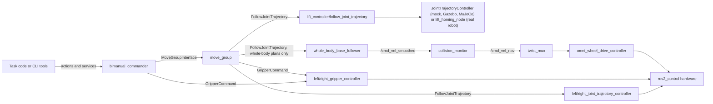

# Manipulation

Launch MoveIt and send motion goals to Walkie's two 7-joint OpenArm v10 arms,
their parallel grippers, and the vertical lift they are mounted on. MoveIt 2
plans for the arms and the lift together, and a C++ commander node exposes
MoveIt as ROS actions and services for task code.

## Launch the stack

Start the Zenoh router first (see [Middleware (Zenoh)](middleware.md)). Run
each command in its own terminal.

### In simulation or with mock hardware

Start MoveIt and the controllers for your setup:

=== "Mock hardware"

    ```bash
    pixi run ros2 launch openarm_bimanual_moveit_config moveit_demo.launch.py
    ```

    No simulator. ros2_control runs `mock_components`, so commands are echoed
    back as joint states.

=== "Gazebo, started by MoveIt"

    ```bash
    pixi run ros2 launch openarm_bimanual_moveit_config moveit_demo.launch.py hardware_type:=gazebo
    ```

    Starts its own Gazebo instance with the Bullet Featherstone physics
    engine, the ros_gz bridge, and the controllers.

=== "Gazebo, full simulation"

    ```bash
    pixi run ros2 launch robot_simulation gzsim_omnibot.launch.py
    ```

    ```bash
    pixi run ros2 launch openarm_bimanual_moveit_config moveit_only.launch.py hardware_type:=gazebo \
      point_cloud_topic:=/zed_head/zed_node/point_cloud/cloud_registered
    ```

    `gzsim_omnibot.launch.py` already spawns the arm, gripper, and lift
    controllers. The `point_cloud_topic` override is needed because Gazebo does
    not publish the filtered cloud that `moveit_only.launch.py` expects by
    default.

=== "MuJoCo"

    ```bash
    pixi run ros2 launch robot_bringup mujoco_omnibot.launch.py
    ```

    ```bash
    pixi run ros2 launch openarm_bimanual_moveit_config moveit_only.launch.py hardware_type:=mujoco
    ```

    Not tested: MoveIt has not been run with MuJoCo yet.
    `mujoco_omnibot.launch.py` starts the simulator, `robot_state_publisher`,
    and the arm, gripper, and lift controllers, so pair it with
    `moveit_only.launch.py`, which starts only `move_group` and RViz. Add
    `use_rviz:=false` to `mujoco_omnibot.launch.py` to keep only the MoveIt
    RViz window. Do not use `moveit_demo.launch.py hardware_type:=mujoco`
    here: it starts a second `robot_state_publisher` and its own spawners, and
    on its own it starts no simulator. See [Known issues](#known-issues).

When MoveIt is up, start the commander:

```bash
pixi run ros2 launch openarm_bimanual_commander_cpp commander.launch.py
```

!!! note
    In Gazebo the commander does not use simulation time. See [Known issues](#known-issues).

### On the real robot

MoveIt connects to the controllers that the bringup starts.
`real_omnibot.launch.py` already runs ros2_control and spawns the arm and
gripper controllers, so use `moveit_only.launch.py`. Do not use
`moveit_demo.launch.py hardware_type:=real_robot` on the robot: it spawns its
own `lift_controller`, which clashes with the action server of the real lift
node.

!!! warning "The arms move to zero on activation"
    When the hardware component activates, it enables all motors and commands
    every arm joint to 0 rad. Keep the space around the arms clear when you
    start `real_omnibot.launch.py`. After the arm controllers start, the
    bringup sends the arms to the home pose over 5 s.

1. Set up the CAN FD interfaces once with the device setup script (device 3,
   OpenArm USB CAN FD). See [Real Robot: Set up the devices](real-robot.md#device-setup).

    ```bash
    sudo ./scripts/setup_device/setup_all_device.sh
    ```

2. Start the parts in this order, each in its own terminal:

    ```bash
    pixi run ros2 launch robot_bringup lift_homing.launch.py
    pixi run ros2 launch robot_bringup real_omnibot.launch.py
    pixi run ros2 launch openarm_bimanual_moveit_config moveit_only.launch.py hardware_type:=real_robot
    pixi run ros2 launch openarm_bimanual_commander_cpp commander.launch.py
    ```

To run the bringup without the arms powered, pass
`use_fake_arm_hardware:=true` to `real_omnibot.launch.py`. Both arms then use
mock hardware. See [Real Robot](real-robot.md) for CAN setup, lift homing, and
the bringup switches.

??? info "How the real arms are driven"
    Each arm is a separate ros2_control hardware component,
    `openarm_left_hardware_interface` and `openarm_right_hardware_interface`.
    Both use the plugin `openarm_hardware/OpenArm_v10HW` from
    `hardware/actuator/openarm/openarm_hardware/`.

    | Item | Value |
    | --- | --- |
    | CAN interface | Left arm `can1`, right arm `can0` (`left_can_interface` and `right_can_interface` on `real_omnibot.launch.py`) |
    | Bus | CAN FD, 1 Mbit/s nominal, 5 Mbit/s data |
    | Motors | Damiao DM8009 (joints 1–2), DM4340 (joints 3–4), DM4310 (joints 5–7 and the gripper) |
    | CAN IDs | Send `0x01`–`0x07`, receive `0x11`–`0x17`; gripper `0x08` / `0x18` |
    | Control mode | MIT mode: position, velocity, gains, and a feed-forward torque |
    | Stiffness `kp` | 400, 167, 167, 120, 47, 47, 47, from `description/config/openarm/arm/v10/control_gains.yaml` |
    | Feed-forward torque | Commanded effort plus gravity compensation from a KDL model (`gravity_compensation` on, `coriolis_compensation` off by default) |

    The plugin talks to the motors through `openarm_can`
    (`hardware/actuator/openarm/openarm_can/`, a submodule of
    `enactic/openarm_can`). It is a SocketCAN library for Damiao motors over
    CAN and CAN FD.

### Move the arms in RViz

The RViz window of `moveit_demo.launch.py` and `moveit_only.launch.py` has
the **MotionPlanning** panel:

1. Choose the group to move in **Planning Group**. RViz starts on
   `both_arms_lift`.
2. Set the goal. Drag the interactive marker at a hand, pick a named state in
   **Goal State**, or set single joints in the **Joints** tab.
3. Click **Plan** to preview the motion, then **Execute**. **Plan & Execute**
   does both.

Dragging a marker solves inverse kinematics with TRAC-IK. If `move_group`
logs `The kinematics plugin (trac_ik_kinematics_plugin/TRAC_IKKinematicsPlugin)
failed to load`, the environment is older than `pixi.lock`: run
`pixi install`.

!!! warning "On the real robot, Execute moves the arms"
    Check the planned motion in RViz before you click **Execute**.

## Send goals with the commander

The commander node (`bimanual_commander`) wraps a `MoveGroupInterface` for each
of the eight arm and gripper
[planning groups](#planning-groups-and-named-states). Send it
goals with `ros2 action send_goal` or from task code:

```bash
pixi run ros2 action send_goal /go_to_home my_robot_interfaces/action/GoToHome \
  "{group_name: both_arms, pose_name: home}"
```

The [package README](https://github.com/EIC-Robocup-2026/walkie-ros/blob/main/manipulate/openarm_bimanual_commander_cpp/README.md)
has goal formats and example calls for each interface. Where the README and the
code disagree, the code is correct (see [Known issues](#known-issues)).

| Kind | Name | Type | Purpose |
| --- | --- | --- | --- |
| Action | `/go_to_pose` | `GoToPose` | Move an end effector to an absolute pose (Euler angles) |
| Action | `/go_to_pose_quat` | `GoToPoseQuaternion` | Same, with a quaternion |
| Action | `/go_to_pose_relative` | `GoToPoseRelative` | Move relative to the current pose |
| Action | `/go_to_home` | `GoToHome` | Move a group to an SRDF named state (`pose_name`, empty means `home`) |
| Action | `/set_joint_position` | `SetJointPosition` | Move a group to joint angles |
| Action | `/control_gripper` | `ControlGripper` | Move a gripper to a position in meters |
| Service | `/get_joint_states` | `GetJointStates` | Current joint positions of a group |
| Service | `/get_ee_pose` | `GetEEPose` | Current end-effector pose of a group |
| Service | `/toggle_gripper_collision` | `ToggleGripperCollision` | Ignore or restore collisions between a gripper and the world |
| Service | `/toggle_octomap_collision` | `std_srvs/SetBool` | Enable or disable collision checking against the octomap |
| Service | `/toggle_all_collision_checking` | `std_srvs/SetBool` | Enable or disable collision checking |
| Service | `/clear_collision_objects` | `std_srvs/Trigger` | Detach held objects and remove all world collision objects from the planning scene |
| Service | `/execute_stored_plan` | `std_srvs/Trigger` | Execute the stored `plan_only` plan of the group named in `execute_plan_group` |

Pose goals use `base_footprint` as the default frame. Cartesian paths use a
1 cm step.

??? info "Fields of the `my_robot_interfaces` definitions"
    Unless noted, results are `success` and `status`.

    | Kind | Name | Fields |
    | --- | --- | --- |
    | Message | `PoseCommand` | `x`, `y`, `z`, `roll`, `pitch`, `yaw`, `cartesian_path` |
    | Service | `GetPosition` | Request `get_position`; response `x`, `y`, `z`, `success` |
    | Service | `GetEEPose` | Request `group_name`, `frame_id`; response position, quaternion, `frame_id`, `success`, `status` |
    | Service | `GetJointStates` | Request `group_name`; response `joint_names`, `joint_positions`, `success`, `status` |
    | Service | `ToggleGripperCollision` | Request `group_name`, `enable`; response `success`, `status` |
    | Action | `GoToPose` | Goal `group_name`, position, roll/pitch/yaw, `cartesian_path`, `frame_id` |
    | Action | `GoToPoseQuaternion` | Goal `group_name`, position, quaternion, `cartesian_path`, `frame_id`; feedback `current_status` |
    | Action | `GoToPoseRelative` | Goal like `GoToPose`, plus `ee_frame` |
    | Action | `GoToHome` | Goal `group_name`, `pose_name`; result `success`; feedback `time_elapsed` |
    | Action | `SetJointPosition` | Goal `group_name`, `joint_positions` |
    | Action | `ControlGripper` | Goal `group_name`, `position`; result `success`, `status`, `grasped`, `gripper_gap` |

### Change commander parameters

```bash
pixi run ros2 param set /bimanual_commander <name> <value>
```

Most parameters take effect live. The node reads `plan_only` and
`grasp_attach_enable` only at startup. `commander.launch.py` has an argument for
`plan_only`, and none for `grasp_attach_enable`.

| Parameter | Default | Meaning |
| --- | --- | --- |
| `planner_id` | `RRTConnect` | OMPL planner for the arm groups |
| `arm_planning_time` | `5.0` | Planning time per request, in seconds |
| `max_velocity_scaling_factor` | `0.5` from `config/joint_limits.yaml` | Velocity scaling for the arm groups, in (0, 1]. Applies to the next plan |
| `max_acceleration_scaling_factor` | `0.3` from `config/joint_limits.yaml` | Acceleration scaling for the arm groups, in (0, 1]. Applies to the next plan |
| `plan_only` | `false` | Plan without executing. The plan is stored per group |
| `execute_plan_group` | empty | Group whose stored plan `/execute_stored_plan` runs |
| `gripper_speed` | `0.1` from the launch file (`1.0` in code) | Gripper ramp speed; `<= 0` disables the ramp |
| `grasp_scene_action` | `none` | `grasp`, `place`, or `none`, see [Grippers](#grippers) |

!!! warning "The arms no longer run at full speed"
    The commander used to run every arm group at full speed (`1.0`) and ignore
    `joint_limits.yaml`. It now starts with the file's
    `default_velocity_scaling_factor` (0.5) and
    `default_acceleration_scaling_factor` (0.3), so arm moves take about twice
    as long, in simulation too. The node rejects a value outside (0, 1], and
    refuses to start with one. Write `1.0`, not `1`: the parameters are
    doubles and reject an integer.

    For full speed in one session:

    ```bash
    pixi run ros2 param set /bimanual_commander max_velocity_scaling_factor 1.0
    pixi run ros2 param set /bimanual_commander max_acceleration_scaling_factor 1.0
    ```

    To change the default, edit the two values in `config/joint_limits.yaml`.
    A plan stored with `plan_only` keeps the speed it was planned with.

??? info "Planning-scene parameters"
    | Parameter | Default | Meaning |
    | --- | --- | --- |
    | `grasp_attach_enable` | `true` | Master switch for the planning-scene changes of `grasp_scene_action` |
    | `grasp_object_size` | `[0.09, 0.05, 0.16]` | Size of the attached box, in meters |
    | `finger_padding_enable`, `finger_padding` | `true`, `0.01` | Pad the finger links in collision checking |
    | `table_enable` | `false` | Add a table box to the planning scene (`table_pose`, `table_size`) |
    | `allow_gripper_vs_octomap` | `false` | Ignore collisions between the gripper links and the octomap only, for grasping inside sensed voxels |

??? info "Other executables in the package"
    | Executable | Purpose |
    | --- | --- |
    | `commander_interactive` | Interactive command-line client for the actions |
    | `commander_benchmark` | Planning and execution benchmark |
    | `pick_and_place_isaac`, `pick_and_place_isaac2` | Pick-and-place demos for Isaac Sim |
    | `save_named_constraint` | Saves a named orientation constraint to the MoveIt warehouse, so RViz can select it |

## Grippers

```bash
pixi run ros2 action send_goal /control_gripper my_robot_interfaces/action/ControlGripper \
  "{group_name: right_gripper, position: 0.044}"
```

The position is the finger travel in meters: 0 is closed and 0.044 is fully
open. After a close command, the result field `grasped` reports whether an
object is held.

To make MoveIt plan around the held object, set `grasp_scene_action` before
you send the gripper goal. The commander reads it on every gripper command.

```bash
pixi run ros2 param set /bimanual_commander grasp_scene_action grasp
```

- `grasp` attaches a box to the hand, so MoveIt plans around the held object.
- `place` detaches the box and removes it after the next motion.
- `none` (the default) leaves the planning scene unchanged.

??? info "How grasp detection works"
    After a close command (goal position at or below `grasp_close_threshold`,
    0.03), the commander checks the settled finger gap. A gap between
    `grasp_detect_min` (0.005) and `grasp_detect_max` (0.044) counts as
    "object held", and the result field `grasped` reports it.

??? info "How the grippers are controlled"
    - Each gripper is a parallel gripper with one controlled joint,
      `openarm_<side>_finger_joint1`. `openarm_<side>_finger_joint2` is
      passive.
    - The controllers are `position_controllers/GripperActionController`, with
      the action `<controller>/gripper_cmd` (`control_msgs/action/GripperCommand`).
    - The commander sends gripper goals straight to
      `/left_gripper_controller/gripper_cmd` and
      `/right_gripper_controller/gripper_cmd`, without planning. It ramps the
      command at `gripper_speed`, in position units per second (0.1 from
      `commander.launch.py`).
    - On the real robot, the gripper motor is a Damiao DM4310 on the same CAN
      bus as its arm. `openarm_hardware` maps joint 0 to 0.044 m onto motor
      0 to -1.0472 rad.

## Move the lift with the arms

Plan with a `*_lift` group (`left_arm_lift`, `right_arm_lift`,
`both_arms_lift`). These groups include `lift_joint`, so MoveIt moves the lift
and the arm in one plan. MoveIt executes lift motion through the
`lift_controller/follow_joint_trajectory` action.

On the real robot, `lift_homing_node` serves that action, not a controller.
The mock lift node (`lift_homing.launch.py mock:=true`) does not serve it, so
`*_lift` plans fail to execute, see [Troubleshooting](#troubleshooting).

??? info "Who serves the lift action in each setup"
    | Setup | Server of `lift_controller/follow_joint_trajectory` | Lift joint state |
    | --- | --- | --- |
    | Mock | `lift_controller` (JointTrajectoryController) on mock hardware | `/joint_states` from the joint state broadcaster |
    | Gazebo | `lift_controller` in `gz_ros2_control` | `/joint_states` from the joint state broadcaster |
    | MuJoCo | `lift_controller` in `mujoco_ros2_control` | `/joint_states` from the joint state broadcaster |
    | Real robot | `lift_homing_node` (`bringup/scripts/lift_homing_node.py`) | `lift/joint_states`, relayed to `/joint_states` by `real_omnibot.launch.py` |

    On the real robot, `real_omnibot.launch.py` deliberately does not spawn a
    `lift_controller`. The lift homing node owns the action server directly
    and reports success when the motor reaches the goal.

## Move the base with a whole-body goal { #whole-body-goals }

A whole-body goal moves the base, the lift, and one arm together, to reach a
target the arm cannot reach from where the robot stands. A caller chooses it per
request: send `group_name: whole_body_left` or `whole_body_right` on `/go_to_pose`
or `/go_to_pose_quat`. Every other group name keeps its old behaviour and cannot
command the base.

!!! warning "Tested in MuJoCo only"
    No whole-body goal has run on the real robot. The default, `base_mode:=fixed`,
    refuses these goals, so the option stays off until a launch command turns it on.

Run the demo in two terminals:

```bash
pixi run ros2 launch robot_bringup whole_body_demo.launch.py
pixi run ros2 run openarm_bimanual_commander_cpp whole_body_demo
```

The launch file starts the obstacle scene, Nav2 (idle, it owns the collision
monitor), `move_group` with `base_mode:=whole_body`, the commander, the base
follower, RViz, and a Zenoh router. Pass `start_router:=false` if a router already
runs, and `headless:=true use_rviz:=false` for no windows. The client prints one
JSON report and exits non-zero if a step misses its expectation.

Send your own goal once the launch file is up:

```bash
pixi run ros2 action send_goal /go_to_pose my_robot_interfaces/action/GoToPose \
  "{group_name: whole_body_left, x: 1.75, y: 0.15, z: 1.05, roll: 0.0, pitch: 1.5708, yaw: 0.0, frame_id: map}"
```

The status of a successful goal ends in `(base fixed)` when the arm and lift
reached the target alone, or in `(base travel <length> m)` with the length of the
planned base path.

??? info "Demo steps and options"
    | Step | Group | Expected |
    | --- | --- | --- |
    | `far_arm` | `left_arm_lift` | Target on the table, out of reach: fails, with no base command |
    | `near_arm` | `left_arm_lift` | Reachable target: the arm moves, the base stays |
    | `near_body` | `whole_body_left` | Target the arm reaches alone: the status says `base fixed` |
    | `far_body` | `whole_body_left` | The target of `far_arm`: base, lift, and arm move together |
    | `home_<n>`, `far_<n>` | `whole_body_left` | Only with `--cycles N`: `N` round trips to a target near the start and back |
    | `seam_turn` | `whole_body_left` | Hand along -x, which turns the body to a heading near +π |
    | `seam_cross` | `whole_body_left` | A hand direction that makes the base turn through ±π the short way |

    A whole-body step also fails on a tip error above `--tip-tolerance` (0.03 m),
    a turn more than π above the heading change, or a base path above 1.5 times the
    displacement plus 0.3 m. `--report <file>` writes the report to a file, because
    `rmw_zenoh_cpp` also logs to stdout. `--skip-near` skips `near_arm` and
    `near_body`, and `--settle` sets how long the octomap fills before the first goal.

    The simulation runs slower than real time: a real-time factor of about 0.5
    headless, and 0.16 to 0.30 with the viewer and RViz, depending on what else the
    laptop runs. A step takes about 40 to 70 s of wall time.

### Keep the base still

| You want | Send | What happens |
| --- | --- | --- |
| The base must not move | An arm group, such as `left_arm_lift` | These groups have no base variables, so they cannot command the base. A target out of reach fails with `Planning Failed`. |
| The base may move when it has to | `whole_body_left`, `whole_body_right` | The current base pose is tried first. If that does not work, the base moves. |

!!! warning "A whole-body goal near the edge of the arm's reach can move the base a little"
    The first attempt of a whole-body goal needs an exact IK solution from the
    current base. An arm group's pose goal also accepts a solution within the goal
    tolerances, so it reaches a little further. A target in that gap succeeds on
    `left_arm_lift` without moving the base, and moves the base by a few centimeters
    on `whole_body_left`. If the base must not move, use an arm group.

### Choose the base model

`base_mode` selects the model. Give `moveit_only.launch.py` and
`commander.launch.py` the same value.

| `base_mode` | Model | Octomap frame | Whole-body goals |
| --- | --- | --- | --- |
| `fixed` (default) | Fixed joint from `world` to `base_footprint`, as before | `base_link` | Refused |
| `map` | Planar joint from `map` to `base_footprint`. `map` is the planning frame. | `map` | Refused |
| `whole_body` | `map`, plus the whole-body option | `map` | Accepted |

To bring the option up without the demo launch file, for example in MuJoCo with
Nav2 already running:

```bash
pixi run ros2 launch openarm_bimanual_moveit_config moveit_only.launch.py hardware_type:=mujoco base_mode:=whole_body
pixi run ros2 launch openarm_bimanual_commander_cpp commander.launch.py base_mode:=whole_body use_sim_time:=true
pixi run ros2 run openarm_bimanual_commander_cpp whole_body_base_follower --ros-args -p use_sim_time:=true
```

- Under `map` and `whole_body`, `moveit_only.launch.py` waits for
  `map` to `base_footprint` before it starts `move_group`.
- `base_mode:=whole_body` needs `openarm_bimanual_commander_cpp` built, also for
  `move_group`, because the `UnwrapPlanarHeading` plugin lives in that package.
- The octomap keeps the whole room in `map`, so it needs a working localization. A
  stale or jumping `map` to `odom` leaves ghost obstacles.
- The follower takes goals only while the commander is running, and stops the base
  if the commander goes quiet for 2 s. So **Plan & Execute** on a whole-body group in
  RViz needs the commander too.
- Restart the commander along with `move_group`. A motion holds the commander's
  motion slot until `move_group` finishes it, so after a crash of `move_group` new
  whole-body and arm goals stay refused.

### Why a goal is refused

Every refusal is an accepted goal that aborts with a reason in `status`, because a
rejected goal gives the client no reason. A motion that already started ends the same
way, and stops every controller it was using.

| Status | Fix |
| --- | --- |
| `Whole-body mode unavailable: this bring-up runs base_mode:=...` | Start the commander with `base_mode:=whole_body` |
| `move_group's robot model has no base joint: start it with base_mode:=whole_body` | `move_group` and the commander disagree. Give both the same value. |
| `Octomap collision checking is off: call toggle_octomap_collision first` | Turn the octomap back on. A base moving without it could hit what the camera sees. |
| `Collision checking is off: call toggle_all_collision_checking first` | Turn collision checking back on |
| `No base server on /base_controller/follow_joint_trajectory: is the base follower running?` | Start `whole_body_base_follower`. Arm groups keep working without it. |
| `Nav2 has an active goal on ...: the base is in use` | Wait for the Nav2 goal or cancel it. The status of a Nav2 server that has left the graph does not count. |
| `The base is moving (...)` | Wait until the base is at rest: below 0.03 m/s and 0.05 rad/s |
| `The node's clock is not advancing: is the simulation running?` | The node's clock did not move for 5 s of wall time. Check that the simulation is running and not paused. |
| `Refused: another motion is in progress` | A whole-body goal runs alone. Wait for the running arm goal. |
| `Refused: a whole-body motion is in progress` | The same, seen from an arm goal |
| `Cartesian paths are not supported on ...: use ...` | Set `cartesian_path: false`, or send the arm group the status names |
| `No base pose found to reach the target (...)` | No sampled base pose gave a usable IK solution. The numbers say how many samples had one and how many sat on a joint limit. |
| `Planning Failed for N sampled base pose(s), last MoveIt code ...` | IK found base poses, but no path to them. Code `-10` means the start state is in collision, and `-2` that the planner found no path in time. |
| `Execution deadline of N s exceeded: stop sent` | A controller did not finish in 1.5 times the planned duration plus `whole_body_execution_margin`. Check the follower's log. |
| `Base moved ... since the plan: plan again` | The base moved by more than 0.05 m or 0.05 rad while planning ran, or, with `(plan still stored)`, since a `plan_only` plan was stored. Send the goal again. |
| `Stopped: <controller> aborted its goal` | One controller of the plan aborted a goal sent during this motion, so the others were stopped. Check that controller's log. The follower's reasons are [below](#why-the-follower-stops). |
| `Stopped: Nav2 took a goal on <action>` | Nav2 got a goal while the motion ran. Wait for it, or cancel it. |
| Any of the stops above, ending in `(move_group has not finished: the stop repeats, and new whole-body and arm goals stay refused, until it does)` | `move_group` did not end the motion within 10 s of the stop. The commander keeps sending a stop every 500 ms. Check that the robot stopped, then restart `move_group` and the commander. |

### Why the follower stops

`whole_body_base_follower` ends a goal, and with it the whole motion, when:

- the goal is canceled,
- a `stop` arrives on `/trajectory_execution_event`,
- the commander's heartbeat stops,
- the collision monitor reports a stop,
- the base is more than `stall_error` (0.05 m) or `stall_yaw_error` (0.1 rad) behind
  the plan and covered less than a tenth of that in the last `stall_time` (0.5 s): the
  status says `not moving`,
- the base is more than `abort_position_error` (0.25 m) or `abort_yaw_error` (0.35 rad)
  behind the plan,
- the transform is older than `max_transform_age` (0.5 s), or
- the base does not settle within `goal_settle_time` (3 s) of the end.

The follower's log names the reason. The slowdown polygon of the collision monitor
does not end a goal: its speed limit matches the plan's base limit of 0.12 m/s.

When the commander's heartbeat stops during a motion that sent the follower no goal, the
follower publishes one `stop` on `/trajectory_execution_event`, so `move_group` does not
finish the arm motion of a commander that has died.

### Whole-body parameters

Set them with `pixi run ros2 param set /bimanual_commander <name> <value>`. They
take effect on the next goal. `base_mode` is read once, at startup.

| Parameter | Default | Meaning |
| --- | --- | --- |
| `base_mode` | `fixed` | `fixed`, `map`, or `whole_body`, see [Choose the base model](#choose-the-base-model) |
| `whole_body_planner_id` | `RRTConnect` | OMPL planner of a whole-body goal |
| `whole_body_planning_time` | `5.0` | Planning time per sampled base pose, in seconds. The first 2 s at most go to the small box, see below. |
| `whole_body_velocity_scaling` | `1.0` | Velocity scaling of a plan that moves the base, in (0, 1] |
| `whole_body_acceleration_scaling` | `1.0` | Acceleration scaling of a plan that moves the base, in (0, 1] |
| `whole_body_goal_joint_tolerance` | `0.001` | Joint tolerance of the goal |
| `whole_body_execution_margin` | `15.0` | Seconds added to 1.5 times the planned duration for the execution deadline, on the node's clock |

A goal the arm reaches alone uses the arm groups' `max_velocity_scaling_factor`
and `max_acceleration_scaling_factor`. The base limits are `virtual_joint/*` in
`config/joint_limits.yaml`: 0.12 m/s and 0.2 m/s², 0.3 rad/s and 0.4 rad/s². They
match the `PolygonSlow` speed of the collision monitor.

??? info "How a whole-body goal runs"
    1. The commander takes a motion slot and runs the gate behind the
       [refusals](#why-a-goal-is-refused).
    2. It freezes the goal in `map`, so a goal in `base_footprint` does not move along
       with the base.
    3. It solves IK with the base where it is. If that works and the goal has
       clearance, the matching `*_arm_lift` group plans and runs it. The status says
       `base fixed`.
    4. Otherwise it samples base poses that put the arm's shoulder behind the hand,
       nearest first. Up to five with a usable IK solution are planned to.
    5. Each plan first runs in a small box, 0.3 m around the start and the end of the
       move, for at most 2 s. Only if that fails does it run in a 5 m box. RRTConnect
       samples the base uniformly in the box, and path simplification does not always
       remove a waypoint far off the straight line. A 5 m box alone gave 2.18 m of
       travel for a 1.02 m displacement.
    6. It runs the gate's Nav2 check again and compares the base with where it was at
       step 3, because planning takes seconds and the first check is old by then.
    7. `move_group` runs the plan on `base_controller` and on the arm and lift
       controllers together. The commander watches for a canceled goal, an aborted
       controller goal, a Nav2 goal, and the deadline. On any of them it sends a stop
       every 500 ms until `move_group` ends the motion.

    `move_group` waits for the results of its controllers one at a time, in name order.
    Without the watch in step 7, an arm that aborts while the base is still running goes
    unnoticed until the base finishes.

    The sampled poses come in two tiers of 40. The first keeps to where IK finds usable
    goals for a hand pointing forward at about 1 m: shoulder 0.3 to 0.6 m behind the
    hand, body turned up to 1 rad away from the hand direction, mirrored for the right
    arm. The second tier is wider, for other hand orientations. So the base often
    arrives turned away from the target, which matters if the head camera has to see it.

    A pose goal at z = 1.05 m often needs the lift at the top. The lift moves at
    0.03 m/s, so it often sets the duration of the whole motion.

??? info "How the base follows the plan"
    MoveIt's `base_controller` entry sends a `FollowJointTrajectory` goal with the base
    motion in `multi_dof_trajectory`, as `map`-frame poses. The stock
    `joint_trajectory_controller` ignores that field, so `whole_body_base_follower` is
    its own server on `/base_controller/follow_joint_trajectory`. The omni controller
    runs open loop, so the follower closes the loop on `map` to `base_footprint`.

    It publishes to `/cmd_vel_smoothed`, the input of Nav2's collision monitor, so
    whole-body base motion passes the same stop and slowdown polygons as Nav2. Its
    reasons to stop are listed under [Why the follower stops](#why-the-follower-stops).
    Every one of them publishes zero commands and, unless the reason was a `stop` event
    itself, one `stop` on `/trajectory_execution_event`, which also halts the arm and the
    lift. The follower ignores the events it publishes itself, and sends at most one per
    heartbeat period: an event carries no time, so a late one would end the next motion.

    The collision monitor reports its state only when the active polygon changes, and it
    only looks when a command arrives. So a stop on record can be stale, with nothing to
    correct it while no commands flow. A goal that arrives during a stop therefore
    publishes one zero command and waits up to 500 ms for the state to change. If the
    stop is still active, the follower rejects the goal. The other way round, a follower
    that starts during a stop never hears of it. The stall check covers that case: a base
    that lags and does not move under the commands ends the goal within about two
    `stall_time` windows.

    | Parameter | Default | Meaning |
    | --- | --- | --- |
    | `position_gain`, `yaw_gain` | `1.5` | Proportional gains on the error to the plan |
    | `max_linear_speed`, `max_angular_speed` | `0.25`, `0.6` | Command limits |
    | `start_position_tolerance`, `start_yaw_tolerance` | `0.05`, `0.1` | Largest difference to the plan's start. A larger one rejects the goal. |
    | `goal_position_tolerance`, `goal_yaw_tolerance` | `0.02`, `0.03` | Tolerance at the end of the plan |
    | `cmd_topic` | `/cmd_vel_smoothed` | Output |
    | `monitor_state_topic` | `/collision_monitor_state` | Collision monitor state. `nav_mujoco_omnibot.launch.py` turns it on; the real-robot Nav2 parameters do not set `state_topic` yet. |
    | `commander_topic` | `/whole_body/commander_alive` | Commander heartbeat, `std_msgs/Bool` at 5 Hz of wall time. `data` is true while one of the commander's motions executes. |
    | `commander_timeout` | `2.0` | Wall seconds without a heartbeat before the follower stops. At 0.12 m/s the base can travel about 24 cm in that time. |
    | `stall_time` | `0.5` | Window of the stall check, in seconds between `map` to `base_footprint` stamps. A transform that stops updating is reported as stale, not as a stalled base. |
    | `stall_error`, `stall_yaw_error` | `0.05`, `0.1` | Lag behind the plan above which a base that covered less than a tenth of it in one window is not moving |

??? info "The heading seam"
    OMPL returns the planar joint's heading normalized to [-π, π]. Time parameterization
    treats it as a plain number, so a path across ±π would jump by almost 2π, and the
    base would turn the long way round. Under `base_mode:=whole_body`,
    `moveit_only.launch.py` puts the response adapter
    `openarm_bimanual_commander_cpp/UnwrapPlanarHeading` in front of
    `AddTimeOptimalParameterization`. It rewrites the headings of the path so that each
    step takes the short way. Values outside [-π, π] are safe: MoveIt only uses the angle,
    and the trajectory message carries quaternions. The commander still rejects a plan
    that turns more than π above the heading change.

??? info "The octomap in map"
    Under `map` and `whole_body`, `moveit_only.launch.py`:

    - sets no `octomap_frame`, so the octree frame is the planning frame, `map`.
    - uses `planar_octomap_resolution` (0.03 m) and `planar_octomap_max_range` (1.5 m,
      3.5 m in the demo). Anything farther is unknown, and unknown plans as free.
    - starts `cloud_floor_gate.py`, which decimates the cloud and keeps the base out of
      collision with the floor. A floor return moves out along its ray past the updater's
      range, so it clears the voxels on the way and marks nothing.
    - starts `octomap_jump_guard.py`, which clears the octomap when `map` to `odom` jumps
      by more than 0.1 m or 0.1 rad.
    - sets `padding_offset` to 0.10 m, because the self-filter mask is built from the
      collision geometry and the camera sees the visual meshes. Obstacles within that
      padding of the robot are not marked.
    - loads `config/moveit_map.rviz`, which uses `map` as its fixed frame. With
      `hardware_type:=mujoco` it also starts `depth_image_proc`, because MuJoCo publishes
      depth images and no cloud.

    `publish_planning_scene_hz` drops to 1 Hz, because each scene update carries the
    whole octree.

??? info "Repairs before a plan"
    Under `map` and `whole_body` the commander repairs three states that would otherwise
    fail every plan. Under `fixed` it does nothing and the old behaviour stays.

    - **Voxels inside the robot.** A stale voxel behind the robot's own surface gets no
      ray through it. If the current state touches the octomap, the commander clears the
      whole octree, waits 1 s of the node's clock (10 s of wall time at most), and logs a
      warning. MoveIt cannot edit part of an octree, so whatever is out of view at that
      moment is forgotten and plans as free.
    - **A joint just past its limit.** A position controller can stop there. A joint of the
      planned group up to 0.02 past its limit starts from the limit. A joint farther out,
      or one the group does not move, is left for MoveIt to report.
    - **Self-contact.** The MuJoCo lift settled 2.65 mm below its command, which was enough
      to put the idle arm's fingers on the base. For a group that moves the lift, a plan
      then starts from the lift 2, 5, 10, or 20 mm higher, whichever is free, and goals
      must stay valid 10 mm below where they stop the lift. `allowed_start_tolerance` in
      `config/move_group.yaml` accepts these raises. A group without the lift, such as
      `left_arm`, plans from the real lift: a raised start would describe a robot that is
      not there, and nothing would close the difference.

## How the parts fit together

The MoveIt configuration, the commander, and its interfaces are in
`manipulate/`. The real arms are driven by a ros2_control plugin in
`hardware/actuator/openarm/`, and the real lift by the lift homing node in
`robot_bringup`.



!!! note "Older packages"
    The single-arm packages (`left_arm_moveit_config`, `left_arm_commander_cpp`)
    and the `walkie_ik_servo` package are no longer in the repository. Some
    older documents still mention them. This page covers only the bimanual
    packages.

??? info "Packages in the manipulation stack"
    | Package | Path | Role |
    | --- | --- | --- |
    | `openarm_bimanual_moveit_config` | `manipulate/openarm_bimanual_moveit_config/` | MoveIt configuration: SRDF, kinematics, OMPL, controllers, launch files |
    | `openarm_bimanual_commander_cpp` | `manipulate/openarm_bimanual_commander_cpp/` | Commander node: actions and services on top of MoveIt |
    | `my_robot_interfaces` | `manipulate/my_robot_interfaces/` | Message, service, and action definitions used by the commander |
    | `openarm_hardware` | `hardware/actuator/openarm/openarm_hardware/` | ros2_control plugin for the real OpenArm arms |
    | `openarm_can` | `hardware/actuator/openarm/openarm_can/` (submodule) | CAN library for the Damiao motors in the arms |
    | `robot_bringup` | `bringup/scripts/lift_homing_node.py` | Real lift driver; also serves the lift trajectory action for MoveIt |

## Configure MoveIt

The MoveIt configuration is the package `openarm_bimanual_moveit_config`.
Paths in this section are relative to `manipulate/openarm_bimanual_moveit_config/`.

### Launch files and arguments

- `moveit_demo.launch.py`: all-in-one. Starts `robot_state_publisher`, the
  ros2_control backend for `hardware_type`, the controller spawners,
  `move_group`, and RViz.
- `moveit_only.launch.py`: `move_group` and RViz only. Assumes
  `robot_state_publisher`, ros2_control, and the controllers are already
  running. Use this one on the real robot, see
  [On the real robot](#on-the-real-robot).

| Argument | `moveit_demo` default | `moveit_only` default | Meaning |
| --- | --- | --- | --- |
| `hardware_type` | `mock_components` | `mock_components` | ros2_control backend: `mock_components`, `gazebo`, `mujoco`, `real_robot`, `isaac` |
| `point_cloud_topic` | `/zed_head/zed_node/point_cloud/cloud_registered` | `/zed_head/zed_node/point_cloud/cloud_registered/filtered` | Input of the octomap |
| `octomap_resolution` | `0.05` | `0.008` | Octomap voxel size, in meters |

The octomap is only enabled for `gazebo` and `real_robot`, because only Gazebo
and the real robot publish the ZED point cloud.

??? info "Other launch arguments"
    | Argument | `moveit_demo` default | `moveit_only` default | Meaning |
    | --- | --- | --- | --- |
    | `left_use_fake_arm_hardware` | `true` | `true` | Mock the left arm instead of using CAN. Only used with `real_robot` |
    | `right_use_fake_arm_hardware` | `true` | `true` | Same, for the right arm |
    | `right_joint2_fixed` | `false` | `false` | Treat `openarm_right_joint2` as fixed. It is dropped from the SRDF named states and from `right_joint_trajectory_controller` |
    | `controllers_file` | `config/ros2_controllers.yaml` | not available | ros2_control parameters for the `mock_components`, `isaac`, and `real_robot` branches |
    | `use_rviz` | not available | `true` | Start RViz |
    | `base_mode` | not available | `fixed` | Base model: `fixed`, `map`, or `whole_body`. See [Choose the base model](#choose-the-base-model). `commander.launch.py` has the same argument. |
    | `planar_octomap_resolution` | not available | `0.03` | Octomap voxel size under `map` and `whole_body`, in meters. `fixed` uses `octomap_resolution`. |
    | `planar_octomap_max_range` | not available | `1.5` | Octomap updater range under `map` and `whole_body`, in meters. Anything farther is unknown, which plans as free. |

    `commander.launch.py` has the arguments `gripper_speed`, `gripper_init_pos`,
    `base_mode` (`fixed`), `plan_only` (`false`), and `use_sim_time` (`false`).

??? info "What each `hardware_type` starts"
    `hardware_type` selects which ros2_control backend the robot description
    uses. It also sets `use_sim_time` and decides whether the launch file
    starts ros2_control itself.

    | `hardware_type` | `ros2_control` xacro value | ros2_control is run by | Sim time |
    | --- | --- | --- | --- |
    | `mock_components` (default) | `mock` | `moveit_demo.launch.py` (`ros2_control_node`) | no |
    | `gazebo` | `gazebo` | `gz_ros2_control` inside Gazebo | yes |
    | `mujoco` | `mujoco` | `mujoco_ros2_control`, started by `robot_bringup`'s `mujoco_omnibot.launch.py`, not by `moveit_demo.launch.py` | yes |
    | `real_robot` | `real_robot` | `moveit_demo.launch.py`, or `real_omnibot.launch.py` when you use `moveit_only.launch.py` | no |
    | `isaac` | `isaac` | `moveit_demo.launch.py`, but the description has no `isaac` hardware block | yes |

    With `hardware_type:=real_robot`, `moveit_demo.launch.py` builds a
    `real_robot` description in which the lift is a mock system and each arm
    is mock or real depending on `left_use_fake_arm_hardware` and
    `right_use_fake_arm_hardware`.

??? info "Octomap anchoring and sensor settings"
    Under `base_mode:=fixed` the octomap is anchored to `base_link`, so the voxels
    move with the mobile base. Under `map` and `whole_body` it stays in `map`, see
    [Move the base with a whole-body goal](#whole-body-goals). The sensor settings
    are in `config/sensors_3d.yaml` (range 1.5 m, update rate 5 Hz).

??? info "Other launch files in the package"
    | File | Purpose |
    | --- | --- |
    | `moveit_demo_with_commander.launch.py` | Variant that also starts the commander, plus fake object TFs for a pick-and-place demo with `mock_components`. Prefer `moveit_demo.launch.py` plus `commander.launch.py`, see [Known issues](#known-issues) |
    | `move_group.launch.py`, `moveit_rviz.launch.py`, `spawn_controllers.launch.py`, `static_virtual_joint_tfs.launch.py`, `setup_assistant.launch.py` | Standard files generated by the MoveIt Setup Assistant |

### Planning groups and named states

The groups are defined in `config/openarm_bimanual.srdf`:

- Arms: `left_arm`, `right_arm`, `both_arms`.
- Arms with the lift: `left_arm_lift`, `right_arm_lift`, `both_arms_lift`.
- Grippers: `left_gripper`, `right_gripper`.
- Base, lift, and arm: `whole_body_left`, `whole_body_right`. The commander only
  plans with them under `base_mode:=whole_body`, see
  [Move the base with a whole-body goal](#whole-body-goals).

??? info "Chains and joints of each group"
    | Group | Contents | Includes the lift |
    | --- | --- | --- |
    | `left_arm` | chain `lift_link` to `openarm_left_hand` | no |
    | `right_arm` | chain `lift_link` to `openarm_right_hand` | no |
    | `left_arm_lift` | chain `base_link` to `openarm_left_hand` | yes |
    | `right_arm_lift` | chain `base_link` to `openarm_right_hand` | yes |
    | `both_arms` | `left_arm` and `right_arm` | no |
    | `both_arms_lift` | `left_arm_lift` and `right_arm_lift` | yes |
    | `left_gripper` | joint `openarm_left_finger_joint1` | no |
    | `right_gripper` | joint `openarm_right_finger_joint1` | no |
    | `whole_body_left` | joint `virtual_joint` and `left_arm_lift` | yes |
    | `whole_body_right` | joint `virtual_joint` and `right_arm_lift` | yes |

    Every `base_mode` has the same group list. Under the fixed virtual joint the
    `whole_body_*` groups have no base variables.

Named states, for `go_to_home` and for the MoveIt RViz panel:

| State | Groups |
| --- | --- |
| `home`, `hands_up`, `standby`, `basket`, `basket_hold` | all six arm groups |
| `pre-place` | `left_arm`, `both_arms`, `left_arm_lift`, `both_arms_lift` |
| `tray` | `both_arms`, `both_arms_lift` |
| `open` (0.044), `half_closed` (0.022), `closed` (0) | `left_gripper`, `right_gripper` |

??? info "Lift heights in named states and other SRDF contents"
    In the `*_lift` variants, the lift is at 0.7435 m for every state except
    `pre-place` (0.735 m) and `basket` (0.303 m).

    The SRDF also defines the virtual joint `virtual_joint` (fixed from `world` to
    `base_footprint` under `base_mode:=fixed`, planar from `map` to `base_footprint`
    otherwise), the end effectors `left_ee` and `right_ee`, and the passive joints
    `openarm_left_finger_joint2` and `openarm_right_finger_joint2`.

### Kinematics, planners, and controllers

- **Inverse kinematics:** TRAC-IK, set in `config/kinematics.yaml`. The
  plugin comes from `ros-jazzy-trac-ik-kinematics-plugin` in `pixi.toml`.
- **Planner:** `RRTConnect` for every arm group, set in
  `config/ompl_planning.yaml`. The commander can switch planners at runtime
  with its `planner_id` parameter.
- **Controllers:** `config/moveit_controllers.yaml` tells MoveIt which
  controller actions to use. MoveIt does not start or switch these
  controllers; the launch file or bringup must spawn them.

??? info "Kinematics settings"
    `config/kinematics.yaml` sets TRAC-IK
    (`trac_ik_kinematics_plugin/TRAC_IKKinematicsPlugin`) for `left_arm`,
    `right_arm`, `left_arm_lift`, and `right_arm_lift`, with a 0.05 s timeout
    and the `Distance` solve type. KDL entries are kept in the file as
    comments.

??? info "OMPL planners and collision-check density"
    `config/ompl_planning.yaml` configures the planners RRTConnect, RRT,
    RRTstar, BKPIECE, BITstar, and TRRT.

    Every arm group sets `longest_valid_segment_fraction: 0.003`. This value
    controls how densely OMPL checks for collisions along each motion segment.
    OMPL's internal default is 0.01, which can let an arm pass through thin
    obstacles between checked points. A smaller value is safer and costs more
    planning time.

    The `whole_body_*` groups use the same value and RRTConnect. They have no IK
    solver of their own: the commander solves IK on the `*_arm_lift` group with the
    base held at a sampled pose.

??? info "Controllers and their actions"
    | Controller | Action | Joints |
    | --- | --- | --- |
    | `base_controller` | `FollowJointTrajectory`, `follow_joint_trajectory`, served by `whole_body_base_follower` | `virtual_joint` |
    | `left_joint_trajectory_controller` | `FollowJointTrajectory`, `follow_joint_trajectory` | `openarm_left_joint1` to `openarm_left_joint7` |
    | `right_joint_trajectory_controller` | `FollowJointTrajectory`, `follow_joint_trajectory` | `openarm_right_joint1` to `openarm_right_joint7` |
    | `left_gripper_controller` | `GripperCommand`, `gripper_cmd` | `openarm_left_finger_joint1` |
    | `right_gripper_controller` | `GripperCommand`, `gripper_cmd` | `openarm_right_finger_joint1` |
    | `lift_controller` | `FollowJointTrajectory`, `follow_joint_trajectory` | `lift_joint` |

    The controller parameters come from a different file in each setup:

    | Setup | Controller parameters |
    | --- | --- |
    | Mock (`moveit_demo.launch.py`) | `manipulate/openarm_bimanual_moveit_config/config/ros2_controllers.yaml` |
    | Gazebo | `description/config/ros2_controller/sim_controllers.yaml` |
    | MuJoCo | `description/config/ros2_controller/mujoco_controllers.yaml` |
    | Real robot (`real_omnibot.launch.py`) | `description/config/ros2_controller/real_controllers.yaml` |

??? info "Execution time limits and speed scaling"
    `config/move_group.yaml` widens the execution time limits:
    `allowed_execution_duration_scaling: 2.0` and
    `allowed_goal_duration_margin: 60.0`. The real lift moves at about
    3 cm/s, and MoveIt's default allowance (planned duration × 1.2 + 0.5 s) is
    too tight for longer lift moves. Without the margin, MoveIt would cancel
    lift moves that are still in progress.

    Velocity and acceleration scaling defaults are in
    `config/joint_limits.yaml` (0.5 and 0.3). The commander reads them at
    startup into `max_velocity_scaling_factor` and
    `max_acceleration_scaling_factor`, see
    [Change commander parameters](#change-commander-parameters). Lower scaling
    gives longer planned durations, and the execution allowance grows with them.

### Run the package tests

`test/test_srdf_urdf_contract.py` checks that every link and joint named in
the SRDF exists in the URDF, for the `mock`, `gazebo`, `real_robot`, and
`mujoco` descriptions.

```bash
pixi run test --packages-select openarm_bimanual_moveit_config
pixi run colcon test-result --verbose
```

The launch tests of the whole-body option are in `openarm_bimanual_commander_cpp`.
They need a Zenoh router, and take about 7 minutes:

```bash
pixi run test --packages-select openarm_bimanual_commander_cpp
```

See [Tests](testing.md#whole-body-launch-tests) for what they check.

## Why MuJoCo collision settings do not affect MoveIt

MoveIt and MuJoCo each keep their own collision model, built from different
files. `move_group` never reads `description/mujoco/walkie.xml`. If you change
the collision classes or excludes in `description/scripts/build_mjcf.py`,
MuJoCo simulates different contacts, but MoveIt plans exactly as before. It is
neither faster nor slower. See
[2.3 Collisions](../migrations/02-mujoco/03-collisions.md) for the MuJoCo side.

??? info "MoveIt and MuJoCo collision models compared"
    | | MoveIt (`move_group`) | MuJoCo |
    | --- | --- | --- |
    | Geometry | URDF collision meshes from `robot_description`. The OpenArm links use `description/meshes/openarm/arm/v10/collision/link*_symp.stl` | Collision geoms in `description/mujoco/walkie.xml` |
    | Pairs that are checked | All pairs, except the 315 `disable_collisions` entries in the SRDF. Planning scene objects and the octomap are added on top | Pairs allowed by the `contype` / `conaffinity` bits and not removed by `<exclude>`, written by `description/scripts/build_mjcf.py` |
    | Used for | Checking every state and motion segment while planning | Physics contacts during the simulation |

If planning is slow, change MoveIt's own settings: planning time, planning
attempts, collision mesh size, segment check density, disabled collision
pairs, and the octomap. Simplifying the `link3_symp.stl` collision mesh gives
the largest gain.

??? info "Where each planning-cost setting lives"
    - **Planning time:** commander parameter `arm_planning_time`, 5.0 s. Upper
      bound on the time spent per request. Can be changed live.
    - **Planning attempts:** `setNumPlanningAttempts` in
      `manipulate/openarm_bimanual_commander_cpp/src/commander_template.cpp`,
      10000 for arm groups and 100 for grippers. Hard-coded. More attempts mean more planning work per
      request.
    - **Collision mesh size:** `description/meshes/openarm/arm/v10/collision/`.
      `link3_symp.stl` has 72,160 triangles, `link4` 22,798, and `link5`
      15,028. The other links have fewer than 1,000. Every collision check
      against a dense mesh costs more.
    - **Segment check density:** `longest_valid_segment_fraction` in
      `config/ompl_planning.yaml`, 0.003. Smaller values add collision checks
      along every motion.
    - **Disabled pairs:** `disable_collisions` in
      `config/openarm_bimanual.srdf`, 315 pairs. Pairs that can never collide
      are skipped. Regenerate them with the Setup Assistant after model
      changes.
    - **Octomap:** `octomap_resolution` launch argument (0.05 m for
      `moveit_demo`, 0.008 m for `moveit_only`) and
      `/toggle_octomap_collision`. A finer octomap has more voxels to check.

## Known issues

| Issue | Effect | Workaround |
| --- | --- | --- |
| `moveit_demo.launch.py` does not start the MuJoCo simulator (`mujoco_ros2_control`) | With `hardware_type:=mujoco`, `moveit_demo.launch.py` starts no `ros2_control_node`. The spawners have no timeout and wait forever | Use `whole_body_demo.launch.py` in `robot_bringup`, or start `mujoco_omnibot.launch.py` ([MuJoCo Simulation: Run with ROS 2](simulation-mujoco.md#run-with-ros-2)) and then `moveit_only.launch.py hardware_type:=mujoco` |
| MoveIt in MuJoCo is tested only with `base_mode:=whole_body` | `hardware_type:=mujoco` with `base_mode:=fixed` starts no octomap, and nobody has run it | Use `base_mode:=whole_body` in MuJoCo |
| Whole-body goals have not run on the real robot | The follower, the octomap in `map`, and the repairs are tested only against MuJoCo and a stub. The real lift has its own driver, and the real-robot Nav2 parameters set no `state_topic`, so the follower would not see a collision monitor stop | Keep `base_mode:=fixed` on the real robot |
| The idle arm limits the lift during a whole-body goal | In the home pose the right arm's fingers reach the base at a lift position of about 0.495 m. The planner rejects lower lift positions, so targets that need them fail. | Move the idle arm first |
| The description has no `isaac` ros2_control block | With `hardware_type:=isaac` the URDF has no hardware, so no controller starts | None in this repository |
| `moveit_demo_with_commander.launch.py` passes xacro arguments the description does not declare, and has no `right_joint2_fixed` | With `hardware_type:=real_robot` both arms stay mock, and `right_joint2_fixed` cannot be set | Use `moveit_demo.launch.py` plus `commander.launch.py` |
| `commander.launch.py` defaults to `use_sim_time:=false` | In Gazebo and MuJoCo, `move_group` and the controllers use simulation time but the commander does not, so it can fail to get the current robot state | Pass `use_sim_time:=true` |
| `commander.launch.py` builds the robot description from the package's `.setup_assistant` defaults | The commander's description ignores `hardware_type` and `right_joint2_fixed` | None in this repository |
| `action/GoToPoseRelativeQuaternion.action` is not listed in `CMakeLists.txt` | No code is generated for it | Use `GoToPoseRelative` |

## Troubleshooting

| Symptom | Cause | Fix |
| --- | --- | --- |
| `moveit_only.launch.py` in Gazebo builds no octomap | The default `point_cloud_topic` is the filtered cloud, which only the real robot publishes | Pass `point_cloud_topic:=/zed_head/zed_node/point_cloud/cloud_registered` |
| `*_lift` plans fail to execute on the real robot | Nothing serves `lift_controller/follow_joint_trajectory`: the lift homing node is not running, or runs with `mock:=true` | Start `lift_homing.launch.py` without `mock`, or plan with `left_arm`, `right_arm`, or `both_arms` |
| `move_group` cannot load `openarm_bimanual_commander_cpp/UnwrapPlanarHeading` | `base_mode:=whole_body` needs the plugin from the commander package | `pixi run build-pkg openarm_bimanual_commander_cpp` |
| The log says `Clearing the octomap: the current state touches voxels at ...` | A stale voxel lies inside the robot. The commander cleared the octree, see `Repairs before a plan` under [whole-body goals](#whole-body-goals) | Nothing, if it is rare. If it repeats, check localization and the self-filter. |
| RViz does not start from a launch file that includes `nav_mujoco_omnibot.launch.py` with `use_rviz:=false` | An include's launch arguments stay set after it, so a later include reads the same `false` | Wrap the include in a `GroupAction`, as `whole_body_demo.launch.py` does |
| RViz logs `moveit.core.dynamics_solver: Group 'whole_body_left' does not have a parent link` at ERROR | The group starts at the planar joint from `map`, so it has no parent link. RViz's plan display builds a dynamics solver for it. | Nothing. Plans and execution were not affected in the MuJoCo runs. |
| A whole-body goal from RViz fails with the base controller rejecting it | The follower rejects goals while no commander reports on `/whole_body/commander_alive` | Start the commander |

More fixes are collected in [Troubleshooting](../troubleshooting.md).
