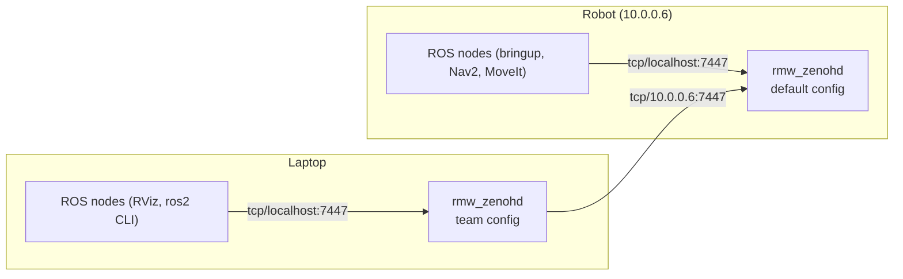

# Middleware (Zenoh)

Walkie uses the Zenoh middleware (`rmw_zenoh_cpp`) instead of the default DDS
middleware. This page explains how to turn it on, what the Zenoh router does,
and how a laptop connects to the robot.

## Why Zenoh

With DDS, ROS 2 nodes find each other with multicast messages on the local
network. Many Wi-Fi networks block or drop multicast, so discovery between a
laptop and the robot is often unreliable.

`rmw_zenoh_cpp` works differently:

- Each machine runs one Zenoh router (`rmw_zenohd`).
- Every node connects to the router on its own machine over TCP. The router
  tells the nodes about each other.
- Routers on different machines connect to each other over TCP, to an address
  that you write in a config file.

Multicast discovery is turned off in both default config files that ship with
`rmw_zenoh_cpp` (`scouting.multicast.enabled: false`). Nothing is found
automatically. Every connection between machines is configured on purpose.

## Installed, but not selected by default

`pixi.toml` installs `ros-jazzy-rmw-zenoh-cpp` (version `>=0.2.10,<0.3`). Pixi
does not set `RMW_IMPLEMENTATION`. Without that variable, ROS 2 Jazzy uses its
default middleware, which is DDS (`rmw_fastrtps_cpp`).

Export these two variables in every terminal that runs ROS nodes:

```bash
export RMW_IMPLEMENTATION=rmw_zenoh_cpp
export ROS_DOMAIN_ID=23
```

`pixi run` keeps the variables of the terminal it starts from, so the exports
work together with `pixi run ros2 ...`.

All processes that must talk to each other need the same middleware and the
same `ROS_DOMAIN_ID`. A node that uses DDS cannot see a node that uses Zenoh.

!!! tip
    You can add the two `export` lines to your shell profile (for example
    `~/.bashrc`). They then apply to every terminal, including terminals for
    other ROS workspaces.

The Docker compose files set the middleware for the containers.
`docker/compose.physical.yml` and `docker/compose.simulation.yml` both set
`RMW_IMPLEMENTATION=rmw_zenoh_cpp`. See [Docker Images](docker.md).

## The router: `rmw_zenohd`

Start the router before the other nodes, and leave it running:

```bash
pixi run ros2 run rmw_zenoh_cpp rmw_zenohd
```

Run exactly one router on each machine. The reasons come from the default
config files in `.pixi/envs/default/share/rmw_zenoh_cpp/config/`:

| Config | Setting | Effect |
| --- | --- | --- |
| `DEFAULT_RMW_ZENOH_SESSION_CONFIG.json5` (used by every node) | `connect.endpoints: ["tcp/localhost:7447"]` | Each node connects to the router on its own machine, port 7447 |
| `DEFAULT_RMW_ZENOH_SESSION_CONFIG.json5` | `listen.endpoints: ["tcp/localhost:0"]` | Nodes only accept connections from their own machine |
| `DEFAULT_RMW_ZENOH_ROUTER_CONFIG.json5` (used by `rmw_zenohd`) | `listen.endpoints: ["tcp/[::]:7447"]` | The router accepts connections on port 7447 on all network interfaces |

Because all nodes look for the router on port 7447, a second router on the
same machine has no purpose: it would try to listen on the same port. Because
nodes only listen on `localhost`, all traffic between machines goes through the
two routers.

If a node starts and no router is running, it logs this message:

```text
Unable to connect to a Zenoh router. Have you started a router with `ros2 run rmw_zenoh_cpp rmw_zenohd`?
```

The node keeps running, but it cannot discover other nodes until a router
starts. Start the router and the node connects to it.

## The team router config

`scripts/bringup/WALKIE_RMW_ZENOH_ROUTER_CONFIG.json5` is a copy of
`DEFAULT_RMW_ZENOH_ROUTER_CONFIG.json5` with one change: it adds a connect
endpoint for the robot. The important settings are:

| Setting | Value | Meaning |
| --- | --- | --- |
| `mode` | `"router"` | This config is for `rmw_zenohd` |
| `connect.endpoints` | `["tcp/10.0.0.6:7447"]` | Connect to the router on the robot. The file marks this line as `// WALKIE IP`. |
| `listen.endpoints` | `["tcp/[::]:7447"]` | Accept connections on port 7447 on all interfaces |
| `connect.timeout_ms.router` | `-1` | Keep trying to connect forever |
| `connect.exit_on_failure.router` | `false` | Do not exit when the robot cannot be reached |
| `connect.retry` | `1000` ms, doubling up to `4000` ms | Time between connection attempts |
| `scouting.multicast.enabled` | `false` | No automatic discovery on the network |

Because the router never gives up, you can start it before the robot is on. It
connects when the robot's router becomes reachable.

## The connect script

`scripts/bringup/connect_walkie_zenoh_router.sh` starts a router with the team
config. It does three things:

1. Exports `RMW_IMPLEMENTATION=rmw_zenoh_cpp` and `ROS_DOMAIN_ID=23`.
2. Exports `ZENOH_ROUTER_CONFIG_URI` with the path of
   `WALKIE_RMW_ZENOH_ROUTER_CONFIG.json5` (next to the script).
   `rmw_zenohd` reads its config from this variable.
3. Runs `ros2 run rmw_zenoh_cpp rmw_zenohd`.

Run it from the repository root like this:

```bash
pixi run bash scripts/bringup/connect_walkie_zenoh_router.sh
```

- `pixi run` is needed because the script calls `ros2` without sourcing any
  ROS setup file.
- `bash` is needed because the script has no working `#!` line. See
  [Known issues](#known-issues).

!!! note
    The exports in the script only apply to the router process. Your other
    terminals still need `RMW_IMPLEMENTATION` and `ROS_DOMAIN_ID`.

## Connect a laptop to the robot



On the robot, the tmux layouts in `.tmuxp.yaml` and `scripts/tmux_walkie.sh`
type `ros2 run rmw_zenoh_cpp rmw_zenohd` into the first pane. Nothing in the
repository sets `ZENOH_ROUTER_CONFIG_URI` there, so that router uses the
default config. The default config listens on port 7447, so the laptop's
router can connect to it.

On the laptop:

1. Join the same network as the robot. Check that the robot answers at the
   address in the config (`10.0.0.6`).
2. In the first terminal, start the router with the team config:

    ```bash
    pixi run bash scripts/bringup/connect_walkie_zenoh_router.sh
    ```

3. In a second terminal, set the same middleware and domain as the robot, then
   list the robot's topics:

    ```bash
    export RMW_IMPLEMENTATION=rmw_zenoh_cpp
    export ROS_DOMAIN_ID=23
    pixi run ros2 topic list
    ```

If the robot has a different address, do not edit the team file for a
one-off test. Copy it, change `connect.endpoints` in the copy, and point
`ZENOH_ROUTER_CONFIG_URI` at the copy before you run `rmw_zenohd`.

!!! warning "Bandwidth"
    All data between the laptop and the robot goes through one TCP connection
    between the two routers. Subscribing to camera images or point clouds from
    the laptop over Wi-Fi can use a lot of bandwidth and slow down other
    topics.

## ROS_DOMAIN_ID

`rmw_zenoh_cpp` uses the domain ID in the names of its data, so nodes with
different `ROS_DOMAIN_ID` values do not see each other, even through the same
router. The team uses domain `23`.

| File | Value |
| --- | --- |
| `scripts/bringup/connect_walkie_zenoh_router.sh` | Sets `ROS_DOMAIN_ID=23` |
| `docker/compose.physical.yml` | Sets `ROS_DOMAIN_ID=23` |
| `scripts/map/record_mapping_bag.sh` | Uses `23` if `ROS_DOMAIN_ID` is not set |

Pixi, `docker/compose.simulation.yml`, `.tmuxp.yaml`, and
`scripts/tmux_walkie.sh` do not set it. If it is not set, ROS uses domain `0`.
The repository does not show what the robot's shell profile sets. Check it on
the robot with `echo $ROS_DOMAIN_ID` and use the same value on the laptop.

## Simulation on one machine

For Gazebo or MuJoCo on one computer, the default router is enough. You do not
need the team config:

```bash
# Terminal 1
pixi run ros2 run rmw_zenoh_cpp rmw_zenohd
```

```bash
# Terminal 2
export RMW_IMPLEMENTATION=rmw_zenoh_cpp
pixi run ros2 launch robot_simulation gzsim_omnibot.launch.py
```

`ROS_DOMAIN_ID` can stay unset on one computer, as long as every terminal uses
the same value. Set it to `23` when you also want to talk to the robot.

To add Nav2, see [Gazebo with Nav2](simulation-gazebo.md#gazebo-with-nav2).

If you leave `RMW_IMPLEMENTATION` unset everywhere, all nodes use DDS and the
router is not needed. This also works on one machine, but it is not the setup
used on the robot.

### How `sim_nav_gazebo.sh` starts a router

`scripts/bringup/sim_nav_gazebo.sh` checks for a running router with
`pgrep -x rmw_zenohd` (`-x` matches the exact process name). If none is
running, it starts `ros2 run rmw_zenoh_cpp rmw_zenohd` in the background and
discards its output. Then it launches `nav_sim_omnibot.launch.py`.
`scripts/bringup/isaac_sim_bringup.sh` uses the same check. Read
[Known issues](#known-issues) before you use either script.

## Known issues

| Issue | Effect | Workaround |
| --- | --- | --- |
| `connect_walkie_zenoh_router.sh` has its `#!/usr/bin/env bash` line on line 4, not line 1 | The system ignores it. Started as `./connect_walkie_zenoh_router.sh` from a shell other than bash, the script runs under `sh`, prints `Bad substitution` (from the bash-only `BASH_SOURCE`), and points `ZENOH_ROUTER_CONFIG_URI` at the current directory instead of the script's directory | Run `pixi run bash scripts/bringup/connect_walkie_zenoh_router.sh` |
| `sim_nav_gazebo.sh` and `isaac_sim_bringup.sh` do not set `RMW_IMPLEMENTATION` | The nodes only use the router they start if you exported the variable before you ran the script | Export `RMW_IMPLEMENTATION=rmw_zenoh_cpp` first, or run the launch command directly |
| The same scripts start the router in the background and never stop it | The router keeps running after the launch ends | Stop it with `pkill -x rmw_zenohd` |
| The same scripts source `/opt/ros/$ROS_DISTRO/setup.bash` when it exists | On a computer with a system ROS 2 Jazzy, the system and pixi installations are mixed | See [A helper script mixes in the system ROS](../troubleshooting.md#a-helper-script-mixes-in-the-system-ros) |

## Troubleshooting

For the general case, see
[Nodes cannot see each other](../troubleshooting.md#nodes-cannot-see-each-other).

| Symptom | Cause | Fix |
| --- | --- | --- |
| A node logs `Unable to connect to a Zenoh router` | No router runs on this machine | Start `pixi run ros2 run rmw_zenoh_cpp rmw_zenohd` |
| `ros2 topic list` on the laptop shows only `/parameter_events` and `/rosout` | Different `ROS_DOMAIN_ID` or `RMW_IMPLEMENTATION` than the robot, or the laptop router uses the default config | Export the same values as the robot. Start the router with `connect_walkie_zenoh_router.sh`. |
| `connect_walkie_zenoh_router.sh` prints `Bad substitution` or cannot find `ros2` | The script ran without bash or without pixi | Run `pixi run bash scripts/bringup/connect_walkie_zenoh_router.sh` |
| Topics from the simulation appear on another computer on the network | Both use DDS (no `RMW_IMPLEMENTATION`) with the same domain ID, and DDS found the other machine by multicast | Use Zenoh, or set a different `ROS_DOMAIN_ID` |
