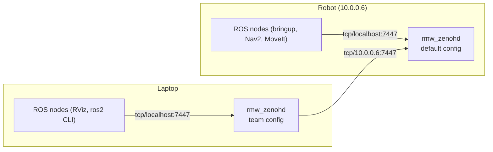

# Middleware (Zenoh)

Walkie uses the Zenoh middleware (`rmw_zenoh_cpp`) instead of the default DDS
middleware. This page shows how to turn it on, run the Zenoh router, and
connect a laptop to the robot.

## Zenoh is on in every pixi command { #turn-on-zenoh-in-every-terminal }

`pixi run` and `pixi shell` set `RMW_IMPLEMENTATION=rmw_zenoh_cpp`. You do not
need to export it. To talk to the robot, export the team domain in every
terminal that runs ROS nodes:

```bash
export ROS_DOMAIN_ID=23
```

- Every node needs a running Zenoh router. See [Start the router](#start-the-router).
- `pixi.toml` installs `ros-jazzy-rmw-zenoh-cpp` (`>=0.2.11,<0.3`; the lock
  has 0.2.11) and sets `RMW_IMPLEMENTATION` in `[activation.env]`.
- The pixi value replaces a value that you export in your terminal. To use
  another middleware for one command, set it inside the pixi environment:
  `pixi run env RMW_IMPLEMENTATION=rmw_fastrtps_cpp <command>`.
- Commands that run outside pixi do not get the variable. Without it, ROS 2
  Jazzy uses its default DDS middleware (`rmw_fastrtps_cpp`).
- All processes that must talk to each other need the same middleware and the
  same `ROS_DOMAIN_ID`. A node that uses DDS cannot see a node that uses Zenoh.
- `docker/compose.physical.yml` and `docker/compose.simulation.yml` also
  set `RMW_IMPLEMENTATION=rmw_zenoh_cpp` for the containers. See
  [Docker Images](docker.md).

??? info "How pixi sets RMW_IMPLEMENTATION"
    `pixi.toml` sets the variable in `[activation.env]`. Pixi applies it after
    the activation script (`install/setup.bash`) and after the variables of
    your terminal, so it always wins. A task that sets the variable in its own
    `env` table would win over it. Checked with pixi 0.80.0 on 2026-10-19:

    | Command | `RMW_IMPLEMENTATION` in the command |
    | --- | --- |
    | `pixi run printenv RMW_IMPLEMENTATION` | `rmw_zenoh_cpp` |
    | `RMW_IMPLEMENTATION=rmw_fastrtps_cpp pixi run printenv RMW_IMPLEMENTATION` | `rmw_zenoh_cpp` |
    | `pixi run env RMW_IMPLEMENTATION=rmw_fastrtps_cpp printenv RMW_IMPLEMENTATION` | `rmw_fastrtps_cpp` |
    | `export RMW_IMPLEMENTATION=rmw_fastrtps_cpp` inside `pixi shell`, then a command | `rmw_fastrtps_cpp` |
    | `pixi run -e docs printenv RMW_IMPLEMENTATION` | `rmw_zenoh_cpp` (set by the `docs` feature; the environment has no ROS) |

    An `export RMW_IMPLEMENTATION=...` line in your shell profile therefore has
    no effect on `pixi run`. It still applies to other ROS workspaces.

??? info "Why Zenoh instead of DDS"
    With DDS, ROS 2 nodes find each other with multicast messages on the local
    network. Many Wi-Fi networks block or drop multicast, so discovery between
    a laptop and the robot is often unreliable.

    `rmw_zenoh_cpp` works differently:

    - Each machine runs one Zenoh router (`rmw_zenohd`).
    - Every node connects to the router on its own machine over TCP. The
      router tells the nodes about each other.
    - Routers on different machines connect to each other over TCP, to an
      address that you write in a config file.

    Multicast discovery is turned off in both default config files that ship
    with `rmw_zenoh_cpp` (`scouting.multicast.enabled: false`). Nothing is
    found automatically. Every connection between machines is configured on
    purpose.

??? info "Why rmw_zenoh_cpp 0.2.11 or newer"
    0.2.10 has a lost-wakeup bug: an executor can stall until another event
    arrives, and a process without timers can stall indefinitely. 0.2.11
    fixes it. Both versions use zenoh-c 1.9.0. The message type hashes are
    the same in RoboStack build sets `_21` and `_25` and in apt Jazzy.

    With 0.2.11, a local `rmw_zenohd` starts and relays messages.
    Communication across machines, through the team router or with computers
    on apt Jazzy, has not been tested with it yet. See
    [4. Move to RoboStack Build Set _25](../migrations/04-robostack-build-25.md).

## Start the router

Run exactly one router on each machine. Start it before the other nodes, and
leave it running:

```bash
pixi run ros2 run rmw_zenoh_cpp rmw_zenohd
```

If a node starts and no router is running, it logs this message:

```text
Unable to connect to a Zenoh router. Have you started a router with `ros2 run rmw_zenoh_cpp rmw_zenohd`?
```

The node keeps running, but it cannot discover other nodes until a router
starts. Start the router and the node connects to it.

??? info "Why exactly one router per machine"
    The reasons come from the default config files in
    `.pixi/envs/default/share/rmw_zenoh_cpp/config/`:

    | Config | Setting | Effect |
    | --- | --- | --- |
    | `DEFAULT_RMW_ZENOH_SESSION_CONFIG.json5` (used by every node) | `connect.endpoints: ["tcp/localhost:7447"]` | Each node connects to the router on its own machine, port 7447 |
    | `DEFAULT_RMW_ZENOH_SESSION_CONFIG.json5` | `listen.endpoints: ["tcp/localhost:0"]` | Nodes only accept connections from their own machine |
    | `DEFAULT_RMW_ZENOH_ROUTER_CONFIG.json5` (used by `rmw_zenohd`) | `listen.endpoints: ["tcp/[::]:7447"]` | The router accepts connections on port 7447 on all network interfaces |

    Because all nodes look for the router on port 7447, a second router on the
    same machine has no purpose: it would try to listen on the same port.
    Because nodes only listen on `localhost`, all traffic between machines goes
    through the two routers.

## Simulation on one machine

For Gazebo or MuJoCo on one computer, the default router is enough. You do not
need the team config.

```bash
# Terminal 1
pixi run ros2 run rmw_zenoh_cpp rmw_zenohd
```

```bash
# Terminal 2
pixi run ros2 launch robot_simulation gzsim_omnibot.launch.py
```

- `ROS_DOMAIN_ID` can stay unset on one computer, as long as every terminal
  uses the same value. Set it to `23` when you also want to talk to the robot.
- To add Nav2, see [Run Gazebo with Nav2](simulation-gazebo.md#gazebo-with-nav2).
- To run without a router, use DDS for every command:
  `pixi run env RMW_IMPLEMENTATION=rmw_fastrtps_cpp ros2 launch ...`. This also
  works on one machine, but it is not the setup used on the robot.

`scripts/bringup/sim_nav_gazebo.sh` and `scripts/bringup/isaac_sim_bringup.sh`
start a router when none is running. Read [Known issues](#known-issues) before
you use either script.

??? info "How `sim_nav_gazebo.sh` starts a router"
    `scripts/bringup/sim_nav_gazebo.sh` checks for a running router with
    `pgrep -x rmw_zenohd` (`-x` matches the exact process name). If none is
    running, it starts `ros2 run rmw_zenoh_cpp rmw_zenohd` in the background
    and discards its output. Then it launches `nav_sim_omnibot.launch.py`.
    `scripts/bringup/isaac_sim_bringup.sh` uses the same check.

## Connect a laptop to the robot



On the robot, the tmux layouts in `.tmuxp.yaml` and `scripts/tmux_walkie.sh`
start the router with the default config in the first pane.

??? info "Why the robot router uses the default config"
    The tmux layouts type `ros2 run rmw_zenoh_cpp rmw_zenohd` into the first
    pane. Nothing in the repository sets `ZENOH_ROUTER_CONFIG_URI` there, so
    that router uses the default config. The default config listens on port
    7447, so the laptop's router can connect to it.

On the laptop:

1. Join the same network as the robot. Check that the robot answers at the
   address in the config (`10.0.0.6`).
2. In the first terminal, start the router with the team config (see
   [The connect script](#the-connect-script)):

    ```bash
    pixi run bash scripts/bringup/connect_walkie_zenoh_router.sh
    ```

3. In a second terminal, set the same domain as the robot, then list the
   robot's topics. Pixi already selects Zenoh.

    ```bash
    export ROS_DOMAIN_ID=23
    pixi run ros2 topic list
    ```

If the robot has a different address, do not edit the team file
(`scripts/bringup/WALKIE_RMW_ZENOH_ROUTER_CONFIG.json5`) for a one-off test.
Copy it, change `connect.endpoints` in the copy, and point
`ZENOH_ROUTER_CONFIG_URI` at the copy before you run `rmw_zenohd`.

!!! warning "Bandwidth"
    All data between the laptop and the robot goes through one TCP connection
    between the two routers. Subscribing to camera images or point clouds from
    the laptop over Wi-Fi can use a lot of bandwidth and slow down other
    topics.

## The connect script

`scripts/bringup/connect_walkie_zenoh_router.sh` starts a router with the team
config. Run it from the repository root:

```bash
pixi run bash scripts/bringup/connect_walkie_zenoh_router.sh
```

- `pixi run` is needed because the script calls `ros2` without sourcing any
  ROS setup file.
- `bash` is needed because the script has no working `#!` line. See
  [Known issues](#known-issues).
- The router never gives up, so you can start it before the robot is on. It
  connects when the robot's router becomes reachable.

!!! note
    The exports in the script only apply to the router process. Your other
    terminals still need `ROS_DOMAIN_ID=23`. Pixi sets `RMW_IMPLEMENTATION`
    for them.

??? info "What the script does"
    1. Exports `RMW_IMPLEMENTATION=rmw_zenoh_cpp` and `ROS_DOMAIN_ID=23`.
    2. Exports `ZENOH_ROUTER_CONFIG_URI` with the path of
       `WALKIE_RMW_ZENOH_ROUTER_CONFIG.json5` (next to the script).
       `rmw_zenohd` reads its config from this variable.
    3. Runs `ros2 run rmw_zenoh_cpp rmw_zenohd`.

??? info "Team router config settings"
    `scripts/bringup/WALKIE_RMW_ZENOH_ROUTER_CONFIG.json5` is a copy of
    `DEFAULT_RMW_ZENOH_ROUTER_CONFIG.json5` with one change: it adds a connect
    endpoint for the robot. The important settings are:

    | Setting | Value | Meaning |
    | --- | --- | --- |
    | `mode` | `"router"` | This config is for `rmw_zenohd` |
    | `connect.endpoints` | `["tcp/10.0.0.6:7447"]` | Connect to the router on the robot. The file marks this line as `// WALKIE IP`. |
    | `listen.endpoints` | `["tcp/[::]:7447"]` | Accept connections on port 7447 on all interfaces |
    | `connect.timeout_ms.router` | `-1` | Keep trying to connect forever |
    | `connect.exit_on_failure.router` | `false` | Do not exit when the robot cannot be reached |
    | `connect.retry` | `1000` ms, doubling up to `4000` ms | Time between connection attempts |
    | `scouting.multicast.enabled` | `false` | No automatic discovery on the network |

## ROS_DOMAIN_ID

The team uses domain `23`. If `ROS_DOMAIN_ID` is not set, ROS uses domain `0`.
Nodes with different values do not see each other, even through the same
router, because `rmw_zenoh_cpp` uses the domain ID in the names of its data.

The repository does not show what the robot's shell profile sets. Check it on
the robot and use the same value on the laptop:

```bash
echo $ROS_DOMAIN_ID
```

??? info "Which files set ROS_DOMAIN_ID"
    | File | Value |
    | --- | --- |
    | `scripts/bringup/connect_walkie_zenoh_router.sh` | Sets `ROS_DOMAIN_ID=23` |
    | `docker/compose.physical.yml` | Sets `ROS_DOMAIN_ID=23` |
    | `scripts/map/record_mapping_bag.sh` | Uses `23` if `ROS_DOMAIN_ID` is not set |

    Pixi, `docker/compose.simulation.yml`, `.tmuxp.yaml`, and
    `scripts/tmux_walkie.sh` do not set it.

## Known issues

| Issue | Effect | Workaround |
| --- | --- | --- |
| `connect_walkie_zenoh_router.sh` has its `#!/usr/bin/env bash` line on line 4, not line 1 | Started as `./connect_walkie_zenoh_router.sh` from a shell other than bash, it prints `Bad substitution` and uses the wrong config path | Run `pixi run bash scripts/bringup/connect_walkie_zenoh_router.sh` |
| `sim_nav_gazebo.sh` and `isaac_sim_bringup.sh` do not set `RMW_IMPLEMENTATION` | Started outside pixi, the nodes use DDS and ignore the router that the script starts. Under `pixi run`, they get Zenoh from pixi. | Run the launch command directly with `pixi run` |
| The same scripts start the router in the background and never stop it | The router keeps running after the launch ends | Stop it with `pkill -x rmw_zenohd` |
| The same scripts source `/opt/ros/$ROS_DISTRO/setup.bash` when it exists | On a computer with a system ROS 2 Jazzy, the system and pixi installations are mixed | See [A helper script mixes in the system ROS](../troubleshooting.md#a-helper-script-mixes-in-the-system-ros) |

??? info "Why the connect script breaks without bash"
    The system ignores a `#!` line that is not on line 1. Started as
    `./connect_walkie_zenoh_router.sh` from a shell other than bash, the script
    runs under `sh`. `sh` prints `Bad substitution` because `BASH_SOURCE` is
    bash-only, and `ZENOH_ROUTER_CONFIG_URI` then points at the current
    directory instead of the script's directory.

## Troubleshooting

For the general case, see
[Nodes cannot see each other](../troubleshooting.md#nodes-cannot-see-each-other).

| Symptom | Cause | Fix |
| --- | --- | --- |
| A node logs `Unable to connect to a Zenoh router` | No router runs on this machine | Start `pixi run ros2 run rmw_zenoh_cpp rmw_zenohd` |
| `ros2 topic list` on the laptop shows only `/parameter_events` and `/rosout` | Different `ROS_DOMAIN_ID` than the robot, a command that ran outside pixi (DDS), or the laptop router uses the default config | Export `ROS_DOMAIN_ID=23` and run the command with `pixi run`. Start the router with `connect_walkie_zenoh_router.sh`. |
| `connect_walkie_zenoh_router.sh` prints `Bad substitution` or cannot find `ros2` | The script ran without bash or without pixi | Run `pixi run bash scripts/bringup/connect_walkie_zenoh_router.sh` |
| Topics from the simulation appear on another computer on the network | Both use DDS (commands outside pixi, or a DDS override) with the same domain ID, and DDS found the other machine by multicast | Run the commands with `pixi run` so they use Zenoh, or set a different `ROS_DOMAIN_ID` |
