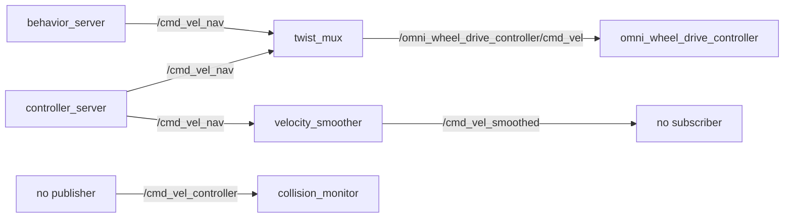

# Navigation

Walkie navigates with Nav2: AMCL on a saved map for localization, SLAM Toolbox
for mapping, and the MPPI controller for an omnidirectional base. This page
covers the `robot_navigation` package, its launch files and configs, the maps,
and the sensor pipeline that feeds the costmaps.

## Where things live

| Path | Contents |
| --- | --- |
| `navigation/` | Git submodule (`EIC-Robocup-2026/navigation`) |
| `navigation/navigation2/` | Nav2 source, a nested submodule pinned to an upstream `main` commit |
| `navigation/spatio_temporal_voxel_layer/` | Spatio-Temporal Voxel Layer (STVL) costmap plugin and `openvdb_vendor` |
| `navigation/walkie-navigation/` | The `robot_navigation` package |
| `navigation/walkie-navigation/launch/` | Navigation launch files |
| `navigation/walkie-navigation/config/nav2/` | Nav2 parameter files and behavior trees |
| `navigation/walkie-navigation/config/slam/` | SLAM Toolbox parameters |
| `navigation/walkie-navigation/config/walkie_nav.yaml` | `nav_commander` parameters |
| `navigation/walkie-navigation/map/` | Saved maps, a nested submodule (`EIC-Robocup-2026/map-collection`) |
| `navigation/walkie-navigation/robot_navigation/` | Nodes and behavior tree plugins |
| `hardware/lidar/dual_laser_merger/` | Merges the two 2D lidars into `/scan` |
| `hardware/lidar/robot_self_filter/` | Removes the robot's own body from point clouds |
| `bringup/launch/dual_lidar_hokuyo_lakibeam.launch.py` | Real lidar drivers and the merger |
| `bringup/launch/octomap_3d_mapping.launch.py` | 3D OctoMap built next to the 2D SLAM map |
| `scripts/map/` | Mapping rosbag recorder and replay helper |

`navigation/` and the map collection are submodules. Clone with
`--recurse-submodules`, or run `git submodule update --init --recursive` after
cloning.

## Why Nav2 is built from source

`pixi.toml` does not install the Nav2 stack. It is built from
`navigation/navigation2/` (`nav2_bringup` version 1.5.0). The custom behavior
tree plugins in `robot_navigation` need this build: their `CMakeLists.txt`
requires `nav2_ros_common`, which the Jazzy release of Nav2 does not have.

Consequences:

- The first `pixi run build` compiles all of Nav2, so it takes a long time.
- Nav2 behaves like upstream `main`, not like the Jazzy release. Check the
  source in `navigation/navigation2/` when the Jazzy documentation and the
  behavior disagree.
- Nav2 publishes velocity commands as `geometry_msgs/msg/TwistStamped`
  (`enable_stamped_cmd_vel` defaults to `true`). `twist_mux` and the wheel
  controller expect stamped messages too.

## Launch files

| Launch file | Package | Purpose |
| --- | --- | --- |
| `localization_Nav2_sim.launch.py` | `robot_navigation` | Nav2 with AMCL on a saved map, for Gazebo |
| `localization_Nav2_real.launch.py` | `robot_navigation` | Nav2 with AMCL on a saved map, plus keepout zones, for the real robot |
| `mapping_Nav2_real.launch.py` | `robot_navigation` | SLAM Toolbox mapping plus Nav2, for the real robot |
| `slam_toolbox.launch.py` | `robot_navigation` | SLAM Toolbox only. Does not load the Walkie parameters (see [Known issues](#known-issues)). |
| `nav2_loopback.launch.py` | `robot_navigation` | Nav2 with the loopback simulator, no physics |
| `slam_cartographer.launch.py` | `robot_navigation` | Cartographer. Does not run (see [Known issues](#known-issues)). |
| `nav_sim_omnibot.launch.py` | `robot_bringup` | Gazebo plus `localization_Nav2_sim.launch.py`. See [Gazebo Simulation](simulation-gazebo.md). |
| `dual_lidar_hokuyo_lakibeam.launch.py` | `robot_bringup` | Real lidar drivers and merger. Started by `real_omnibot.launch.py`. |
| `octomap_3d_mapping.launch.py` | `robot_bringup` | 3D OctoMap during mapping |

### `localization_Nav2_sim.launch.py`

Includes `nav2_bringup`'s `bringup_launch.py` (map server, AMCL, and the Nav2
servers) and starts `nav_commander`.

| Argument | Default |
| --- | --- |
| `use_sim_time` | `true` |
| `map` | `<robot_navigation share>/map/8_23102025_SimWalkie_awssmallhouse_slam_toolbox/map.yaml` (missing, see [The simulation map](#the-simulation-map)) |
| `nav2_config` | `<robot_navigation share>/config/nav2/nav2_mppi_walkie_sim_params.yaml` |
| `nav_debug` | `false` |

### `localization_Nav2_real.launch.py`

Includes `nav2_bringup`'s `localization_launch.py` (map server and AMCL) and
`navigation_launch.py` (the Nav2 servers). It also starts:

- `head_tilt_near_goal_node.py`, which tilts the ZED head down near the goal
  so tabletops stay in view
- `nav_commander`
- a keepout mask server, a costmap filter info server, and their lifecycle
  manager, when `use_keepout_zones` is `true`

| Argument | Default |
| --- | --- |
| `use_sim_time` | `false` |
| `map` | `<robot_navigation share>/map/27_01072026_Arena/map.yaml` |
| `nav2_config` | `<robot_navigation share>/config/nav2/nav2_mppi_walkie_real_param.yaml` |
| `nav_debug` | `false` |
| `use_keepout_zones` | `true` |
| `keepout_mask` | `<robot_navigation share>/map/27_01072026_Arena/keepout.yaml` |

### `mapping_Nav2_real.launch.py`

Includes SLAM Toolbox's `online_sync_launch.py` with
`config/slam/slam_toolbox_params.yaml`, and `navigation_launch.py`. It also
starts `head_tilt_near_goal_node.py` and `nav_commander`. There is no AMCL and
no map server: SLAM Toolbox publishes `/map` and the `map` to `odom` transform.

| Argument | Default |
| --- | --- |
| `use_sim_time` | `false` |
| `nav2_config` | `<robot_navigation share>/config/nav2/nav2_mppi_walkie_real_restaurant_param.yaml` |
| `nav_debug` | `false` |

### `nav2_loopback.launch.py`

Runs Nav2 with `nav2_loopback_sim`, which moves the robot exactly as commanded
and needs no physics or sensors. It is useful for testing behavior trees and
goal logic quickly. It uses `ros2_control:=mock` for the robot model and
`nav2_mppi_walkie_loopback_params.yaml`, which uses plain `Twist` everywhere.

| Argument | Default |
| --- | --- |
| `map` | `<robot_navigation share>/map/8_23102025_SimWalkie_awssmallhouse_slam_toolbox/map.yaml` (missing, see [The simulation map](#the-simulation-map)) |
| `nav2_config` | `<robot_navigation share>/config/nav2/nav2_mppi_walkie_loopback_params.yaml` |
| `use_rviz` | `true` (uses `nav2_bringup`'s `nav2_default_view.rviz`) |
| `nav_debug` | `false` |

`nav_commander` is commented out in this file, so `/navigate_to_object` is not
available in loopback mode.

## Nav2 configuration

| File in `config/nav2/` | Used by |
| --- | --- |
| `nav2_mppi_walkie_sim_params.yaml` | `localization_Nav2_sim.launch.py` |
| `nav2_mppi_walkie_real_param.yaml` | `localization_Nav2_real.launch.py` |
| `nav2_mppi_walkie_real_restaurant_param.yaml` | `mapping_Nav2_real.launch.py` |
| `nav2_mppi_walkie_loopback_params.yaml` | `nav2_loopback.launch.py` |
| `nav2_mppi_walkie_real_param_hero_10_04_26.yaml`, `nav2_RPP_*.yaml` | No launch file |

To try a different file, pass it with `nav2_config:=<full path>`.

Main settings shared by the simulation and real files:

| Component | Setting |
| --- | --- |
| AMCL | `nav2_amcl::OmniMotionModel`. `set_initial_pose: true` at (0, 0, 0). |
| Controller | MPPI with `motion_model: "Omni"`. `vx_max` and `vy_max` 0.3 m/s, `wz_max` 1.5 rad/s. |
| Footprint | Polygon about 0.6 m long and 0.48 m wide |
| Behavior tree | `default_nav_to_pose_bt_xml` is `behavior_tree/nav_to_pose_real_recovery_bt.xml` |
| BT plugins | `compute_goal_heading_spin_bt_node`, `compute_goal_bearing_spin_bt_node`, `compute_path_heading_spin_bt_node` (built from `robot_navigation`) |

| Costmap | Simulation (`nav2_mppi_walkie_sim_params.yaml`) | Real robot (`nav2_mppi_walkie_real_param.yaml`) |
| --- | --- | --- |
| Local | Layers `voxel_layer` (`/scan`), `inflation_layer` | Layers `voxel_layer` (`/scan`), `stvl_layer`, `inflation_layer`. Filter `keepout_filter`. |
| Global | Layers `static_layer`, `obstacle_layer` (`/scan`), `inflation_layer` | Layers `static_layer`, `obstacle_layer` (`/scan`), `inflation_layer`. Filter `keepout_filter`. |

The launch files pass a `default_nav_to_pose_bt_xml` launch argument, but the
included Nav2 launch files do not declare it, so it has no effect. The value in
the parameter file is the one Nav2 uses.

### Velocity command path



`twist_mux` gives `/cmd_vel_nav` priority 10. Joystick and keyboard topics
(priority 100) override Nav2. See
[Gazebo Simulation](simulation-gazebo.md#driving-the-robot).

!!! warning
    The collision monitor and the velocity smoother are bypassed. See [Known issues](#known-issues).

## Maps

Maps are in `navigation/walkie-navigation/map/`. Directory names follow
`<number>_<DDMMYYYY>_<place>`.

| Directory | Keepout mask | Other files |
| --- | --- | --- |
| `19_25062026_AirBnbHouse_1` | | |
| `20_27062026_AirBnbHouse_2` | | |
| `21_27062026_AirBnbHouse_3` | `map_keepout.yaml` | Map editor files |
| `22_27062026_AirBnbHouse_4` | `map_keepout.yaml` | Map editor files |
| `23_29062026_AirBnbHouse2_1` | | `map.ot` (OctoMap) |
| `24_30062026_Arena2_1` | | `map.ot` |
| `25_30062026_Arena2_2` | `keepout.yaml` | Map editor files |
| `26_01072026_Arena2_3` | | `map.ot` |
| `27_01072026_Arena` | `keepout.yaml` | Map editor files. Default for the real robot. |

Each directory has `map.yaml` and `map.pgm`. The keepout mask file name is not
the same in every directory, so pass it explicitly.

### Choosing a map on the real robot

Pass the map and its keepout mask together. Run from the repository root so
`$PWD` is correct:

```bash
MAP_DIR=$PWD/navigation/walkie-navigation/map/22_27062026_AirBnbHouse_4
pixi run ros2 launch robot_navigation localization_Nav2_real.launch.py \
  map:=$MAP_DIR/map.yaml keepout_mask:=$MAP_DIR/map_keepout.yaml
```

For a map without a keepout mask, turn the keepout servers off:

```bash
MAP_DIR=$PWD/navigation/walkie-navigation/map/20_27062026_AirBnbHouse_2
pixi run ros2 launch robot_navigation localization_Nav2_real.launch.py \
  map:=$MAP_DIR/map.yaml use_keepout_zones:=false
```

If you change only `map`, the Arena keepout mask stays active on a different
map.

### The simulation map

`localization_Nav2_sim.launch.py` and `nav2_loopback.launch.py` default to
`8_23102025_SimWalkie_awssmallhouse_slam_toolbox`.

!!! warning
    That directory is missing at the pinned map commit. See [Known issues](#known-issues).

Extract the map from the map submodule history and pass it with `map:=`:

```bash
mkdir -p /tmp/sim_map
SRC=94d86cc~1:8_23102025_SimWalkie_awssmallhouse_slam_toolbox
git -C navigation/walkie-navigation/map show $SRC/map.yaml > /tmp/sim_map/map.yaml
git -C navigation/walkie-navigation/map show $SRC/map.pgm > /tmp/sim_map/map.pgm
pixi run ros2 launch robot_bringup nav_sim_omnibot.launch.py map:=/tmp/sim_map/map.yaml
```

`git show <commit>:<path>` prints a file as it was in that commit. `94d86cc~1`
is the commit before the one that removed the directory. The `map` argument
reaches `localization_Nav2_sim.launch.py` because ROS 2 launch arguments are
global.

## Localization and mapping in simulation

### Localization

```bash
pixi run ros2 launch robot_bringup nav_sim_omnibot.launch.py map:=/tmp/sim_map/map.yaml
```

AMCL starts at (0, 0, 0) in the map frame. If the laser scan in RViz does not
line up with the map, set the pose with the **2D Pose Estimate** tool. Then
send a goal with the **Nav2 Goal** tool.

### Mapping in simulation

There is no simulation mapping launch file. Start Gazebo, then SLAM Toolbox
with the Walkie parameters:

```bash
# Terminal 1
pixi run ros2 launch robot_simulation gzsim_omnibot.launch.py
```

```bash
# Terminal 2
pixi run ros2 launch slam_toolbox online_sync_launch.py use_sim_time:=true \
  slam_params_file:=$PWD/navigation/walkie-navigation/config/slam/slam_toolbox_params.yaml
```

Drive the robot around (see
[Gazebo Simulation](simulation-gazebo.md#driving-the-robot)), then save the map:

```bash
pixi run ros2 run nav2_map_server map_saver_cli -f /tmp/my_map/map
```

`map_saver_cli` writes `map.yaml` and `map.pgm` with the given prefix.

## Localization and mapping on the real robot

Start the robot first with `real_omnibot.launch.py`. It starts the lidars and
the wheel controller. See [Real Robot](real-robot.md).

| Task | Command |
| --- | --- |
| Localize on a saved map | `pixi run ros2 launch robot_navigation localization_Nav2_real.launch.py` |
| Build a new map | `pixi run ros2 launch robot_navigation mapping_Nav2_real.launch.py` |
| Save the map while mapping | `pixi run ros2 run nav2_map_server map_saver_cli -f <map_dir>/map` |

Nav2 runs during mapping too, so you can send goals while the map grows.

To rebuild maps after a run without driving again, record a rosbag during
mapping. The steps are in the
[mapping rosbag guide](https://github.com/EIC-Robocup-2026/walkie-ros/blob/main/scripts/map/README.md).

Use the launch files above, not `scripts/bringup/real_slam_nav.sh`. See
[Known issues](#known-issues).

## Sensors for navigation

### Dual 2D lidar

The real robot has two 2D lidars. `dual_lidar_hokuyo_lakibeam.launch.py`
starts both drivers and merges them. The settings are in
`bringup/config/lidar/dual_lidar_config.yml`.

| Lidar | Position | Driver | Address | Frame | Topic | Field of view |
| --- | --- | --- | --- | --- | --- | --- |
| Hokuyo | Front | `urg_node2` | `10.0.0.101:10940` | `front_lidar_link` | `/front_lidar` | ±2.093 rad (±120°) |
| Lakibeam | Rear | `lakibeam1_scan_node` | Sensor `10.0.0.102`, host `10.0.0.201`, port 2368 | `back_lidar_link` | `/back_lidar` | `scan_range_start: 60`, `scan_range_stop: 300`, `scanfreq: 30` |

`dual_laser_merger` (`merger_node::MergerNode`) combines the two scans into one
360° scan in `merged_lidar_link`, with ranges from 0.3 to 25 m. Its output is
remapped to `/scan`, which AMCL, SLAM Toolbox, and the costmaps use.

The merger pairs messages by time (approximate time synchronization). It
publishes only when both lidars deliver data. If one lidar stops, `/scan`
stops too.

### Robot self filter

The depth cameras and the 3D lidar see parts of the robot, such as the arms.
`robot_self_filter` removes points that fall inside the robot's collision
geometry from the URDF. `real_omnibot.launch.py` runs up to three instances:

| Input | Output | Config | Runs when |
| --- | --- | --- | --- |
| `/unilidar/cloud` | `/unilidar/cloud/filtered` | `bringup/config/lidar/unitree_self_filter.yaml` | `use_unitree_lidar:=true` (default) |
| `/camera/camera/depth/color/points` | `/camera/camera/depth/color/points/filtered` | `bringup/config/camera/d415_bottom_self_filter.yaml` | Always |
| `/zed_head/zed_node/point_cloud/cloud_registered` | `/zed_head/zed_node/point_cloud/cloud_registered/filtered` | `bringup/config/camera/zed2i_self_filter.yaml` | `use_zed:=true` (default) |

### Spatio-Temporal Voxel Layer

The real local costmap uses STVL (`stvl_layer`) to mark obstacles in 3D from
the filtered clouds. STVL stores voxels with a time stamp and removes them after
`voxel_decay` seconds, so moving people do not stay in the costmap.

| Setting | Value |
| --- | --- |
| `voxel_size` | 0.05 m |
| `voxel_decay` | 1.0 s |
| `decay_model` | `0` (linear) |
| Sources | `/unilidar/cloud/filtered` (0.2 to 1.5 m high), ZED filtered cloud (0.1 to 1.5 m), RealSense filtered cloud (0.1 to 1.5 m) |

Tabletops are above the 2D lidar, so only the cameras and the 3D lidar see
them. `head_tilt_near_goal_node.py` tilts the head down near the goal so the
ZED keeps marking the table edge.

The simulation config does not use STVL. It has a `voxel_layer` fed by `/scan`
only.

### 3D OctoMap

`octomap_3d_mapping.launch.py` builds a 3D OctoMap in the `map` frame while
SLAM Toolbox runs. It projects the occupied space to a 2D grid on
`/projected_map`. That projection shows the full footprint of furniture, which
helps when drawing keepout zones. `scripts/save_octomap_for_editor.py` (with
the required `--map-dir` argument) saves both maps on the same grid for the map
editor.

| Argument | Default |
| --- | --- |
| `resolution` | `0.02` |
| `max_range` | `6.0` |
| `use_zed` | `true` |
| `use_realsense` | `true` |
| `use_unitree` | `false` |
| `use_sim_time` | `false` |

!!! warning
    This launch file does not start under pixi. See [Known issues](#known-issues).

## Goal interfaces

### `/navigate_to_object` action

`nav_commander.py` turns an object position into a Nav2 goal in front of the
object. It finds the table edge in the local costmap and drives to a pose that
faces the edge. The localization and mapping launch files start it (except the
loopback one).

| Field | Type | Meaning |
| --- | --- | --- |
| `obj_x`, `obj_y` | `float64` | Object position in the `map` frame |
| `align_method` | `string` | Empty uses `default_method` (`nearest_edge`) |
| `standoff` | `float64` | 0 or less uses the `standoff` parameter (0.1 m) |
| Result `success`, `message` | `bool`, `string` | |
| Feedback `distance_remaining`, `x`, `y`, `theta` | `float32` | |

```bash
pixi run ros2 action send_goal /navigate_to_object robot_navigation/action/NavigateToObject \
  "{obj_x: 1.0, obj_y: -3.0, align_method: '', standoff: 0.0}" --feedback
```

You can also use the **Publish Point** tool in RViz. `nav_commander` listens on
`/clicked_point` and runs the same pipeline. Its parameters are in
`config/walkie_nav.yaml`. Set `nav_debug:=true` on the launch file to publish
debug markers. More detail is in `navigation/walkie-navigation/README.md`.

### `/move_robot` service

`Sgoal_Service_node` offers a simpler goal service. No launch file starts it.

```bash
pixi run ros2 run robot_navigation Sgoal_Service_node
```

```bash
pixi run ros2 service call /move_robot robot_navigation/srv/MoveRobot \
  "{x: 2.0, y: 1.0, theta: 0.0}"
```

The request fields `x`, `y`, and `theta` are `float32`. The response has
`success` (`bool`) and `message` (`string`).

The node reads `/global_costmap/costmap`. A goal cell counts as free when its
cost is below 50 and not unknown. If the goal is blocked, the node searches up
to 2.0 m around it for a free cell and turns the robot to face the original
goal. Then it sends a `navigate_to_pose` goal and returns without waiting for
the result.

`success: true` means the goal was sent, not that the robot arrived. The node
also returns `true` when the Nav2 action server is offline; it only logs an
error in that case.

### Other nodes in `robot_navigation`

| Executable | Started by | Purpose |
| --- | --- | --- |
| `current_pose_publisher.py` | `nav_sim_omnibot.launch.py`, `real_omnibot.launch.py` | Publishes the `map` to `base_footprint` transform on `current_pose` (`nav_msgs/msg/Odometry`) |
| `head_tilt_near_goal_node.py` | Real localization and mapping launches | Tilts the head down near the goal |
| `human_follower_node.py` | Nothing | Sends `/goal_pose` 1.2 m from the `detected_human` TF frame, every 0.5 s |
| `accel_stamp_node.py` | Nothing (commented out in the Isaac launch) | Velocity ramping and stamping |
| `pointcloud_self_filter_node.py` | Nothing | Older box-crop filter, replaced by `robot_self_filter` |
| `stvl_decay_manager_node.py` | Nothing | Older approach that froze STVL near the goal, replaced by head tilting |

## Known issues

| Issue | Effect | Workaround |
| --- | --- | --- |
| `localization_Nav2_sim.launch.py` and `nav2_loopback.launch.py` default to `8_23102025_SimWalkie_awssmallhouse_slam_toolbox`. The map commit pinned by the `navigation` submodule removed that directory. The map collection's `main` branch has it as `08_23102025_SimWalkie_awssmallhouse_slam_toolbox`, but the pin does not point there. | Nav2 in simulation and loopback cannot load its map | Extract the map and pass `map:=`, as shown in [The simulation map](#the-simulation-map) |
| The parameter files set `controller_server.cmd_vel_topic` to `/cmd_vel_controller` and connect `collision_monitor` from `/cmd_vel_controller` to `/cmd_vel_nav`. The pinned controller server does not read `cmd_vel_topic`. It publishes on `cmd_vel`, which `navigation_launch.py` remaps to `/cmd_vel_nav`. | Controller output goes straight to `twist_mux`. The collision monitor gets no input, so its stop and slow-down zones never act. The velocity smoother output, `/cmd_vel_smoothed`, has no subscriber. | None in the repository. The topic wiring in the parameter files needs a fix. |
| `slam_toolbox.launch.py` passes its parameter file as `params_file`, but `online_sync_launch.py` expects `slam_params_file` | SLAM Toolbox runs with its own default parameters and with `use_sim_time: true` | Run `online_sync_launch.py` with `slam_params_file:=`, as in [Mapping in simulation](#mapping-in-simulation) |
| `slam_cartographer.launch.py` needs `cartographer_ros`, which `pixi.toml` does not install | The launch fails | Use SLAM Toolbox |
| `octomap_3d_mapping.launch.py` needs `octomap_server` and `topic_tools`. Neither is in `pixi.toml`. | The launch fails with "package not found" under pixi | Add both packages to the environment |
| `scripts/bringup/real_slam_nav.sh` starts `localization_Nav2_stvl_real.launch.py`, which does not exist, and starts SLAM Toolbox (`online_async_launch.py`) in a second tab | The Nav2 tab fails. If it did start, AMCL and SLAM Toolbox would both publish the `map` to `odom` transform. | Use the launch files in [Localization and mapping on the real robot](#localization-and-mapping-on-the-real-robot) |
| `navigation/README.md` describes an older setup. It starts `localization_Nav2.launch.py` with a config under `./src/navigation/nav2/config/`. Neither exists. | Its commands fail | Use this page |

## Troubleshooting

| Symptom | Cause | Fix |
| --- | --- | --- |
| Keepout zones from the Arena appear on another map | Only `map` was changed | Also pass `keepout_mask:=` or `use_keepout_zones:=false` |
| `/scan` stops on the real robot | One of the two lidars stopped. The merger needs both. | Check both `/front_lidar` and `/back_lidar` |
| `/move_robot` returns success but the robot does not move | Nav2 is not running, or the goal failed later | Check the node log and the Nav2 logs |
