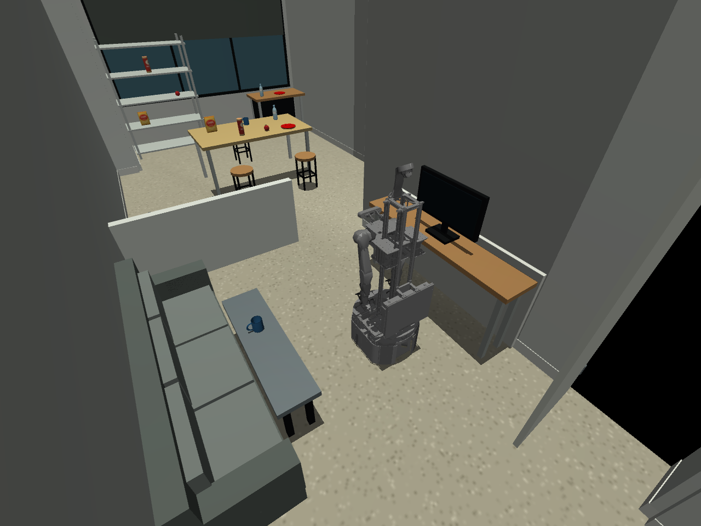
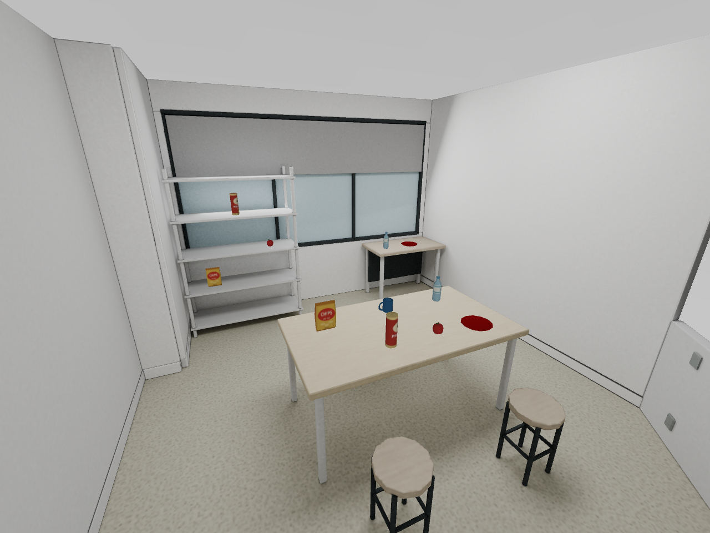
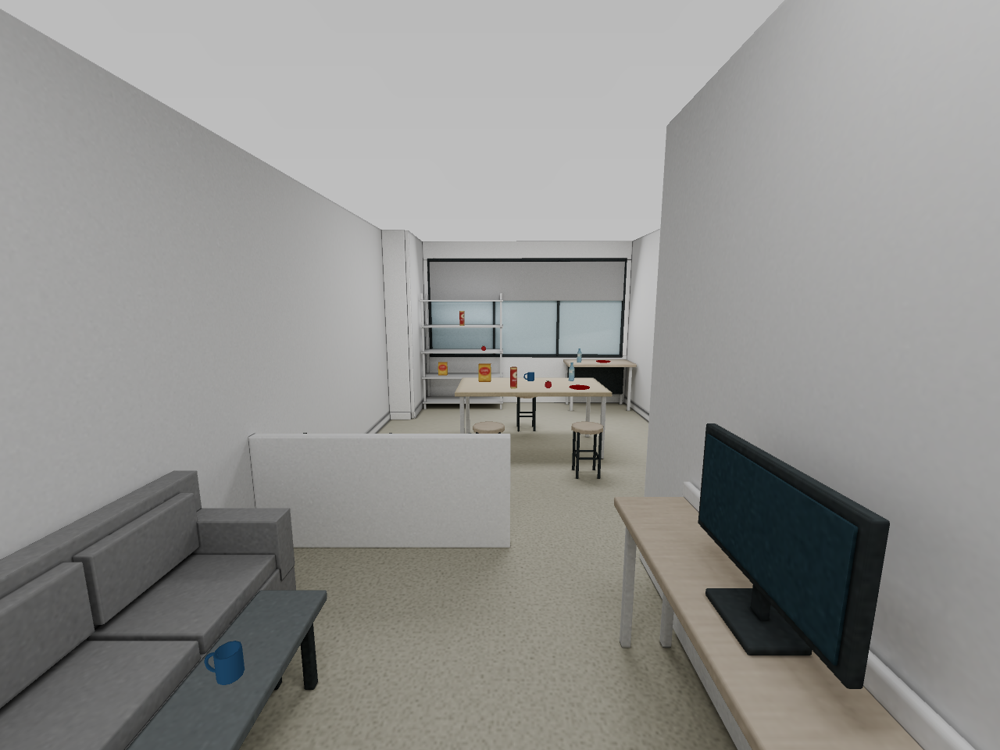
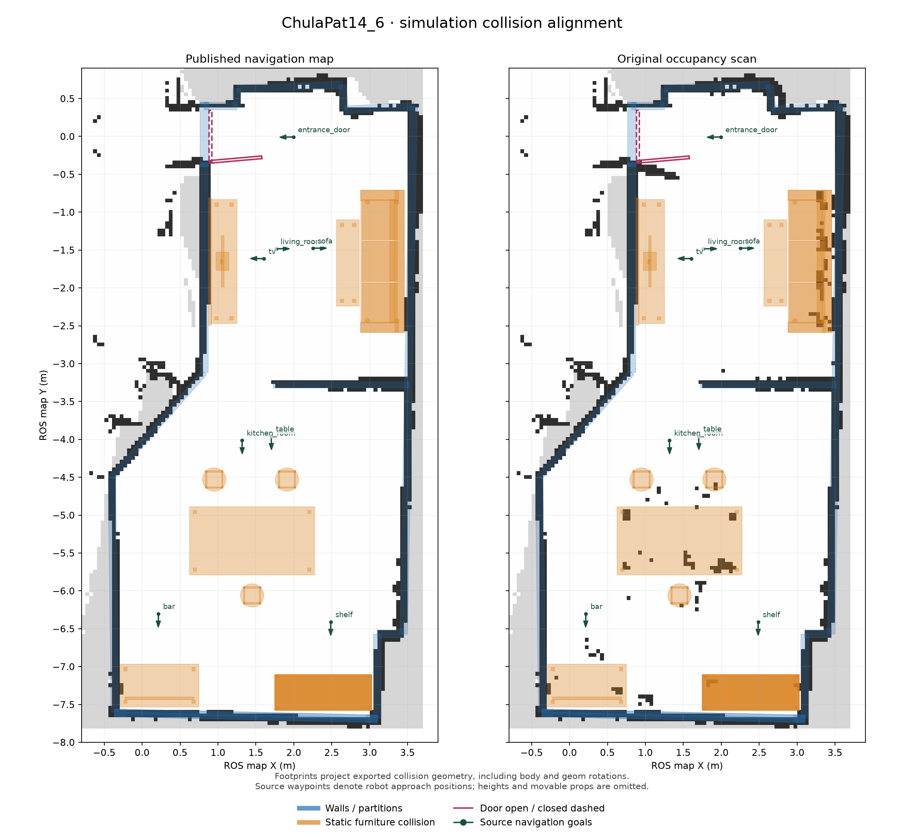
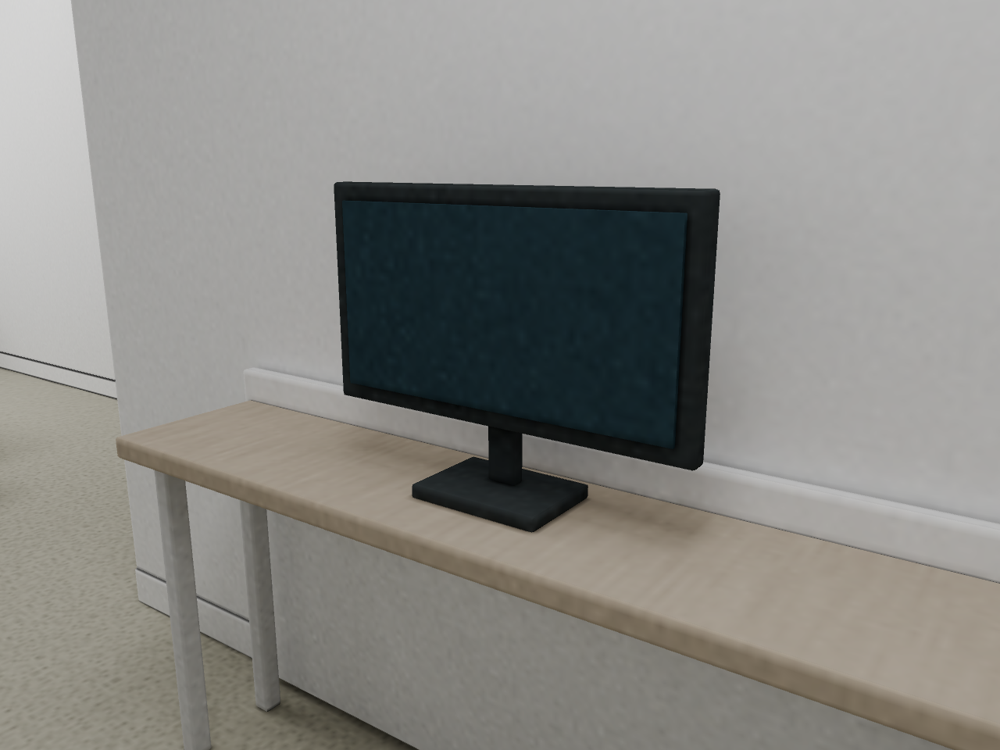

# Chula Pat14 Room Simulation

Run Walkie in the reconstructed living room and kitchen of Chula Pat14, with the captured
occupancy map, AMCL and Nav2. The room is the named world `chula_pat14_6` of the
`walkie_mujoco_worlds` package (`simulation/mujoco/`). The launch arguments are in
[MuJoCo Simulation: Launch arguments](simulation-mujoco.md#launch-arguments), and the
world format in [Add a named world](simulation-mujoco.md#add-a-named-world).



## Run with ROS 2 and AMCL

Build the workspace first with `pixi run build`, and again after pulling changes to
`robot_bringup` or `walkie_mujoco_worlds`. Run the commands from the repository root.
Reuse a Zenoh router that is already running.

```bash
# Terminal 1: Zenoh router
pixi run ros2 run rmw_zenoh_cpp rmw_zenohd
```

```bash
# Terminal 2: the room, Walkie, the controllers, RViz, AMCL and Nav2
pixi run ros2 launch robot_bringup nav_mujoco_omnibot.launch.py world:=chula_pat14_6
```

This loads the `lowpoly` variant, with Walkie at the `living-room` spawn facing the
kitchen. Running the room needs neither Blender nor the Blender add-on. Nav2 is ready when
the log shows `Managed nodes are active`, about 10 s after the start.

| Task | Command or argument |
| --- | --- |
| Use the baked-lighting variant, for camera and perception work | Add `variant:=baked` |
| Run the room, the controllers and RViz without Nav2 | `pixi run ros2 launch robot_bringup mujoco_omnibot.launch.py world:=chula_pat14_6` |
| Run without the MuJoCo window and RViz | Add `headless:=true use_rviz:=false` |
| Start at another pose | See [Choose the spawn](#choose-the-spawn) |
| Send a goal from a terminal | See [Send a goal](#send-a-goal) |
| Drive the robot by hand | See [Drive by hand](#drive-by-hand) |
| Check the room offline, without a build | `pixi run world-validate chula_pat14_6 --robot` |

!!! warning "AMCL is 0.1 to 0.2 m off in this room"
    The map has no furniture, but the world has. AMCL starts exactly at the spawn. Once the
    robot drives, lidar hits on the sofa and the TV desk pull the estimate toward the walls.
    In a live run, the AMCL pose was 0.09 and 0.17 m from the true pose after the two goals,
    and the robot stopped 0.13 and 0.11 m from the goal. See
    [Check localization and stop](#check-localization-and-stop).

### Choose the variant { #variants }

| Variant | Scene file | Use |
| --- | --- | --- |
| `lowpoly` (default) | `scene.xml` | Driving, navigation and manipulation |
| `baked` | `baked/scene.xml` | Camera images: adds a baked-lighting visual mesh of the static room |

Both variants have the same colliders, task objects, door hinge and floor plane. The baked
mesh has no contacts, but it slows the simulation down. Stop the running launch before you
start another variant.

| Baked kitchen in MuJoCo | Baked living room in MuJoCo |
| --- | --- |
|  |  |

??? info "What each variant costs"
    Measured offline with `mj_step`, on a loaded machine. Compare the rows, not the absolute
    numbers.

    | Model | Real-time factor | Lidar ray cost against the empty floor |
    | --- | --- | --- |
    | Walkie on the empty floor (`description/mujoco/scene.xml`) | 0.30 | Reference |
    | `lowpoly` | 0.20 | About +12 % |
    | `baked` | 0.16 | +45 to +65 % |

    The baked mesh has about 12,000 triangles. Its lightmap,
    `scene_assets/chula_baked_lightmap.png`, is 3.4 MB.

    In the live ROS launch, headless and on a loaded laptop, the real-time factor (simulated
    time over wall time) was:

    | Launch | `lowpoly` | `baked` |
    | --- | --- | --- |
    | `mujoco_omnibot.launch.py`, no Nav2 | 0.93 | 0.63 |
    | `nav_mujoco_omnibot.launch.py` | 0.6 to 0.8 | 0.61 |

### Choose the spawn

The default spawn, `living-room`, is x = 1.76 m, y = −1.48 m, yaw = −90° in the map
frame: inside the living room, facing the kitchen.

| Argument | Start pose |
| --- | --- |
| `spawn:=living-room` | The default |
| `spawn:=origin` | The map origin, x = 0, y = 0, yaw = 0: in the hallway, outside the room door. In a live test, Nav2 did not get through the door into the room within 200 s. |
| `spawn_pose:='X Y YAW_DEG'` | Any pose in the map frame, yaw in degrees. Do not combine it with `spawn`. |

The launch places the robot at the spawn and sets the AMCL initial pose to the same pose.
The robot keeps its height and the joint positions of the `home` keyframe.

### Check localization and stop

1. Wait until the log shows `Managed nodes are active`.
2. In RViz, check that `/scan` lies on the walls of the map. Hits on the sofa, the TV desk
   and the room divider have no wall under them: the map has no furniture.
3. If the walls do not line up, correct the pose with **2D Pose Estimate**: click the
   robot's true position, drag in its heading, and release.
4. Send a goal with **2D Goal Pose** or **Nav2 Goal**, or from a terminal, as in
   [Send a goal](#send-a-goal).
5. Stop the launch and the router with ++ctrl+c++ in their terminals.

Do not start a second localization launch or another `map` to `odom` publisher next to this
launch. AMCL publishes that transform.

!!! warning "At the living-room spawn, the scan matches the map only in part"
    In an offline check at the `living-room` spawn, 59 % of the 2D lidar hits were within
    0.05 m of an occupied map cell. Most of the other hits were on the sofa and the open
    door. At the `origin` spawn, 91 % were. A **2D Pose Estimate** at the true pose does not
    remove the AMCL offset: in a live check, AMCL settled 0.1 m off again.

### Send a goal

Run these in a third terminal, from the repository root, while the launch runs. The goal
pose is in the `map` frame. The orientation is a quaternion: `z: -0.7071, w: 0.7071` is a
yaw of −90°, the heading of the `living-room` spawn.

```bash
# To the kitchen, past the room divider (about 2.6 m)
pixi run ros2 action send_goal /navigate_to_pose nav2_msgs/action/NavigateToPose \
  "{pose: {header: {frame_id: map}, pose: {position: {x: 1.32, y: -4.01}, orientation: {z: -0.7071, w: 0.7071}}}}" \
  --feedback
```

```bash
# Back to the living-room spawn
pixi run ros2 action send_goal /navigate_to_pose nav2_msgs/action/NavigateToPose \
  "{pose: {header: {frame_id: map}, pose: {position: {x: 1.76, y: -1.48}, orientation: {z: -0.7071, w: 0.7071}}}}" \
  --feedback
```

The command prints feedback while the robot drives and ends with
`Goal finished with status: SUCCEEDED`. ++ctrl+c++ cancels the goal.

| Goal, in a live run | Result | Wall time |
| --- | --- | --- |
| Spawn to the kitchen, `lowpoly` | `SUCCEEDED`, 0.13 m from the goal | 36 s |
| Spawn to the kitchen, `baked` | `SUCCEEDED` | 44 s |
| Kitchen back to the spawn, `lowpoly` | `SUCCEEDED`, 0.11 m from the goal, after 15 collision monitor stops | 156 s |

!!! warning "On the way back from the kitchen, the robot stops at the room divider"
    In the passage between the kitchen and the living room, the end of the room divider is
    close to the robot's right side. The collision monitor's `forward_right` stop band covers
    that side back to 0.285 m behind the robot's center, so the monitor stops the robot
    there, and Nav2 aborts and replans until it gets through. If it stays stuck, nudge it
    with [Drive by hand](#drive-by-hand) and send the goal again.

### Drive by hand

`twist_mux` takes stamped velocity commands on `/cmd_vel_key` and `/cmd_vel_joy`. Both
bypass the collision monitor and override Nav2 while they publish. This drives the robot
backward at 0.2 m/s until you press ++ctrl+c++:

```bash
pixi run ros2 topic pub -r 10 /cmd_vel_key geometry_msgs/msg/TwistStamped \
  "{header: {frame_id: base_footprint}, twist: {linear: {x: -0.2}}}"
```

`linear.x` is forward, `linear.y` is left (the base is omnidirectional), and `angular.z`
turns counterclockwise, in rad/s. The base drives through furniture, so watch the MuJoCo
window. Nav2 commands take effect again 0.5 s after the last manual command. In a live run,
a goal on `/goal_pose`, the topic of **2D Goal Pose**, sent after 0.9 m of manual driving
reached the spawn in 10 s.

??? info "Live check on 2026-10-22"
    Headless (`headless:=true`), on a laptop running other work, with `rmw_zenoh_cpp`. The
    Nav2 runs used `navigation` at `5df839a`, whose simulation parameters are the same as in
    the pinned `359719f`. `mujoco_omnibot.launch.py world:=chula_pat14_6` without Nav2:

    | Topic | `lowpoly`, Hz of simulated time | `baked`, Hz of simulated time |
    | --- | --- | --- |
    | `/joint_states`, `/omni_wheel_drive_controller/odom` | 55 | 55 |
    | `/scan` | 28 | 28 |
    | `/unilidar/cloud`, `/unilidar/cloud/filtered` | 12 | 12 |
    | ZED head color, depth and `camera_info` | 4.7 | 4.6 |
    | Real-time factor | 0.93 | 0.63 |
    | Memory of the MuJoCo process (`ros2_control_node`) | 255 MB | 303 MB |

    - All controllers are active. The world-settings line of the
      [world loader](simulation-mujoco.md#named-world-scene) appears once per launch.
    - The room's three cameras, `chula_top`, `chula_living` and `chula_kitchen`, also
      published 1 × 1 images on `/mujoco_camera_plugin/<camera>/{color,depth,camera_info}`
      at the ZED camera's rate, without frames in TF. `mujoco_plugins.yaml` now disables
      them (`policy: disabled`); they stay viewer presets. They had not changed the
      real-time factor: the plugin renders on its own thread, and they cost about 1.4 % of
      one core. With them removed or disabled, the real-time factor stayed within the
      run-to-run noise (about ±0.06 for `lowpoly`, none for `baked`). Most of each physics
      step goes to the lidar sensors (75 to 83 %), not to the cameras.
    - With Nav2, all 13 nodes of `lifecycle_manager_nav2` become active about 10 s after
      the start. `/map` is the 168 × 485 map at 0.05 m. All processes of the launch
      together use about 1.4 GB.
    - AMCL starts at the spawn. With the robot at rest it stays there. After the goals, the
      AMCL pose was 0.09 m (kitchen) and 0.17 m (back at the spawn) from the true pose on
      `/mujoco_ground_truth/odom`. An initial pose at the true pose, followed by updates
      without motion, settled about 0.1 m off as well.
    - From `spawn:=origin`, a goal to the living-room spawn moved the robot 0.46 m in 200 s,
      with 32 `Failed to make progress` aborts and no collision monitor stop.

??? info "How the spawn, the odometry and AMCL fit together"
    - Wheel odometry starts at zero at the spawn. AMCL supplies the `map` to `odom`
      transform, so its initial pose must match the spawn. The launch sets both from the
      same value.
    - The launch writes the spawn into the free base and every keyframe of the generated
      model, and into the AMCL initial pose of a copy of the Nav2 parameter file
      (`set_initial_pose: true`). The source parameter file is not changed.
    - The generated files are `world.xml` and `nav2.yaml` in
      `$ROS_HOME/mujoco_worlds/chula_pat14_6/<variant>/` (`~/.ros/mujoco_worlds/` by
      default). Every launch rewrites them.
    - The map source in `authoring/source/` includes a keepout mask (`keepout.pgm`, 921
      occupied cells) that the simulation does not use. `nav_mujoco_omnibot.launch.py`
      starts Nav2 with `use_keepout_zones:=False` and `use_speed_zones:=False`, and the
      simulation Nav2 parameters have no costmap filters.

## Interact with the room { #open-the-door }

These controls work with both launch files. Robot motion stays under ROS 2 control.

- **Door:** double-click the door leaf in the MuJoCo viewer, then ++ctrl++ + right-drag to
  pull it. Press ++space++ if the simulation is paused. The door has no handle and no
  actuator. Its vertical hinge has damping and limits from −110° to 0°, and it starts open
  at −85°.
- **Task objects:** twelve free bodies that you can drag in the viewer or grasp: apples, red
  plates, Pringles cans, chip bags, water bottles and mugs.

## Where the room files live { #project-locations }

The room is in `simulation/mujoco/worlds/chula_pat14_6/`. The package installs only the
files that the launch reads.

| Path | Contents | Installed |
| --- | --- | --- |
| `world.toml` | Manifest: variants, map and spawns | Yes |
| `scene.xml`, `scene_assets/` | Low-poly export, and the meshes and textures of both variants | Yes |
| `baked/scene.xml` | Baked-lighting export | Yes |
| `map/map.yaml`, `map/map.pgm` | Captured occupancy map for `map_server` and AMCL | Yes |
| `chula_pat14_6.blend` | Low-poly Blender project | No |
| `baked/baked.blend` | Baked Blender project, with the hidden procedural originals, the lights and the packed HDR lightmap | No |
| `authoring/source/` | Map collection source files and `provenance.json` | No |
| `authoring/source/reconstruction_geometry.json` | Derived reconstruction notes: fitted wall segments and estimated furniture and door sizes. Not part of the map collection. | No |
| `authoring/checks.py` | Room-specific checks and defaults of `world-validate` and `world-overlay` | No |

The workspace is built with `--symlink-install`, so edits to existing files apply at the
next launch. Rebuild `walkie_mujoco_worlds` only after you add or rename files.

## Map and coordinates



The world uses the frame of the captured map: +Z up, in meters. The map resolution is
0.05 m per pixel, and its origin is (−4.698, −7.82, 0). Do not move the world without
transforming the map and the spawns too.

??? info "Where the map and the geometry come from"
    - `map/map.pgm` and `map/map.yaml` are byte-for-byte copies from
      [map collection `30_16102026_ChulaPat14_6`](https://github.com/EIC-Robocup-2026/map-collection/tree/main/30_16102026_ChulaPat14_6),
      revision `281dc635b2d6a3d80177f2c1d24973869719060e`. Their hashes are in
      `authoring/source/provenance.json`. The map collection submodule,
      `navigation/walkie-navigation/map`, is pinned to an earlier revision without this
      map, so the world keeps its own copy.
    - Only the living room and the kitchen have geometry. Objects and scan noise outside
      them are left out, so the map shows clutter that the world does not have.
    - The walls follow the scan. Heights, furniture sizes, masses and the hinge side are
      estimates from photographs.
    - The semantic poses in `authoring/source/30_16102026_ChulaPat14_6_element.json` are
      approach goals, not furniture centers.

??? info "Floor, colliders and the TV"
    - The visible floor mesh has no contacts. A separate analytic plane named `floor`,
      larger than the visible floor, carries the robot and the objects: Walkie's omni wheels
      only work against a plane.
    - Fixed furniture uses simple primitive colliders. Plates and mugs have compound
      colliders, so their openings stay open; a single convex hull would fill them.
    - The robot base drives through furniture by design. Navigation relies on the lidars;
      the arms and grippers collide with furniture and objects. See
      [Collision classes](simulation-mujoco.md#collision-classes).
    - The TV rests on the desk, with its support neck below the display.
      `authoring/checks.py` checks this assembly.

    

## Edit and export the room

The room is authored in Blender with the **MuJoCo World — Easy Export** add-on from
[EIC-Robocup-2026/blender-mujoco-world](https://github.com/EIC-Robocup-2026/blender-mujoco-world).
In a clone of that repository, build the add-on ZIP with `python3 package_addon.py` and
install it in Blender with **Install from Disk…**, as its README describes.

!!! warning "An export from the tracked project rewrites tracked files"
    The projects export into `scene_assets/` next to the `.blend` file (`//scene_assets`).
    An export from a `.blend` in this repository therefore overwrites tracked meshes and
    textures. To experiment, export a copy outside the repository (step 1).

1. To experiment, copy the world out of the repository and open the copy's `.blend`:

    ```bash
    mkdir -p /tmp/worlds
    cp -r simulation/mujoco/worlds/chula_pat14_6 /tmp/worlds/
    ```

    To change the room itself, open the tracked `.blend` instead.

2. Edit geometry, bodies, materials and lights. Keep the visual parts and compound
   collision helpers of a movable object under its body. Keep simple colliders when you add
   visual detail.
3. In `baked/baked.blend`, run **Bake static lighting** after you change fixed geometry or
   lights. The door and the movable objects are not baked.
4. Run **Export world…**, then save the `.blend`. Saving alone does not export the MJCF.
5. Check the export, as described in [Verify an export](#verify-exported-worlds). For the
   copy, add `--worlds-dir /tmp/worlds`.
6. If you added or renamed files in the tracked world, run
   `pixi run build-pkg walkie_mujoco_worlds`.
7. Restart the launch. For the copy, add `worlds_dir:=/tmp/worlds`.
8. Commit the `.blend`, the exported `scene.xml` and the changed assets together.

??? info "How the bake and the export work"
    - The bake writes a linear HDR lightmap, packed into `baked.blend`, and a
      display-transformed PNG, `scene_assets/chula_baked_lightmap.png`, which MuJoCo reads.
      Blender's AgX view transform gives neutral white lighting; the pale floor color comes
      from the terrazzo material.
    - The baked static mesh is visual only. The primitive colliders keep the physics, and
      the baked shadows stay fixed.
    - Both variants use the single `scene_assets/` library, so keep it next to `baked/`.
      The meshes are OBJ files because they keep the UV coordinates of the baked textures.
    - The exported MJCF keeps its own physics and rendering settings, for example
      `iterations="40"` and `zfar="8"`. The launch ignores them in favor of the robot's and
      logs one line that lists them. See
      [What the scene must contain](simulation-mujoco.md#named-world-scene).

## Verify an export { #verify-exported-worlds }

These checks need no build. Run them from the repository root:

```bash
pixi run world-validate chula_pat14_6 --robot
pixi run world-overlay chula_pat14_6 --check-navigation
```

| Command | Checks |
| --- | --- |
| `world-validate` | Every variant compiles, has one analytic floor plane, finds all its assets, keeps the physics of the default variant and settles without warnings. Every limited hinge reaches both limits. `--robot` also merges each variant with Walkie as the launch does, and checks the start pose and the lidar readings. `authoring/checks.py` adds the plate cavities, the TV assembly, furniture clearances and the baked mesh. |
| `world-overlay` | Draws the colliders and spawns over the map, as `map_alignment_<variant>.png`. `--check-navigation` adds a flood fill for a round robot (radius 0.30 m) from the default spawn to the other spawns and waypoints. It shows geometric reachability, not Nav2 behavior. |
| `pixi run test --packages-select robot_bringup --ctest-args " -LE" linter` | After a build: merges and compiles every installed variant with the installed `walkie.xml`. See [Tests](simulation-mujoco.md#tests). |

Reports and images go to the ignored `simulation/mujoco/output/chula_pat14_6/`. Add
`--render` to `world-validate` for camera previews; on a machine without a display, run it
as `MUJOCO_GL=egl pixi run world-validate chula_pat14_6 --render`.
