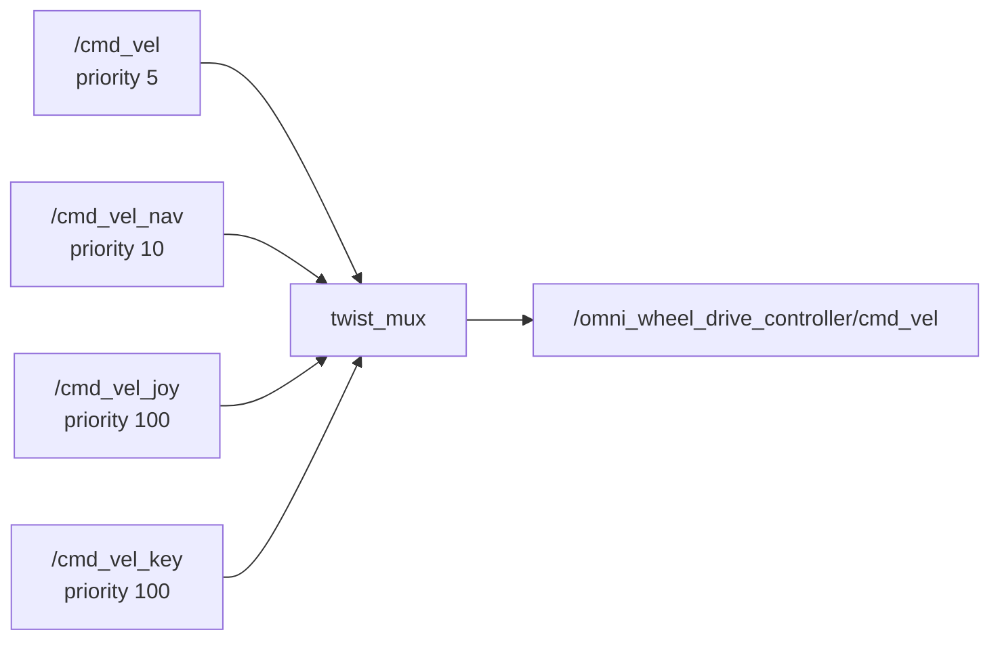

# Gazebo Simulation

This page explains how to run Walkie in Gazebo Harmonic: the launch files,
worlds, controllers, bridged topics, and how to drive the robot. For the newer
MuJoCo simulation, see [MuJoCo Simulation](simulation-mujoco.md).

## Quick start

Build the workspace first (see [Getting Started](../getting-started.md)). Then
start Gazebo with the robot, its controllers, and RViz:

```bash
pixi run ros2 launch robot_simulation gzsim_omnibot.launch.py
```

To run Gazebo together with Nav2, see [Gazebo with Nav2](#gazebo-with-nav2).

The command above works with any middleware. To use Zenoh like the real robot,
start a router and export `RMW_IMPLEMENTATION` first. See
[Middleware (Zenoh)](middleware.md).

## Where the pieces live

| Path | Package | Contents |
| --- | --- | --- |
| `simulation/gazebo/launch/` | `robot_simulation` | `gzsim_omnibot.launch.py`, `world_preview_gz.launch.py`, `rviz.launch.py` |
| `simulation/gazebo/worlds/` | `robot_simulation` | Four world files |
| `simulation/gazebo/models/` | `robot_simulation` | AWS RoboMaker residential models and `turtlebot3_world` |
| `simulation/gazebo/config/gazebo/gz_bridge.yaml` | `robot_simulation` | Gazebo to ROS topic bridge |
| `simulation/gazebo/rviz/` | `robot_simulation` | `turtlebot3_rviz.rviz`, `display.rviz` |
| `bringup/launch/nav_sim_omnibot.launch.py` | `robot_bringup` | Gazebo plus Nav2 plus rosbridge |
| `bringup/config/twist_mux/twist_mux.yml` | `robot_bringup` | Velocity command priorities |
| `description/robots/gz_walkie.urdf.xacro` | `walkie_description` | Robot model used in simulation |
| `description/urdf/walkie/ros2_control.xacro` | `walkie_description` | `ros2_control` hardware blocks, including the Gazebo block |
| `description/config/ros2_controller/sim_controllers.yaml` | `walkie_description` | Controller settings for simulation |
| `tools/joy_interface/` | `joy_interface` | Joystick teleoperation |

## `gzsim_omnibot.launch.py`

This is the main Gazebo launch file. It starts:

1. Gazebo (`gz sim -r -v4 <world>`) through `ros_gz_sim`'s `gz_sim.launch.py`.
   `-r` starts the simulation running instead of paused, and `-v4` sets the
   most detailed log level. Closing Gazebo stops the whole launch.
2. `ros_gz_bridge`'s `parameter_bridge` with `gz_bridge.yaml`.
3. `robot_state_publisher`, through `walkie_description`'s
   `robot_state_publisher.launch.py`, with `use_zed:=false`.
4. `ros_gz_sim create`, which spawns the robot from the `/robot_description`
   topic as the model `walkie_bot` at height 0.1 m.
5. The controller spawners. They start only after `create` exits, so the
   controller manager inside Gazebo exists before they run.
6. `twist_mux` (see [Driving the robot](#driving-the-robot)).
7. `foxglove_bridge` with a 50 MB send buffer.
8. RViz, through `rviz.launch.py`.
9. `walkie_tf`'s `tf_server`.
10. `walkie_perception`'s `cloud_to_map` (reads
    `/zed_head/zed_node/point_cloud/cloud_registered`) and
    `ob_pose_service_cpp`. See [Perception](perception.md).

### Arguments

| Argument | Default | Meaning |
| --- | --- | --- |
| `world` | `<robot_simulation share>/worlds/aws_small_house.world` | Full path to the world file |
| `x_pose` | `-2.0` | Spawn position, x (m) |
| `y_pose` | `1.0` | Spawn position, y (m) |
| `use_sim_time` | `true` | Passed to `robot_state_publisher`, `foxglove_bridge`, and the perception nodes |
| `robot_model` | `<walkie_description share>/robots/gz_walkie.urdf.xacro` | Xacro file of the robot |
| `ros2_control` | `gazebo` | Hardware type passed to the xacro |
| `dual_lidar` | `False` | Simulate two lidars instead of one. See [Lidar](#lidar). |
| `use_rviz` | `True` | Start RViz |
| `rviz_config_file` | `<robot_simulation share>/rviz/turtlebot3_rviz.rviz` | RViz config |

Example: start in the obstacle world without RViz. Run it from the repository
root so that `$PWD` is correct.

```bash
pixi run ros2 launch robot_simulation gzsim_omnibot.launch.py \
  world:=$PWD/simulation/gazebo/worlds/obstacle_gz.world use_rviz:=false
```

### Environment variables set by the launch file

| Variable | Value | Why |
| --- | --- | --- |
| `GZ_SIM_RESOURCE_PATH` | `<robot_simulation share>/models` and the `share` directory that contains `walkie_description` | Gazebo searches these directories for `model://` URIs |
| `GZ_SIM_SYSTEM_PLUGIN_PATH` | `/opt/ros/jazzy/lib/` | Gazebo searches this directory for system plugins before the others |

!!! warning
    This plugin path points outside the pixi environment. See [Known issues](#known-issues).

## Worlds

| File | World name | Notes |
| --- | --- | --- |
| `aws_small_house.world` | `default` | Default. AWS RoboMaker small house with furniture from `models/`. |
| `obstacle_gz.world` | `empty` | Simple world with obstacles. It loads no IMU system, so `/imu` gets no data. |
| `PlainWorld.world` | `default` | The file declares no system plugins. It has no Sensors system, so the lidar and cameras publish no data. |
| `turtlebot3_world_gz.world` | `default` | Uses `model://turtlebot3_world` from `models/` |

The world name matters. The bottom camera topics in `gz_bridge.yaml` contain
`/world/default/...`, so they get no data in `obstacle_gz.world`.

To open a world without the robot, use `world_preview_gz.launch.py`. It takes
the same `world` argument with the same default:

```bash
pixi run ros2 launch robot_simulation world_preview_gz.launch.py \
  world:=$PWD/simulation/gazebo/worlds/turtlebot3_world_gz.world
```

## The robot model in Gazebo

The launch file builds the robot from `gz_walkie.urdf.xacro` with
`ros2_control:=gazebo`. This value selects the Gazebo block in
`ros2_control.xacro`:

- The hardware plugin is `gz_ros2_control/GazeboSimSystem`. It connects the
  `ros2_control` joints to the simulated joints.
- The Gazebo plugin `gz_ros2_control::GazeboSimROS2ControlPlugin`
  (`libgz_ros2_control-system.so`) runs the controller manager inside the
  Gazebo process. It loads `sim_controllers.yaml`. No separate
  `ros2_control_node` runs.
- The wheel joints take velocity commands. The head servo, lift, arm, and
  finger joints take position commands. The lift command interface accepts
  0.000 to 0.743 m, but the URDF joint limit is 0.08 to 0.7435 m.

See [Robot Description](../reference/robot-description.md) for the full model.

### Lidar

The real robot has two lidars. The simulation uses one by default because it
is faster.

| `dual_lidar` | Lidar links | Coverage | Range | Result |
| --- | --- | --- | --- | --- |
| `False` (default) | `single_lidar_link`, 0.315 m above the center of `base_link` | 360° | 0.6 to 10 m | Bridged to `/scan` |
| `True` | `front_lidar_link` and `back_lidar_link`, 0.235 m in front of and behind the center | ±120° each | 0.18 to 10 m | Not bridged. No `/scan`. |

Both variants publish at 40 Hz with 360 samples per scan. Keep the default.
`dual_lidar:=True` leaves Nav2 without `/scan` (see [Known issues](#known-issues)).

### Other sensors

| Sensor | Link | Notes |
| --- | --- | --- |
| IMU | `top_imu_link` | Gazebo topic `imu` |
| Bottom RealSense D415 | on `base_link` | Color and depth only (`flag_ir="0"`), updates at 2 Hz |
| Head RGB-D camera | on the head servo, which rides on the lift | Bridged to the ZED topic names. See [Bridged topics](#bridged-topics). |

## Controllers

`sim_controllers.yaml` sets the controller manager to 60 Hz. The launch file
spawns these controllers, each with `--switch-timeout 30.0`:

| Controller | Type | Joints |
| --- | --- | --- |
| `joint_broad` | `JointStateBroadcaster` | All joints |
| `omni_wheel_drive_controller` | `OmniWheelDriveController` | Four wheel joints |
| `lift_controller` | `JointTrajectoryController` | `lift_joint` |
| `left_joint_trajectory_controller` | `JointTrajectoryController` | Left arm |
| `right_joint_trajectory_controller` | `JointTrajectoryController` | Right arm |
| `left_gripper_controller` | `GripperActionController` | Left gripper |
| `right_gripper_controller` | `GripperActionController` | Right gripper |

MoveIt uses the arm and gripper controllers. See
[Manipulation](manipulation.md).

The file also defines controllers that are not spawned: `left_arm_controller`,
`arm_controller`, `right_arm_controller`, the forward position and velocity
controllers for each arm, and `head_servo_controller`. To move the head in
simulation, spawn its controller by hand:

```bash
pixi run ros2 run controller_manager spawner head_servo_controller
```

`head_servo_controller` is a `JointGroupPositionController` on
`head_servo_joint`. It listens on `/head_servo_controller/commands`.

### Omni wheel controller settings

The full parameter list is in
[Omni wheel controller parameters](../reference/robot-description.md#omni-wheel-controller-parameters).
Two settings matter when you drive the simulated robot:

- `cmd_vel_timeout: 0.5`. The robot stops if no command arrives for 0.5 s.
- `open_loop: true`. Odometry is computed from the commands, not from wheel
  feedback. Wheel slip in Gazebo does not show up in
  `/omni_wheel_drive_controller/odom`.

## Bridged topics

All entries in `gz_bridge.yaml` go from Gazebo to ROS.

| ROS topic | Type | Gazebo topic | Notes |
| --- | --- | --- | --- |
| `/clock` | `rosgraph_msgs/msg/Clock` | `clock` | Simulation time |
| `/scan` | `sensor_msgs/msg/LaserScan` | `single_lidar` | Only with `dual_lidar:=False` |
| `/imu` | `sensor_msgs/msg/Imu` | `imu` | Lazy: bridged only while someone subscribes |
| `/gazebo_ground_truth/odom` | `geometry_msgs/msg/Pose` | `/model/my_bot/pose` | No data. See [Known issues](#known-issues). |
| `/bottom_rgb/image_raw`, `/bottom_rgb/camera_info` | `Image`, `CameraInfo` | `/world/default/model/walkie_bot/link/base_footprint/sensor/bottom_rgb_sensor/...` | Only in worlds named `default` |
| `/bottom_depth/image_raw` | `Image` | `/bottom_depth/image` | |
| `/bottom_depth/points` | `PointCloud2` | `/bottom_depth/image/points` | |
| `/bottom_depth/camera_info` | `CameraInfo` | `/bottom_depth_sensor/camera_info` | No data. See [Known issues](#known-issues). |
| `/bottom_left_ir/...`, `/bottom_right_ir/...` | `Image`, `CameraInfo` | `.../bottom_left_ired_sensor/...`, `.../bottom_right_ired_sensor/...` | No data. See [Known issues](#known-issues). |
| `/zed_head/zed_node/rgb/color/rect/image` | `Image` | `/head/rgb/image` | Head color image |
| `/zed_head/zed_node/rgb/color/rect/image/camera_info` | `CameraInfo` | `/head/rgb/camera_info` | |
| `/zed_head/zed_node/depth/depth_registered` | `Image` | `/head/rgbd/depth_image` | Head depth image |
| `/zed_head/zed_node/depth/depth_registered/camera_info` | `CameraInfo` | `/head/rgbd/camera_info` | |
| `/zed_head/zed_node/point_cloud/cloud_registered` | `PointCloud2` | `/head/rgbd/points` | Head point cloud |

The head camera topics use the same names as the real ZED camera, so the
perception nodes can subscribe to the same topics in simulation. One
`ob_pose_service_cpp` parameter does not match the bridge. See
[Known issues](#known-issues).

## Driving the robot

`gzsim_omnibot.launch.py` starts `twist_mux`. It picks the highest-priority
velocity source that is active and forwards it to the wheel controller. The
config is `bringup/config/twist_mux/twist_mux.yml`.



- `use_stamped: true`, so every input must be
  `geometry_msgs/msg/TwistStamped`. Plain `Twist` messages are not used.
- Each input has a 0.5 s timeout. A source must keep publishing to stay
  active.
- Nav2 publishes on `/cmd_vel_nav`. A joystick on `/cmd_vel_joy` overrides Nav2.
  A command on `/cmd_vel` loses to Nav2.

### From the command line

Publish at 10 Hz so neither the `twist_mux` timeout nor the controller timeout
stops the robot. Stop with Ctrl+C.

```bash
pixi run ros2 topic pub -r 10 /cmd_vel geometry_msgs/msg/TwistStamped \
  "{header: {frame_id: base_footprint}, twist: {linear: {x: 0.2}}}"
```

The robot is omnidirectional. Set `linear.y` to move sideways and `angular.z` to
turn.

### With a joystick

The `joy_interface` package has two launch files. Both start `joy_linux_node`,
which reads `/dev/input/jsX` and publishes `/joy`.

| Launch file | Output topic | Max linear / angular | Notes |
| --- | --- | --- | --- |
| `joy_control.launch.py` | `/cmd_vel` | 0.65 m/s / 1.4 rad/s | No smoothing. Uses the lowest priority, so Nav2 overrides it. |
| `joy_control_smooth.launch.py` | `/cmd_vel_joy` | 0.45 m/s / 1.0 rad/s | Acceleration limits. Overrides Nav2. Button 0 cancels all goals on `/navigate_to_pose` and `/navigate_through_poses`. |

```bash
pixi run ros2 launch joy_interface joy_control_smooth.launch.py
```

Both use the left stick for forward and sideways motion (axes 1 and 0) and the
right stick for turning (axis 3).

### Keyboard

The repository has no keyboard teleop package, and `pixi.toml` does not install
`teleop_twist_keyboard`. `twist_mux` reserves `/cmd_vel_key` for a keyboard
source. A keyboard tool must publish `TwistStamped` on that topic.

### `twist_stamper`

`tools/twist_stamper` is fetched by `pixi run import` from
`walkie_external.repos`, because RoboStack does not build it. It converts
`Twist` to `TwistStamped`. Only the Isaac Sim launch file uses it. The Gazebo
launch files do not.

## Gazebo with Nav2

`bringup/launch/nav_sim_omnibot.launch.py` starts:

- `gzsim_omnibot.launch.py`, with `robot_model`, `ros2_control`, and
  `dual_lidar`
- `robot_navigation`'s `localization_Nav2_sim.launch.py` (map server, AMCL,
  and the Nav2 servers)
- `rosbridge_server`'s `rosbridge_websocket_launch.xml`
- `current_pose_publisher.py`, which publishes the `map` to `base_footprint`
  transform on `current_pose` (`nav_msgs/msg/Odometry`) at 10 Hz

| Argument | Default |
| --- | --- |
| `robot_model` | `<walkie_description share>/robots/gz_walkie.urdf.xacro` |
| `ros2_control` | `gazebo` |
| `dual_lidar` | `False` |

ROS 2 launch arguments are global, so arguments of the included files also work
here. For example, `map:=...` reaches `localization_Nav2_sim.launch.py`, and
`use_rviz:=false` reaches `gzsim_omnibot.launch.py`.

!!! warning
    The default simulation map is missing. Pass one with `map:=` as shown in [The simulation map](navigation.md#the-simulation-map).

`scripts/bringup/sim_nav_gazebo.sh` runs the same launch file. It also starts a
Zenoh router if none is running. Prefer the pixi commands in
[Middleware (Zenoh)](middleware.md#simulation-on-one-machine) over this script.
See [Known issues](#known-issues).

## RViz

| Config | Fixed frame | Used by | Shows |
| --- | --- | --- | --- |
| `simulation/gazebo/rviz/turtlebot3_rviz.rviz` | `map` | `gzsim_omnibot.launch.py` | Robot model, TF, `/scan`, `/map`, costmaps, `/plan`, head camera image and point cloud, Nav2 panel |
| `simulation/gazebo/rviz/display.rviz` | `base_link` | Nothing by default | Robot model and TF |
| `description/rviz/robot_preview.rviz` | `base_link` | The `walkie_description` preview launch files | Robot model |

Notes:

- The default fixed frame is `map`. Without Nav2 there is no `map` frame, so
  RViz shows a TF error. Set the fixed frame to `odom` in the Displays panel.
- `rviz.launch.py` shuts down the whole launch when RViz exits. Closing RViz
  also closes Gazebo. Use `use_rviz:=false` if you want to restart RViz on its
  own.
- The config has tools for a Nav2 goal (`nav2_rviz_plugins/GoalTool`),
  initial pose (`/initialpose`), and publish point (`/clicked_point`).

## Preview the robot model without Gazebo

`walkie_description` has two launch files that show the model in RViz with no
physics. See [Preview in RViz](../reference/robot-description.md#preview-in-rviz).

## Isaac Sim

There is an Isaac Sim launch file, `bringup/launch/isaac_omnibot.launch.py`,
and a helper script, `scripts/bringup/isaac_sim_bringup.sh`. The Isaac Sim
scene is not in this repository. The launch file uses `ros2_control:=topic_base`,
which selects `topic_based_ros2_control/TopicBasedSystem`. It exchanges joint
commands and states with Isaac Sim on `/isaac_joint_commands` and
`/isaac_joint_states`.

!!! warning
    The Isaac Sim launch file does not start as it is. See [Known issues](#known-issues).

## Known issues

| Issue | Effect | Workaround |
| --- | --- | --- |
| `gzsim_omnibot.launch.py` and `world_preview_gz.launch.py` set `GZ_SIM_SYSTEM_PLUGIN_PATH` to `/opt/ros/jazzy/lib/`. Under pixi, `gz_ros2_control` is in `.pixi/envs/default/lib`. | On a computer with a system ROS 2 Jazzy, Gazebo searches the system folder first and can load a system build of `libgz_ros2_control-system.so` | See [Gazebo problems only on computers with a system ROS](../troubleshooting.md#gazebo-problems-only-on-computers-with-a-system-ros) |
| The default map of `localization_Nav2_sim.launch.py` is missing at the map commit that the `navigation` submodule pins | `nav_sim_omnibot.launch.py` cannot load its map | Pass `map:=`. See [The simulation map](navigation.md#the-simulation-map). |
| With `dual_lidar:=True`, the `front_lidar` and `back_lidar` entries in `gz_bridge.yaml` are commented out, and no laser merger runs in simulation | No `/scan`, so Nav2 has no laser data | Keep the default `dual_lidar:=False` |
| The `/gazebo_ground_truth/odom` bridge entry reads `/model/my_bot/pose`, but the model is spawned as `walkie_bot` | `/gazebo_ground_truth/odom` gets no data | None in the repository |
| The `/bottom_depth/camera_info` bridge entry reads `/bottom_depth_sensor/camera_info`, but the sensor publishes on `bottom_depth/camera_info` | `/bottom_depth/camera_info` gets no data | None in the repository |
| The bottom camera is built with `flag_ir="0"`, but `gz_bridge.yaml` still bridges the IR topics | `/bottom_left_ir/...` and `/bottom_right_ir/...` get no data | None needed unless you use IR |
| `ob_pose_service_cpp` is started with `info_topic: /zed_head/zed_node/depth/camera_info`. The bridge publishes `/zed_head/zed_node/depth/depth_registered/camera_info`. | The service gets no camera info in Gazebo | None in the repository |
| One point cloud display in `turtlebot3_rviz.rviz` uses `/head/depth/points`, which the bridge does not publish | The display stays empty | Use the display for `/zed_head/zed_node/point_cloud/cloud_registered` |
| `sim_nav_gazebo.sh` sources `/opt/ros/$ROS_DISTRO/setup.bash` when it exists, does not set `RMW_IMPLEMENTATION`, and leaves the router it starts running | System ROS and pixi are mixed. The nodes may use DDS. A router stays running after the launch ends. | Run the pixi commands in [Middleware (Zenoh)](middleware.md#simulation-on-one-machine). Stop a leftover router with `pkill -x rmw_zenohd`. |
| `isaac_omnibot.launch.py` includes `robot_state_publisher.launch.py` from `robot_bringup`, but that file only exists in `walkie_description` | The launch fails at start | None in the repository |

## Troubleshooting

| Symptom | Cause | Fix |
| --- | --- | --- |
| RViz shows "Fixed Frame [map] does not exist" | Nav2 is not running | Set the fixed frame to `odom` |
| Closing RViz stops Gazebo | `rviz.launch.py` emits a shutdown when RViz exits | Use `use_rviz:=false` and start RViz separately |
| The robot does not move with `ros2 topic pub` | Message type is `Twist`, or it was published once | Publish `TwistStamped` with `-r 10` |
| The robot ignores `joy_control.launch.py` while Nav2 runs | `/cmd_vel` has a lower priority than `/cmd_vel_nav` | Use `joy_control_smooth.launch.py` |
| `/bottom_rgb/...` topics have no data | World is not named `default` (for example `obstacle_gz.world`) | Use a world named `default` |
| No lidar or camera data in `PlainWorld.world` | The world loads no Sensors system | Use another world |
