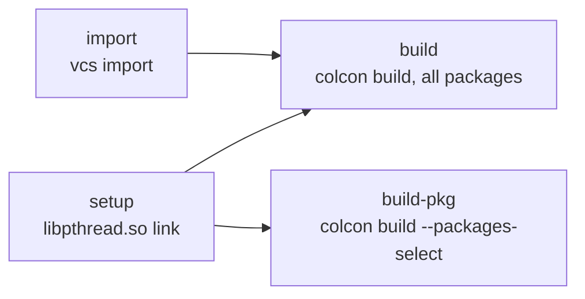

# 1. Move to Pixi

**Goal:** build and run the whole workspace from a project-local pixi
environment, with no system ROS installation, and with the same package
versions on every computer.

This entry reconstructs the move from the Git history of this repository and of
the `navigation` submodule. For day-to-day use of the result, read
[Working with Pixi](../guides/pixi.md).

## In short

- **Changed:** ROS 2 Jazzy and the workspace dependencies come from a
  project-local pixi environment, with versions pinned in `pixi.lock`. The
  repository root is the workspace, and `pixi run build` builds it.
- **Decisions:** the dependency list mirrors the workspace `package.xml`
  files. GCC 13 and CMake below 4 are pinned. Packages missing from the
  channels are cloned from `walkie_external.repos`.
- **Result:** the workspace builds without a system ROS installation. The
  Docker images, the cameras, the perception venv, and a few scripts and paths
  are still outside pixi
  ([What is not on pixi yet](#what-is-not-on-pixi-yet)).

## What changed

| | Before | After |
| --- | --- | --- |
| ROS 2 installed by | apt, system-wide in `/opt/ros/jazzy` | pixi, inside the project in `.pixi/envs/default/` |
| Other dependencies | `rosdep` installs Ubuntu packages | Listed in `pixi.toml`, installed from conda channels |
| Versions | Whatever apt offers on the day of installation | Pinned in `pixi.lock` |
| Host | Ubuntu 24.04, the platform of the ROS 2 Jazzy apt packages | Linux on x86_64 (`linux-64`); Ubuntu 24.04 is the tested host |
| Workspace | `~/ros2_ws/` with the repository in `src/` | The repository root |
| Build | `colcon build --symlink-install` | `pixi run build` |
| Sourcing | By hand, in every terminal | Automatic, through pixi activation |

The Docker images in `docker/` still use the old system ROS setup.

??? info "The setup steps before the move"
    1. Install Ubuntu 24.04 and ROS 2 Jazzy from apt.
    2. Create `~/ros2_ws/src` and clone the repository into it.
    3. Install the dependencies with
       `rosdep install --from-paths src --ignore-src -y`.
    4. Build with `colcon build --symlink-install`.
    5. Source `/opt/ros/jazzy/setup.bash` and `install/setup.bash` in every
       terminal.

??? info "All commits of the move, by date"
    | Commit | Date | Where | Change |
    | --- | --- | --- | --- |
    | `cd21d18` | 2026-09-12 | this repository | First `pixi.toml`, `pixi.lock`, and `walkie_external.repos` |
    | `c9e4940` | 2026-09-24 | this repository | Fixes in two vendored lidar libraries so that newer compilers accept them |
    | `d6fa265` | 2026-09-24 | this repository | RoboStack environment rebuilt from the workspace `package.xml` files |
    | `23edf14` | 2026-10-08 | `navigation` | `openvdb_vendor` finds the conda OpenVDB |
    | `a32769b` | 2026-10-08 | `navigation` | `spatio_temporal_voxel_layer` builds with Boost 1.89 and newer |
    | `02a697a` | 2026-10-08 | `navigation` | `navigation2` moved to the latest upstream `main` |
    | `507c62e` | 2026-10-08 | this repository | Compiler and kernel header pins; `setup`, `import`, `build-pkg` tasks; vcstool and Zenoh added back |
    | `a0cf1b2` | 2026-10-08 | this repository | `navigation` submodule moved to its `feat/pixi` branch |
    | `8ead77e` | 2026-10-12 | this repository | Follow-up: LFS files in the Docker CI; `tools/twist_stamper` untracked |
    | `a926459` | 2026-10-12 | this repository | Follow-up: pytest pinned below 9; MuJoCo added |

## Step 1: A first pixi.toml

`cd21d18` grouped hand-picked dependencies by topic, including meta-packages
such as `ros-jazzy-desktop` and `ros-jazzy-moveit`. Later steps replaced most
of it. Only `walkie_external.repos`
([Step 5](#step-5-clone-packages-that-are-not-on-the-channels)) and the
`linux-64` platform stayed.

CMake is now pinned below 4, because CMake 4 refuses the unilidar SDK.

??? info "Why CMake 4 fails, and the first workaround"
    CMake 4 refuses projects that declare `cmake_minimum_required` below 3.5.
    In this workspace that is
    `hardware/lidar/unilidar_sdk2/unitree_lidar_sdk/CMakeLists.txt`, which asks
    for 3.0. The first version locked CMake 4.4 and passed
    `-DCMAKE_POLICY_VERSION_MINIMUM=3.5` to work around it. The final version
    pins `cmake` below 4 instead, so no extra flag is needed.

??? info "The first pixi.toml compared with the current one"
    | Part | First version | Now |
    | --- | --- | --- |
    | Channels | Short names `robostack-jazzy` and `conda-forge`, which resolved to `https://conda.anaconda.org/...` | Full URLs on `https://prefix.dev/...` |
    | Dependencies | Hand-picked groups, including meta-packages | `ros-jazzy-ros-base` and the build tools, then one entry per dependency of a workspace `package.xml` |
    | CMake | Any version (CMake 4.4 was locked), plus `-DCMAKE_POLICY_VERSION_MINIMUM=3.5` | `cmake = "<4"` |
    | Compiler | `gcc_linux-64` and `gxx_linux-64` pinned to `13.*` | Still GCC 13, see [Step 3](#step-3-pin-the-toolchain) |
    | Activation | `scripts/setup_env.sh`, which sources `install/local_setup.sh` | `install/setup.bash` |
    | Tasks | `build-ros2`, `build-openvdb-chain`, `test-ros2` | `setup`, `import`, `build`, `build-pkg`, `test`, `clean` |
    | OpenVDB | `-DCMAKE_MODULE_PATH=$CONDA_PREFIX/lib/cmake/OpenVDB` on the colcon command line | `openvdb_vendor` searches the environment by itself, see [Step 6](#step-6-fix-the-navigation-submodule) |

## Step 2: Build the dependency list from package.xml

`d6fa265` replaced the first list. The `[dependencies]` table starts with
`ros-jazzy-ros-base` and the build tools. After that, it has one alphabetical
entry per dependency that the workspace packages declare in their
`package.xml` files.

Why: a list derived from `package.xml` installs what the code declares, and a
missing entry points at a missing `package.xml` declaration.

??? info "How package.xml keys map to pixi.toml entries"
    - ROS dependencies become RoboStack names. `<depend>tf2_ros</depend>`
      becomes `ros-jazzy-tf2-ros`.
    - System dependencies (rosdep keys) become the matching conda-forge
      package. For example, `libceres-dev` becomes `ceres-solver`.
    - Keys with no match on either channel are kept in a commented block,
      `# The following packages were not found:`.
      [Working with Pixi](../guides/pixi.md) lists them and explains each one.

??? info "Other changes in the same commit"
    - The channels moved to full `prefix.dev` URLs.
    - `cmake = "<4"` was pinned (see Step 1).
    - `openvdb = ">=13.0.0,<14"` was pinned.
    - Activation switched to `install/setup.bash` (see [Step 8](#step-8-activation)).
    - `.gitattributes` and the `.pixi` lines in `.gitignore` were added
      (see [Step 9](#step-9-git-settings)).

## Step 3: Pin the toolchain

`507c62e` pins `compilers` 1.x, GCC 13, and kernel headers 5.14 or newer.

- **GCC 13** is the compiler of Ubuntu 24.04, the platform that ROS 2 Jazzy
  targets and that the Docker images use.
- **Kernel headers 5.14 or newer**: the commit does not record why. The pin
  moves the sysroot from glibc 2.28 to glibc 2.39.

??? info "The pins, and what the solver picked before and after them"
    ```toml title="pixi.toml"
    compilers = ">=1,<2"
    gcc_linux-64 = ">=13,<14"
    gxx_linux-64 = ">=13,<14"
    kernel-headers_linux-64 = ">=5.14"
    ```

    `d6fa265` asked for `compilers = "*"`. The solver picked the newest
    `compilers` 2.0.0, which brings GCC 15.3, kernel headers 4.18, and a
    glibc 2.28 sysroot.

    With the pins of `507c62e`, the lock file has `compilers` 1.10.0, GCC 13.4,
    kernel headers 6.12, and a glibc 2.39 sysroot.

    The first version of `pixi.toml` gave the same Ubuntu 24.04 reason for
    GCC 13. It also said that GCC 14 and newer reject code in two vendored
    lidar libraries. [Step 4](#step-4-fix-the-vendored-lidar-code) fixes that
    code too.

### The libpthread link

The glibc 2.39 sysroot has no `libpthread.so`, the name that the linker looks
for. `507c62e` added the `setup` task, which creates it as a link to
`libpthread.so.0`. `build` and `build-pkg` both depend on `setup`, so the link
is always there before colcon starts.

??? info "Why the file is missing, and the command the task runs"
    Since glibc 2.34, the pthread functions live in `libc`. The glibc 2.39
    sysroot package still ships `libpthread.so.0` and an empty `libpthread.a`,
    but no `libpthread.so`. The link lives inside `.pixi/envs/default/`, so
    reinstalling the environment removes it. The `setup` task runs:

    ```bash
    ln -sf libpthread.so.0 $CONDA_PREFIX/x86_64-conda-linux-gnu/sysroot/usr/lib/libpthread.so
    ```

    `ln -sf` overwrites an existing link, so running it again is harmless.

## Step 4: Fix the vendored lidar code

`c9e4940` made small fixes in two vendored libraries, rapidjson in the
Lakibeam driver and `urg_library` in `urg_node2`, so that GCC 14 and newer
compile them. This removes the two GCC 14 errors that the first version named
as the reason for the GCC 13 pin. `507c62e` still pins GCC 13, the compiler of
an Ubuntu 24.04 build.

??? info "The two compiler errors and the fixes"
    | File | Problem | Fix |
    | --- | --- | --- |
    | `hardware/lidar/Lakibeam_ROS2_Driver/thirdparty/rapidjson/document.h` | `GenericStringRef` has `const` members, but defines a copy assignment operator that assigns to them and returns nothing | The operator becomes a private declaration with no body, as in newer rapidjson versions |
    | `hardware/lidar/urg_node2/urg_library/current/src/urg_utils.c` | Calls `usleep()` without including `<unistd.h>`. GCC 14 turns implicit function declarations into errors | Include `<unistd.h>` (or `<windows.h>` on Windows) |

    ```cpp title="document.h, after the fix"
    private:
        //! Copy assignment operator not permitted - immutable type
        GenericStringRef& operator=(const GenericStringRef& rhs) /* = delete */;
    ```

    The same commit converted `urg_utils.c` from Shift-JIS to UTF-8, so its
    Japanese comments are readable in editors and on GitHub.

## Step 5: Clone packages that are not on the channels

Two ROS packages that the workspace needs had no RoboStack package. They are
listed in `walkie_external.repos`, a
[vcstool](https://github.com/dirk-thomas/vcstool) file, and the `import` task
clones them:

| Path | Source | Version | Needed by |
| --- | --- | --- | --- |
| `hardware/lidar/laser_proc` | `ros-perception/laser_proc` | A fixed commit | `urg_node2` |
| `tools/twist_stamper` | `joshnewans/twist_stamper` | Tag `0.0.5`, the version released for Jazzy | `robot_bringup`, `robot_simulation` |

Both paths are in `.gitignore`, because the clones are not part of this
repository. `build` depends on `import`, so a fresh clone gets them on the
first build.

??? info "How vcstool and the import task arrived"
    `cd21d18` added `walkie_external.repos` and listed `vcstool` as a
    dependency. `d6fa265` dropped `vcstool`. `507c62e` added it back, together
    with the `import` task that reads the file.

## Step 6: Fix the navigation submodule

Nav2 is built from source in `navigation/navigation2/`. Two packages in the
`navigation` submodule needed changes to build against conda libraries. The
changes are on the submodule's `feat/pixi` branch, and `a0cf1b2` moved the
submodule to that branch.

- **`openvdb_vendor` (`23edf14`)** finds the conda OpenVDB 13. Without the
  fix it builds OpenVDB 10 from source, which fails against the newer oneTBB.
- **`spatio_temporal_voxel_layer` (`a32769b`)** builds with Boost 1.89 and
  newer, which removed the separate `boost_system` library.
- **`navigation2` (`02a697a`)** moved to the latest upstream `main`. The commit
  does not record why.

??? info "Why the two packages failed, and how the fixes work"
    **`openvdb_vendor`.** The package uses the system OpenVDB if CMake finds
    it, and otherwise builds OpenVDB 10 from source. The conda `openvdb`
    package ships a `FindOpenVDB.cmake` module in `lib/cmake/OpenVDB/`, not an
    `OpenVDBConfig.cmake`, so CMake did not find it. The fix adds
    `lib/cmake/OpenVDB` under every `CMAKE_PREFIX_PATH` entry and under
    `$CONDA_PREFIX` to `CMAKE_MODULE_PATH`. It also accepts any OpenVDB version
    instead of only version 10, because the environment has OpenVDB 13.

    **`spatio_temporal_voxel_layer`.** Boost 1.89 removed the separate
    `boost_system` library; Boost.System is header-only now. The environment
    has Boost 1.90, so `find_package(Boost REQUIRED COMPONENTS system ...)`
    failed. The fix moves `system` to `OPTIONAL_COMPONENTS`.

    **No extra flag.** The `openvdb_vendor` fix checks `$CONDA_PREFIX` itself,
    and the build tasks pass `-DCMAKE_PREFIX_PATH=$CONDA_PREFIX` as well. So
    the plain build tasks work, without the extra `CMAKE_MODULE_PATH` flag of
    Step 1.

## Step 7: Build tasks

`507c62e` gave the build its final shape:



Both build tasks run
`colcon build --symlink-install --cmake-args -DCMAKE_PREFIX_PATH=$CONDA_PREFIX`.
Neither sets `--parallel-workers` or `CMAKE_BUILD_TYPE`, so colcon builds
several packages in parallel, without a build type.
`build-pkg` does not run `import`, so rebuilding one package does not touch
the external clones.

`507c62e` also added back the Zenoh middleware that the robot uses, pinned as
`ros-jazzy-rmw-zenoh-cpp = ">=0.2.10,<0.3"`.

??? info "Earlier build flags and the Zenoh history"
    The first version also passed `--parallel-workers 1` and
    `-DCMAKE_BUILD_TYPE=Release`. Its comment said that Nav2 and MoveIt compile
    units need about 1 to 2 GB of memory each. `d6fa265` dropped both flags.

    The first version listed Zenoh without a version, and `d6fa265` had dropped
    it before `507c62e` added it back with the pin.

## Step 8: Activation

`d6fa265` made pixi source colcon's own script when it activates the
environment:

```toml title="pixi.toml"
[activation]
scripts = ["install/setup.bash"]
```

So every `pixi run` and `pixi shell` sees the built workspace packages. Before
the first build the file does not exist, and pixi prints
`WARN Could not find activation scripts`. That is expected.

??? info "The activation script of the first version"
    The first version used `scripts/setup_env.sh`, which sourced
    `install/local_setup.sh`. `scripts/setup_env.sh` is still in the
    repository, but nothing uses it.

## Step 9: Git settings

`d6fa265` added the settings that `pixi init` creates:

- `.gitattributes` marks `pixi.lock` as `merge=binary` and hides it from
  diffs. Git never merges it line by line. Regenerate a conflicted lock file
  with `pixi lock`, never edit it by hand.
- `.gitignore` ignores `.pixi/*`, the installed environments. Its exception
  for `.pixi/config.toml` has no effect, because an earlier `.pixi` line
  ignores the whole folder ([Known issues](../guides/pixi.md#known-issues)).

## Follow-ups

### LFS files in the Docker CI and the twist_stamper gitlink (8ead77e)

The robot meshes in `description/` are stored in Git LFS. `actions/checkout`
with `lfs: true` downloads the LFS files of the main repository, but not of
the submodules, so the Docker images were built with LFS pointer files instead
of meshes. Both jobs in `.github/workflows/build-docker.yml` now run
`git submodule foreach --recursive git lfs pull` after the checkout.

??? info "The workflow step"
    ```yaml title=".github/workflows/build-docker.yml"
    - name: Fetch submodule LFS files
      run: git submodule foreach --recursive git lfs pull
    ```

The first commit had added `tools/twist_stamper` as a gitlink, a submodule
entry without a matching line in `.gitmodules`. On a branch that still has it,
`git submodule update --init --recursive` stops with
`fatal: No url found for submodule path 'tools/twist_stamper' in .gitmodules`.
The fix removes the gitlink and adds the path to `.gitignore`, since
`pixi run import` clones it.

### pytest pinned below 9 (a926459)

`pytest = "*"` had locked pytest 9.1.1. With it, every ament Python test
aborted before running, because pytest 9 rejects a plugin hook of
`launch_testing`. `a926459` pinned `pytest = ">=8,<9"`.

??? info "Why pytest 9 rejects launch_testing"
    `launch_testing` registers itself as a pytest plugin:

    - `launch_testing/pytest/hooks.py` defines
      `pytest_pycollect_makemodule(path, parent)`.
    - pytest 8 still offers the old `path` argument (deprecated).
    - pytest 9 removed it. pytest checks plugin hooks when it loads them,
      finds an argument it does not know, and refuses to start.

    The pin has a comment in `pixi.toml`:

    ```toml title="pixi.toml"
    # pytest 9 rejects the pytest11 plugins of Jazzy launch_testing / launch_testing_ros.
    pytest = ">=8,<9"
    ```

The same commit added `mujoco = ">=3.14"` and the `mjcf` and `mjcf-view`
tasks. [2. Add MuJoCo Simulation](02-mujoco/index.md) covers that work.

## What is not on pixi yet

| Area | Current state |
| --- | --- |
| Docker images | apt, `rosdep`, and `colcon build` outside pixi. `pixi.toml` is not used. |
| ZED camera | `real_omnibot.launch.py` starts `zed_wrapper` when `use_zed:=true` (the default). The wrapper needs the ZED SDK and CUDA, and is not on the channels. |
| RealSense camera and topic relay | `real_omnibot.launch.py` always starts `realsense2_camera` and a `topic_tools` relay. Neither package is in `pixi.toml`. |
| Helper scripts | Four scripts in `scripts/` still source `/opt/ros`. See [Known issues](../guides/pixi.md#known-issues). |
| Gazebo plugin path | The Gazebo launch files set `GZ_SIM_SYSTEM_PLUGIN_PATH` to `/opt/ros/jazzy/lib/`. See [Gazebo Simulation](../guides/simulation-gazebo.md#known-issues). |
| Perception venv | `perception/setup_env.sh` builds its venv on `/usr/bin/python3.12` and was written for a system ROS. See [Perception](../guides/perception.md#what-a-pixi-user-must-do). |
| `laser_proc`, `twist_stamper` | Cloned from `walkie_external.repos`. See [Working with Pixi: Packages that are not on the channels](../guides/pixi.md#packages-that-are-not-on-the-channels). |

??? info "Base images and channel availability per area"
    - **Docker images:** `docker/Dockerfile.simulation` starts from
      `osrf/ros:jazzy-desktop-full`, and `docker/Dockerfile.physical` from a
      Stereolabs ZED image.
    - **ZED camera:** the physical Docker image builds `zed_wrapper` from
      source.
    - **RealSense camera and topic relay:** `ros-jazzy-realsense2-camera` and
      `ros-jazzy-topic-tools` exist on `robostack-jazzy` for the locked
      RoboStack build, but nobody has added or tried them.
    - **`laser_proc`:** `ros-jazzy-laser-proc` is on `robostack-jazzy` only for
      a newer RoboStack build than the one in `pixi.lock`.
    - **`twist_stamper`:** not on the channel.
