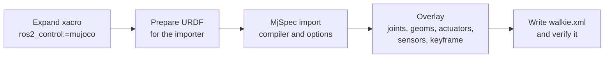

# 2.1 Generate the Model

**Goal:** turn the existing robot xacro into a MuJoCo model, `description/mujoco/walkie.xml`,
without keeping a second hand-written robot description.

This page records how the generator `description/scripts/build_mjcf.py` builds the model and
what the default world `description/mujoco/scene.xml` adds around it.

## In short

- **What changed:** the script expands the xacro, imports the URDF with MjSpec, and adds
  what URDF cannot express: a free base joint, collision classes, capsule wheel contacts,
  actuators, sensors, self-collision excludes and a `home` keyframe.
- **Single source of truth:** the xacro. A robot change reaches MuJoCo by running the
  generator again.
- **Estimates:** placeholder URDF values (base and lift inertia, lift effort) are replaced by
  estimates in the model, pending real data. The URDF is not changed.
- **World file:** `walkie.xml` has no floor. The floor and the four wheel-floor contact pairs
  live in the world file, `scene.xml` by default.
- **Result:** `pixi run mjcf` regenerates the model without a colcon build. The script checks
  the written file, and a test fails when `walkie.xml` is stale.



## Step 1: Expand the xacro

The script expands `description/robots/gz_walkie.urdf.xacro` with one argument,
`ros2_control:=mujoco`. This selects the MuJoCo branch of
`description/urdf/walkie/ros2_control.xacro`, which the generator reads later to build the
home keyframe and to check the actuators. The script reads the source tree, not `install/`,
so you do not need a colcon build before you run it.

??? info "Default xacro arguments, and how the source tree is read"
    All other xacro arguments keep their defaults, for example `dual_lidar` (`True`),
    `use_arm` (`True`) and `right_joint2_fixed` (`False`).

    The xacro files use `$(find walkie_description)`. Normally that resolves to the installed
    package under `install/`, which can be older than your source files. During the
    expansion the script puts a temporary ament prefix first on `AMENT_PREFIX_PATH`. That
    prefix contains only a symlink to the source directory of `walkie_description`, so the
    generator always reads the source tree.

## Step 2: Prepare the URDF for the MuJoCo importer

MuJoCo can import URDF directly, but the expanded URDF needs four changes first:

- Remove `<gazebo>`, `<ros2_control>` and `<transmission>`: the importer does not use them.
- Strip `package://walkie_description/` from mesh paths: MuJoCo does not know ROS package URIs.
- Replace visual meshes MuJoCo cannot load with the collision geometry of the same link.
- Add a `<mujoco><compiler .../></mujoco>` element for the mesh directory and import flags.

Because of the mesh fallback, the omni wheels, the OpenArm links, hands and fingers, and the
D415 camera look simpler in the viewer and in simulated camera images.

??? info "Details of the URDF changes"
    - The script keeps its own copy of the full URDF and reads the Gazebo sensors and the
      ros2_control block from that copy.
    - A mesh outside `walkie_description` is an error.
    - The `<compiler>` element sets the mesh directory, and turns off path stripping, visual
      discarding and static-body fusing for the import.

??? info "Visual mesh fallback: rules and affected links"
    MuJoCo cannot read COLLADA (`.dae`) files. The generator treats only STL, OBJ and MSH
    files as loadable, and for STL only binary files with at most 200,000 faces
    (`STL_MAX_FACES`), the limit of MuJoCo's STL decoder. Any other visual mesh is replaced
    by the collision origin and geometry of the same link. This needs no extra mesh files,
    and the fallback shape has the right size and position.

    Mesh paths are relative to `description/`.

    | Link | Visual mesh | Why it falls back |
    | --- | --- | --- |
    | `fl_wheel_link`, `fr_wheel_link`, `bl_wheel_link`, `br_wheel_link` | `meshes/walkie/omni_wheel_optimize.dae` | COLLADA |
    | `openarm_left_link0` to `link7`, `openarm_right_link0` to `link7` | `meshes/openarm/arm/v10/visual/link*.dae` | COLLADA |
    | `openarm_*_hand`, `openarm_*_left_finger`, `openarm_*_right_finger` | `meshes/openarm/ee/openarm_hand/visual/*.dae` | COLLADA |
    | `bottom_link` (D415 camera) | `urdf/walkie/depth_camera/d415/visual/d415.stl` | 425,160 faces, above the limit |

## Step 3: Import with MjSpec and set the options

The script imports the prepared URDF with `mujoco.MjSpec.from_string()` (`MjSpec` is
MuJoCo's Python API for building and editing a model before it is compiled) and names the
model `walkie`. The key settings:

- Static-body fusing stays off, so every URDF link stays a body with the same name.
- The `implicitfast` integrator keeps the stiff lift and the wheels stable at the default
  0.002 s step.
- Elliptic friction cones follow Coulomb friction more closely, which matters for the
  direction-dependent wheel friction.

??? info "All compiler and solver settings, with reasons"
    | Setting | Value | Reason |
    | --- | --- | --- |
    | `compiler.fusestatic` | `false` | Every URDF link stays a body with the same name. Rigidly attached bodies already act as one for contact filtering, and fusing would rewrite the spec so that it no longer recompiles. |
    | `compiler.discardvisual` | `false` | Keep the visual geoms. |
    | `compiler.inertiafromgeom` | `auto` | Bodies without an explicit inertial get one from their geoms. |
    | `option.timestep` | 0.002 s | MuJoCo's default step. |
    | `option.integrator` | `implicitfast` | Treats joint damping and velocity-actuator gains implicitly. This keeps the stiff lift damping and the velocity-driven wheels stable at a 2 ms step. |
    | `option.cone` | `elliptic` | Elliptic friction cones follow the Coulomb friction model more closely than the default pyramidal cones. The wheel friction depends on direction, so this matters. |

    In the written file the options appear as follows. The timestep is not written because
    0.002 s is the default.

    ```xml
    <compiler angle="radian" meshdir="../"/>
    <option integrator="implicitfast" cone="elliptic"/>
    ```

## Step 4: The MuJoCo overlay

The script then edits the spec in the order of the sections below.

### Free joint

A free joint named `floating_base_joint` is added to `base_footprint`, the root body, so the
base can move in all six degrees of freedom. It moves only because the wheels push against
the floor. Nothing sets its pose directly.

### Inertia estimates

Two URDF inertials are placeholders: `base_link` has a negligible inertia tensor, and
`lift_link` has no inertial at all. The model replaces them with estimates, marked as pending
CAD data in the script and in the header of `walkie.xml`. The URDF itself is not changed.

??? info "Inertia estimate values"
    | Link | Estimate | Constants |
    | --- | --- | --- |
    | `base_link` | URDF mass (20.2 kg) as a solid cylinder, radius 0.275 m, height 0.33 m, center 0.165 m above the link origin | `BASE_LINK_INERTIA_ESTIMATE_*` |
    | `lift_link` | 3.0 kg solid box, 0.346 × 0.174 × 0.132 m, center 0.109 m above the link origin | `LIFT_LINK_MASS_ESTIMATE`, `LIFT_LINK_INERTIA_ESTIMATE_*` |

### Geoms

- **Groups:** visual 2, collision 3, frame and IMU sites 4, lidar beam sites 5. MuJoCo shows
  groups 0 to 2 by default and cameras render the same groups, so collision geoms and sites
  stay out of camera images.
- **Wheels:** each wheel's collision cylinder becomes a capsule, `<wheel>_wheel_contact`, that
  touches only through the contact pairs in the world file.
  [2.2 Omni Wheels](02-omni-wheels.md) explains why.
- **Everything else:** each collision geom gets a collision class from its link name
  ([2.3 Collisions](03-collisions.md) has the table). A link with collision geometry but no
  class stops generation: add it to `LINK_COLLISION_CLASSES`.

??? info "Geom names, wheel capsule size, class bits, massless links and the error text"
    - Every geom gets a name: `<body>_visual` and `<body>_collision`, with an index suffix
      when a body has several. Geoms that already have a name in the URDF keep it (for
      example `top_bar` and `stem` on `lift_link`).
    - Group 3 (collision) includes the wheel capsules. Group 4 holds the frame sites and the
      IMU site.
    - The wheel capsules (for example `fl_wheel_contact`) have radius 0.075 m, half-length
      0.005 m and `contype="0" conaffinity="0"`.
    - A collision class is one bit as `contype`, and the classes it may touch as
      `conaffinity`.
    - Links without an `<inertial>` in the URDF are massless. Their geoms get `density="0"`,
      so `inertiafromgeom` does not give them a mass.

    A link with collision geometry that matches no collision class fails with:

    ```text
    link '<name>' has collision geometry but no collision class; add it to LINK_COLLISION_CLASSES
    ```

### Joints

- **Wheels:** near-zero damping and no friction loss replace the Gazebo values, which slow
  the wheels.
- **Other movable joints:** added rotor inertia (`armature`) keeps the light arm links stable
  at a 2 ms step.
- **Lift:** damping and force range from the lift drive estimates (see [Actuators](#actuators)).
- **Mimic joints:** the URDF `<mimic>` becomes a joint equality named `<follower>_mimic`.

??? info "Joint values and why"
    | Joints | Settings |
    | --- | --- |
    | Four wheel joints | `damping` 0.001, `frictionloss` 0, `armature` 0.01 |
    | All other movable joints except mimic joints | `armature` 0.01 |
    | `lift_joint` | `damping` 6000 N s/m, `actuatorfrcrange` ±600 N |
    | Mimic joints | Joint equality named `<follower>_mimic` |

    - The Gazebo wheel values (`damping="5.0" friction="0.5"`) would eat about 22 % of the
      commanded speed. See [2.2 Omni Wheels](02-omni-wheels.md).
    - The added rotor inertia (`armature`) keeps the light distal arm links stable at a 2 ms
      step with stiff position gains.
    - The URDF `<mimic>` of `openarm_*_finger_joint2` becomes an equality constraint, for
      example `openarm_left_finger_joint2_mimic`.

### Actuators

Every movable joint that is not a mimic joint gets one actuator with the joint's name,
because `mujoco_ros2_control` finds the actuators by the joint names in the ros2_control block.

- The wheels get velocity actuators. All others are position actuators with a damping ratio
  of 1 (critical damping).
- Arm and gripper gains follow `kp = effort / 0.05`: the actuator reaches the URDF effort
  limit at 0.05 rad (or 0.05 m) of tracking error.
- The lift's URDF effort limit of 10000 N is a placeholder, so the lift uses three
  estimates instead, pending real drive data.

??? info "Actuator gains, control ranges and force limits"
    | Joints | Actuator | Gain | Control range | Force limit |
    | --- | --- | --- | --- | --- |
    | Wheels | Velocity | `kv` = 20 N m per rad/s | ±URDF velocity limit (±100 rad/s) | ±URDF effort (±100 N m) |
    | `lift_joint` | Position | `kp` = 5.0e4 N/m (estimate) | URDF limits, 0.08 to 0.7435 m | ±600 N (estimate) |
    | Arm, gripper | Position | `kp` = URDF effort / 0.05 | URDF joint limits | ±URDF effort |
    | `head_servo_joint` | Position | `kp` = 20 (fallback, the URDF effort is 0) | URDF limits, -0.785398 to 1.0472 rad | none |

    Examples from the generated file:

    | Joints | `kp` | Force limit |
    | --- | --- | --- |
    | `openarm_*_joint1`, `joint2` | 800 | ±40 |
    | `openarm_*_joint3`, `joint4` | 540 | ±27 |
    | `openarm_*_joint5` to `joint7` | 140 | ±7 |
    | `openarm_*_finger_joint1` | 6660 | ±333 |

??? info "Why the lift does not use its URDF effort limit"
    An actuator derived from the 10000 N placeholder throws the robot off the floor on a
    setpoint step and crushes the arms into the base when the lift goes down. The script
    uses these estimates instead:

    | Constant | Value | Reason |
    | --- | --- | --- |
    | `LIFT_FORCE_LIMIT_ESTIMATE` | 600 N | About four times the static load of the lift with both arms (154 N) |
    | `LIFT_POSITION_KP_ESTIMATE` | 5.0e4 N/m | Keeps the static sag near 3 mm |
    | `LIFT_JOINT_DAMPING_ESTIMATE` | 6000 N s/m | Force limit / damping = 0.1 m/s, the URDF velocity limit, so steps move at a drive-like speed |

### Frame sites

Every link that is only a frame (no visual, no collision, no inertial) gets a site with the
same name in group 4. Enable site group 4 in the viewer to see these frames.

### Sensors

The script adds an IMU, two cameras and one rangefinder per lidar beam.
[2.4 Sensors](04-sensors.md) covers them in detail.

??? info "Sensor elements in walkie.xml"
    | Sensor | MJCF elements |
    | --- | --- |
    | IMU | Site `top_imu` on `top_imu_link`, sensors `top_imu_quat`, `top_imu_gyro`, `top_imu_accel` |
    | Cameras | `head_camera` and `bottom_camera` at the URDF optical frames, with field of view and resolution from the Gazebo sensors |
    | Lidars | One rangefinder per beam for `front_lidar` and `back_lidar`, 241 beams each, on `base_link` |

    The offscreen render buffer is set to the largest camera resolution, so camera images
    can be rendered at full size.

### Rest height

The root body is moved down so the wheel capsules touch z = 0. The robot starts at rest
instead of dropping onto the floor.

??? info "How the rest height is computed"
    The script compiles the model and finds the lowest point of the wheel capsules. It then
    moves the root body down so the capsules touch z = 0. In the URDF the wheel bottoms are
    6.2 mm above `base_footprint`, so the root ends up at `pos="0 0 -0.0062"`:

    ```xml
    <body name="base_footprint" pos="0 0 -0.0062">
      <joint name="floating_base_joint" type="free"/>
    ```

### Self-collision excludes

Some meshes overlap in the zero pose because of how they were modeled, and those contacts
would push the joints apart. The script excludes only the body pairs that touch at both lift
limits. A pair that touches at only one height is a real self-collision and stays active.

??? info "How the excludes are found, and the four current excludes"
    1. Put every joint at zero (clamped to its limits).
    2. List the robot body pairs in contact with the lift at its lower limit, and again at
       its upper limit.
    3. Exclude only the pairs that touch at both lift heights.

    A pair that touches at both heights comes from the meshes themselves. A pair that
    touches at only one height, such as an arm reaching into the base when the lift is low,
    is a real self-collision. The current model has four excludes:

    ```xml
    <exclude body1="openarm_left_link5" body2="openarm_left_link7"/>
    <exclude body1="openarm_left_right_finger" body2="openarm_left_left_finger"/>
    <exclude body1="openarm_right_link5" body2="openarm_right_link7"/>
    <exclude body1="openarm_right_right_finger" body2="openarm_right_left_finger"/>
    ```

### Home keyframe

The keyframe `home` uses the `initial_value` parameters of the MuJoCo ros2_control block.
It also sets the controls: each position actuator's control equals its joint position, so
the robot holds the pose.

??? info "Home keyframe values"
    | Joint | Value |
    | --- | --- |
    | `lift_joint` | 0.51 m |
    | `openarm_left_joint1`, `openarm_left_joint4` | 0.2618 rad |
    | `openarm_right_joint1` | -0.2618 rad |
    | `openarm_right_joint4` | 0.2618 rad |

    All other joints are at zero, clamped to their limits. The mimic followers are placed
    where their equality puts them. The wheel controls are zero.

### Header comment

Finally the script writes a header comment into `walkie.xml`. A launch file or a custom world
should read its values from there instead of guessing them: the collision classes with their
bit values, the lidar beam parameters (count, angles, range, rate), the cameras, the IMU
sensors and every estimate.

## Step 5: Write and verify walkie.xml

The script writes the model with `MjSpec.to_xml()`. Mesh paths resolve from `description/`
(`meshdir="../"`), so the model also loads from the installed package, which has the same
layout under `share/walkie_description/`. Two checks follow:

- **Round trip:** the MJCF writer can drop a setting without warning, so the script compiles
  the written XML again and compares it with the spec. A difference stops the script with
  `written model differs from the spec in <field>`.
- **Actuators against ros2_control:** if a joint of the MuJoCo ros2_control block has no
  actuator, or an actuator has no joint, the script prints an `error:` line and exits with
  code 1. The file is already written at that point, so fix the mismatch and run the
  generator again.

??? info "What the round-trip check compares, and a successful run's output"
    The check compares counts such as `nq`, `nu`, `ngeom` and `nsensor`, and arrays such as
    body masses, collision bits, actuator gains and the keyframe.

    A successful run prints a summary like this:

    ```text
    wrote .../description/mujoco/walkie.xml: nq=31 nv=30 nu=22 nbody=57 ngeom=69 nmesh=23 nsensor=485 mass=36.664 kg, 4 self-collision excludes
    ```

## The default world: scene.xml

`walkie.xml` has no floor, so it cannot be simulated on its own. `description/mujoco/scene.xml`
is the minimal world around it: the robot (included first in the file), the floor, the four
wheel-floor `<pair>` elements, the camera near-plane settings, and lights and materials for
appearance.

The wheel pairs live in the world file because a `<pair>` can only be declared where both of
its geoms exist, and the floor belongs to the world. This also lets each world define its
own floor.

??? info "Appearance elements and the wheel-floor pairs in scene.xml"
    The appearance elements are a headlight, haze, a skybox, a directional light and a
    checker material.

    ```xml
    <contact>
      <!-- friction: along the axle, along the rolling direction, torsional, rolling (x2) -->
      <pair geom1="fl_wheel_contact" geom2="floor" condim="3" friction="0.005 1 0.005 0.0001 0.0001"/>
      ...
    </contact>
    ```

### Rules for a custom world

The header comment of `scene.xml` lists the rules. A custom world must:

1. **Stay in `description/mujoco/`.** `walkie.xml` finds its meshes relative to the
   directory of the top-level file (`meshdir="../"`). A world file elsewhere breaks the mesh
   paths.
2. **Include `walkie.xml` before any other body with joints**, as `<include file="walkie.xml"/>`.
   The robot's degrees of freedom must come first in `qpos`, so the `home` keyframe stays
   valid.
3. **Declare a `type="plane"` geom named `floor`** with `contype="1" conaffinity="32"` (the
   FLOOR collision class).
4. **Contain the four wheel-floor `<pair>` elements.** They are the only contacts of the
   wheels, and the wheel friction only works against a plane.
5. **Keep the `<statistic>` extent and the `<map znear>` value.** `scene.xml` uses
   `<statistic center="0 0 0.7" extent="2.2"/>` and `<map znear="0.025"/>`, so the camera
   near plane is 0.025 × 2.2 = 5.5 cm. It must stay above about 3 cm, or the head camera
   renders the inside of the ZED housing it sits in.

Every other geom in the world needs a collision class: FURN (`contype="64" conaffinity="56"`)
for furniture, walls and other static geometry, and OBJ (`contype="32" conaffinity="121"`)
for anything that moves. FURN does not collide with FLOOR, so furniture must be a body
without joints. [2.3 Collisions](03-collisions.md#objects-and-furniture-in-a-custom-world)
explains the classes.
[MuJoCo Simulation: Build a custom world](../../guides/simulation-mujoco.md#build-a-custom-world)
walks through these rules step by step, with a complete example world.

## Regenerate and view

| Task | Command |
| --- | --- |
| Regenerate `description/mujoco/walkie.xml` | `pixi run mjcf` |
| Open `scene.xml` in the MuJoCo viewer at the `home` keyframe | `pixi run mjcf-view` |
| Write to another file, for comparison only | `pixi run python description/scripts/build_mjcf.py /tmp/walkie.xml` |
| Run the MJCF tests | `pixi run python -m pytest description/test/test_mjcf.py` |

None of these needs a colcon build. Regenerate the model after any change to the robot xacro
files, the meshes, or `build_mjcf.py`, and commit the new `walkie.xml` with the change. If
you forget, `test_generated_model_is_up_to_date` in `description/test/test_mjcf.py` fails.
It runs the generator into a temporary directory and compares the result with the
checked-in file:

```text
mujoco/walkie.xml is out of date; regenerate it with "pixi run mjcf"
```

!!! tip "Seeing collision geometry"
    Collision geoms are in group 3, which the viewer hides by default. Enable geom group 3
    to see the wheel capsules and the collision shapes of the arms and base.

!!! warning "Do not edit walkie.xml by hand"
    The header comment starts with `GENERATED FILE - DO NOT EDIT BY HAND`. A manual edit is
    lost the next time someone runs `pixi run mjcf`, and the freshness test fails until
    then. Change the xacro or `build_mjcf.py` instead.
