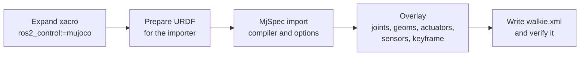

# 2.1 Generate the Model

**Goal:** turn the existing robot xacro into a MuJoCo model, `description/mujoco/walkie.xml`,
without keeping a second hand-written robot description.

The generator is `description/scripts/build_mjcf.py`. This page follows the script in the
order it runs. Then it covers the default world `description/mujoco/scene.xml`, and how to
regenerate and view the model.

## Overview



The xacro stays the single source of truth. Everything MuJoCo needs that URDF cannot express
is added by the script, so a change to the robot description reaches MuJoCo by running the
generator again.

## Step 1: Expand the xacro

The script expands `description/robots/gz_walkie.urdf.xacro` with one argument:
`ros2_control:=mujoco`. All other xacro arguments keep their defaults, for example
`dual_lidar` (`True`), `use_arm` (`True`) and `right_joint2_fixed` (`False`).

The `mujoco` value selects the MuJoCo branch of `description/urdf/walkie/ros2_control.xacro`.
The generator reads that block later to build the home keyframe and to check the actuators
against it.

The xacro files use `$(find walkie_description)`. Normally that resolves to the installed
package under `install/`, which can be older than your source files. The script avoids this:
during the expansion it puts a temporary ament prefix first on `AMENT_PREFIX_PATH`. That
prefix contains only a symlink to the source directory of `walkie_description`. So the
generator always reads the source tree, and you do not need a colcon build before you run it.

## Step 2: Prepare the URDF for the MuJoCo importer

MuJoCo can import URDF directly, but the expanded URDF needs a few changes first:

| Change | Reason |
| --- | --- |
| Remove `<gazebo>`, `<ros2_control>` and `<transmission>` | The importer does not use them. The script keeps its own copy of the full URDF and reads the Gazebo sensors and the ros2_control block from that copy. |
| Strip `package://walkie_description/` from mesh paths | MuJoCo does not know ROS package URIs. A mesh outside `walkie_description` is an error. |
| Replace visual meshes MuJoCo cannot load | See below. |
| Add a `<mujoco><compiler .../></mujoco>` element | Sets the mesh directory, and turns off path stripping, visual discarding and static-body fusing for the import. |

### Visual mesh fallback

MuJoCo cannot read COLLADA (`.dae`) files. The generator treats only STL, OBJ and MSH files
as loadable, and for STL only binary files with at most 200,000 faces (`STL_MAX_FACES`), the
limit of MuJoCo's STL decoder. Any other visual mesh is replaced by the collision origin and
geometry of the same link. This needs no extra mesh files, and the fallback shape has the
right size and position.

| Link | Visual mesh | Why it falls back |
| --- | --- | --- |
| `fl_wheel_link`, `fr_wheel_link`, `bl_wheel_link`, `br_wheel_link` | `meshes/walkie/omni_wheel_optimize.dae` | COLLADA |
| `openarm_left_link0` to `link7`, `openarm_right_link0` to `link7` | `meshes/openarm/arm/v10/visual/link*.dae` | COLLADA |
| `openarm_*_hand`, `openarm_*_left_finger`, `openarm_*_right_finger` | `meshes/openarm/ee/openarm_hand/visual/*.dae` | COLLADA |
| `bottom_link` (D415 camera) | `urdf/walkie/depth_camera/d415/visual/d415.stl` | 425,160 faces, above the limit |

The mesh paths in this table are relative to `description/`. The consequence is that these
parts look simpler in the viewer and in simulated camera images.

## Step 3: Import with MjSpec and set the options

`MjSpec` is MuJoCo's Python API for building and editing a model before it is compiled. The
script imports the prepared URDF with `mujoco.MjSpec.from_string()`, names the model
`walkie`, and sets:

| Setting | Value | Reason |
| --- | --- | --- |
| `compiler.fusestatic` | `false` | Every URDF link stays a body with the same name. Rigidly attached bodies already act as one for contact filtering, and fusing would rewrite the spec so that it no longer recompiles. |
| `compiler.discardvisual` | `false` | Keep the visual geoms. |
| `compiler.inertiafromgeom` | `auto` | Bodies without an explicit inertial get one from their geoms. |
| `option.timestep` | 0.002 s | MuJoCo's default step. |
| `option.integrator` | `implicitfast` | Treats joint damping and velocity-actuator gains implicitly. This keeps the stiff lift damping and the velocity-driven wheels stable at a 2 ms step. |
| `option.cone` | `elliptic` | Elliptic friction cones follow the Coulomb friction model more closely than the default pyramidal cones. The wheel friction depends on direction, so this matters. |

In the written file the options appear as:

```xml
<compiler angle="radian" meshdir="../"/>
<option integrator="implicitfast" cone="elliptic"/>
```

The timestep is not written because 0.002 s is the default.

## Step 4: The MuJoCo overlay

The script then edits the spec in this order.

### Free joint

A free joint named `floating_base_joint` is added to `base_footprint`, the root body. The
base can then move in all six degrees of freedom. It moves only because the wheels push
against the floor. Nothing sets its pose directly.

```xml
<body name="base_footprint" pos="0 0 -0.0062">
  <joint name="floating_base_joint" type="free"/>
```

### Inertia estimates

Two URDF inertials are placeholders. `base_link` has a negligible inertia tensor, and
`lift_link` has no inertial at all. The model replaces them with estimates. The URDF itself
is not changed.

| Link | Estimate | Constants |
| --- | --- | --- |
| `base_link` | URDF mass (20.2 kg) as a solid cylinder, radius 0.275 m, height 0.33 m, center 0.165 m above the link origin | `BASE_LINK_INERTIA_ESTIMATE_*` |
| `lift_link` | 3.0 kg solid box, 0.346 × 0.174 × 0.132 m, center 0.109 m above the link origin | `LIFT_LINK_MASS_ESTIMATE`, `LIFT_LINK_INERTIA_ESTIMATE_*` |

These values are marked as estimates pending CAD data in the script and in the header of
`walkie.xml`.

### Geoms

Every geom gets a name: `<body>_visual` and `<body>_collision`, with an index suffix when a
body has several. Geoms that already have a name in the URDF keep it (for example `top_bar`
and `stem` on `lift_link`).

Geoms and sites are sorted into groups. MuJoCo shows groups 0 to 2 by default, and cameras
render the same groups, so collision geoms and sites stay out of camera images.

| Group | Contents |
| --- | --- |
| 2 | Visual geoms |
| 3 | Collision geoms, including the wheel capsules |
| 4 | Frame sites and the IMU site |
| 5 | Lidar beam sites |

Links without an `<inertial>` in the URDF are massless. Their geoms get `density="0"`, so
`inertiafromgeom` does not give them a mass.

Each wheel's collision cylinder becomes a capsule named `<wheel>_wheel_contact` (for example
`fl_wheel_contact`) with radius 0.075 m and half-length 0.005 m. It has
`contype="0" conaffinity="0"`, so it touches only through the explicit contact pairs in the
world file. [Omni wheels](02-omni-wheels.md) explains why.

All other collision geoms get a collision class: one bit as `contype`, and the classes it may
touch as `conaffinity`. The class comes from the link name. If a link with collision geometry
matches no class, generation fails with
`link '<name>' has collision geometry but no collision class; add it to LINK_COLLISION_CLASSES`.
[Collisions](03-collisions.md) has the full table.

### Joints

| Joints | Settings | Reason |
| --- | --- | --- |
| Four wheel joints | `damping` 0.001, `frictionloss` 0, `armature` 0.01 | Replace the Gazebo values (`damping="5.0" friction="0.5"`), which would eat about 22 % of the commanded speed. See [Omni wheels](02-omni-wheels.md). |
| All other movable joints except mimic joints | `armature` 0.01 | Added rotor inertia keeps the light distal arm links stable at a 2 ms step with stiff position gains. |
| `lift_joint` | `damping` 6000 N s/m, `actuatorfrcrange` ±600 N | Lift drive estimates, see below. |
| Mimic joints | Joint equality named `<follower>_mimic` | The URDF `<mimic>` of `openarm_*_finger_joint2` becomes an equality constraint, for example `openarm_left_finger_joint2_mimic`. |

### Actuators

There is one actuator for every movable joint that is not a mimic joint. Each actuator has
the same name as its joint. This matches the joint names in the ros2_control block, which
`mujoco_ros2_control` uses to find the actuators.

| Joints | Actuator | Gain | Control range | Force limit |
| --- | --- | --- | --- | --- |
| Wheels | Velocity | `kv` = 20 N m per rad/s | ±URDF velocity limit (±100 rad/s) | ±URDF effort (±100 N m) |
| `lift_joint` | Position | `kp` = 5.0e4 N/m (estimate) | URDF limits, 0.08 to 0.7435 m | ±600 N (estimate) |
| Arm, gripper | Position | `kp` = URDF effort / 0.05 | URDF joint limits | ±URDF effort |
| `head_servo_joint` | Position | `kp` = 20 (fallback, the URDF effort is 0) | URDF limits, -0.785398 to 1.0472 rad | none |

The position gain rule, `kp = effort / 0.05`, means the actuator reaches the URDF effort limit
at 0.05 rad (or 0.05 m) of tracking error. All position actuators use a damping ratio of 1
(critical damping). Examples from the generated file:

| Joints | `kp` | Force limit |
| --- | --- | --- |
| `openarm_*_joint1`, `joint2` | 800 | ±40 |
| `openarm_*_joint3`, `joint4` | 540 | ±27 |
| `openarm_*_joint5` to `joint7` | 140 | ±7 |
| `openarm_*_finger_joint1` | 6660 | ±333 |

The lift is a special case. Its URDF effort limit of 10000 N is a placeholder. An actuator
derived from it throws the robot off the floor on a setpoint step and crushes the arms into
the base when the lift goes down. The script therefore uses three estimates, pending real
drive data:

| Constant | Value | Reason |
| --- | --- | --- |
| `LIFT_FORCE_LIMIT_ESTIMATE` | 600 N | About four times the static load of the lift with both arms (154 N) |
| `LIFT_POSITION_KP_ESTIMATE` | 5.0e4 N/m | Keeps the static sag near 3 mm |
| `LIFT_JOINT_DAMPING_ESTIMATE` | 6000 N s/m | Force limit / damping = 0.1 m/s, the URDF velocity limit, so steps move at a drive-like speed |

### Frame sites

Every link that is only a frame (no visual, no collision, no inertial) gets a site with the
same name in group 4. You can show these frames in the viewer by enabling site group 4.

### Sensors

The script adds three kinds of sensors. [Sensors](04-sensors.md) covers them in detail.

| Sensor | MJCF elements |
| --- | --- |
| IMU | Site `top_imu` on `top_imu_link`, sensors `top_imu_quat`, `top_imu_gyro`, `top_imu_accel` |
| Cameras | `head_camera` and `bottom_camera` at the URDF optical frames, with field of view and resolution from the Gazebo sensors |
| Lidars | One rangefinder per beam for `front_lidar` and `back_lidar`, 241 beams each, on `base_link` |

The offscreen render buffer is set to the largest camera resolution, so camera images can be
rendered at full size.

### Rest height

The script compiles the model and finds the lowest point of the wheel capsules. It then moves
the root body down so the capsules touch z = 0. In the URDF the wheel bottoms are 6.2 mm above
`base_footprint`, so the root ends up at `pos="0 0 -0.0062"`. The robot starts at rest instead
of dropping onto the floor.

### Self-collision excludes

Some meshes overlap in the zero pose because of how they were modelled. Those contacts would
push the joints apart. The script finds them like this:

1. Put every joint at zero (clamped to its limits).
2. List the robot body pairs in contact with the lift at its lower limit, and again at its
   upper limit.
3. Exclude only the pairs that touch at both lift heights.

A pair that touches at both heights comes from the meshes themselves. A pair that touches at
only one height, such as an arm reaching into the base when the lift is low, is a real
self-collision and stays active. The current model has four excludes:

```xml
<exclude body1="openarm_left_link5" body2="openarm_left_link7"/>
<exclude body1="openarm_left_right_finger" body2="openarm_left_left_finger"/>
<exclude body1="openarm_right_link5" body2="openarm_right_link7"/>
<exclude body1="openarm_right_right_finger" body2="openarm_right_left_finger"/>
```

### Home keyframe

The keyframe `home` uses the `initial_value` parameters of the MuJoCo ros2_control block:

| Joint | Value |
| --- | --- |
| `lift_joint` | 0.51 m |
| `openarm_left_joint1`, `openarm_left_joint4` | 0.2618 rad |
| `openarm_right_joint1` | -0.2618 rad |
| `openarm_right_joint4` | 0.2618 rad |

All other joints are at zero, clamped to their limits. The mimic followers are placed where
their equality puts them. The keyframe also sets the controls: each position actuator's
control equals its joint position, so the robot holds the pose. The wheel controls are zero.

### Header comment

Finally the script writes a header comment into `walkie.xml`. It lists the collision classes
with their bit values, the lidar beam parameters (count, angles, range, rate), the cameras,
the IMU sensors and every estimate. A launch file or a custom world should read these values
from the header instead of guessing them.

## Step 5: Write and verify walkie.xml

The script writes the model with `MjSpec.to_xml()`. The mesh directory is `meshdir="../"`,
so mesh paths resolve from `description/`. The installed package has the same layout under
`share/walkie_description/`, so the model loads from either place.

The MJCF writer can drop a setting without warning. To catch that, the script compiles the
written XML again and compares it with the spec: counts such as `nq`, `nu`, `ngeom` and
`nsensor`, and arrays such as body masses, collision bits, actuator gains and the keyframe.
Any difference stops the script with `written model differs from the spec in <field>`.

Last, the script compares the actuators with the joints of the MuJoCo ros2_control block.
A joint without an actuator, or an actuator without a joint, prints an `error:` line and
makes the script exit with code 1. The file has already been written at that point, so fix
the mismatch and run the generator again.

A successful run prints a summary like this:

```text
wrote .../description/mujoco/walkie.xml: nq=31 nv=30 nu=22 nbody=57 ngeom=69 nmesh=23 nsensor=485 mass=36.664 kg, 4 self-collision excludes
```

## The default world: scene.xml

`walkie.xml` has no floor, so it cannot be simulated on its own. `description/mujoco/scene.xml`
is the minimal world around it:

| Element | Purpose |
| --- | --- |
| `<include file="walkie.xml"/>` | The robot, first in the file |
| `<statistic center="0 0 0.7" extent="2.2"/>` and `<map znear="0.025"/>` | Camera near plane of 0.025 × 2.2 = 5.5 cm. It must stay above about 3 cm, or the head camera renders the inside of the ZED housing it sits in. |
| Headlight, haze, skybox, a directional light, a checker material | Appearance only |
| `<geom name="floor" type="plane" ... contype="1" conaffinity="32"/>` | The floor, in the FLOOR collision class |
| Four `<pair>` elements | The only contacts of the wheels |

```xml
<contact>
  <!-- friction: along the axle, along the rolling direction, torsional, rolling (x2) -->
  <pair geom1="fl_wheel_contact" geom2="floor" condim="3" friction="0.005 1 0.005 0.0001 0.0001"/>
  ...
</contact>
```

### Why the wheel pairs live in the world file

A `<pair>` names two geoms, and the floor belongs to the world, not to the robot. So the
pairs can only be declared where both geoms exist. Keeping the floor out of `walkie.xml` also
lets each world define its own floor.

### Rules for a custom world

The header comment of `scene.xml` lists the rules. A custom world must:

1. **Stay in `description/mujoco/`.** `walkie.xml` finds its meshes relative to the
   directory of the top-level file (`meshdir="../"`). A world file elsewhere breaks the mesh
   paths.
2. **Include `walkie.xml` before any other body with joints.** The robot's degrees of freedom
   must come first in `qpos`, so the `home` keyframe stays valid.
3. **Declare a `type="plane"` geom named `floor`** with `contype="1" conaffinity="32"`.
4. **Contain the four wheel-floor `<pair>` elements.** The wheel friction only works against
   a plane.
5. **Keep the `<statistic>` extent and the `<map znear>` value**, for the camera near plane.

Every other geom in the world needs a collision class: FURN (`contype="64" conaffinity="56"`)
for furniture, walls and other static geometry, and OBJ (`contype="32" conaffinity="121"`)
for anything that moves. FURN does not collide with FLOOR, so furniture must be a body
without joints.
[Collisions](03-collisions.md#objects-and-furniture-in-a-custom-world) explains the classes.

[MuJoCo simulation: Build a custom world](../../guides/simulation-mujoco.md#build-a-custom-world)
walks through these rules step by step, with a complete example world.

## Regenerate and view

| Task | Command |
| --- | --- |
| Regenerate `description/mujoco/walkie.xml` | `pixi run mjcf` |
| Open `scene.xml` in the MuJoCo viewer at the `home` keyframe | `pixi run mjcf-view` |
| Write to another file, for comparison only | `pixi run python description/scripts/build_mjcf.py /tmp/walkie.xml` |
| Run the MJCF tests | `pixi run python -m pytest description/test/test_mjcf.py` |

None of these needs a colcon build. Regenerate the model after any change to the robot
xacro files, the meshes, or `build_mjcf.py`, and commit the new `walkie.xml` together with
the change.

The test `test_generated_model_is_up_to_date` in `description/test/test_mjcf.py` runs the
generator into a temporary directory and compares the result with the checked-in file. If
you forget to regenerate, it fails with:

```text
mujoco/walkie.xml is out of date; regenerate it with "pixi run mjcf"
```

!!! tip "Seeing collision geometry"
    Collision geoms are in group 3, which the viewer hides by default. Enable geom group 3
    in the viewer to see the wheel capsules and the collision shapes of the arms and base.

!!! warning "Do not edit walkie.xml by hand"
    The header comment of the file starts with `GENERATED FILE - DO NOT EDIT BY HAND`. A
    manual edit is lost the next time someone runs `pixi run mjcf`, and the freshness test
    fails until then. Change the xacro or `build_mjcf.py` instead.
