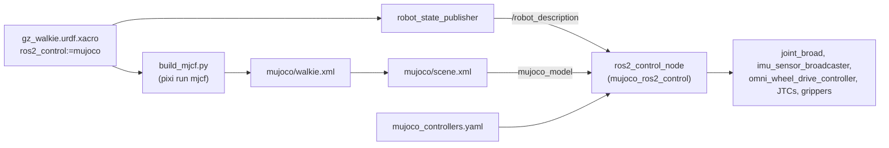

# 2.5 ros2_control

**Goal:** let the existing controllers, MoveIt and Nav2 drive the MuJoCo model through
ros2_control, without any MuJoCo-specific code in the controllers.

This entry records how the URDF got a `mujoco` ros2_control mode, and what is still
missing before MuJoCo runs with ROS.

!!! warning "No launch file yet"
    No launch file starts the simulator yet. See
    [The launch file still to write](#the-launch-file-still-to-write).

!!! note "Update 2026-10-13"
    Since the [move to RoboStack build set `_25`](../04-robostack-build-25.md),
    `mujoco_ros2_control` 0.1.2 is in the pixi environment. A headless bringup started by
    hand, with the `mujoco` branch and `mujoco_controllers.yaml`, worked.
    [MuJoCo Simulation: Run with ROS 2](../../guides/simulation-mujoco.md#run-with-ros-2)
    has the verified setup.

## In short

- `ros2_control:=mujoco` selects the `mujoco_ros2_control` hardware plugin. That
  package ships its own `ros2_control_node`, so the simulation and the controller
  manager run in one process, as with `gz_ros2_control` inside Gazebo.
- Each commanded joint has one MJCF actuator of the same name and one command
  interface: velocity for the wheels, position for everything else.
- `mujoco_controllers.yaml` is `sim_controllers.yaml` without the arm velocity
  controllers and with an IMU broadcaster.
- MoveIt accepts `hardware_type:=mujoco`. The same commit fixed the Gazebo `joint_broad`
  spawner.
- Done: the `mujoco` branch, the controller file (both tested) and the MoveIt changes.
  The re-lock to the RoboStack `_25` build set for `mujoco_ros2_control` 0.1.2 followed
  in [entry 4](../04-robostack-build-25.md). Open: the launch file.

??? info "Commits of this step"
    | Repository | Commit | Change |
    | --- | --- | --- |
    | `description` submodule | `851618c` | `mujoco` ros2_control branch, `mujoco_model` / `mujoco_headless` arguments, `mujoco_controllers.yaml` |
    | `description` submodule | `301c439` | Generator: one actuator per joint, equality constraints, `home` keyframe |
    | `description` submodule | `2b15ba1` | Contract tests |
    | superproject | `72359aa` | MoveIt `hardware_type:=mujoco` and the `joint_broad` spawner fix |
    | superproject | `a926459` | `mujoco` in the pixi environment and the `mjcf` / `mjcf-view` tasks |

## How the pieces fit



One xacro feeds both sides: `robot_state_publisher` publishes the URDF with the `mujoco`
block, and the generator turns the same URDF into the MJCF model. The block expects the
hardware plugin to pair each ros2_control joint with the MJCF actuator of the same name.

## The mujoco branch

The block lives in `description/urdf/walkie/ros2_control.xacro`, inside
`<xacro:if value="${ros2_control == 'mujoco'}">`. These xacro arguments control it:

| Argument | Default | Notes |
| --- | --- | --- |
| `ros2_control` | `gazebo` | Set to `mujoco` for this branch |
| `mujoco_model` | `$(find walkie_description)/mujoco/scene.xml` | MJCF world to load (`mujoco` branch only) |
| `mujoco_headless` | `false` | `true` runs without the MuJoCo Simulate window (`mujoco` branch only) |

!!! warning
    `robot_state_publisher.launch.py` does not forward `mujoco_model` or
    `mujoco_headless`. See [Known issues](#known-issues).

??? info "Shortened excerpt of the mujoco block"
    ```xml
    <ros2_control name="MujocoSystem" type="system">
      <hardware>
        <plugin>mujoco_ros2_control/MujocoSystemInterface</plugin>
        <param name="mujoco_model">${mujoco_model}</param>
        <param name="headless">${'true' if mujoco_headless else 'false'}</param>
        <!-- Ground-truth pose of the free-floating base (nav_msgs/Odometry, no TF) -->
        <param name="odom_free_joint_name">floating_base_joint</param>
        <param name="odom_topic">/mujoco_ground_truth/odom</param>
      </hardware>
      <xacro:mujoco_wheel_joint name="fl_wheel_joint" vel_min="-3.14" vel_max="3.14"/>
      <!-- fr, br, bl wheels, head_servo_joint and lift_joint ... -->
      <xacro:mujoco_position_arm_joint joint_name="openarm_left_joint1" initial_position="0.2618" />
      <!-- other arm joints and openarm_*_finger_joint1 ... -->
      <sensor name="top_imu">
        <param name="mujoco_type">imu</param>
        <param name="mujoco_sensor_name">top_imu</param>
        <!-- orientation.x/y/z/w, angular_velocity.x/y/z, linear_acceleration.x/y/z -->
      </sensor>
    </ros2_control>
    ```

??? info "Hardware parameters, plugin version, and where the arguments are declared"
    | Parameter | Value | Meaning |
    | --- | --- | --- |
    | `plugin` | `mujoco_ros2_control/MujocoSystemInterface` | The system interface of `mujoco_ros2_control` |
    | `mujoco_model` | `${mujoco_model}`, default `$(find walkie_description)/mujoco/scene.xml` | The MJCF world to load. The default is the installed copy of `scene.xml`. |
    | `headless` | `false` unless `mujoco_headless` is true | Run without the MuJoCo Simulate window |
    | `odom_free_joint_name` | `floating_base_joint` | The free joint of the base, used for ground truth |
    | `odom_topic` | `/mujoco_ground_truth/odom` | Ground-truth `nav_msgs/Odometry` of the base. It publishes no TF. |

    The plugin parameters were checked against the 0.1.2 package on `robostack-jazzy`
    (commit `851618c` of the `description` submodule).

    Both new arguments are declared in `description/robots/gz_walkie.urdf.xacro` and
    passed into the `ros2_control` macro. The commit message of `851618c` states that
    the other modes expand byte-identical to before.

## The actuator contract

Every commanded joint has an MJCF actuator with the same name, and exactly one command
interface that matches the actuator type (the rule is in the comment above the block):

- **Wheels: velocity.** `omni_wheel_drive_controller` writes wheel velocities. A
  velocity actuator acts like the speed loop of a motor driver.
- **Arms, grippers, lift and head: position.** Their controllers all write positions. A
  position actuator acts like the position loop inside a servo.

Only one interface, because a MuJoCo actuator reads its control value as whatever its
type says: a target position or a target velocity. A joint with both interfaces would let a controller write a velocity into a
position actuator. The MuJoCo arms have no velocity interface, so the Gazebo arm
velocity controllers were dropped from the MuJoCo controller file.

`pixi run mjcf` checks the contract after writing the model. On a mismatch it prints
`error: ros2_control joint '<name>' has no actuator` or
`error: actuator '<name>' has no ros2_control joint` and exits with code 1, but it still
writes the file.

!!! warning
    The head, lift and wheel command limits do not match the MJCF actuators. See
    [Known issues](#known-issues).

??? info "Interfaces, ranges, gains and force limits per joint"
    | Joints | Command (xacro limits) | State interfaces | MJCF actuator | `ctrlrange` | Gain | Force limit |
    | --- | --- | --- | --- | --- | --- | --- |
    | `fl/fr/bl/br_wheel_joint` | velocity (±3.14) | position, velocity | velocity | ±100 rad/s | kv 20 | ±100 |
    | `lift_joint` | position (0.000 to 0.743) | position (initial 0.51), velocity | position | 0.08 to 0.7435 m | kp 50000 | ±600 N |
    | `head_servo_joint` | position (±1.54) | position, velocity | position | -0.785398 to 1.0472 rad | kp 20 | none |
    | `openarm_*_joint1`, `joint2` | position | position, velocity, effort | position | URDF limits | kp 800 | ±40 |
    | `openarm_*_joint3`, `joint4` | position | position, velocity, effort | position | URDF limits | kp 540 | ±27 |
    | `openarm_*_joint5` to `joint7` | position | position, velocity, effort | position | URDF limits | kp 140 | ±7 |
    | `openarm_*_finger_joint1` | position | position, velocity, effort | position | 0 to 0.044 m | kp 6660 | ±333 |

    The generator creates one actuator per movable, non-mimic URDF joint. It does not
    read the ros2_control block to decide which actuators exist; it only compares the
    two sets afterwards.

??? info "Controller types, stability, and the difference from Gazebo"
    - Wheels: the wheel turns, and the wheel-floor contact pushes the base. See
      [2.2 Omni Wheels](02-omni-wheels.md).
    - The position-writing controllers are `JointTrajectoryController`,
      `GripperActionController`, `ForwardCommandController` with
      `interface_name: position`, and `JointGroupPositionController`.
    - With the joint armature of 0.01, a position actuator stays stable at the 0.002 s
      time step.
    - The Gazebo branch offers position, velocity and effort commands on every arm
      joint, and `sim_controllers.yaml` uses the velocity ones in
      `left/right_forward_velocity_controller`. The MuJoCo arms have position actuators
      only.

### How the gains are chosen

- **Arm and gripper joints:** `kp = effort / 0.05`, critically damped. The actuator
  reaches the URDF effort limit at 0.05 rad (or 0.05 m) of tracking error.
- **`head_servo_joint`:** fallback `kp = 20`, because its URDF effort is 0.
- **`lift_joint`:** `kp = 50000` N/m, 600 N force limit, 6000 N s/m joint damping,
  because the URDF effort (10000 N) is a placeholder. These are estimates pending the
  lift drive data.
- **Wheels:** velocity actuator with `kv = 20`.

??? info "Gain constants, the lift numbers, and how MuJoCo stores damping"
    - Constant names: `POSITION_SATURATION_ERROR` (the 0.05 in the arm rule),
      `POSITION_KP_FALLBACK` (head), `WHEEL_KV` (wheels).
    - Damping ratio 1 (critical damping) avoids overshoot.
    - With a head effort of 0, the arm rule would give nothing.
    - A lift actuator derived from the 10000 N placeholder threw the robot off the
      floor on a setpoint step.
    - The code comment for the lift explains its numbers. The force limit is about four
      times the static load of the lift with both arms (154 N). The stiffness keeps the
      static sag near 3 mm. The force limit divided by the damping equals the URDF
      velocity limit of 0.1 m/s, so a setpoint step moves the lift at a drive-like
      speed.
    - Wheel force = `kv * (command - wheel speed)`, limited to ±100.
    - In the MJCF file, a position actuator looks like `biasprm="0 -800 1"`. The
      positive third value is the damping ratio, not a damping gain. MuJoCo stores
      `dampratio` this way.

### Mimic joints

Each OpenArm gripper has two fingers, and `openarm_*_finger_joint2` mimics
`openarm_*_finger_joint1` in the URDF. The MuJoCo block does not list the mimic joint.
MuJoCo's URDF importer turns each `<mimic>` into a joint equality constraint. Only
`openarm_*_finger_joint1` has an actuator, and the constraint makes the second finger
follow.

??? info "The equality constraints and the tests that check them"
    The Gazebo branch, in contrast, declares the mimic joint in ros2_control with
    `<param name="mimic">`.

    The generator names each constraint after the follower joint:

    ```xml
    <equality>
      <joint name="openarm_left_finger_joint2_mimic" joint1="openarm_left_finger_joint2" joint2="openarm_left_finger_joint1"/>
      <joint name="openarm_right_finger_joint2_mimic" joint1="openarm_right_finger_joint2" joint2="openarm_right_finger_joint1"/>
    </equality>
    ```

    `test_description.py` checks that no mimic joint is declared in the `mujoco` block.
    `test_mjcf.py` also checks that mimic joints have no actuator and that each one has
    its `<name>_mimic` equality.

### Initial positions

The start pose comes from the `initial_value` parameters. The xacro does not set the
`initial_keyframe` parameter that 0.1.2 offers.

| Joint | `initial_value` |
| --- | --- |
| `lift_joint` | 0.51 |
| `openarm_left_joint1` | 0.2618 |
| `openarm_left_joint4` | 0.2618 |
| `openarm_right_joint1` | -0.2618 |
| `openarm_right_joint4` | 0.2618 |
| all other arm and finger joints | 0.0 |

The generator also writes these values into the `home` keyframe of `walkie.xml` (joint
positions and actuator controls). `test_home_keyframe_matches_initial_positions` keeps
them equal.

### right_joint2_fixed

With `right_joint2_fixed:=true`, the block omits `openarm_right_joint2`. The controller
file still lists that joint in several controllers, so the launch file must drop it from
them in that mode.

??? info "Why walkie.xml still has the actuator"
    The checked-in `walkie.xml` is generated with `right_joint2_fixed:=false`, so it
    still has the actuator. Its control stays at 0, which holds the joint at the pose of
    the fixed URDF joint.

### IMU

The `<sensor name="top_imu">` block maps the MJCF IMU sensors to ros2_control state
interfaces. See [2.4 Sensors](04-sensors.md#imu).

## mujoco_controllers.yaml

`description/config/ros2_controller/mujoco_controllers.yaml` is a copy of
`sim_controllers.yaml` with three changes:

- Removed `left_forward_velocity_controller` and `right_forward_velocity_controller`:
  the MuJoCo arm joints have no velocity command interface.
- Removed the unused `forward_velocity_controller` parameter block: its type declaration
  was already commented out in `sim_controllers.yaml`.
- Added `imu_sensor_broadcaster` (`sensor_name: top_imu`, `frame_id: top_imu_link`). It
  publishes on `~/imu`, so the launch file must remap it.

The controller manager runs at `update_rate: 60` with `use_sim_time: true`. The omni
drive parameters match Gazebo (`robot_radius` 0.185, see
[Robot Description](../../reference/robot-description.md#omni-wheel-controller-parameters)),
but `wheel_radius` does not match the wheel collision radius (see
[Known issues](#known-issues)).

??? info "All controllers in mujoco_controllers.yaml"
    | Controller | Type | Joints |
    | --- | --- | --- |
    | `joint_broad` | `joint_state_broadcaster/JointStateBroadcaster` | all |
    | `imu_sensor_broadcaster` | `imu_sensor_broadcaster/IMUSensorBroadcaster` | sensor `top_imu` |
    | `omni_wheel_drive_controller` | `omni_wheel_drive_controller/OmniWheelDriveController` | `fl`, `bl`, `br`, `fr` wheels |
    | `lift_controller` | `joint_trajectory_controller/JointTrajectoryController` | `lift_joint` |
    | `left_arm_controller`, `right_arm_controller` | `joint_trajectory_controller/JointTrajectoryController` | one arm each |
    | `arm_controller` | `joint_trajectory_controller/JointTrajectoryController` | both arms and both `finger_joint1` |
    | `left_joint_trajectory_controller`, `right_joint_trajectory_controller` | `joint_trajectory_controller/JointTrajectoryController` | one arm each |
    | `left_gripper_controller`, `right_gripper_controller` | `position_controllers/GripperActionController` | `openarm_*_finger_joint1` |
    | `left_forward_position_controller`, `right_forward_position_controller` | `forward_command_controller/ForwardCommandController` | one arm each |
    | `head_servo_controller` | `position_controllers/JointGroupPositionController` | `head_servo_joint` |

## MoveIt: hardware_type:=mujoco

Commit `72359aa` added `mujoco` to the `hardware_type` argument of
`moveit_demo.launch.py`, `moveit_demo_with_commander.launch.py` and
`moveit_only.launch.py` in `manipulate/openarm_bimanual_moveit_config/launch/`. The
command, once the simulator launch exists:

```bash
pixi run ros2 launch openarm_bimanual_moveit_config moveit_demo.launch.py hardware_type:=mujoco
```

!!! warning "The spawners wait forever today"
    MoveIt starts no `ros2_control_node` for `mujoco`, and its spawners have no
    `--controller-manager-timeout`. They wait for the simulator's controller manager,
    which no launch file starts yet. MoveIt with MuJoCo has not been tested.

The same commit fixed the Gazebo branch, which spawned `joint_state_broadcaster`
instead of `joint_broad`. Gazebo and MuJoCo now share `_sim_controller_spawners()`,
which spawns `joint_broad`.

??? info "Everything hardware_type:=mujoco sets"
    | Setting | Value for `mujoco` |
    | --- | --- |
    | Xacro mappings | `ros2_control: mujoco`, `add_world_link: false` (the commander launch also sets `openarm_ros2_control: false`) |
    | `use_sim_time` | true |
    | Octomap | off: no point cloud source is wired for MuJoCo |
    | `ros2_control_node` | not started: the simulator runs its own |
    | Spawners | `joint_broad`, `left/right_joint_trajectory_controller`, `left/right_gripper_controller`, `lift_controller`. Only the two demo launch files start them; `moveit_only.launch.py` starts no controllers. |

??? info "What the joint_broad spawner bug broke"
    `sim_controllers.yaml` declares the joint state broadcaster as `joint_broad`, but
    the Gazebo branch spawned a controller named `joint_state_broadcaster`. The spawner
    failed, no joint states were published, and MoveIt had no robot state.

## Packaging status

!!! note "Update 2026-10-13: the plan below was carried out"
    Commit `fe423e3` moved the default environment to build set `_25` and pinned it with
    `ros2-distro-mutex = "0.19.*"` in `pixi.toml`. It added
    `ros-jazzy-mujoco-ros2-control = ">=0.1.2"`, so the lock now holds
    `mujoco_ros2_control` 0.1.2 with its plugins and messages packages, and
    `mujoco_vendor` 0.1.0. `mujoco` is pinned to `3.15.*`, the libmujoco version that
    `mujoco_vendor` 0.1.0 is built against. A trial build of the full workspace on `_25`
    succeeded, and the description tests gave the same results as on `_21`. The rest of
    this section describes the `_21` lock. See
    [4. Move to RoboStack Build Set _25](../04-robostack-build-25.md).

On the `_21` lock, `mujoco_ros2_control` was not in the pixi environment. The `mujoco`
expansion and all tests work without it. Running the simulation with ROS did not.

- **Blocker:** the xacro targets 0.1.2 (build `_25`), which needs
  `ros2-distro-mutex 0.19.*`. The lock had the `_21` build set, and the mutex pins one
  build set per environment.
- **Plan:** re-lock the whole environment to `_25`, then add
  `ros-jazzy-mujoco-ros2-control`. Every ROS package changes build, so rebuild and test
  the full workspace afterwards.
- **Rejected:** a separate pixi environment with only the `_25` simulator. It would
  need a second full ROS installation and a second workspace build.

To see what RoboStack offers now:

```bash
pixi search ros-jazzy-mujoco-ros2-control
```

??? info "Versions in the `_21` lock and on robostack-jazzy"
    | Fact | Value |
    | --- | --- |
    | MuJoCo in the lock | `mujoco` 3.15.0 from conda-forge (`pixi.toml` asked for `>=3.14`) |
    | ROS build set in the lock | `ros2-distro-mutex` 0.16.0, build `jazzy_21`. Of the 669 RoboStack packages, 661 are `_21` builds and 8 are `_22` builds. |
    | `ros-jazzy-mujoco-ros2-control` on `robostack-jazzy` | 0.1.2 (build `_25`), 0.0.3 (build `_21`), 0.0.1 (build `_16`) |
    | 0.1.2 needs | `ros2-distro-mutex 0.19.*` |
    | 0.0.3 needs | `ros2-distro-mutex 0.16.*` |

    Almost every RoboStack package depends on `ros2-distro-mutex` (638 of the 669
    RoboStack packages in the lock). The 0.1.2 package therefore could not be added to the
    `_21` lock; adding it moves the whole ROS stack from `_21` to `_25`.

??? info "Why 0.1.2 and not 0.0.3, which matches the `_21` build set"
    The version matters because of the plugins:

    | Version | Plugins in `mujoco_ros2_control_plugins` |
    | --- | --- |
    | 0.0.3 (`_21`) | `HeartbeatPublisherPlugin`, `ExternalWrenchPlugin` |
    | 0.1.2 (`_25`) | the two above, plus `CameraPlugin`, `RangefinderLidarPlugin` (deprecated), `Mujoco3dLidarPlugin`, `FreeJointStatePublisherPlugin`, `BaseVelocityPlugin` |

    The 0.0.3 core library does contain camera and lidar code and the hardware
    parameters the xacro uses. The xacro and the sensor naming target 0.1.2, though.

    [4. Move to RoboStack Build Set _25](../04-robostack-build-25.md) records one more
    reason: the `mujoco_vendor` 0.0.9 of 0.0.3 pins libmujoco 3.10.0. That conflicts with
    `mujoco = ">=3.14"`, which `pixi.toml` asked for on `_21`, so that environment cannot
    be solved.

??? info "Why a separate simulator environment was rejected"
    The simulator's `ros2_control_node` loads the controllers
    (`omni_wheel_drive_controller`, the trajectory controllers and the rest) as plugins
    into its own process. They must come from the same build set as the node. A
    separate environment would therefore hold a second full ROS installation, and the
    workspace would have to be built twice.

## The launch file still to write

!!! note "Update 2026-10-13: checked in a manual bringup"
    A headless bringup on build set `_25` started `robot_state_publisher`, the
    `ros2_control_node` of `mujoco_ros2_control` and the spawners from the table below,
    plus `head_servo_controller`. All nine spawned controllers became active. It did not
    cover `twist_mux` or `dual_laser_merger`. It added these requirements:

    - Expand the xacro with `mujoco_headless:=true` for a run without a display. The
      default `false` opens the MuJoCo window.
    - Build `walkie_description` before the first run. The plugin loads the model from
      `install/`.
    - The cameras and lidars publish on their configured topics only with a
      `mujoco_plugins` parameter file. Its naming rules are in
      [2.4 Sensors: What /scan will need](04-sensors.md#what-scan-will-need).

    [MuJoCo Simulation: Run with ROS 2](../../guides/simulation-mujoco.md#run-with-ros-2)
    has the working setup and parameter file.

No launch file starts MuJoCo with ros2_control yet; the MoveIt comment says it is "not
wired into this package yet". It needs:

| Part | Details |
| --- | --- |
| `robot_state_publisher` | `ros2_control:=mujoco`, `use_sim_time:=true`; forward `mujoco_model` and `mujoco_headless` |
| `ros2_control_node` | From `mujoco_ros2_control`, with `use_sim_time: true`, `mujoco_controllers.yaml` and a `mujoco_plugins` parameter file |
| Spawners | `joint_broad`, `imu_sensor_broadcaster`, `omni_wheel_drive_controller`, `lift_controller`, `left/right_joint_trajectory_controller`, `left/right_gripper_controller` |
| IMU remap | `imu_sensor_broadcaster` `~/imu` to `/imu` |
| Velocity input | `twist_mux`, `/cmd_vel_out` remapped to `/omni_wheel_drive_controller/cmd_vel` |
| Lidars | Two LaserScan publishers plus `dual_laser_merger` to `/scan` |
| Cameras | `CameraPlugin` entries for `head_camera` and `bottom_camera` |
| `right_joint2_fixed` | A controller file without `openarm_right_joint2` when the joint is fixed |

??? info "Sources and notes for each part"
    The list is based on the Gazebo launch
    (`simulation/gazebo/launch/gzsim_omnibot.launch.py`) and the upstream demo
    `01_basic_robot.launch.py` of `mujoco_ros2_control_demos` 0.1.2.

    - `robot_state_publisher`: forwarding `mujoco_model` and `mujoco_headless` makes a
      custom world or a headless run possible.
    - `ros2_control_node`: package `mujoco_ros2_control`, executable
      `ros2_control_node`. It reads `robot_description` from the topic.
    - Spawners: Gazebo spawns the same list without the IMU broadcaster.
    - Velocity input: the same `twist_mux` remap as in Gazebo.
    - Lidars: see [2.4 Sensors](04-sensors.md).

??? info "Sketch of the controller node (not in the repository yet)"
    This follows the upstream demo:

    ```python
    control_node = Node(
        package="mujoco_ros2_control",
        executable="ros2_control_node",
        parameters=[
            {"use_sim_time": True},
            ParameterFile(mujoco_controllers_yaml),
            ParameterFile(mujoco_plugins_yaml),
        ],
        on_exit=Shutdown(),
    )
    ```

## Known issues

| Issue | Effect | Workaround |
| --- | --- | --- |
| Head and lift command limits were copied from the `gazebo` branch | The declared ranges differ from the URDF and MJCF ranges. MuJoCo clamps every control to `ctrlrange`, so the joints stay inside the URDF limits. | Use the URDF limits in the `mujoco` branch of `ros2_control.xacro` |
| Wheel speed limit and `wheel_radius` disagree with the MJCF model | See [2.2 Omni Wheels](02-omni-wheels.md#known-issues) | See [2.2 Omni Wheels](02-omni-wheels.md#known-issues) |
| `description/launch/robot_state_publisher.launch.py` does not forward `mujoco_model` or `mujoco_headless` | Through that launch file you always get the default world with a window | Add both arguments to the launch file, or expand the xacro in your own launch file |

??? info "Exact mismatched values"
    | Joint or parameter | Command side (xacro or controller file) | Model side (URDF and MJCF) |
    | --- | --- | --- |
    | `head_servo_joint` command range | -1.54 to 1.54 | -0.785398 to 1.0472 |
    | `lift_joint` command range | 0.000 to 0.743 | 0.08 to 0.7435 |
    | Wheel command limit vs actuator `ctrlrange` | ±3.14 rad/s | ±100 rad/s |
    | `wheel_radius` vs wheel collision radius | 0.076 m | 0.075 m |
