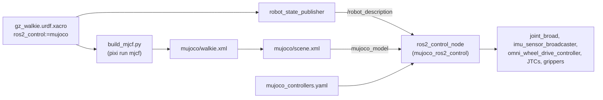

# 2.5 ros2_control

The URDF has a new ros2_control mode, `ros2_control:=mujoco`. It selects the
`mujoco_ros2_control` hardware plugin. That package ships its own `ros2_control_node`,
so the MuJoCo simulation and the controller manager run in one process, as they do
with `gz_ros2_control` inside Gazebo.

**Goal:** let the existing controllers, MoveIt and Nav2 drive the MuJoCo model through
ros2_control, without any MuJoCo-specific code in the controllers.

!!! warning "Not runnable yet"
    The `mujoco` branch, the controller file and the MoveIt launch changes are in place.
    Tests cover the branch and the controller file. The launch file that starts the
    simulator does not exist yet, and
    `mujoco_ros2_control` is not in the pixi environment. See
    [Packaging status](#packaging-status) and
    [The launch file still to write](#the-launch-file-still-to-write).

## How the pieces fit



The same xacro feeds both sides. `robot_state_publisher` publishes the URDF with the
`mujoco` ros2_control block. The generator turns the same URDF into the MJCF model. The
block expects the hardware plugin to pair each ros2_control joint with the MJCF actuator
of the same name.

## The mujoco branch

The block lives in `description/urdf/walkie/ros2_control.xacro`, inside
`<xacro:if value="${ros2_control == 'mujoco'}">`. A shortened excerpt:

```xml
<ros2_control name="MujocoSystem" type="system">
  <hardware>
    <plugin>mujoco_ros2_control/MujocoSystemInterface</plugin>
    <param name="mujoco_model">${mujoco_model}</param>
    <param name="headless">${'true' if mujoco_headless else 'false'}</param>
    <!-- Ground-truth pose of the free-floating base (nav_msgs/Odometry, no TF) -->
    <param name="odom_free_joint_name">floating_base_joint</param>
    <param name="odom_topic">/mujoco_ground_truth/odom</param>
  </hardware>
  <xacro:mujoco_wheel_joint name="fl_wheel_joint" vel_min="-3.14" vel_max="3.14"/>
  <!-- fr, br, bl wheels, head_servo_joint and lift_joint ... -->
  <xacro:mujoco_position_arm_joint joint_name="openarm_left_joint1" initial_position="0.2618" />
  <!-- other arm joints and openarm_*_finger_joint1 ... -->
  <sensor name="top_imu">
    <param name="mujoco_type">imu</param>
    <param name="mujoco_sensor_name">top_imu</param>
    <!-- orientation.x/y/z/w, angular_velocity.x/y/z, linear_acceleration.x/y/z -->
  </sensor>
</ros2_control>
```

### Hardware parameters

| Parameter | Value | Meaning |
| --- | --- | --- |
| `plugin` | `mujoco_ros2_control/MujocoSystemInterface` | The system interface of `mujoco_ros2_control` |
| `mujoco_model` | `${mujoco_model}`, default `$(find walkie_description)/mujoco/scene.xml` | The MJCF world to load. The default is the installed copy of `scene.xml`. |
| `headless` | `false` unless `mujoco_headless` is true | Run without the MuJoCo Simulate window |
| `odom_free_joint_name` | `floating_base_joint` | The free joint of the base, used for ground truth |
| `odom_topic` | `/mujoco_ground_truth/odom` | Ground-truth `nav_msgs/Odometry` of the base. It publishes no TF. |

The plugin parameters were checked against the 0.1.2 package on `robostack-jazzy`
(commit `851618c` of the `description` submodule). The xacro sets no `initial_keyframe`
parameter, although 0.1.2 has one; the start pose comes from the `initial_value`
parameters instead (see [Initial positions](#initial-positions)).

### Xacro arguments

| Argument | Default | Notes |
| --- | --- | --- |
| `ros2_control` | `gazebo` | Set to `mujoco` for this branch |
| `mujoco_model` | `$(find walkie_description)/mujoco/scene.xml` | Only used by the `mujoco` branch |
| `mujoco_headless` | `false` | Only used by the `mujoco` branch |

Both new arguments are declared in `description/robots/gz_walkie.urdf.xacro` and passed
into the `ros2_control` macro. The commit message of `851618c` states that the other
modes expand byte-identical to before.

!!! warning
    `robot_state_publisher.launch.py` does not forward these arguments. See [Known issues](#known-issues).

## The actuator contract

The rule, from the comment above the block: every commanded joint has an MJCF actuator
with the same name. Wheels use velocity actuators; every other joint uses a position
actuator. Each joint exposes exactly one command interface, and it matches the
actuator type.

The reason for one interface per joint: in MuJoCo, the control value of an actuator
means whatever the actuator type says. A position actuator reads it as a target
position, a velocity actuator as a target velocity. A joint that offered both
interfaces would let a controller write a velocity into a position actuator.

!!! warning
    The head, lift and wheel command limits do not match the MJCF actuators. See [Known issues](#known-issues).

| Joints | Command (xacro limits) | State interfaces | MJCF actuator | `ctrlrange` | Gain | Force limit |
| --- | --- | --- | --- | --- | --- | --- |
| `fl/fr/bl/br_wheel_joint` | velocity (±3.14) | position, velocity | velocity | ±100 rad/s | kv 20 | ±100 |
| `lift_joint` | position (0.000 to 0.743) | position (initial 0.51), velocity | position | 0.08 to 0.7435 m | kp 50000 | ±600 N |
| `head_servo_joint` | position (±1.54) | position, velocity | position | -0.785398 to 1.0472 rad | kp 20 | none |
| `openarm_*_joint1`, `joint2` | position | position, velocity, effort | position | URDF limits | kp 800 | ±40 |
| `openarm_*_joint3`, `joint4` | position | position, velocity, effort | position | URDF limits | kp 540 | ±27 |
| `openarm_*_joint5` to `joint7` | position | position, velocity, effort | position | URDF limits | kp 140 | ±7 |
| `openarm_*_finger_joint1` | position | position, velocity, effort | position | 0 to 0.044 m | kp 6660 | ±333 |

The generator creates one actuator per movable, non-mimic URDF joint. It does not read
the ros2_control block to decide which actuators exist. After writing the model,
`pixi run mjcf` compares both sets. It prints `error: ros2_control joint '<name>' has no
actuator` or `error: actuator '<name>' has no ros2_control joint` and exits with code 1.
It still writes the file.

### How the gains are chosen

| Actuator | Rule | Why |
| --- | --- | --- |
| Arm and gripper joints | `kp = effort / 0.05` (`POSITION_SATURATION_ERROR`), damping ratio 1 | The actuator reaches the URDF effort limit at 0.05 rad (or 0.05 m) of tracking error. Critical damping avoids overshoot. |
| `head_servo_joint` | `kp = 20` (`POSITION_KP_FALLBACK`) | The URDF effort of the head servo is 0, so the rule above gives nothing. |
| `lift_joint` | `kp = 50000` N/m, force limit 600 N, joint damping 6000 N s/m | The URDF effort of 10000 N is a placeholder. An actuator derived from it threw the robot off the floor on a setpoint step. These values are estimates pending the lift drive data. |
| Wheels | velocity actuator, `kv = 20` (`WHEEL_KV`) | Force = `kv * (command - wheel speed)`, limited to ±100 |

For the lift, the code comment explains the numbers. The force limit is about four
times the static load of the lift with both arms (154 N). The stiffness keeps the
static sag near 3 mm. The force limit divided by the damping equals the URDF velocity
limit of 0.1 m/s, so a setpoint step moves the lift at a drive-like speed.

In the MJCF file, a position actuator looks like
`biasprm="0 -800 1"`. The positive third value is the damping ratio, not a damping
gain. MuJoCo stores `dampratio` this way.

### Why wheels take velocity and arms take position

- **Wheels.** `omni_wheel_drive_controller` writes wheel velocities. A MuJoCo velocity
  actuator acts like the speed loop of a motor driver. The wheel turns, and the
  wheel-floor contact pushes the base. See [2.2 Omni Wheels](02-omni-wheels.md).
- **Arms, grippers, lift and head.** Their controllers (`JointTrajectoryController`,
  `GripperActionController`, `ForwardCommandController` with `interface_name: position`,
  `JointGroupPositionController`) all write positions. A position actuator acts like
  the position loop inside a servo. With the joint armature of 0.01 it stays stable at
  the 0.002 s time step.

The Gazebo branch offers position, velocity and effort commands on every arm joint,
and `sim_controllers.yaml` uses the velocity ones in
`left/right_forward_velocity_controller`. The MuJoCo arms have position actuators only,
so those controllers were dropped from the MuJoCo controller file.

### Mimic joints

The OpenArm grippers have two fingers. In the URDF, `openarm_*_finger_joint2` mimics
`openarm_*_finger_joint1`. The Gazebo branch declares the mimic joint in ros2_control
with `<param name="mimic">`. The MuJoCo branch does not list it at all.

Instead, MuJoCo's URDF importer turns each `<mimic>` into a joint equality constraint.
The generator names it after the follower joint:

```xml
<equality>
  <joint name="openarm_left_finger_joint2_mimic" joint1="openarm_left_finger_joint2" joint2="openarm_left_finger_joint1"/>
  <joint name="openarm_right_finger_joint2_mimic" joint1="openarm_right_finger_joint2" joint2="openarm_right_finger_joint1"/>
</equality>
```

Only `openarm_*_finger_joint1` has an actuator. The constraint makes the second finger
follow. `test_description.py` checks that no mimic joint is declared in the `mujoco`
block. `test_mjcf.py` also checks that mimic joints have no actuator and that each one
has its `<name>_mimic` equality.

### Initial positions

| Joint | `initial_value` |
| --- | --- |
| `lift_joint` | 0.51 |
| `openarm_left_joint1` | 0.2618 |
| `openarm_left_joint4` | 0.2618 |
| `openarm_right_joint1` | -0.2618 |
| `openarm_right_joint4` | 0.2618 |
| all other arm and finger joints | 0.0 |

The generator writes these values into the `home` keyframe of `walkie.xml`, for both
the joint positions and the actuator controls. The test
`test_home_keyframe_matches_initial_positions` keeps them equal.

### right_joint2_fixed

With `right_joint2_fixed:=true`, the block omits `openarm_right_joint2`. The checked-in
`walkie.xml` is generated with `right_joint2_fixed:=false`, so it still has the actuator.
Its control stays at 0, which holds the joint at the pose of the fixed URDF joint. The
controller file still lists `openarm_right_joint2` in several controllers, so the
launch file must drop it from those controllers in that mode.

### IMU

The `<sensor name="top_imu">` block maps the MJCF IMU sensors to ros2_control state
interfaces. [2.4 Sensors](04-sensors.md#imu) has the details.

## mujoco_controllers.yaml

`description/config/ros2_controller/mujoco_controllers.yaml` is a copy of
`sim_controllers.yaml` with three changes:

| Change | Why |
| --- | --- |
| Removed `left_forward_velocity_controller` and `right_forward_velocity_controller` | The MuJoCo arm joints have position actuators and no velocity command interface |
| Removed the unused `forward_velocity_controller` parameter block | Its type declaration was already commented out in `sim_controllers.yaml` |
| Added `imu_sensor_broadcaster` (`sensor_name: top_imu`, `frame_id: top_imu_link`) | Publishes the `top_imu` sensor. It publishes on `~/imu`; the launch file must remap it. |

The controller manager runs at `update_rate: 60` with `use_sim_time: true`.

| Controller | Type | Joints |
| --- | --- | --- |
| `joint_broad` | `joint_state_broadcaster/JointStateBroadcaster` | all |
| `imu_sensor_broadcaster` | `imu_sensor_broadcaster/IMUSensorBroadcaster` | sensor `top_imu` |
| `omni_wheel_drive_controller` | `omni_wheel_drive_controller/OmniWheelDriveController` | `fl`, `bl`, `br`, `fr` wheels |
| `lift_controller` | `joint_trajectory_controller/JointTrajectoryController` | `lift_joint` |
| `left_arm_controller`, `right_arm_controller` | `joint_trajectory_controller/JointTrajectoryController` | one arm each |
| `arm_controller` | `joint_trajectory_controller/JointTrajectoryController` | both arms and both `finger_joint1` |
| `left_joint_trajectory_controller`, `right_joint_trajectory_controller` | `joint_trajectory_controller/JointTrajectoryController` | one arm each |
| `left_gripper_controller`, `right_gripper_controller` | `position_controllers/GripperActionController` | `openarm_*_finger_joint1` |
| `left_forward_position_controller`, `right_forward_position_controller` | `forward_command_controller/ForwardCommandController` | one arm each |
| `head_servo_controller` | `position_controllers/JointGroupPositionController` | `head_servo_joint` |

The omni drive parameters are the same as in Gazebo (`robot_radius` 0.185). They are
listed in [Robot Description: Omni wheel controller parameters](../../reference/robot-description.md#omni-wheel-controller-parameters).

!!! warning
    `wheel_radius` does not match the wheel collision radius. See [Known issues](#known-issues).

## MoveIt: hardware_type:=mujoco

Commit `72359aa` added `mujoco` to the `hardware_type` argument of three launch files in
`manipulate/openarm_bimanual_moveit_config/launch/`: `moveit_demo.launch.py`,
`moveit_demo_with_commander.launch.py` and `moveit_only.launch.py`.

| Setting | Value for `mujoco` |
| --- | --- |
| Xacro mappings | `ros2_control: mujoco`, `add_world_link: false` (the commander launch also sets `openarm_ros2_control: false`) |
| `use_sim_time` | true |
| Octomap | off: no point cloud source is wired for MuJoCo |
| `ros2_control_node` | not started: the simulator runs its own |
| Spawners | `joint_broad`, `left/right_joint_trajectory_controller`, `left/right_gripper_controller`, `lift_controller`. Only the two demo launch files start them; `moveit_only.launch.py` starts no controllers. |

The spawners are started without `--controller-manager-timeout`, so they wait until
the simulator's controller manager is available. Today that never happens, because
the simulator launch does not exist. The command to use later:

```bash
pixi run ros2 launch openarm_bimanual_moveit_config moveit_demo.launch.py hardware_type:=mujoco
```

### The joint_broad spawner fix

The same commit fixed a bug in the Gazebo branch. It spawned a controller named
`joint_state_broadcaster`, but `sim_controllers.yaml` declares the joint state
broadcaster as `joint_broad`. The spawner failed, no joint states were published, and
MoveIt had no robot state. Gazebo and MuJoCo now share one function,
`_sim_controller_spawners()`, which spawns `joint_broad`.

## Packaging status

`mujoco_ros2_control` is not installed in the pixi environment. The `mujoco` expansion
and all tests work without it; running the simulation with ROS does not.

| Fact | Value |
| --- | --- |
| MuJoCo in the lock | `mujoco` 3.15.0 from conda-forge (`pixi.toml` asks for `>=3.14`) |
| ROS build set in the lock | `ros2-distro-mutex` 0.16.0, build `jazzy_21`. Of the 669 RoboStack packages, 661 are `_21` builds and 8 are `_22` builds. |
| `ros-jazzy-mujoco-ros2-control` on `robostack-jazzy` | 0.1.2 (build `_25`), 0.0.3 (build `_21`), 0.0.1 (build `_16`) |
| 0.1.2 needs | `ros2-distro-mutex 0.19.*` |
| 0.0.3 needs | `ros2-distro-mutex 0.16.*` |

Almost every RoboStack package depends on `ros2-distro-mutex` (638 of the 669 RoboStack
packages in the lock). The mutex pins one build set per environment. The 0.1.2 package
therefore cannot be added to the current lock; adding it moves the whole ROS stack
from `_21` to `_25`.

The version matters because of the plugins:

| Version | Plugins in `mujoco_ros2_control_plugins` |
| --- | --- |
| 0.0.3 (`_21`) | `HeartbeatPublisherPlugin`, `ExternalWrenchPlugin` |
| 0.1.2 (`_25`) | the two above, plus `CameraPlugin`, `RangefinderLidarPlugin` (deprecated), `Mujoco3dLidarPlugin`, `FreeJointStatePublisherPlugin`, `BaseVelocityPlugin` |

The 0.0.3 core library does contain camera and lidar code and the hardware parameters
the xacro uses. The xacro and the sensor naming target 0.1.2, though.

**Plan:** re-lock the whole environment to the `_25` build set, then add
`ros-jazzy-mujoco-ros2-control`. This changes the build of every ROS package in the
lock, so the full workspace must be rebuilt and tested afterwards.

**Rejected:** a separate pixi environment that holds only the `_25` simulator. The
simulator's `ros2_control_node` loads the controllers (`omni_wheel_drive_controller`,
the trajectory controllers and the rest) as plugins into its own process. They must
come from the same build set as the node. A separate environment would therefore hold
a second full ROS installation, and the workspace would have to be built twice.

To see what RoboStack offers now:

```bash
pixi search ros-jazzy-mujoco-ros2-control
```

## The launch file still to write

No launch file starts MuJoCo with ros2_control yet. The MoveIt comment says it is "not
wired into this package yet". Based on the Gazebo launch
(`simulation/gazebo/launch/gzsim_omnibot.launch.py`) and the upstream demo
`01_basic_robot.launch.py` of `mujoco_ros2_control_demos` 0.1.2, it needs:

| Part | Details |
| --- | --- |
| `robot_state_publisher` | `ros2_control:=mujoco`, `use_sim_time:=true`. Forward `mujoco_model` and `mujoco_headless` so a custom world or headless run is possible. |
| `ros2_control_node` | Package `mujoco_ros2_control`, executable `ros2_control_node`. Parameters: `use_sim_time: true`, `mujoco_controllers.yaml`, and a plugin parameter file for `mujoco_plugins`. It reads `robot_description` from the topic. |
| Spawners | `joint_broad`, `imu_sensor_broadcaster`, `omni_wheel_drive_controller`, `lift_controller`, `left/right_joint_trajectory_controller`, `left/right_gripper_controller`. Gazebo spawns the same list without the IMU broadcaster. |
| IMU remap | `imu_sensor_broadcaster` `~/imu` to `/imu` |
| Velocity input | `twist_mux` with `/cmd_vel_out` remapped to `/omni_wheel_drive_controller/cmd_vel`, as in Gazebo |
| Lidars | Two LaserScan publishers plus `dual_laser_merger` to `/scan` (see [2.4 Sensors](04-sensors.md)) |
| Cameras | `CameraPlugin` entries for `head_camera` and `bottom_camera` |
| `right_joint2_fixed` | A controller file without `openarm_right_joint2` when the joint is fixed |

A sketch of the controller node, following the upstream demo. It is not in the
repository yet:

```python
control_node = Node(
    package="mujoco_ros2_control",
    executable="ros2_control_node",
    parameters=[
        {"use_sim_time": True},
        ParameterFile(mujoco_controllers_yaml),
        ParameterFile(mujoco_plugins_yaml),
    ],
    on_exit=Shutdown(),
)
```

## Commits

| Repository | Commit | Change |
| --- | --- | --- |
| `description` submodule | `851618c` | `mujoco` ros2_control branch, `mujoco_model` / `mujoco_headless` arguments, `mujoco_controllers.yaml` |
| `description` submodule | `301c439` | Generator: one actuator per joint, equality constraints, `home` keyframe |
| `description` submodule | `2b15ba1` | Contract tests |
| superproject | `72359aa` | MoveIt `hardware_type:=mujoco` and the `joint_broad` spawner fix |
| superproject | `a926459` | `mujoco` in the pixi environment and the `mjcf` / `mjcf-view` tasks |

## Known issues

| Issue | Effect | Workaround |
| --- | --- | --- |
| The `mujoco` branch copied its head and lift command limits from the `gazebo` branch | `head_servo_joint` declares -1.54 to 1.54, but the URDF and MJCF range is -0.785398 to 1.0472. `lift_joint` declares 0.000 to 0.743, but the URDF and MJCF range is 0.08 to 0.7435. MuJoCo clamps every control value to `ctrlrange`, so the simulated joints stay inside the URDF limits. | Use the URDF limits in the `mujoco` branch of `ros2_control.xacro`. |
| Wheel command limit (±3.14 rad/s) and actuator `ctrlrange` (±100 rad/s) disagree; `wheel_radius` is 0.076 m but the wheel collision radius is 0.075 m | See [2.2 Omni Wheels](02-omni-wheels.md#known-issues). | See [2.2 Omni Wheels](02-omni-wheels.md#known-issues). |
| `description/launch/robot_state_publisher.launch.py` does not forward `mujoco_model` or `mujoco_headless` | Through that launch file you always get the default world with a window | Add both arguments to the launch file, or expand the xacro in your own launch file |
