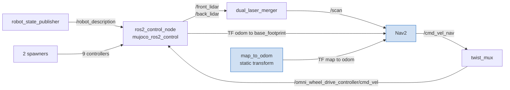

# 2.7 Launch Files and Nav2

**Goal:** start Walkie in MuJoCo with ros2_control, its sensors and RViz from one launch
file, and run Nav2 on it, so that navigation can be tested in MuJoCo as well as in Gazebo.

This entry records what the two launch files start, why they are built this way, two
problems in the Nav2 fork that the work found, and what was tested. For day-to-day use,
read [MuJoCo Simulation: Run with ROS 2](../../guides/simulation-mujoco.md#run-with-ros-2).

## In short

- **Added:** `mujoco_omnibot.launch.py` (MuJoCo, controllers, sensors, RViz) and
  `nav_mujoco_omnibot.launch.py` (the same plus Nav2) in `robot_bringup`, with the
  `mujoco_plugins` parameter file, a blank map and two RViz configs.
- **Key decisions:** the launch file expands the URDF itself; the files live in
  `bringup/`; `mujoco_ros2_control` is not declared in `package.xml`; `/scan` comes from
  `dual_laser_merger`, as on the real robot; Nav2 localizes with wheel odometry only.
- **Found along the way:** two problems in the Nav2 fork stop the default Nav2 bringup.
  The MuJoCo launch works around both. The Gazebo and real-robot Nav2 launches still fail
  ([Two Nav2 fork issues](#two-nav2-fork-issues)).
- **Result:** with Zenoh, Nav2 reached goals on the empty floor and drove around a wall
  in a test world. The wall test gave the same result with Fast DDS
  ([Verification](#verification)). The odometry
  overestimates the distance by about 1.5 %, and the map pose drifts with it
  ([Known issues](#known-issues)).

!!! warning "Nav2 does not start on Gazebo or the real robot"
    No MPPI parameter file in `robot_navigation` sets `FollowPath.Omni.plugin`, which the
    Nav2 fork requires since 2026-10-08. `controller_server` fails to configure, and the
    lifecycle manager aborts the bringup. Only the MuJoCo launch adds the key. See
    [MPPI motion models are plugins now](#mppi-motion-models-are-plugins-now).

!!! note "Update 2026-10-14: fixed in entry 5"
    All MPPI parameter files now set `FollowPath.Omni.plugin`, so the missing key no
    longer stops the Gazebo and real-robot Nav2 launches. See
    [5. Repair Nav2 After the navigation2 Bump](../05-nav2-repair.md). Gazebo itself was
    not run. The real-robot and mapping launches start under `rmw_zenoh_cpp`, but under
    Fast DDS they still fail on a separate problem
    ([5. Repair Nav2 After the navigation2 Bump: Still open](../05-nav2-repair.md#still-open)).

## Start the simulation

```bash
pixi run build-pkg robot_bringup walkie_description   # existing workspace; a fresh clone needs pixi run build
export RMW_IMPLEMENTATION=rmw_zenoh_cpp                 # every shell that runs nodes
pixi run ros2 run rmw_zenoh_cpp rmw_zenohd              # one Zenoh router per machine
pixi run ros2 launch robot_bringup mujoco_omnibot.launch.py        # MuJoCo, controllers, RViz
pixi run ros2 launch robot_bringup nav_mujoco_omnibot.launch.py    # the same plus Nav2
```

Run one of the two launch files. With Nav2, set a goal with **2D Goal Pose** in RViz.
[MuJoCo Simulation](../../guides/simulation-mujoco.md#drive-with-nav2-and-rviz) explains
how to drive, the [launch arguments](../../guides/simulation-mujoco.md#launch-arguments),
and how to [use a custom world](../../guides/simulation-mujoco.md#use-a-custom-world-with-ros-2).

## What changed

All files are new in the `robot_bringup` package, except `package.xml`.

| File | Role |
| --- | --- |
| `bringup/launch/mujoco_omnibot.launch.py` | MuJoCo with ros2_control, the controllers, the velocity mux, `/scan`, the `walkie_tf` server and RViz |
| `bringup/launch/nav_mujoco_omnibot.launch.py` | Includes the file above and adds Nav2, `map_server` and a static `map` to `odom` transform |
| `bringup/config/mujoco/mujoco_plugins.yaml` | Camera and lidar plugin parameters for `mujoco_ros2_control` |
| `bringup/config/map/empty_floor.yaml`, `empty_floor.pgm` | Blank 20 m x 20 m map, centered on the world origin |
| `bringup/config/rviz/mujoco.rviz` | RViz for the simulation alone, fixed frame `odom` |
| `bringup/config/rviz/mujoco_nav.rviz` | RViz for Nav2, fixed frame `map`, with the Nav2 panel and the goal tools |
| `bringup/package.xml` | Run dependencies of the new launch files |

??? info "Branch, and the dependencies added to package.xml"
    The work is on the branch `feat/mujoco-launch` (pull request #43), based on
    `feat/Pixi` at `e8b6e92` and rebased onto `feat/Pixi` at `dfc3909` on 2026-10-14.
    `feat/Pixi` already contains the MuJoCo, documentation and RoboStack `_25` pull
    requests (#35, #36 and #38), merged on 2026-10-13.

    New `exec_depend` entries: `walkie_tf`, `robot_state_publisher`, `xacro`, `tf2_ros`,
    `rviz2`, `dual_laser_merger`, `nav2_bringup`, `nav2_rviz_plugins` and
    `robot_navigation`. `mujoco_ros2_control` is left out on purpose, see
    [mujoco_ros2_control is not declared](#mujoco_ros2_control-is-not-declared).

??? info "Commits of this step"
    | Repository | Commit | Change |
    | --- | --- | --- |
    | superproject | `02e54c8` | Both launch files, `mujoco_plugins.yaml`, the blank map, the two RViz configs and the `package.xml` dependencies |

    The hash is on `feat/mujoco-launch`. If the branch is rebased before the merge, map it
    to the new commit.

## What mujoco_omnibot.launch.py starts { #mujoco-launch }



Blue: added by `nav_mujoco_omnibot.launch.py`. RViz, the `walkie_tf` server, the IMU and
the cameras are left out of the diagram.

| Node | Package | Notes |
| --- | --- | --- |
| `robot_state_publisher` | `robot_state_publisher` | URDF expanded in the launch file, see [Expand the URDF in the launch file](#expand-the-urdf-in-the-launch-file) |
| `ros2_control_node` | `mujoco_ros2_control` | Simulator and controller manager in one process. Loads `mujoco_controllers.yaml` and `mujoco_plugins.yaml`, publishes `/clock`. |
| Two `spawner` nodes | `controller_manager` | Nine controllers, listed in the box below |
| `twist_mux` | `twist_mux` | `bringup/config/twist_mux/twist_mux.yml`, output to `/omni_wheel_drive_controller/cmd_vel` |
| `dual_laser_merger` | `dual_laser_merger` | `/front_lidar` and `/back_lidar` to `/scan`, with the real robot parameters |
| `walkie_tf_server` | `walkie_tf` (`tf_server`) | TF lookup service |
| `rviz2` | `rviz2` | Only with `use_rviz:=true`, the default |

Every node runs on simulated time from `/clock`. Closing the MuJoCo viewer ends the whole
launch, because `ros2_control_node` has `on_exit=Shutdown()`.

The launch arguments are `mujoco_model`, `headless`, `use_rviz` and `rviz_config`.
[MuJoCo Simulation: Launch arguments](../../guides/simulation-mujoco.md#launch-arguments)
lists their defaults.

??? info "Spawned controllers, remaps and twist_mux inputs"
    | Spawner | Controllers |
    | --- | --- |
    | 1 | `joint_broad`, `omni_wheel_drive_controller`, `imu_sensor_broadcaster` |
    | 2 | `lift_controller`, `head_servo_controller`, `left_joint_trajectory_controller`, `right_joint_trajectory_controller`, `left_gripper_controller`, `right_gripper_controller` |

    Both spawners pass `--param-file` with `mujoco_controllers.yaml`. A spawner waits for
    the controller manager services, so the launch file needs no start delay. The five
    other controllers of `mujoco_controllers.yaml` (`arm_controller`,
    `left_arm_controller`, `right_arm_controller`, `left_forward_position_controller`,
    `right_forward_position_controller`) are not spawned.

    | Remap | From | To |
    | --- | --- | --- |
    | IMU, on `ros2_control_node` | `/imu_sensor_broadcaster/imu` | `/imu` |
    | Velocity mux output | `/cmd_vel_out` | `/omni_wheel_drive_controller/cmd_vel` |
    | Merged scan | `/merged_lidar` | `/scan` |

    `twist_mux` runs with `use_stamped: true`. Its inputs are `cmd_vel` (priority 5),
    `cmd_vel_nav` from Nav2 (priority 10), and `cmd_vel_joy` and `cmd_vel_key`
    (priority 100). The active input with the highest priority wins.

## What nav_mujoco_omnibot.launch.py adds { #nav2-launch }

- It includes `mujoco_omnibot.launch.py` and passes on `mujoco_model`, `headless`,
  `use_rviz` and `rviz_config`. The RViz default is `mujoco_nav.rviz`.
- A `static_transform_publisher` named `map_to_odom` publishes an identity transform from
  `map` to `odom` ([Odometry-only localization](#odometry-only-localization)).
- It includes `nav2_bringup/launch/bringup_launch.py` with the arguments below. Two more
  launch arguments set the files: `map` (default `empty_floor.yaml`) and `params_file`
  (default `nav2_mppi_walkie_sim_params.yaml` of `robot_navigation`, the same file as the
  Gazebo Nav2 launch).
- The parameter file passes through `RewrittenYaml` from `nav2_common`, which adds one key
  to a temporary copy ([MPPI motion models are plugins now](#mppi-motion-models-are-plugins-now)).

| `bringup_launch.py` argument | Value | Notes |
| --- | --- | --- |
| `use_sim_time` | `True` | |
| `use_localization` | `False` | No AMCL |
| `serve_static_map` | `True` | Its default follows `use_localization`, so it is set explicitly to start `map_server` |
| `use_keepout_zones`, `use_speed_zones` | `False` | |
| `autostart` | `True` | |
| `use_composition` | `False` | Each Nav2 server runs as its own process, see [Composition deadlock](#composition-deadlock) |

!!! note "Update 2026-10-14: changed in entry 5"
    The `RewrittenYaml` step is gone: the parameter files set the plugin key, so
    `params_file` is passed straight through. The include is now wrapped in
    `SetRemap(cmd_vel -> cmd_vel_controller)`, so Nav2 commands pass the velocity
    smoother and the collision monitor before `twist_mux`. See
    [5. Repair Nav2 After the navigation2 Bump](../05-nav2-repair.md#velocity-smoother-and-collision-monitor-bypassed).

## Expand the URDF in the launch file

`mujoco_omnibot.launch.py` runs `xacro` on `description/robots/gz_walkie.urdf.xacro` itself,
with `ros2_control:=mujoco`, `mujoco_model:=<mujoco_model>` and
`mujoco_headless:=<headless>`. It does not include
`description/launch/robot_state_publisher.launch.py`, because that file does not forward
`mujoco_model` or `mujoco_headless` ([2.5 ros2_control: Known issues](05-ros2-control.md#known-issues)).
Through that file, every run would load the default world and open the viewer window.

??? info "Consequences of expanding the xacro in the launch file"
    - The known issue in `robot_state_publisher.launch.py` stays open. It still matters for
      anyone who starts the MuJoCo branch through that file.
    - The launch file sets three xacro arguments. All others keep their xacro defaults.
      For example, `right_joint2_fixed` is always `False`, so the launch file needs no
      second controller file for a fixed `openarm_right_joint2`.

## Keep the files in robot_bringup

The launch files and their configuration live in `bringup/`, not in the `description` or
`navigation` submodules. `robot_bringup` already holds the top-level launch files that
combine several packages, such as `real_omnibot.launch.py` and `nav_sim_omnibot.launch.py`
(Gazebo with Nav2).

??? info "Why not the description or navigation submodule"
    - `description/` and `navigation/` are git submodules: separate repositories on their
      own branches. A launch file there needs a commit in that repository and a pointer
      update in this one. In `bringup/`, the whole change is in this repository.
    - The MuJoCo launch reuses configuration that is already in `bringup/`:
      `config/twist_mux/twist_mux.yml` and the merger parameters of
      `launch/dual_lidar_hokuyo_lakibeam.launch.py`.
    - A launch file in `walkie_description` would make the description package depend on
      Nav2, `twist_mux` and `dual_laser_merger` at run time.

## mujoco_ros2_control is not declared { #mujoco_ros2_control-is-not-declared }

`bringup/package.xml` declares every package that the new launch files start, except
`mujoco_ros2_control`. The pixi environment provides it. The Docker images install their
dependencies with apt and rosdep from the `package.xml` files, not with pixi, so declaring
it would install MuJoCo into the `physical` image. A comment in `package.xml` says so.

The consequence: rosdep does not install `mujoco_ros2_control`. Outside the pixi
environment, `mujoco_omnibot.launch.py` cannot start the simulator unless the package is
installed by hand.

## Sensor topics: the plugin parameter file

`bringup/config/mujoco/mujoco_plugins.yaml` is the `mujoco_plugins` parameter file that the
guide listed before. It is now in the repository, and `ros2_control_node` loads it. Without
it, the cameras and lidars publish nothing on their configured topics
([2.4 Sensors](04-sensors.md)).

- **Head camera on the ZED topic names.** The head camera publishes its images and camera
  info on the topics of the real ZED driver, so nodes that read them need no remaps. The
  file in the guide before this change used `/head_camera/...` topic names. No ZED point
  cloud is published, so nodes that read `/zed_head/zed_node/point_cloud/cloud_registered`
  get no cloud.
- **Lidars on the real topics and frames.** `/front_lidar` in `front_lidar_link` and
  `/back_lidar` in `back_lidar_link`, as the Hokuyo and the Lakibeam on the robot.

The file and its naming rules are in
[MuJoCo Simulation: The mujoco_plugins parameter file](../../guides/simulation-mujoco.md#the-mujoco_plugins-parameter-file).

??? info "Topics, frames and rates of each sensor"
    | Sensor | Plugin | Topics | Frame |
    | --- | --- | --- | --- |
    | `head_camera` | `CameraPlugin`, 5 Hz | `/zed_head/zed_node/rgb/color/rect/image`, `/zed_head/zed_node/depth/depth_registered`, `/zed_head/zed_node/depth/camera_info` | `zed_head_left_camera_frame_optical` |
    | `bottom_camera` | `CameraPlugin`, 5 Hz | `/bottom_camera/image_raw`, `/bottom_camera/depth/image_raw`, `/bottom_camera/camera_info` | `bottom_color_optical_frame` |
    | `front_lidar` | `RangefinderLidarPlugin`, 40 Hz configured | `/front_lidar` | `front_lidar_link` |
    | `back_lidar` | `RangefinderLidarPlugin`, 40 Hz configured | `/back_lidar` | `back_lidar_link` |

    - One MuJoCo camera renders both the color and the depth image of the head camera, so
      the depth is registered to the color image.
    - Each lidar has 241 beams from -2.09333333 to 2.09333333 rad, `angle_increment`
      0.017444444416, and a range of 0.18 m to 10 m. A beam with no hit reads -1.0.
    - The lidar plugin instance must be named `rangefinder_lidar_plugin`
      ([2.4 Sensors](04-sensors.md)).
    - The lidars publish at about 27.8 Hz, see [Known issues](#known-issues).

??? info "Why RangefinderLidarPlugin, although it is deprecated"
    [2.4 Sensors](04-sensors.md) left the choice between `RangefinderLidarPlugin` and
    `Mujoco3dLidarPlugin` open. The launch uses `RangefinderLidarPlugin`, which reads the
    rangefinder fans that `walkie.xml` already has.

    `Mujoco3dLidarPlugin` was not chosen because it needs the `mujoco_3d_lidar` MuJoCo
    extension, which is not in the pixi environment.

!!! note "Update 2026-10-16: head 3D lidar"
    `mujoco_plugins.yaml` now has a `mujoco_3d_lidar_plugin` instance
    (`Mujoco3dLidarPlugin`) for the head 3D lidar on `/unilidar/cloud`, and
    `mujoco_omnibot.launch.py` starts `robot_self_filter` for it. The extension is in
    `pixi.toml`. Like `mujoco_ros2_control`, it is not declared in `bringup/package.xml`.
    The 2D lidars stay on `RangefinderLidarPlugin`, now because the extension cannot skip
    the robot's own geoms. See [2.8 Head 3D Lidar](08-3d-lidar.md).

## /scan from dual_laser_merger, as on the real robot { #scan-from-dual_laser_merger }

`dual_laser_merger` merges `/front_lidar` and `/back_lidar` into `/scan` in the frame
`merged_lidar_link`. It runs with the parameters of
`bringup/launch/dual_lidar_hokuyo_lakibeam.launch.py`, so Nav2 gets `/scan` the same way
as on the real robot.

!!! warning "No /scan on the empty floor"
    The merger publishes only when both lidars hit something. The default `scene.xml` has
    only a floor, so `/scan` stays silent. Nav2 still runs, but its obstacle layers see
    nothing. To test obstacle avoidance, use a world with walls or objects in front of and
    behind the robot.

!!! note "Update 2026-10-14: changed in entry 5"
    The merger has a new parameter, `publish_on_empty_cloud` (default `false`), which
    `mujoco_omnibot.launch.py` sets to `true`. The merger then publishes `/scan` on the
    empty floor; a lidar with no return in range reads as free space. The real robot keeps
    the default. See
    [5. Repair Nav2 After the navigation2 Bump](../05-nav2-repair.md#scan-in-the-empty-mujoco-world).

??? info "Merger parameters, the same as on the real robot"
    | Parameter | Value |
    | --- | --- |
    | `laser_1_topic`, `laser_2_topic` | `/front_lidar`, `/back_lidar` |
    | `merged_scan_topic` | `/merged_lidar`, remapped to `/scan` |
    | `target_frame` | `merged_lidar_link` |
    | `angle_min`, `angle_max`, `angle_increment` | -3.141592654, 3.141592654, 0.001 rad |
    | `range_min`, `range_max` | 0.3 m, 25.0 m |
    | `allowed_radius` | 0.45 m |
    | `use_inf`, `inf_epsilon` | true, 1.0 |
    | `tolerance`, `queue_size`, `scan_time` | 0.01, 5, 0.067 |
    | Shadow and average filters | off |

    All x, y and yaw offsets are 0. `min_height` and `max_height` are -1.0 and 1.0.

## Odometry-only localization

Nav2 runs without AMCL. The static identity transform from `map` to `odom` makes the pose
in the map equal to the wheel odometry of `omni_wheel_drive_controller`, which publishes
`odom` to `base_footprint`. `map_server` serves `empty_floor.yaml`, a blank map.

!!! warning "The robot must start at the world origin"
    The robot must start at the origin of the MuJoCo world, and the map origin must match
    the world origin. The `home` keyframe of the default world starts the robot at the
    origin, and `empty_floor.yaml` is centered on it. Check both for a custom world or map.

??? info "Why no AMCL, and the blank map"
    AMCL matches the laser scan against walls in the map. The default world has only a
    floor, so there is nothing to match. The blank map follows from that: 20 m x 20 m,
    resolution 0.05 m, 400 x 400 pixels that are all free (value 254), origin
    `[-10, -10, 0]`.

    The price is drift: the pose in the map carries the full odometry error
    ([Known issues](#known-issues)).

    Localization from MuJoCo ground truth is a possible follow-up. The true base pose is
    published on `/mujoco_ground_truth/odom` (`nav_msgs/Odometry`, no TF).

## Two Nav2 fork issues

The `navigation` submodule moved its `navigation2` fork to upstream `main` on 2026-10-08
(`navigation` commit `02a697a`). Both issues below arrived with that move; neither comes
from MuJoCo. The MuJoCo launch works around them but does not fix them.

| Issue | Workaround in the MuJoCo launch | Effect on Gazebo and the real robot |
| --- | --- | --- |
| [Composition deadlock](#composition-deadlock) | `use_composition: False` | `localization_Nav2_sim.launch.py`, which `nav_sim_omnibot.launch.py` includes for Gazebo, keeps composition and can hit the same race |
| [MPPI motion models are plugins now](#mppi-motion-models-are-plugins-now) | `RewrittenYaml` adds `FollowPath.Omni.plugin` | The Gazebo and real-robot Nav2 launches fail to configure `controller_server` until the parameter files are fixed |

!!! note "Update 2026-10-14: fixed in entry 5"
    Both issues are fixed in the navigation repository: the MPPI parameter files set
    `FollowPath.Omni.plugin`, and `localization_Nav2_sim.launch.py` passes
    `use_composition:=False`. The same work found a third break from the bump:
    `nav2_bringup`'s `navigation_launch.py` and `localization_launch.py` no longer start
    a lifecycle manager. See
    [5. Repair Nav2 After the navigation2 Bump](../05-nav2-repair.md).

### Composition deadlock

With composition on, Nav2 can stop during startup with
`Waiting for service smoother_server/get_state...`, repeated forever. The MuJoCo launch sets
`use_composition` to `False`, so each Nav2 server runs as its own process.

??? info "Cause of the deadlock"
    - `nav2_bringup` starts `nav2_container` as
      `component_container --isolated --executor-type single-threaded`.
    - The Jazzy `component_container` ignores both flags. They belong to a newer
      `rclcpp_components`; Jazzy ships separate `component_container_isolated` and
      `component_container_mt` executables instead.
    - All composed servers then share one executor thread.
    - `lifecycle_manager_nav2` is loaded by a separate `LoadComposableNodes` action, so it
      can be loaded before the servers. Its blocking startup then keeps the container from
      loading the rest.

### MPPI motion models are plugins now

Since upstream pull request #6076, the MPPI controller loads its motion models as plugins.
`motion_model: "Omni"` now also needs `FollowPath.Omni.plugin: "mppi::OmniMotionModel"`. No
MPPI parameter file in `robot_navigation` sets it, so `controller_server` fails to configure
and `lifecycle_manager_nav2` aborts the bringup.

The MuJoCo launch adds the key with `RewrittenYaml`. The fix for Gazebo and the real robot
is to add it to the parameter files in the navigation repository; that is outside this
change.

??? info "Error messages, the workaround code and the missing key"
    `controller_server` logs:

    ```text
    Can not get 'plugin' param value for FollowPath.Omni
    Failed to load motion model plugin 'Omni'
    ```

    The workaround in `nav_mujoco_omnibot.launch.py` writes a temporary copy of the
    parameter file with one more key:

    ```python title="bringup/launch/nav_mujoco_omnibot.launch.py"
    nav2_params = RewrittenYaml(
        source_file=params_file,
        param_rewrites={
            "controller_server.ros__parameters.FollowPath.Omni.plugin": "mppi::OmniMotionModel",
        },
        convert_types=True,
    )
    ```

    The same key, written into a parameter file:

    ```yaml
    controller_server:
      ros__parameters:
        FollowPath:
          motion_model: "Omni"
          Omni:
            plugin: "mppi::OmniMotionModel"
    ```

## Verification

The stack was run headless on 2026-10-13, with `rmw_zenoh_cpp` unless noted.

- **Startup:** all nine spawned controllers became active. Nav2 reported
  `Managed nodes are active` about 8 s after the launch started. The real-time factor was
  1.00.
- **Empty floor:** two goals succeeded, one sent like the RViz **2D Goal Pose** tool and one
  as a `NavigateToPose` action goal.
- **Wall test world:** with `/scan` available, Nav2 drove the robot around a wall to the
  goal. The same run with `rmw_fastrtps_cpp` gave the same result.

??? info "Results, 2026-10-13"
    | Check | Result |
    | --- | --- |
    | Controllers | All 9 spawned controllers active |
    | Nav2 startup | `Managed nodes are active` about 8 s after the launch started |
    | Simulation speed | Real-time factor 1.00, `/clock` at about 500 Hz |
    | Topic frames | `/imu` in `top_imu_link`; `/front_lidar` in `front_lidar_link`; `/back_lidar` in `back_lidar_link`; `/scan` in `merged_lidar_link`; the cameras in their optical frames; `/omni_wheel_drive_controller/odom` in `odom` |
    | Map | `/map` is 400 cells wide |
    | Lidar rate | About 27.8 Hz each, against 40 Hz configured |
    | `/goal_pose` goal on the empty floor | x 1.5 m, y 1.0 m, yaw 90 degrees (what RViz **2D Goal Pose** sends): `bt_navigator` logged `Goal succeeded` |
    | `NavigateToPose` action goal on the empty floor | x -1.0 m, y -0.5 m, yaw 0: `SUCCEEDED`, 0.04 m from the target in ground truth |
    | `/scan` on the empty floor | Not published (see [/scan from dual_laser_merger](#scan-from-dual_laser_merger)) |
    | Wall test world | `/scan` at about 27.8 Hz. While passing the wall, the robot stayed 0.83 m to 0.99 m from the x axis in ground truth, and it reached the goal. |
    | Wall test world with `rmw_fastrtps_cpp` | Same result |

??? info "The wall test world"
    The test world is not in the repository. It is an 8 m x 8 m room with a 1.2 m wall
    segment at x = 1.5 m, between the start at the origin and the goal at (3, 0). The wall
    spans y = -0.6 m to 0.6 m.

    The robot base never collides with world geometry, by design
    ([2.3 Collisions](03-collisions.md)). The test therefore shows that Nav2 avoided the
    wall through the lidars, not that the wall stopped the robot.

Not verified:

- Interactive RViz use. The test machine had no usable display. Every RViz plugin class in
  both configs exists, and every topic they subscribe to exists in the running stack.
- MoveIt with MuJoCo.

## Known issues

| Issue | Effect | Workaround |
| --- | --- | --- |
| Odometry scale | The base moves less than the odometry reports. Ground truth divided by odometry: 0.985 forward, 0.986 sideways, 0.978 turning in place, 0.969 on an arc. With odometry-only localization, the map pose drifts: 0.22 m and 4.7 degrees after a 3 m run with turns. | None yet. See [2.2 Omni Wheels: Known issues](02-omni-wheels.md#known-issues). |
| No `/scan` on the empty floor | Nav2 runs without obstacle data | Use a world with walls or objects in front of and behind the robot |
| Gazebo and real-robot Nav2 fail to start | `controller_server` fails to configure | Add `FollowPath.Omni.plugin` to the MPPI parameter files ([MPPI motion models are plugins now](#mppi-motion-models-are-plugins-now)) |
| ++ctrl+c++ takes about 15 s with `nav_mujoco_omnibot.launch.py` | Launch prints red `failed to terminate` and `process has died ... exit code -9` lines | None needed. It is harmless. |
| `tf_server` traceback on ++ctrl+c++ | `RCLError`: `rcl_shutdown already called` | None needed. It is harmless and older than this change. |
| Lidars publish at about 27.8 Hz | Not the configured 40 Hz | None. The Nav2 tests ran at this rate. |
| Nav2 log noise | Repeated inflation radius errors, and an occasional `Failed to make progress` abort | None needed. It comes from the parameter files, and the behavior tree recovers. |
| RViz not checked by a person | The configs may need adjustment in use | Report problems |

!!! note "Update 2026-10-14: fixed in entry 5"
    The MPPI parameter files set the plugin key. The local inflation radius is no longer
    below the circumscribed radius, so the inflation radius errors are gone. With
    `publish_on_empty_cloud`, which `mujoco_omnibot.launch.py` now sets, the merger
    publishes `/scan` on the empty floor. The `Failed to make progress` abort can still
    occur. See [5. Repair Nav2 After the navigation2 Bump](../05-nav2-repair.md#scan-in-the-empty-mujoco-world).

??? info "Causes and measurements behind the known issues"
    - **Odometry scale.** The ratios were measured with fixed twists on
      `/omni_wheel_drive_controller/cmd_vel`. The translation factor equals 0.075 / 0.076. The MJCF wheel capsule radius comes from the URDF collision cylinder
      (0.075 m), while `wheel_radius` in `mujoco_controllers.yaml` is 0.076 m. The
      controller runs with `open_loop: true`, so its odometry integrates the commanded
      twist. The rest of the turning error is wheel slip.
    - **++ctrl+c++ takes about 15 s.** `planner_server` and `controller_server`, sometimes
      also `smoother_server`, do not exit on SIGINT or SIGTERM, and launch kills them with
      SIGKILL. The same happens with Fast DDS. Sent alone while the simulation still runs,
      `controller_server` exits at once. The likely cause is that `/clock` stops first.
    - **`tf_server` traceback.** `tools/walkie_tf/walkie_tf/tf_server_node.py` calls
      `rclpy.shutdown()` after the context is already shut down.
    - **Lidar rate.** The likely cause, not checked in the plugin source: the plugin
      publishes from the controller manager loop, which runs at `update_rate` 60 in
      `mujoco_controllers.yaml`. A 40 Hz target is then met only every second cycle, about
      30 Hz, and the loop runs at about 55 Hz in practice.
    - **Nav2 log noise.** The errors read
      `inflation radius (0.250000) is smaller than the circumscribed radius (0.313249)`.
      The abort happens on the first `FollowPath` after the initial spin; the progress
      checker requires 0.5 m within 4 s ([entry 5](../05-nav2-repair.md) raised the allowance to 8 s).

## Still open

- Localization from MuJoCo ground truth, to remove the odometry drift.
- `FollowPath.Omni.plugin` in the MPPI parameter files of the navigation repository. With
  it, the `RewrittenYaml` step is no longer needed.
- The composition deadlock in the Gazebo Nav2 launch.
- MoveIt with MuJoCo, which has not been run.
- A `right_joint2_fixed` launch argument, with a controller file to match.

!!! note "Update 2026-10-14: done in entry 5"
    The MPPI parameter files set the plugin key, so the `RewrittenYaml` step is gone,
    and the Gazebo Nav2 launch runs without composition. See
    [5. Repair Nav2 After the navigation2 Bump](../05-nav2-repair.md).
