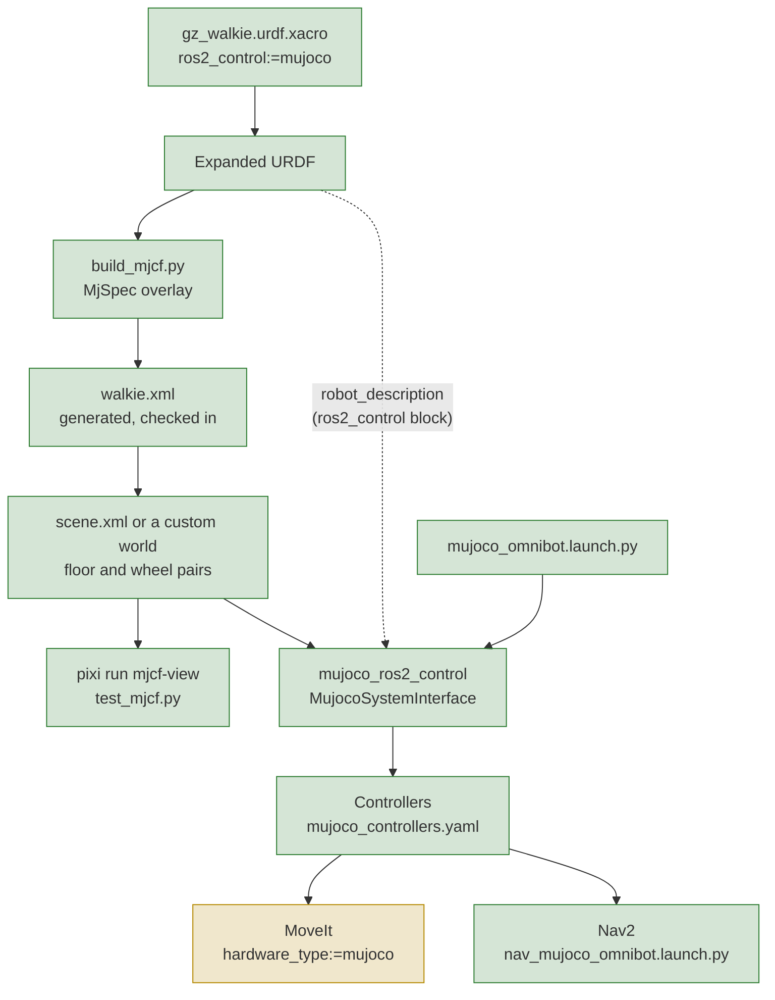

# 2. Add MuJoCo Simulation

**Goal:** run Walkie in MuJoCo next to Gazebo, with omni wheels that drive like the real
ones and a collision setup that stays cheap during navigation but still lets the arms touch
things during manipulation.

This entry records what the team built, why, and what is still missing. The
[sub-pages](#reading-order) explain each part in detail.

## In short

- **What changed:** `description/scripts/build_mjcf.py` generates
  `description/mujoco/walkie.xml` from the robot xacro. A minimal world, a
  `ros2_control:=mujoco` branch, a MuJoCo controller file and tests come with it. The
  MoveIt launches accept `hardware_type:=mujoco`.
- **Key decisions:** MuJoCo for per-contact control, LeKiwi-style capsule omni wheels,
  custom worlds, the xacro as the single source of truth, and a separate controller file.
- **Found along the way:** `robot_radius` was 0.252 instead of 0.185 in two controller files.
- **Result:** the model, the viewer and the MJCF tests work. The ros2_control runtime was
  blocked because `mujoco_ros2_control` was not in `pixi.lock`. Since
  [entry 4](../04-robostack-build-25.md) it is installed. Since
  [2.7](07-launch.md), `mujoco_omnibot.launch.py` starts it, and
  `nav_mujoco_omnibot.launch.py` adds Nav2. MoveIt with MuJoCo has not been run yet
  ([Current status](#current-status)).

## Why MuJoCo

The team set four requirements for the new simulator. MuJoCo makes all four possible with
one static model, because it gives direct control over every contact: which geometry
pairs may touch, and with which friction in which direction.

1. **Omni wheels with anisotropic friction,** modeled per wheel: grip in the rolling
   direction, free sliding along the axle.
2. **All collisions off by default.** The robot mostly only drives, so contact checks for
   the base, the lift and the arms are wasted work.
3. **Arm and body collisions during manipulation.** The arms must collide with the robot
   body and with the objects they handle.
4. **Both modes at the same time,** ideally without switching anything at runtime.

??? info "What MuJoCo is, compared with Gazebo"
    MuJoCo (Multi-Joint dynamics with Contact) is an open-source physics engine maintained
    by Google DeepMind. A robot and its world are described in one XML format called MJCF.
    You load an MJCF file with the `mujoco` Python package (or the C API), step the
    physics, and read joint states and sensors.

    MuJoCo ships an interactive viewer but no ROS integration of its own. The ROS side
    comes from a separate package, `mujoco_ros2_control`, which runs MuJoCo as a
    ros2_control hardware system.

    Compared with Gazebo, MuJoCo is a library first: the physics of the robot and the
    world, including every contact setting, lives in the MJCF file.

## Key decisions

### Follow the LeKiwi omni-wheel model { #reference-model-lekiwi }

The omni-wheel model follows LeKiwi, a small three-wheel omni robot with a MuJoCo model in
[Ekumen-OS/lekiwi](https://github.com/Ekumen-OS/lekiwi). Each wheel touches the floor
through a thin capsule, with one explicit contact pair per wheel and floor.
[2.2 Omni Wheels](02-omni-wheels.md) explains why the capsule and the plane floor are required.

??? info "What Walkie copies from LeKiwi"
    LeKiwi model file: `packages/lekiwi_sim/lekiwi_sim/assets/lekiwi/lekiwi.xml`.

    | LeKiwi idea | How Walkie uses it |
    | --- | --- |
    | Wheel collision geometry is a thin capsule (radius 0.051 m, half-length 0.001 m) | Each wheel touches the floor through a capsule of radius 0.075 m and half-length 0.005 m |
    | The wheel visual mesh has `contype="0" conaffinity="0"` | All visual geoms have `contype="0" conaffinity="0"`, and so do the wheel capsules |
    | One explicit `<pair>` per wheel and floor, `condim="3"`, friction along the axle first | Same, in `description/mujoco/scene.xml` |
    | Wheel hinges driven by velocity actuators | Same, `kv` = 20 |
    | The base is a free joint, so wheel contact drives it; nothing sets its pose directly | Same, `floating_base_joint` |

### Custom worlds instead of converting the Gazebo world

The `aws_small_house` world of `simulation/gazebo/launch/gzsim_omnibot.launch.py` was not
converted to MJCF. The team builds its own MuJoCo worlds instead, because a MuJoCo world
has rules a converted Gazebo world would not meet: the floor must be a plane named
`floor`, the wheel contact pairs must be present, and every world geom needs a collision
class. The minimal world `description/mujoco/scene.xml` documents these rules in its
header comment, and [2.1 Generate the Model](01-model-generation.md#rules-for-a-custom-world)
lists them.

### Generate the MJCF from the xacro, with an MjSpec overlay

`description/scripts/build_mjcf.py` expands the existing robot xacro with
`ros2_control:=mujoco`, imports the URDF with MuJoCo's `MjSpec` Python API, and adds what
URDF cannot express: free joint, wheel capsules, actuators, collision classes, sensors and
a keyframe. This keeps the xacro the single source of truth for the robot.

The generated `description/mujoco/walkie.xml` is checked in, so you can load the model
without running the generator. A test fails when it differs from the generator output.

??? info "Rejected alternatives: the mujoco_ros2_control converter, Blender with LinkForge"
    - **The URDF converter of `mujoco_ros2_control`.** The overlay needs full control over
      wheel geometry, collision bits, actuator gains and sensors. A generic converter does
      not produce the capsule wheels, the collision classes or the lidar emulation.
    - **Blender with the LinkForge add-on as the description source.** Walkie's meshes come
      from CAD, so Blender would only be an extra step in between. The evaluation also
      found LinkForge 1.5.x lossy for ros2_control blocks, sensors and xacro arguments.
      Blender stays an optional tool for one-off mesh cleanup.

### A separate controller file for MuJoCo

MuJoCo gets its own `description/config/ros2_controller/mujoco_controllers.yaml`, derived
from `sim_controllers.yaml`. A separate file keeps the Gazebo configuration unchanged.

??? info "Differences from sim_controllers.yaml"
    - No `left_forward_velocity_controller` and `right_forward_velocity_controller`. The
      MuJoCo arm joints are driven by position actuators, so they expose only a `position`
      command interface.
    - No parameter block for the wheel `forward_velocity_controller`, which
      `sim_controllers.yaml` configures but does not load.
    - An added `imu_sensor_broadcaster` for the `top_imu` sensor.

## Pipeline

- Green: works today. The launch files of [2.7](07-launch.md) start the hardware plugin
  and the controllers, and Nav2 drives the base.
- Yellow: written, but not run. MoveIt with `hardware_type:=mujoco` has not been run.

## What changed where

The work spans four commits in the `description/` submodule and four in the superproject.
The `description/` commits were made on its `feat/mujoco` branch and are on `main` since
description pull request #38 (merge commit `90a2243`). That pull request also merged `main`
into the branch and regenerated `walkie.xml` (`f6649ee`); see
[Robot Description: Frames and joints](../../reference/robot-description.md#frames-and-joints)
for the `base_link` change it brought. The other ros2_control modes (`gazebo`, `mock`,
`topic_base`, `real_robot`) expanded to the same URDF as before this work.

??? info "Commits, files and changes"
    | Repository | Commit | Files | Change |
    | --- | --- | --- | --- |
    | `description/` | `13244ae` | `description/config/ros2_controller/sim_controllers.yaml`, `description/config/ros2_controller/isaac_controllers.yaml` | `robot_radius` 0.252 to 0.185 (see [the robot_radius fix](#found-along-the-way-the-robot_radius-fix)) |
    | `description/` | `851618c` | `description/urdf/walkie/ros2_control.xacro`, `description/robots/gz_walkie.urdf.xacro`, `description/config/ros2_controller/mujoco_controllers.yaml` | `ros2_control:=mujoco` hardware branch, new xacro args `mujoco_model` and `mujoco_headless`, MuJoCo controller file |
    | `description/` | `301c439` | `description/scripts/build_mjcf.py`, `description/mujoco/walkie.xml`, `description/mujoco/scene.xml` | The generator, the generated model and the minimal world |
    | `description/` | `2b15ba1` | `description/test/test_description.py`, `description/test/test_mjcf.py`, `description/CMakeLists.txt`, `description/package.xml`; removed `description/test/test_xacro.py` | Description and MJCF tests; CMake installs the `mujoco` directory and registers every `test/test_*.py` |
    | superproject | `a926459` | `pixi.toml`, `pixi.lock`, `description` pointer | `mujoco >=3.14`, the `mjcf` and `mjcf-view` tasks, pytest pinned to `>=8,<9` |
    | superproject | `9a405ff` | `config/openarm_bimanual.srdf`, `test/test_srdf_urdf_contract.py`, `CMakeLists.txt` and `package.xml` in `manipulate/openarm_bimanual_moveit_config/` | Removed 12 SRDF entries for links that are not in the URDF, plus a test that every SRDF link, joint and group exists in the URDF |
    | superproject | `72359aa` | `moveit_demo.launch.py`, `moveit_demo_with_commander.launch.py` and `moveit_only.launch.py` in `manipulate/openarm_bimanual_moveit_config/launch/` | `hardware_type:=mujoco`; also fixed the Gazebo branch, which spawned `joint_state_broadcaster` although the controller is named `joint_broad` |
    | superproject | `ed927f3` | `README.md` | README rewritten for the pixi workflow |

## Found along the way: the robot_radius fix

`sim_controllers.yaml` and `isaac_controllers.yaml` had `robot_radius` 0.252, but each
wheel is 0.185 m from the base center. The robot turned in place about 1.36 times faster
than commanded, and the open-loop odometry was skewed. Commit `13244ae` set both files to
0.185.

`description/test/test_description.py` now checks `robot_radius`, `wheel_radius` and the
wheel order of every controller file against the URDF geometry, so this cannot drift again
silently.

??? info "Where 0.185 m and the 1.36 factor come from"
    `omni_wheel_drive_controller` needs `robot_radius`, the distance from the base center
    to each wheel. The wheels sit at (±0.130943, ±0.130943) m from `base_link`, which is
    0.185 m from the center.

    For a rotation command, the controller computes each wheel speed in proportion to
    `robot_radius`. With 0.252 instead of 0.185, the turn rate is 0.252 / 0.185, about
    1.36 times the commanded one.

    `real_controllers.yaml` already had 0.18518136649782.

## Current status

What works today, with no colcon build:

| Task | Command |
| --- | --- |
| Regenerate the model | `pixi run mjcf` |
| Open the scene in the MuJoCo viewer | `pixi run mjcf-view` |
| Run the MJCF tests | `pixi run python -m pytest description/test/test_mjcf.py` |

With ROS 2, after `pixi run build` (on a workspace built before the launch files existed,
`pixi run build-pkg robot_bringup walkie_description` is enough):

| Task | Command |
| --- | --- |
| MuJoCo with ros2_control, the sensors and RViz | `pixi run ros2 launch robot_bringup mujoco_omnibot.launch.py` |
| The same plus Nav2 on a blank map | `pixi run ros2 launch robot_bringup nav_mujoco_omnibot.launch.py` |

Set up the middleware first, as described in
[MuJoCo Simulation: Run with ROS 2](../../guides/simulation-mujoco.md#run-with-ros-2).

What did not work when this entry was written: the ros2_control runtime.

- `mujoco_ros2_control`, which provides the hardware plugin, was not in `pixi.lock`. The
  `mujoco` ros2_control branch was written against 0.1.2, which the `robostack-jazzy`
  channel publishes only for RoboStack build 25. The lock was on build 21, which has only
  the older 0.0.3. See [2.5 ros2_control](05-ros2-control.md#packaging-status).
- There was no MuJoCo launch file.
- The MoveIt launches accept `hardware_type:=mujoco`, but they expect the MuJoCo
  controller manager to be started separately.

!!! note "Update 2026-10-13: runtime installed"
    The default environment is now on RoboStack build set `_25`, and
    `mujoco_ros2_control` 0.1.2 is in the lock. A headless bringup started by hand loaded
    the model and activated the controllers, and the base followed velocity commands on
    `/omni_wheel_drive_controller/cmd_vel`. At that point, there was still no MuJoCo
    launch file (added in [2.7 Launch Files and Nav2](07-launch.md)). See
    [the move to build set `_25`](../04-robostack-build-25.md) and
    [MuJoCo Simulation: Run with ROS 2](../../guides/simulation-mujoco.md#run-with-ros-2).

!!! note "Update 2026-10-13: launch files added"
    Two launch files in `robot_bringup` now start the runtime. `mujoco_omnibot.launch.py`
    starts MuJoCo with ros2_control, the controllers, `twist_mux`, `dual_laser_merger`
    for `/scan`, and RViz. `nav_mujoco_omnibot.launch.py` adds Nav2 with odometry-only
    localization on a blank map. In headless tests, Nav2 reached its goals. MoveIt with
    MuJoCo has still not been run. See
    [2.7 Launch Files and Nav2](07-launch.md) and
    [MuJoCo Simulation: Run with ROS 2](../../guides/simulation-mujoco.md#run-with-ros-2).

## Next steps

1. **Re-lock the default pixi environment to RoboStack build 25**, so
   `ros-jazzy-mujoco-ros2-control` 0.1.2 resolves. This is planned as its own step. Every
   ROS package changes build, so the whole workspace, including the Nav2 fork, must be
   rebuilt afterwards.
2. **Write the MuJoCo launch file.** It should:
    - expand the URDF with `ros2_control:=mujoco` and load `mujoco_controllers.yaml`
    - start from the `home` keyframe
    - publish the lidar fans as `LaserScan` messages, with the beam parameters from the
      `walkie.xml` header
    - remap the `~/imu` topic of `imu_sensor_broadcaster`
3. **Fix the [known issues](#known-issues)**, starting with the values that need
   measurements of the real robot.
4. **Build custom worlds** for the competition arenas, following the rules in
   `description/mujoco/scene.xml`.

!!! note "Update 2026-10-13"
    Step 1 is done, see [the move to build set `_25`](../04-robostack-build-25.md). For
    step 2, a manual bringup established what the launch file needs, including a plugin
    parameter file for the cameras and lidars. It is listed in
    [MuJoCo Simulation: Run with ROS 2](../../guides/simulation-mujoco.md#run-with-ros-2).

!!! note "Update 2026-10-13: launch files added"
    Step 2 is done, see [2.7 Launch Files and Nav2](07-launch.md). The parameter file is
    now `bringup/config/mujoco/mujoco_plugins.yaml`.

??? info "Why not a separate pixi environment for MuJoCo"
    A separate pixi environment for MuJoCo was the alternative to re-locking. It was not
    chosen because pixi activation sources `install/setup.bash`, so a second environment
    would also need its own build and install directories.

## Reading order

| Page | Topic |
| --- | --- |
| [2.1 Generate the Model](01-model-generation.md) | How `build_mjcf.py` builds `walkie.xml`, what `scene.xml` adds, rules for custom worlds |
| [2.2 Omni Wheels](02-omni-wheels.md) | Wheel layout, the capsule-on-plane trick, friction values, driving accuracy tests |
| [2.3 Collisions](03-collisions.md) | Collision classes, MuJoCo's filtering rules, performance, effect on MoveIt |
| [2.4 Sensors](04-sensors.md) | IMU, cameras and the lidar emulation |
| [2.5 ros2_control](05-ros2-control.md) | The `mujoco` hardware branch, the controller file, MoveIt support, packaging status |
| [2.6 Tests](06-tests.md) | What the description, MJCF and SRDF contract tests check |
| [2.7 Launch Files and Nav2](07-launch.md) | The MuJoCo and Nav2 launch files, the plugin parameter file, two Nav2 fork issues, test results |

For day-to-day use, see the [MuJoCo Simulation guide](../../guides/simulation-mujoco.md).

## Known issues

| Issue | Effect | Workaround |
| --- | --- | --- |
| MoveIt with MuJoCo not run | The launch files start the runtime and Nav2 ([2.7](07-launch.md)), but MoveIt with `hardware_type:=mujoco` has not been run against them | Use Gazebo for MoveIt |
| Launch and Nav2 issues | Odometry drift in the map, no `/scan` on the empty floor, and other issues of the launch files. Update 2026-10-14: `/scan` on the empty floor is fixed in [entry 5](../05-nav2-repair.md#scan-in-the-empty-mujoco-world). | See [2.7 Launch Files and Nav2: Known issues](07-launch.md#known-issues) |
| Wheel radius mismatch | Drives about 1.5 % and turns about 2.4 % slower than commanded | None. The drive test tolerances (3 % and 4 %) allow for it. |
| `base_footprint` below the floor | It rests at z = -0.0062 m | None |
| Wheel speed limits disagree | ros2_control: ±3.14 rad/s. MJCF actuators: ±100 rad/s. | Replace the URDF placeholder `velocity="100"` with the real motor limit, then `pixi run mjcf` |
| Inertia estimates | `base_link` and `lift_link` use estimated inertials | Replace the `*_ESTIMATE` constants in `build_mjcf.py` with CAD data, then `pixi run mjcf` |
| Lift drive estimates | Force limit, stiffness and damping are estimates | Replace the `LIFT_*_ESTIMATE` constants with drive data, then `pixi run mjcf` |
| Bottom camera direction | `bottom_camera` (the D415) looks about 50 degrees up | Check the mount pitch against the real robot |
| Simplified visuals | Some parts are drawn with their collision geometry, also in camera images | Provide binary STL or OBJ visual meshes with at most 200,000 faces |
| The base passes through furniture | By design ([2.3 Collisions](03-collisions.md)). Bumping into furniture cannot be tested in MuJoCo. | Check the Nav2 costmaps and planned paths |
| The lift stalls when lowered from `home` | Commanded from 0.51 m down to 0.30 m, it stops near 0.48 m, and the `lift_controller` action still reports success | None yet |

??? info "Known issue causes and estimated values"
    - **Wheel radius mismatch.** The wheel capsules have radius 0.075 m, the URDF wheel
      cylinder. The controller files use `wheel_radius: 0.076`.
    - **`base_footprint` below the floor.** In the URDF the wheel bottoms are 6.2 mm above
      `base_footprint`. The generator puts the wheels on the floor.
    - **Wheel speed limits.** The MuJoCo ros2_control block declares wheel commands of
      ±3.14 rad/s, about 0.24 m/s at the rim with `wheel_radius` 0.076 m. The MJCF
      actuators accept ±100 rad/s, copied from the URDF placeholder `velocity="100"`.
    - **Inertia estimates.** The URDF inertials of `base_link` (negligible tensor) and
      `lift_link` (none) are placeholders. The model uses a solid cylinder (radius
      0.275 m, height 0.33 m, URDF mass) for `base_link` and a 3.0 kg box for
      `lift_link`.
    - **Lift drive estimates.** The URDF lift effort of 10000 N is a placeholder. The
      model uses a 600 N force limit, 5.0e4 N/m stiffness and 6000 N s/m damping.
    - **Bottom camera direction.** The upward view comes from the URDF mount pitch.
    - **Simplified visuals.** MuJoCo cannot load COLLADA files or STL files above 200,000
      faces. The wheels, the OpenArm links, hands and fingers, and the D415 are therefore
      drawn with their collision geometry.
    - **Lift stall.** At the `home` pose, the fingers hit `base_link` when the lift goes
      down. Plain MuJoCo, without ROS 2, shows the same, so it is a model issue. The
      manual bringup of 2026-10-12 found it.
