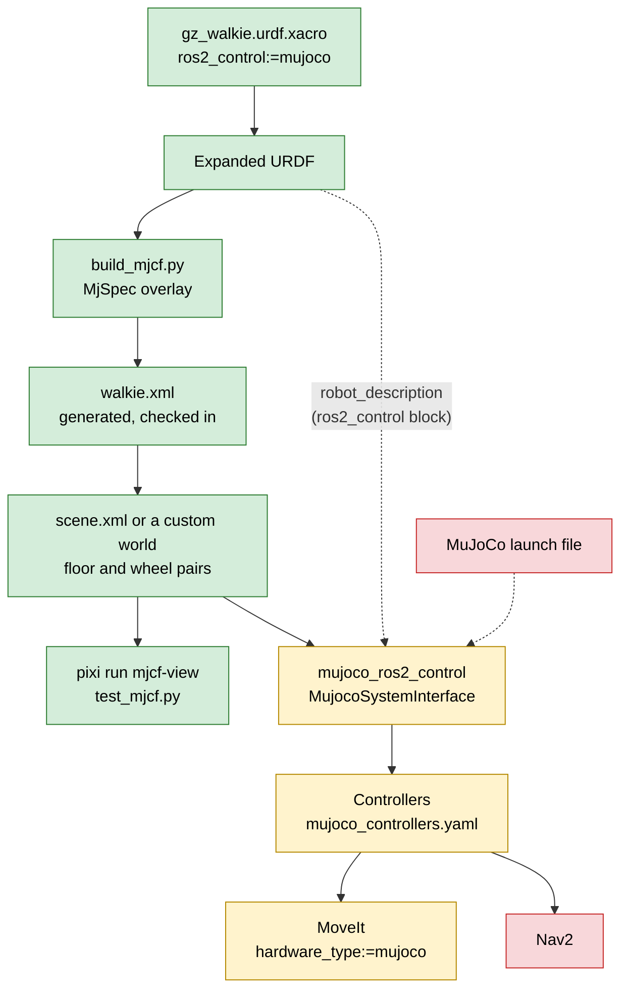

# 2. Add MuJoCo Simulation

**Goal:** run Walkie in MuJoCo next to Gazebo, with omni wheels that drive like the real
ones and a collision setup that stays cheap during navigation but still lets the arms touch
things during manipulation.

This entry records what the team built, why each decision was made, and what is still
missing. The sub-pages explain each part in detail.

## Why MuJoCo

The team set four requirements for the new simulator:

1. **Omni wheels with anisotropic friction.** An omni wheel grips the floor in its rolling
   direction and slides freely along its axle. The simulator must model this per wheel.
2. **All collisions off by default.** Most of the time the robot only drives. Contact
   checks for the base, the lift and the arms are wasted work in that case.
3. **Arm and body collisions during manipulation.** When the arms work, they must collide
   with the robot body and with the objects they handle.
4. **Both modes at the same time,** ideally without switching anything at runtime.

MuJoCo gives direct control over every contact: which geometry pairs may touch, and with
which friction in which direction. That makes all four requirements possible with one
static model.

Gazebo stays available. It is still the simulator for Nav2 and MoveIt until the MuJoCo
ros2_control runtime works (see [Current status](#current-status)).

## What MuJoCo is

MuJoCo (Multi-Joint dynamics with Contact) is an open-source physics engine maintained by
Google DeepMind. A robot and its world are described in one XML format called MJCF. You
load an MJCF file with the `mujoco` Python package (or the C API), step the physics, and
read joint states and sensors. MuJoCo ships an interactive viewer but no ROS integration of
its own. The ROS side comes from a separate package, `mujoco_ros2_control`, which runs
MuJoCo as a ros2_control hardware system. Compared with Gazebo, MuJoCo is a library first:
the physics of the robot and the world, including every contact setting, lives in the MJCF
file.

## Reference model: LeKiwi

The omni-wheel model follows LeKiwi, a small three-wheel omni robot with a MuJoCo model in
[Ekumen-OS/lekiwi](https://github.com/Ekumen-OS/lekiwi), file
`packages/lekiwi_sim/lekiwi_sim/assets/lekiwi/lekiwi.xml`. Walkie copies these ideas from it:

| LeKiwi idea | How Walkie uses it |
| --- | --- |
| Wheel collision geometry is a thin capsule (radius 0.051 m, half-length 0.001 m) | Each wheel touches the floor through a capsule of radius 0.075 m and half-length 0.005 m |
| The wheel visual mesh has `contype="0" conaffinity="0"` | All visual geoms have `contype="0" conaffinity="0"`, and so do the wheel capsules |
| One explicit `<pair>` per wheel and floor, `condim="3"`, friction along the axle first | Same, in `description/mujoco/scene.xml` |
| Wheel hinges driven by velocity actuators | Same, `kv` = 20 |
| The base is a free joint, so wheel contact drives it; nothing sets its pose directly | Same, `floating_base_joint` |

[Omni wheels](02-omni-wheels.md) explains why the capsule and the plane floor are required.

## Key decisions

### Custom worlds instead of converting the Gazebo world

The Gazebo launch `simulation/gazebo/launch/gzsim_omnibot.launch.py` loads the
`aws_small_house` world. It was not converted to MJCF.
Instead, the team builds its own MuJoCo worlds. The reason is that a MuJoCo world has
requirements that a converted Gazebo world would not meet: the floor must be a plane named
`floor`, the wheel contact pairs must be present, and every world geom needs a collision
class. The minimal world `description/mujoco/scene.xml` documents these rules in its header
comment. [Model generation](01-model-generation.md#rules-for-a-custom-world) lists them.

### Generate the MJCF from the xacro, with an MjSpec overlay

The MJCF model is generated by `description/scripts/build_mjcf.py`. The script expands the
existing robot xacro with `ros2_control:=mujoco`, imports the URDF with MuJoCo's `MjSpec`
Python API, and adds what URDF cannot express (free joint, wheel capsules, actuators,
collision classes, sensors, keyframe). The xacro stays the single source of truth for the
robot.

Two alternatives were rejected:

| Alternative | Why it was rejected |
| --- | --- |
| The URDF converter of `mujoco_ros2_control` | The overlay needs full control over wheel geometry, collision bits, actuator gains and sensors. A generic converter does not produce the capsule wheels, the collision classes or the lidar emulation. |
| Blender with the LinkForge add-on as the description source | Walkie's meshes come from CAD, so Blender would only be an extra step in between. The evaluation also found LinkForge 1.5.x lossy for ros2_control blocks, sensors and xacro arguments. Blender stays an optional tool for one-off mesh cleanup. |

The generated file `description/mujoco/walkie.xml` is checked in, so you can load the model
without running the generator. A test fails when the checked-in file differs from the
generator output.

### A separate controller file for MuJoCo

MuJoCo gets its own `description/config/ros2_controller/mujoco_controllers.yaml`. It is
`sim_controllers.yaml` with these changes:

- No `left_forward_velocity_controller` and `right_forward_velocity_controller`. The MuJoCo
  arm joints are driven by position actuators, so they expose only a `position` command
  interface.
- No parameter block for the wheel `forward_velocity_controller`, which
  `sim_controllers.yaml` configures but does not load.
- An added `imu_sensor_broadcaster` for the `top_imu` sensor.

A separate file keeps the Gazebo configuration unchanged.

## Pipeline

| Colour | Meaning |
| --- | --- |
| Green | Works today |
| Yellow | Written, but cannot run until `mujoco_ros2_control` is installed |
| Red | Not written yet |

## What changed where

| Repository | Commit | Files | Change |
| --- | --- | --- | --- |
| `description/` | `13244ae` | `description/config/ros2_controller/sim_controllers.yaml`, `description/config/ros2_controller/isaac_controllers.yaml` | `robot_radius` 0.252 to 0.185 (see below) |
| `description/` | `851618c` | `description/urdf/walkie/ros2_control.xacro`, `description/robots/gz_walkie.urdf.xacro`, `description/config/ros2_controller/mujoco_controllers.yaml` | `ros2_control:=mujoco` hardware branch, new xacro args `mujoco_model` and `mujoco_headless`, MuJoCo controller file |
| `description/` | `301c439` | `description/scripts/build_mjcf.py`, `description/mujoco/walkie.xml`, `description/mujoco/scene.xml` | The generator, the generated model and the minimal world |
| `description/` | `2b15ba1` | `description/test/test_description.py`, `description/test/test_mjcf.py`, `description/CMakeLists.txt`, `description/package.xml`; removed `description/test/test_xacro.py` | Description and MJCF tests; CMake installs the `mujoco` directory and registers every `test/test_*.py` |
| superproject | `a926459` | `pixi.toml`, `pixi.lock`, `description` pointer | `mujoco >=3.14`, the `mjcf` and `mjcf-view` tasks, pytest pinned to `>=8,<9` |
| superproject | `9a405ff` | `config/openarm_bimanual.srdf`, `test/test_srdf_urdf_contract.py`, `CMakeLists.txt` and `package.xml` in `manipulate/openarm_bimanual_moveit_config/` | Removed 12 SRDF entries for links that are not in the URDF, plus a test that every SRDF link, joint and group exists in the URDF |
| superproject | `72359aa` | `moveit_demo.launch.py`, `moveit_demo_with_commander.launch.py` and `moveit_only.launch.py` in `manipulate/openarm_bimanual_moveit_config/launch/` | `hardware_type:=mujoco`; also fixed the Gazebo branch, which spawned `joint_state_broadcaster` although the controller is named `joint_broad` |
| superproject | `ed927f3` | `README.md` | README rewritten for the pixi workflow |

The `description/` commits are on its `feat/mujoco` branch, except `13244ae`, which is also
on `main`. The other ros2_control modes (`gazebo`, `mock`, `topic_base`, `real_robot`)
expand to the same URDF as before.

## Found along the way: the robot_radius fix

`omni_wheel_drive_controller` needs `robot_radius`, the distance from the base center to
each wheel. The wheels sit at (±0.130943, ±0.130943) m from `base_link`, which is
0.185 m from the center. `sim_controllers.yaml` and `isaac_controllers.yaml` had 0.252.

For a rotation command, the controller computes each wheel speed in proportion to
`robot_radius`. With 0.252 instead of 0.185, the robot turned in place about 1.36 times
faster than commanded (0.252 / 0.185), and the open-loop odometry was skewed. Commit
`13244ae` set both files to 0.185. `real_controllers.yaml` already had 0.18518136649782.

`description/test/test_description.py` now compares `robot_radius`, `wheel_radius` and the
wheel order of every controller file with the URDF geometry, so this cannot drift again
silently.

## Current status

What works today, with no colcon build:

| Task | Command |
| --- | --- |
| Regenerate the model | `pixi run mjcf` |
| Open the scene in the MuJoCo viewer | `pixi run mjcf-view` |
| Run the MJCF tests | `pixi run python -m pytest description/test/test_mjcf.py` |

What does not work yet: the ros2_control runtime. The hardware plugin comes from the
package `mujoco_ros2_control`. Version 0.1.2, which the `mujoco` ros2_control branch was
written against, is published on the `robostack-jazzy` channel only for RoboStack build 25.
The current `pixi.lock` is on build 21, where only the older 0.0.3 release exists. So
`mujoco_ros2_control` is not in the lock, and there is no MuJoCo launch file yet. The MoveIt
launches accept `hardware_type:=mujoco`, but they expect the MuJoCo controller manager to be
started separately.

## Next steps

1. **Re-lock the default pixi environment to RoboStack build 25**, so
   `ros-jazzy-mujoco-ros2-control` 0.1.2 resolves. This is planned as its own step. Every
   ROS package changes build, so the whole workspace, including the Nav2 fork, must be
   rebuilt afterwards. The alternative was a separate pixi environment for MuJoCo. It was
   not chosen because pixi activation sources `install/setup.bash`, so a second environment
   would also need its own build and install directories.
2. **Write the MuJoCo launch file.** It should expand the URDF with `ros2_control:=mujoco`,
   load `mujoco_controllers.yaml`, start from the `home` keyframe, publish the lidar fans as
   `LaserScan` messages with the beam parameters from the `walkie.xml` header, and remap the
   `~/imu` topic of `imu_sensor_broadcaster`.
3. **Fix the [known issues](#known-issues)**, starting with the values that need
   measurements of the real robot.
4. **Build custom worlds** for the competition arenas, following the rules in
   `description/mujoco/scene.xml`.

## Reading order

| Page | Topic |
| --- | --- |
| [2.1 Generate the Model](01-model-generation.md) | How `build_mjcf.py` builds `walkie.xml`, what `scene.xml` adds, and the rules for custom worlds |
| [2.2 Omni Wheels](02-omni-wheels.md) | Wheel layout, the capsule-on-plane trick, friction values, and how driving accuracy is tested |
| [2.3 Collisions](03-collisions.md) | Collision classes, MuJoCo's filtering rules, performance, and what this means for MoveIt |
| [2.4 Sensors](04-sensors.md) | IMU, cameras and the lidar emulation |
| [2.5 ros2_control](05-ros2-control.md) | The `mujoco` hardware branch and the controller file |
| [2.6 Tests](06-tests.md) | What the description and MJCF tests check |

For day-to-day use, see the [MuJoCo Simulation guide](../../guides/simulation-mujoco.md).

## Known issues

| Issue | Effect | Workaround |
| --- | --- | --- |
| No ros2_control runtime | ROS nodes cannot use the MuJoCo simulation yet. See [Current status](#current-status). | Use Gazebo for Nav2 and MoveIt. |
| Wheel radius mismatch | The wheel capsules have radius 0.075 m (the URDF wheel cylinder). The controller files use `wheel_radius: 0.076`. The robot drives about 1.5 % slower and turns about 2.4 % slower than commanded. | None. The drive test tolerances (3 % and 4 %) allow for it. |
| `base_footprint` below the floor | In the URDF the wheel bottoms are 6.2 mm above `base_footprint`. The generator puts the wheels on the floor, so `base_footprint` rests at z = -0.0062 m. | None. |
| Wheel speed limits disagree | The MuJoCo ros2_control block declares wheel commands of ±3.14 rad/s, about 0.24 m/s at the rim with `wheel_radius` 0.076 m. The MJCF actuators accept ±100 rad/s, copied from the URDF placeholder `velocity="100"`. | Replace the URDF placeholder with the real motor limit, then run `pixi run mjcf`. |
| Inertia estimates | The URDF inertials of `base_link` (negligible tensor) and `lift_link` (none) are placeholders. The model uses a solid cylinder (radius 0.275 m, height 0.33 m, URDF mass) for `base_link` and a 3.0 kg box for `lift_link`. | Replace the `*_ESTIMATE` constants in `build_mjcf.py` when CAD data is available, then run `pixi run mjcf`. |
| Lift drive estimates | The URDF lift effort of 10000 N is a placeholder. The model uses a 600 N force limit, 5.0e4 N/m stiffness and 6000 N s/m damping. | Replace the `LIFT_*_ESTIMATE` constants when drive data is available, then run `pixi run mjcf`. |
| Bottom camera direction | `bottom_camera` (the D415) looks about 50 degrees up. This comes from the URDF mount pitch. | Check the mount pitch against the real robot. |
| Simplified visuals | MuJoCo cannot load COLLADA files or STL files above 200,000 faces. The wheels, the OpenArm links, hands and fingers, and the D415 are drawn with their collision geometry, also in camera images. | Provide binary STL or OBJ visual meshes with at most 200,000 faces. |
| The base passes through furniture | By design, see [Collisions](03-collisions.md). Bumping into furniture cannot be tested in MuJoCo. | Check the Nav2 costmaps and planned paths instead. |
