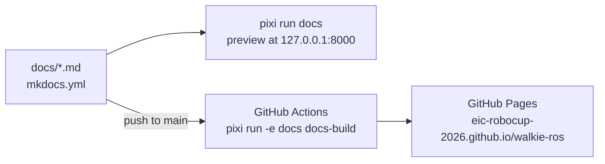

# 3. Add the Documentation Site

**Goal:** keep the workspace documentation as Markdown files in `docs/`,
preview it locally with one command, and publish it to GitHub Pages
automatically when it changes on `main`.

The site uses [MkDocs](https://www.mkdocs.org/) with the
[Material](https://squidfunk.github.io/mkdocs-material/) theme. This entry
shows how the site is built and published, and how to write a page.

## In short

- Preview the site with `pixi run docs`. Check it with `pixi run docs-build`,
  the same strict build that CI runs.
- The docs tools live in their own pixi environment, `docs`. It has no ROS,
  so you can edit pages without building the workspace.
- Every page must be in `nav` in `mkdocs.yml`. Broken links, missing anchors,
  and pages missing from `nav` fail the strict build.
- A push to `main` that changes the docs publishes the site to
  <https://eic-robocup-2026.github.io/walkie-ros/>.
- To add a page, follow [Writing a new page](#writing-a-new-page) and the
  [Writing conventions](#writing-conventions).

## Overview



| File | Role |
| --- | --- |
| `docs/` | The pages, one Markdown file each |
| `mkdocs.yml` | Site settings, theme, Markdown extensions, link checks, and the navigation |
| `pixi.toml` | The `docs` feature, environment, and tasks |
| `.github/workflows/docs.yml` | Builds the site and deploys it to GitHub Pages |

## Step 1: A docs environment without ROS

The documentation tools live in their own pixi **feature** and
**environment**, both named `docs`. The environment sets
`no-default-feature = true`, so it contains MkDocs but not ROS 2, Gazebo,
MoveIt, or the compilers. Someone who only edits pages runs `pixi run docs`
without installing or building the ROS workspace.

??? info "The `docs` feature and environment in pixi.toml"
    ```toml title="pixi.toml"
    [feature.docs.dependencies]
    mkdocs-material = ">=9.7,<10"
    # MkDocs 2 is incompatible with the Material theme.
    mkdocs = ">=1.6,<2"

    [feature.docs.tasks]
    docs = {cmd = "mkdocs serve", description = "Preview the documentation site at http://127.0.0.1:8000"}
    docs-build = {cmd = "mkdocs build --strict", description = "Build the documentation site into site/, failing on any warning"}

    [environments]
    docs = {features = ["docs"], no-default-feature = true}
    ```

    The same tables can be created from the command line, without the comments
    and the task descriptions:

    ```bash
    pixi add --feature docs "mkdocs-material>=9.7,<10" "mkdocs>=1.6,<2"
    pixi task add --feature docs docs "mkdocs serve"
    pixi task add --feature docs docs-build "mkdocs build --strict"
    pixi workspace environment add docs --feature docs --no-default-feature
    pixi install -e docs
    ```

    | Term | Meaning here |
    | --- | --- |
    | Feature | A named group of dependencies and tasks. `docs` holds MkDocs and the two tasks. Everything at the top level of `pixi.toml` belongs to the **default feature**. |
    | Environment | A set of features that pixi installs together into `.pixi/envs/<name>/`. |

??? info "Why the environment uses no-default-feature"
    Without `no-default-feature = true`, the `docs` environment would contain
    the default feature too. With it:

    | | `default` environment | `docs` environment |
    | --- | --- | --- |
    | Packages | 1276 | 63 |
    | Download | About 1.7 GB | About 70 MB |
    | Sources `install/setup.bash` | Yes | No |

    - **Fast CI.** The workflow installs only the `docs` environment, so it
      downloads about 70 MB instead of 1.7 GB.
    - **No activation side effects.** The default feature's `[activation]`
      section is excluded too, so the `docs` environment does not source
      `install/setup.bash` and does not print the missing activation script
      warning.

??? info "Why mkdocs is pinned below 2"
    `mkdocs-material` is a theme for MkDocs 1.x. The locked `mkdocs-material`
    9.7.7 package already requires `mkdocs >=1.6,<2`. The explicit pin, with
    its comment, keeps that rule visible in `pixi.toml`, so nobody removes it
    while updating the theme.

## Step 2: Tasks

| Task | Command | Use |
| --- | --- | --- |
| `docs` | `mkdocs serve` | Preview at <http://127.0.0.1:8000>. Reloads when you save a file. Stop with ++ctrl+c++. |
| `docs-build` | `mkdocs build --strict` | Builds into `site/`, which Git ignores. `--strict` turns every warning into a failure. Run it before you push. |

The tasks exist only in the `docs` feature, so `pixi run docs` picks the
`docs` environment by itself. The workflow names the environment explicitly
with `pixi run -e docs docs-build`.

## Step 3: mkdocs.yml

Two parts of `mkdocs.yml` matter when you write pages:

- **Navigation.** `nav` lists every page in order, and the sidebar follows it
  exactly. A page that is not in `nav` makes the strict build fail.
- **Link checks.** MkDocs checks links while it builds. The `validation` block
  raises most checks from `info` to `warn`. `--strict` ignores `info` but fails
  on `warn`, so `pixi run docs-build` fails on broken links and anchors.

??? info "Site settings and the edit button"
    ```yaml title="mkdocs.yml"
    site_url: https://eic-robocup-2026.github.io/walkie-ros/
    repo_url: https://github.com/EIC-Robocup-2026/walkie-ros
    edit_uri: edit/main/docs/
    ```

    `repo_url` adds a link to the repository in the header. `edit_uri`,
    together with the `content.action.edit` feature, adds an edit button to
    each page that opens the file on GitHub, on the `main` branch.

??? info "Theme palette and features"
    The theme is `material` with a light and a dark palette (indigo). The
    enabled features:

    | Feature | Effect |
    | --- | --- |
    | `navigation.instant`, `navigation.tracking` | Pages load without a full reload; the URL follows the current section |
    | `navigation.sections`, `navigation.indexes` | Top-level sections are shown as groups; a section can have its own `index.md` page |
    | `navigation.top` | A "back to top" button |
    | `search.suggest`, `search.highlight` | Search suggestions, and highlighted search terms on the result page |
    | `content.code.copy`, `content.code.annotate` | A copy button on code blocks, and code annotations |
    | `content.action.edit` | The edit button described in the site settings above |

??? info "Link check settings and what each check catches"
    ```yaml title="mkdocs.yml"
    validation:
      omitted_files: warn
      absolute_links: warn
      unrecognized_links: warn
      anchors: warn
    ```

    | Check | MkDocs default | Here | Catches |
    | --- | --- | --- | --- |
    | `not_found` | `warn` | `warn` (default) | A link to a `.md` file that does not exist |
    | `omitted_files` | `info` | `warn` | A page in `docs/` that is missing from `nav` |
    | `absolute_links` | `info` | `warn` | A link that starts with `/`. It breaks on GitHub Pages, where the site lives under `/walkie-ros/` |
    | `unrecognized_links` | `info` | `warn` | A relative link without a file extension that matches no page, such as `../guides/pixi` instead of `../guides/pixi.md`, or a folder such as `../guides/` |
    | `anchors` | `info` | `warn` | A link to a `#heading` that does not exist on the target page |

??? info "Enabled Markdown extensions"
    | Extension | What it gives you |
    | --- | --- |
    | `admonition`, `pymdownx.details` | Note, tip, and warning boxes; `???` makes a box collapsible |
    | `pymdownx.superfences` | Code blocks inside lists, tabs, and boxes, and Mermaid diagrams in a `mermaid` code block |
    | `pymdownx.highlight`, `pymdownx.inlinehilite` | Syntax highlighting, and `title="..."` on code blocks |
    | `pymdownx.tabbed` | Content tabs with `=== "Name"` |
    | `pymdownx.keys` | Keyboard keys such as `++ctrl+c++` |
    | `pymdownx.tasklist` | Checklists with `- [ ]` |
    | `pymdownx.emoji` | Material icons (`:material-...:`) |
    | `pymdownx.snippets` | Including another file with `--8<--` |
    | `toc` with `permalink` | An anchor link next to each heading |
    | `attr_list`, `md_in_html`, `tables` | Attributes on elements, Markdown inside HTML, and tables |

## Step 4: Publish with GitHub Actions

`.github/workflows/docs.yml` builds the site and deploys it to GitHub Pages.
It runs on a push to `main` that changes `docs/**`, `mkdocs.yml`, `pixi.toml`,
`pixi.lock`, or the workflow itself. Other pushes do not rebuild the site.
To run it by hand, use the **Run workflow** button on the Actions tab
(`workflow_dispatch`).

??? info "Workflow jobs, and why each setting is there"
    | Job | Steps |
    | --- | --- |
    | `build` | Check out the repository; install pixi and the `docs` environment with `prefix-dev/setup-pixi`; run `pixi run -e docs docs-build`; upload `site/` as the Pages artifact |
    | `deploy` | Publish the artifact with `actions/deploy-pages` to the `github-pages` environment |

    - **No submodules, no LFS.** The site needs only `docs/` and `mkdocs.yml`.
      `actions/checkout` skips submodules and LFS files by default, which keeps
      the checkout small.
    - **Locked install.** `setup-pixi` runs `pixi install --locked` when
      `pixi.lock` exists. If `pixi.toml` and `pixi.lock` disagree about the
      docs environment, the job stops instead of solving a new environment.
    - **Cache.** `cache: true` stores the installed environment between runs,
      keyed on `pixi.lock`.
    - **Pinned action.** `setup-pixi` is pinned to a full commit SHA, with the
      version in a comment (`v0.11.0`). A tag can be moved to other code
      later; a SHA cannot.
    - **Permissions.** The workflow reads the repository by default. Only the
      `deploy` job gets `pages: write` and `id-token: write`, the two
      permissions that `actions/deploy-pages` needs.
    - **Concurrency.** `group: pages` with `cancel-in-progress: false` lets a
      running deployment finish before the next one starts.

## One-time setting on GitHub

GitHub Pages must use GitHub Actions as its source. A repository admin sets
this once:

1. Open the repository on GitHub and go to **Settings → Pages**.
2. Under **Build and deployment**, set **Source** to **GitHub Actions**.

!!! note "Only `main` can deploy by default"
    With this source, GitHub creates the `github-pages` environment. By
    default it accepts deployments only from the default branch, `main`. A
    manual run on another branch builds the site, but its `deploy` job is
    rejected.

The site address is the `site_url` in `mkdocs.yml`,
<https://eic-robocup-2026.github.io/walkie-ros/>.

## Writing a new page

1. Create the file under `docs/`, in the folder of its section, for example
   `docs/guides/my-topic.md`. Use lowercase names with dashes.
2. Start it with one `# Title`, followed by one or two sentences that say what
   the page helps the reader do. Follow the
   [Writing conventions](#writing-conventions) for the rest.
3. Add it to `nav` in `mkdocs.yml`, in the right section. Without this, the
   strict build fails.
4. Add a row for it to the section's index page, for example
   `docs/guides/index.md`.
5. Preview it:

    ```bash
    pixi run docs
    ```

6. Before you push, run the same check as the workflow:

    ```bash
    pixi run docs-build
    ```

    Fix every warning it prints. The most common ones are a link to a file
    that does not exist, a link to a missing `#anchor`, and a page that is not
    in `nav`.

## Markdown examples

The body of a box, a collapsible box, or a tab must be indented by
**4 spaces**. Code blocks, tables, and lists inside it are indented 4 spaces
too. Without the indent, the text ends up outside the box or tab, and MkDocs
does not warn about it. These four constructs are the ones most often written
wrong.

=== "Note box"

    ````markdown
    !!! note "Optional title"
        The body is indented 4 spaces.
        Other types: tip, warning, danger, info, example.
    ````

=== "Collapsible box"

    ````markdown
    ??? info "Descriptive title"
        Closed until the reader opens it. The title says what is inside.
        The body and the code block below are indented 4 spaces.

        ```bash
        pixi run docs-build
        ```
    ````

=== "Code block with title"

    ````markdown
    ```bash title="Build one package"
    pixi run build-pkg robot_bringup
    ```
    ````

=== "Tabs"

    ````markdown
    === "Gazebo"

        ```bash
        pixi run ros2 launch robot_simulation gzsim_omnibot.launch.py
        ```

    === "MuJoCo viewer"

        ```bash
        pixi run mjcf-view
        ```
    ````

The same examples, rendered:

!!! note "Optional title"
    The body is indented 4 spaces.
    Other types: tip, warning, danger, info, example.

??? info "Descriptive title"
    Closed until the reader opens it. The title says what is inside.
    The body and the code block below are indented 4 spaces.

    ```bash
    pixi run docs-build
    ```

```bash title="Build one package"
pixi run build-pkg robot_bringup
```

=== "Gazebo"

    ```bash
    pixi run ros2 launch robot_simulation gzsim_omnibot.launch.py
    ```

=== "MuJoCo viewer"

    ```bash
    pixi run mjcf-view
    ```

## Writing conventions

Write each page so a reader can skim it from top to bottom, do the steps, and
get a direct answer.

### Page structure

- **Opening.** One `# Title` per page, then one or two sentences that say what
  the page helps the reader do. Then `##` sections. A task page with one
  obvious main command can show it right after the opening, as a short
  "Quick start".
- **Headings.** Name the task or question the reader has, such as "Run Gazebo
  with Nav2" or "Connect a laptop to the robot".
- **Answer first.** Start each section with the command or a one-sentence
  answer. Then add at most a few short sentences or bullets of essential
  context. Use numbered steps for procedures.
- **Tables.** Use them for anything that has several parallel items. Keep the
  cells short. If a cell needs a paragraph, use bullets instead, or move the
  table into a collapsible box.
- **Content tabs.** Use `=== "Name"` only when one task has clear variants,
  such as simulation and real robot.
- **Visible callouts.** Use `!!! note`, `!!! tip`, and `!!! warning` for short
  callouts only. Use `!!! warning` or `!!! danger` for anything that causes
  breakage, wasted hours, or hardware damage.

### Visible or collapsible

Keep visible what a reader needs to complete the task:

- the commands, and the order to run them in
- required environment variables, launch arguments, and the defaults that
  readers usually change
- warnings, and gotchas that hit most readers
- a one-sentence "why" when it changes what the reader does

Move additional detail into a collapsible box:

- rationale, background, history, and alternatives considered
- internals: config file contents, source code citations, and how a script
  works line by line
- long parameter or config tables (on reference pages, the lookup tables are
  the content and stay visible)
- measurements, experiment numbers, and derivations
- rare edge cases, and flag-by-flag explanations longer than one line

Rules for a collapsible box:

- Write it as `??? info "Descriptive title"`. `???` makes it closed by
  default.
- The title says what is inside, such as "Why one router per machine" or
  "Full router config settings". Never "More details".
- Indent the body exactly 4 spaces, including the code blocks, tables, and
  lists inside it. Nested list items keep their extra indent on top of that.
  Leave a blank line before and after the block.
- Do not put a `#` heading inside, and do not nest a collapsible box inside
  another one.
- A reader must never need to open it to complete a task. Do not wrap a whole
  section in one.

### Language and formatting

- **Plain English.** Short sentences, one idea each. Many readers are not
  native English speakers. Explain **why** a step is needed, not only what to
  type. In the main flow, keep the reason to one sentence.
- **No filler.** No hype, no emoji, no exclamation marks. Avoid "simply",
  "just", and "easy": they add nothing, and a reader who is stuck feels worse.
  Say each fact once. Do not restate what a command or table already shows.
- **One owner per topic.** If another page covers a topic fully, write one
  sentence and link to that page instead of repeating it.
- **Code blocks.** Always give a language (`bash`, `yaml`, `toml`, `text`).
  Use `title="..."` when a block shows part of a file. Show short excerpts,
  not whole files.
- **Commands.** Write ROS commands as `pixi run ros2 ...`, so they work from
  any terminal.
- **Paths.** Write repository files as inline code, such as
  `bringup/launch/real_omnibot.launch.py`.
- **Links.** Link between pages with relative `.md` paths, such as
  `[Working with Pixi](../guides/pixi.md)`. Add a `#anchor` only if the
  heading exists; the strict build checks it. To link to a file of this
  repository on GitHub, use
  `https://github.com/EIC-Robocup-2026/walkie-ros/blob/main/<path>`. Do not
  build GitHub links into the `description` or `navigation` submodules; they
  are separate repositories on their own branches.
- **Accuracy.** Check every command, path, and default value against the code
  before you write it down. If something is not verified, leave it out.
