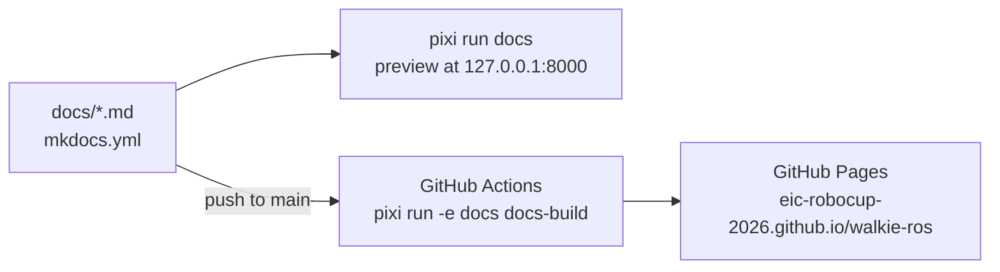

# 3. Add the Documentation Site

**Goal:** keep the workspace documentation as Markdown files in `docs/`,
preview it locally with one command, and publish it to GitHub Pages
automatically when it changes on `main`.

This entry explains how the site is built and published, and how to add a
page. The site uses [MkDocs](https://www.mkdocs.org/) with the
[Material](https://squidfunk.github.io/mkdocs-material/) theme.

## Overview



| File | Role |
| --- | --- |
| `docs/` | The pages, one Markdown file each |
| `mkdocs.yml` | Site settings, theme, Markdown extensions, link checks, and the navigation |
| `pixi.toml` | The `docs` feature, environment, and tasks |
| `.github/workflows/docs.yml` | Builds the site and deploys it to GitHub Pages |

## Step 1: A docs environment without ROS

The documentation tools live in their own pixi **feature** and
**environment**:

```toml title="pixi.toml"
[feature.docs.dependencies]
mkdocs-material = ">=9.7,<10"
# MkDocs 2 is incompatible with the Material theme.
mkdocs = ">=1.6,<2"

[feature.docs.tasks]
docs = {cmd = "mkdocs serve", description = "Preview the documentation site at http://127.0.0.1:8000"}
docs-build = {cmd = "mkdocs build --strict", description = "Build the documentation site into site/, failing on any warning"}

[environments]
docs = {features = ["docs"], no-default-feature = true}
```

The same tables can be created from the command line, without the comments
and the task descriptions:

```bash
pixi add --feature docs "mkdocs-material>=9.7,<10" "mkdocs>=1.6,<2"
pixi task add --feature docs docs "mkdocs serve"
pixi task add --feature docs docs-build "mkdocs build --strict"
pixi workspace environment add docs --feature docs --no-default-feature
pixi install -e docs
```

The two terms:

| Term | Meaning here |
| --- | --- |
| Feature | A named group of dependencies and tasks. `docs` holds MkDocs and the two tasks. Everything at the top level of `pixi.toml` belongs to the **default feature**. |
| Environment | A set of features that pixi installs together into `.pixi/envs/<name>/`. |

### Why no-default-feature

Without `no-default-feature = true`, the `docs` environment would contain the
default feature too: all of ROS 2, Gazebo, MoveIt, and the compilers. With it:

| | `default` environment | `docs` environment |
| --- | --- | --- |
| Packages | 1276 | 63 |
| Download | About 1.7 GB | About 70 MB |
| Sources `install/setup.bash` | Yes | No |

- **Fast CI.** The workflow installs only the `docs` environment, so it
  downloads about 70 MB instead of 1.7 GB.
- **No ROS needed to write docs.** Someone who only edits pages runs
  `pixi run docs` without installing or building the ROS workspace.
- **No activation side effects.** The default feature's `[activation]`
  section is excluded too, so the `docs` environment does not source
  `install/setup.bash` and does not print the missing activation script
  warning.

### Why mkdocs is pinned below 2

`mkdocs-material` is a theme for MkDocs 1.x. The locked `mkdocs-material`
9.7.7 package already requires `mkdocs >=1.6,<2`. The explicit pin, with its
comment, keeps that rule visible in `pixi.toml`, so nobody removes it while
updating the theme.

## Step 2: Tasks

| Task | Command | Use |
| --- | --- | --- |
| `docs` | `mkdocs serve` | Local preview at <http://127.0.0.1:8000>. Reloads the page when you save a file. Stop with ++ctrl+c++. |
| `docs-build` | `mkdocs build --strict` | Builds the site into `site/`, which Git ignores. `--strict` turns every warning into a failure. Run it before you push. |

The tasks exist only in the `docs` feature, so `pixi run docs` picks the
`docs` environment by itself. The workflow names the environment explicitly
with `pixi run -e docs docs-build`.

## Step 3: mkdocs.yml

### Site settings

```yaml title="mkdocs.yml"
site_url: https://eic-robocup-2026.github.io/walkie-ros/
repo_url: https://github.com/EIC-Robocup-2026/walkie-ros
edit_uri: edit/main/docs/
```

`repo_url` adds a link to the repository in the header. `edit_uri`, together
with the `content.action.edit` feature, adds an edit button to each page that
opens the file on GitHub, on the `main` branch.

### Theme

The theme is `material` with a light and a dark palette (indigo). The enabled
features:

| Feature | Effect |
| --- | --- |
| `navigation.instant`, `navigation.tracking` | Pages load without a full reload; the URL follows the current section |
| `navigation.sections`, `navigation.indexes` | Top-level sections are shown as groups; a section can have its own `index.md` page |
| `navigation.top` | A "back to top" button |
| `search.suggest`, `search.highlight` | Search suggestions, and highlighted search terms on the result page |
| `content.code.copy`, `content.code.annotate` | A copy button on code blocks, and code annotations |
| `content.action.edit` | The edit button described above |

### Link checks

```yaml title="mkdocs.yml"
validation:
  omitted_files: warn
  absolute_links: warn
  unrecognized_links: warn
  anchors: warn
```

MkDocs checks links while it builds. Each check reports at a level. By
default, most checks only report at `info` level, which `--strict` ignores.
This block raises them to `warn`, so `pixi run docs-build` fails on them:

| Check | MkDocs default | Here | Catches |
| --- | --- | --- | --- |
| `not_found` | `warn` | `warn` (default) | A link to a `.md` file that does not exist |
| `omitted_files` | `info` | `warn` | A page in `docs/` that is missing from `nav` |
| `absolute_links` | `info` | `warn` | A link that starts with `/`. It breaks on GitHub Pages, where the site lives under `/walkie-ros/` |
| `unrecognized_links` | `info` | `warn` | A relative link without a file extension that matches no page, such as `../guides/pixi` instead of `../guides/pixi.md`, or a folder such as `../guides/` |
| `anchors` | `info` | `warn` | A link to a `#heading` that does not exist on the target page |

### Markdown extensions

| Extension | What it gives you |
| --- | --- |
| `admonition`, `pymdownx.details` | Note, tip, and warning boxes; `???` makes a box collapsible |
| `pymdownx.superfences` | Code blocks inside lists, tabs, and boxes, and Mermaid diagrams in a `mermaid` code block |
| `pymdownx.highlight`, `pymdownx.inlinehilite` | Syntax highlighting, and `title="..."` on code blocks |
| `pymdownx.tabbed` | Content tabs with `=== "Name"` |
| `pymdownx.keys` | Keyboard keys such as `++ctrl+c++` |
| `pymdownx.tasklist` | Checklists with `- [ ]` |
| `pymdownx.emoji` | Material icons (`:material-...:`) |
| `pymdownx.snippets` | Including another file with `--8<--` |
| `toc` with `permalink` | An anchor link next to each heading |
| `attr_list`, `md_in_html`, `tables` | Attributes on elements, Markdown inside HTML, and tables |

### Navigation

`nav` lists every page in order. The sidebar follows it exactly. A page that
is not in `nav` makes the strict build fail (see `omitted_files` above).

## Step 4: Publish with GitHub Actions

`.github/workflows/docs.yml` has two jobs:

| Job | Steps |
| --- | --- |
| `build` | Check out the repository; install pixi and the `docs` environment with `prefix-dev/setup-pixi`; run `pixi run -e docs docs-build`; upload `site/` as the Pages artifact |
| `deploy` | Publish the artifact with `actions/deploy-pages` to the `github-pages` environment |

Details and the reasons behind them:

- **Triggers.** A push to `main` that changes `docs/**`, `mkdocs.yml`,
  `pixi.toml`, `pixi.lock`, or the workflow itself. `workflow_dispatch` adds
  a "Run workflow" button on the Actions tab. Other pushes do not rebuild the
  site.
- **No submodules, no LFS.** The site needs only `docs/` and `mkdocs.yml`.
  `actions/checkout` skips submodules and LFS files by default, which keeps
  the checkout small.
- **Locked install.** `setup-pixi` runs `pixi install --locked` when
  `pixi.lock` exists. If `pixi.toml` and `pixi.lock` disagree about the docs
  environment, the job stops instead of solving a new environment.
- **Cache.** `cache: true` stores the installed environment between runs,
  keyed on `pixi.lock`.
- **Pinned action.** `setup-pixi` is pinned to a full commit SHA, with the
  version in a comment (`v0.11.0`). A tag can be moved to other code later; a
  SHA cannot.
- **Permissions.** The workflow reads the repository by default. Only the
  `deploy` job gets `pages: write` and `id-token: write`, the two permissions
  that `actions/deploy-pages` needs.
- **Concurrency.** `group: pages` with `cancel-in-progress: false` lets a
  running deployment finish before the next one starts.

## One-time setting on GitHub

GitHub Pages must use GitHub Actions as its source. A repository admin sets
this once:

1. Open the repository on GitHub and go to **Settings → Pages**.
2. Under **Build and deployment**, set **Source** to **GitHub Actions**.

With this source, GitHub creates the `github-pages` environment. By default
it accepts deployments only from the default branch, `main`. A manual run on
another branch builds the site, but its `deploy` job is rejected.

The site address is the `site_url` in `mkdocs.yml`,
<https://eic-robocup-2026.github.io/walkie-ros/>.

## Writing a new page

1. Create the file under `docs/`, in the folder of its section, for example
   `docs/guides/my-topic.md`. Use lowercase names with dashes.
2. Start it with one `# Title`, followed by one or two sentences that say what
   the page covers.
3. Add it to `nav` in `mkdocs.yml`, in the right section. Without this, the
   strict build fails.
4. Add a row for it to the section's index page, for example
   `docs/guides/index.md`.
5. Preview it:

    ```bash
    pixi run docs
    ```

6. Before you push, run the same check as the workflow:

    ```bash
    pixi run docs-build
    ```

    Fix every warning it prints. The most common ones are a link to a file
    that does not exist, a link to a missing `#anchor`, and a page that is not
    in `nav`.

## Markdown examples

The three constructs below are the ones most often written wrong. The body of
a box, and the content of a tab, must be indented by **4 spaces**. Without the
indent, the text ends up outside the box or tab, and MkDocs does not warn
about it.

=== "Note box"

    ````markdown
    !!! note "Optional title"
        The body is indented 4 spaces.
        Other types: tip, warning, danger, info, example.
    ````

=== "Code block with title"

    ````markdown
    ```bash title="Build one package"
    pixi run build-pkg robot_bringup
    ```
    ````

=== "Tabs"

    ````markdown
    === "Gazebo"

        ```bash
        pixi run ros2 launch robot_simulation gzsim_omnibot.launch.py
        ```

    === "MuJoCo viewer"

        ```bash
        pixi run mjcf-view
        ```
    ````

The same examples, rendered:

!!! note "Optional title"
    The body is indented 4 spaces.
    Other types: tip, warning, danger, info, example.

```bash title="Build one package"
pixi run build-pkg robot_bringup
```

=== "Gazebo"

    ```bash
    pixi run ros2 launch robot_simulation gzsim_omnibot.launch.py
    ```

=== "MuJoCo viewer"

    ```bash
    pixi run mjcf-view
    ```

## Writing conventions

- **Plain English.** Short sentences, one idea each. Many readers are not
  native English speakers. Explain **why** a step is needed, not only what to
  type.
- **No filler.** No hype, no emoji, no exclamation marks. Avoid "simply",
  "just", and "easy": they add nothing, and a reader who is stuck feels worse.
- **Structure.** One `# Title` per page, then `##` sections. Use tables for
  anything that has several parallel items, and numbered steps for
  procedures.
- **Code blocks.** Always give a language (`bash`, `yaml`, `toml`, `text`).
  Use `title="..."` when a block shows part of a file. Show short excerpts,
  not whole files.
- **Commands.** Write ROS commands as `pixi run ros2 ...`, so they work from
  any terminal.
- **Paths.** Write repository files as inline code, such as
  `bringup/launch/real_omnibot.launch.py`.
- **Links.** Link between pages with relative `.md` paths, such as
  `[Working with Pixi](../guides/pixi.md)`. Add a `#anchor` only if the
  heading exists; the strict build checks it. To link to a file of this
  repository on GitHub, use
  `https://github.com/EIC-Robocup-2026/walkie-ros/blob/main/<path>`. Do not
  build GitHub links into the `description` or `navigation` submodules; they
  are separate repositories on their own branches.
- **Accuracy.** Check every command, path, and default value against the code
  before you write it down. If something is not verified, leave it out.
