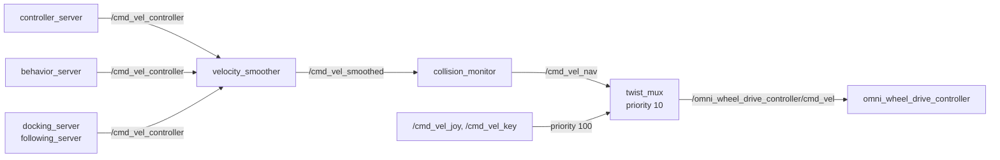

# 5. Repair Nav2 After the navigation2 Bump

**Goal:** make every Nav2 launch file start again on the bumped `navigation2`,
and put the velocity smoother and the collision monitor into the command path
that the parameter files were written for.

This entry records what broke, why, and how each problem was fixed. For
day-to-day use, read [Navigation](../guides/navigation.md). Two of the
problems were first recorded, with workarounds, in
[2.7 Launch Files and Nav2](02-mujoco/07-launch.md#two-nav2-fork-issues).

## In short

- **Changed:** in the `navigation` submodule, the five MPPI parameter files,
  four launch files of `robot_navigation`, and the map submodule pointer. In
  the sim, real and restaurant parameter files, this includes the collision
  monitor stop, `FootprintApproach` and the progress checker. In this
  repository, `hardware/lidar/dual_laser_merger` (new parameter
  `publish_on_empty_cloud`), `bringup/launch/mujoco_omnibot.launch.py`, which
  sets it, `bringup/launch/nav_mujoco_omnibot.launch.py`, and
  `bringup/config/rviz/default.rviz`.
- **Why:** on 2026-10-08, the `navigation` submodule moved `navigation2` to
  upstream `main` (`e48c3296`). Two upstream changes then broke every Nav2
  launch except the MuJoCo one. Independent of the bump, Nav2 commands
  bypassed the velocity smoother and the collision monitor. Once the monitor
  was in the path, the empty MuJoCo world, which gave no `/scan`, stopped
  every Nav2 command. The stop test then showed that the monitor's stop circle
  blocked every Nav2 command after a stop, also commands away from the
  obstacle.
- **After pulling:** update the submodules and rebuild `robot_navigation` and
  `dual_laser_merger` ([After pulling this change](#after-pulling-this-change)).
- **Behavior change:** the collision monitor now stops and slows the robot.
  The stop is direction-aware, so after a stop Nav2 can drive the robot away
  from the obstacle ([Behavior changes](#behavior-changes)).
- **Result:** Nav2 reaches goals in MuJoCo, also from a stop in front of a
  wall, and in the loopback simulator. The sim, loopback and hero launches
  start under Fast DDS. The real-robot and mapping launches start under
  `rmw_zenoh_cpp`; under Fast DDS they fail on a separate, older problem.
  Gazebo and the real robot were not run ([Tests](#tests)).

!!! warning "The collision monitor now acts on Nav2 commands"
    Nav2 commands toward an obstacle stop when 4 or more points are within
    reach: up to 0.35 m from `base_footprint` in the direction of travel.
    Commands that drive away from the obstacle pass. In the MuJoCo stop test,
    the robot stopped with its footprint front 0.045 m before the wall, and a
    Nav2 goal sent from there succeeded. Nav2 commands still stop in every
    direction when a source has no data for 2 s. The joystick and keyboard do
    not pass the monitor. See [Behavior changes](#behavior-changes).

## After pulling this change

1. Check out the new submodule commits, including the moved map submodule:

    ```bash
    git submodule update --init --recursive
    ```

2. Rebuild `robot_navigation` and `dual_laser_merger`:

    ```bash
    pixi run build-pkg robot_navigation dual_laser_merger
    ```

    With `--symlink-install`, changed files are already linked into
    `install/`, but the restored map directory is new and needs a build to be
    installed. `dual_laser_merger` is C++. An old build ignores the new
    parameter, and MuJoCo then has no `/scan`.

## What changed

| Problem | Effect before the fix | Fix |
| --- | --- | --- |
| [MPPI motion models are plugins](#mppi-motion-models-are-plugins) | `controller_server` failed to configure | `FollowPath.Omni.plugin` in all five MPPI parameter files |
| [No lifecycle manager in navigation_launch.py and localization_launch.py](#no-lifecycle-manager-for-the-included-nav2-files) | Real robot, mapping and loopback: every Nav2 node stayed unconfigured | The three launch files start `lifecycle_manager_nav2` themselves |
| [Composition deadlock](#composition-deadlock-in-the-gazebo-launch) | Gazebo Nav2 could hang during startup | `use_composition:=False` in `localization_Nav2_sim.launch.py` |
| [Velocity smoother and collision monitor bypassed](#velocity-smoother-and-collision-monitor-bypassed) | Nav2 commands went straight to `twist_mux` | `SetRemap` of `cmd_vel` to `cmd_vel_controller` in four launch files, and parameter cleanups |
| [/scan in the empty MuJoCo world](#scan-in-the-empty-mujoco-world) | No `/scan`, so the collision monitor stopped every Nav2 command in MuJoCo | New `dual_laser_merger` parameter `publish_on_empty_cloud`, set by `mujoco_omnibot.launch.py` |
| [Local inflation radius too small](#local-inflation-radius-below-the-circumscribed-radius) | An error on every control cycle, and slower MPPI collision checks | Larger local `inflation_radius` in three parameter files |
| [Simulation map missing](#simulation-map-restored) | Gazebo and loopback Nav2 could not load their default map | Map submodule moved to `c22354c`; the launch defaults point at the restored directory |
| [Loopback simulator not started](#loopback-simulator) | Loopback Nav2 never activated | `loopback_simulator` activates itself, with sim time; stamped command fixes in the loopback parameters |
| [Hero parameters incomplete](#hero-parameters) | `bt_navigator` failed to configure | The custom BT plugins and the `spin` behavior added |
| [Stop circle blocked every command](#the-stop-circle-blocked-every-command) | After a stop, Nav2 could not move the robot; goals aborted with 105 | Direction-aware `VelocityPolygonStop` instead of the `PolygonStop` circle |
| [FootprintApproach on the padded footprint](#footprintapproach-used-the-padded-footprint) | Obstacles inside the footprint padding froze Nav2 | `FootprintApproach` uses the physical footprint |
| [Progress checker stricter than the slow zone](#progress-checker-stricter-than-the-slow-zone) | Goals through the slow zone aborted with 105 | `movement_time_allowance` 4 s to 8 s |

## MPPI motion models are plugins

Since upstream pull request
[#6076](https://github.com/ros-navigation/navigation2/pull/6076), MPPI loads
its motion models as plugins.
`motion_model: "Omni"` is an instance name, and `FollowPath.Omni.plugin` gives
its class. No MPPI parameter file set the key, so `controller_server` failed to
configure. All five files now set it:

```yaml title="navigation/walkie-navigation/config/nav2/nav2_mppi_walkie_sim_params.yaml"
controller_server:
  ros__parameters:
    FollowPath:
      motion_model: "Omni"
      Omni:
        plugin: "mppi::OmniMotionModel"
```

The files are `nav2_mppi_walkie_sim_params.yaml`,
`nav2_mppi_walkie_real_param.yaml`, `nav2_mppi_walkie_real_restaurant_param.yaml`,
`nav2_mppi_walkie_real_param_hero_10_04_26.yaml` and
`nav2_mppi_walkie_loopback_params.yaml`, in
`navigation/walkie-navigation/config/nav2/`.

`nav_mujoco_omnibot.launch.py` no longer needs its `RewrittenYaml` workaround
and passes `params_file` straight to `nav2_bringup`. A custom MPPI parameter
file still needs the key; see
[Navigation: controller_server cannot load the Omni motion model](../guides/navigation.md#mppi-omni-motion-model-plugin).

## No lifecycle manager for the included Nav2 files

Upstream commit `a1904cdc` ("Combine lifecycle managers",
[#6410](https://github.com/ros-navigation/navigation2/pull/6410)), part of the
bumped `navigation2`, removed the lifecycle managers from `nav2_bringup`'s
`navigation_launch.py` and `localization_launch.py`. Only `bringup_launch.py`
starts one now, named `lifecycle_manager_nav2`. Three walkie launch files
include the two files directly, so every Nav2 node they started stayed
unconfigured, and the log showed:

```text
Waiting on external lifecycle transitions to activate
```

These launches never reached the MPPI plugin error. Each of them now starts
its own `lifecycle_manager_nav2` with `autostart`:

| Launch file | Nodes managed by `lifecycle_manager_nav2` | Other lifecycle managers |
| --- | --- | --- |
| `localization_Nav2_real.launch.py` | `map_server`, `amcl` and the navigation nodes | `lifecycle_manager_keepout` for the keepout servers, unchanged |
| `mapping_Nav2_real.launch.py` | The navigation nodes | None. SLAM Toolbox manages its own lifecycle. |
| `nav2_loopback.launch.py` | The navigation nodes | `lifecycle_manager_map` for `map_server`, unchanged. `loopback_simulator` activates itself (see [Loopback simulator](#loopback-simulator)). |

`localization_Nav2_sim.launch.py` and `nav_mujoco_omnibot.launch.py` include
`bringup_launch.py`, so they were not affected.

- **The node list comes from `nav2_bringup`.** The launch files call
  `nav2_bringup.navigation_launch.get_lifecycle_nodes()`, so the list follows
  the next `navigation2` bump without an edit. The function takes the launch
  context, so the manager is created in an `OpaqueFunction`.
- **The name is the same as `nav2_bringup`'s manager.** The RViz Nav2 panel
  talks to `lifecycle_manager_nav2`.

??? info "How the finding was checked, and the managed node list"
    `navigation_launch.py` of the bumped `nav2_bringup`, launched alone,
    started 11 nodes and no lifecycle manager. `get_lifecycle_nodes()` returns
    the same 11: `controller_server`, `smoother_server`, `planner_server`,
    `route_server`, `behavior_server`, `velocity_smoother`,
    `collision_monitor`, `bt_navigator`, `waypoint_follower`,
    `docking_server` and `following_server`.

    The manager in `mapping_Nav2_real.launch.py`:

    ```python title="navigation/walkie-navigation/launch/mapping_Nav2_real.launch.py"
    def launch_lifecycle_manager(context):
        return [
            Node(
                package="nav2_lifecycle_manager",
                executable="lifecycle_manager",
                name="lifecycle_manager_nav2",
                output="screen",
                parameters=[
                    {
                        "use_sim_time": use_sim_time,
                        "autostart": True,
                        "node_names": list(get_navigation_nodes(context)),
                    }
                ],
            )
        ]
    ```

    `get_navigation_nodes` is `get_lifecycle_nodes`, imported from
    `nav2_bringup.navigation_launch`. The function is added with
    `ld.add_action(OpaqueFunction(function=launch_lifecycle_manager))`.

## Composition deadlock in the Gazebo launch

`localization_Nav2_sim.launch.py`, which `nav_sim_omnibot.launch.py` includes
for Gazebo, now passes `use_composition:=False` to `bringup_launch.py`.
`nav_mujoco_omnibot.launch.py` already did. Each Nav2 server runs as its own
process.

The deadlock still applies to anyone who runs `nav2_bringup`'s
`bringup_launch.py` directly with its default `use_composition:=True`. See
[Navigation: Nav2 bringup hangs at smoother_server/get_state](../guides/navigation.md#nav2-composition-deadlock).

??? info "Cause of the deadlock"
    The Jazzy `component_container` ignores the `--isolated` flag that
    `bringup_launch.py` passes, so all composed servers share one executor
    thread. If `lifecycle_manager_nav2` is loaded first, its blocking service
    client holds that thread, and `load_node` for the remaining servers never
    runs. [2.7 Launch Files and Nav2](02-mujoco/07-launch.md#composition-deadlock)
    has the full chain.

## Velocity smoother and collision monitor bypassed

Every walkie launch file that runs Nav2 for the robot now wraps the
`nav2_bringup` include in a `SetRemap`, so that Nav2 commands pass the velocity
smoother and the collision monitor before `twist_mux`:

```python title="bringup/launch/nav_mujoco_omnibot.launch.py"
nav2_launch = GroupAction(
    actions=[
        SetRemap(src="cmd_vel", dst="cmd_vel_controller"),
        IncludeLaunchDescription(...),
    ]
)
```

The files are `localization_Nav2_sim.launch.py`,
`localization_Nav2_real.launch.py` and `mapping_Nav2_real.launch.py` in
`robot_navigation`, and `bringup/launch/nav_mujoco_omnibot.launch.py`. A new
launch file that includes `nav2_bringup` for the robot needs the same wrapper.



`twist_mux.yml` did not change. `nav2_loopback.launch.py` gets no `SetRemap`:
its parameter file already chains the commands the upstream way, from
`cmd_vel_nav` through the smoother and the collision monitor to `cmd_vel`,
which `loopback_simulator` reads. It has no `twist_mux`. The loopback launch
file did change in other ways: it starts `lifecycle_manager_nav2`, defaults to
the restored map, and starts `loopback_simulator` with `autostart_node` and
`use_sim_time` (see [Loopback simulator](#loopback-simulator)).

??? info "The command path before the fix"
    `controller_server` and `behavior_server` publish `cmd_vel`, which
    `nav2_bringup` remaps to `/cmd_vel_nav`. That topic is the Nav2 input of
    `twist_mux`, so the commands went straight to the wheels.
    `velocity_smoother` read `/cmd_vel_nav` and wrote `/cmd_vel_smoothed`,
    which had no subscriber. `collision_monitor` read `/cmd_vel_controller`,
    which had no publisher.

    ```mermaid
    flowchart LR
        C[controller_server] -->|"/cmd_vel_nav"| M[twist_mux]
        B[behavior_server] -->|"/cmd_vel_nav"| M
        M -->|"/omni_wheel_drive_controller/cmd_vel"| W[omni_wheel_drive_controller]
        C -->|"/cmd_vel_nav"| S[velocity_smoother]
        S -->|"/cmd_vel_smoothed"| U["no subscriber"]
        P["no publisher"] -->|"/cmd_vel_controller"| CM[collision_monitor]
    ```

    The parameter files set `controller_server.cmd_vel_topic` and
    `velocity_smoother.cmd_vel_in_topic` and `cmd_vel_out_topic`, but Nav2 has
    no such parameters. The topic names are fixed in the code.

??? info "Why one SetRemap overrides nav2_bringup's own remap"
    `SetRemap` adds a global remapping rule to the launch context. `launch_ros`
    puts the global rules before each node's own remappings, and `rcl` applies
    the first rule that matches. `cmd_vel` to `cmd_vel_controller` therefore
    wins over `nav2_bringup`'s `cmd_vel` to `cmd_vel_nav`, for every node in
    the group. The velocity smoother's `cmd_vel` input is remapped the same
    way, so it reads `/cmd_vel_controller`.

    The wrapper uses no copied `nav2_bringup` files, so it survives
    `navigation2` bumps.

??? info "Parameter changes in the sim, real, restaurant and hero files"
    | Parameter | Before | After | Why |
    | --- | --- | --- | --- |
    | `controller_server.cmd_vel_topic` | `/cmd_vel_controller` | Removed | Not a Nav2 parameter |
    | `velocity_smoother.cmd_vel_in_topic`, `cmd_vel_out_topic` | `/cmd_vel_controller`, `/cmd_vel_smoothed` | Removed | Not Nav2 parameters. The input is `cmd_vel`, remapped by the launch files; the output is `cmd_vel_smoothed`. |
    | `collision_monitor.cmd_vel_in_topic` | `/cmd_vel_controller` | `cmd_vel_smoothed` | Reads the smoother output |
    | `collision_monitor.cmd_vel_out_topic` | `/cmd_vel_nav` | `cmd_vel_nav` | The Nav2 input of `twist_mux` |
    | `docking_server.enable_stamped_cmd_vel` | `false` | Removed | It would publish unstamped `Twist` messages onto the stamped `/cmd_vel_controller` |

??? info "Alternatives that were rejected"
    | Alternative | Why it was rejected |
    | --- | --- |
    | Copy `nav2_bringup`'s `navigation_launch.py` and `bringup_launch.py` into `robot_navigation` with the remaps edited (an earlier attempt, not merged) | Hundreds of copied lines that go stale on every `navigation2` bump. Such a copy, made before the bump, no longer starts the localization lifecycle. It also left `behavior_server` publishing straight to `cmd_vel_nav`. |
    | Point `collision_monitor` at `/cmd_vel_nav` and move `twist_mux` to another topic | Needs `robot_bringup` changes on every robot launch |
    | Leave the command path to a later change | On the real robot, the collision monitor is the only hard stop for tabletop obstacles |

## /scan in the empty MuJoCo world { #scan-in-the-empty-mujoco-world }

`dual_laser_merger` has a new parameter, `publish_on_empty_cloud` (bool,
default `false`). `bringup/launch/mujoco_omnibot.launch.py` sets it to `true`.
`/scan` is then published in the default `scene.xml`, which has only a floor,
and Nav2 drives there. `nav_mujoco_omnibot.launch.py` includes that launch
file, so it gets the same setting. The real robot keeps the default.

| `publish_on_empty_cloud` | When a lidar's cloud is empty | Used by |
| --- | --- | --- |
| `false` (default) | No `/scan` message | The real robot (`dual_lidar_hokuyo_lakibeam.launch.py`) |
| `true` | `/scan` is published. The empty side reads as free space (`inf` ranges, with `use_inf: true`). | `mujoco_omnibot.launch.py` |

A lidar's cloud is empty when every beam of that lidar is outside its range
limits or invalid. That happens when nothing is within range (open space, the
empty MuJoCo scene), or when the lidar is covered or faulty.

**Why this was needed.** Before the change, the merger returned without
publishing when either cloud was empty. In the default scene no beam hits
anything, so `/scan` never appeared. With the collision monitor in the command
path, a source without data for 2 s stops every Nav2 command:

```text
Robot to stop due to invalid source
```

The robot did not move, and goals aborted with error 105 ([Tests](#tests),
run 1).

**Why the real robot keeps `false`.** On the real robot, an empty cloud can
mean a covered or faulty lidar. Then no `/scan`, and a collision monitor stop,
is the safe outcome. The consequence: if one lidar has no valid return at all
(covered, faulty, or nothing within its range in any direction), `/scan`
stops, and 2 s later the collision monitor stops all Nav2 commands with the
message above.

!!! note "/scan still needs both lidar topics"
    The merger syncs `/front_lidar` and `/back_lidar` with an approximate-time
    policy. If one of the topics is not published at all, there is no `/scan`,
    whatever the parameter says.

??? info "How the merger handles an empty cloud, and the first version"
    The check is in `MergerNode::sub_callback` in
    `hardware/lidar/dual_laser_merger/src/dual_laser_merger.cpp`. With
    `publish_on_empty_cloud`, the two clouds are merged even if one is empty.
    The shadow filter is skipped when the merged cloud has no points, because
    its k-d tree needs points.

    A first version of the change published unconditionally; review changed it
    to a parameter that defaults to `false`, because treating an empty side as
    free space fails open on the real robot.

## Local inflation radius below the circumscribed radius

The local costmap's `inflation_radius` was smaller than the circumscribed
radius of the footprint. `controller_server` logged this error on every cycle,
and MPPI checked the full footprint for collisions everywhere:

```text
[computeCircumscribedCost]: The inflation radius (0.250000) is smaller than the circumscribed radius (0.313249)...
```

The local `inflation_radius` is now at least the circumscribed radius:

| Parameter file | Before (m) | After (m) | Circumscribed radius |
| --- | --- | --- | --- |
| `nav2_mppi_walkie_sim_params.yaml` | 0.25 | 0.35 | 0.313 m, with the default 0.01 m padding |
| `nav2_mppi_walkie_real_param.yaml` | 0.25 | 0.38 | 0.354 m, with 0.02 m padding |
| `nav2_mppi_walkie_real_restaurant_param.yaml` | 0.30 | 0.45 | 0.435 m, no padding |

The hero file (`robot_radius` 0.15, inflation 0.2) and the loopback file (0.355
against 0.265) were already correct. Costs now reach further from obstacles, so
the robot keeps a little more clearance.

??? info "Alternative that was rejected"
    Lowering the footprint below the inflation radius was rejected: the
    footprint is the size of the robot.

## Simulation map restored

The map submodule of `navigation` moved from `94d86cc` to `c22354c`, the
`main` branch of the map collection ("restore all map"). It brings the AWS
small house map back as `08_23102025_SimWalkie_awssmallhouse_slam_toolbox`,
with a leading zero. `localization_Nav2_sim.launch.py` and
`nav2_loopback.launch.py` now default to that directory.

The old workaround, extracting the map from `94d86cc~1` and passing `map:=`, is
no longer needed.

## Loopback simulator

`nav2_loopback.launch.py` reaches an active Nav2 again. Set an initial pose
after the launch, with **2D Pose Estimate** in RViz or on `/initialpose`:

```bash
pixi run ros2 launch robot_navigation nav2_loopback.launch.py
# In a second terminal, unless you use 2D Pose Estimate in RViz:
pixi run ros2 topic pub --once /initialpose geometry_msgs/msg/PoseWithCovarianceStamped \
    "{header: {frame_id: map}, pose: {pose: {orientation: {w: 1.0}}}}"
```

!!! warning "Nav2 does not activate without an initial pose"
    The loopback simulator publishes `map` to `odom` to `base_footprint` only
    after it receives an initial pose. Until then, `local_costmap` waits for
    the transform, and `lifecycle_manager_nav2` does not finish activating.
    This is upstream behavior.

Navigation `e5d33c2` made three changes:

- **The simulator activates itself.** Since the `navigation2` bump,
  `nav2_loopback_sim` is a C++ Nav2 lifecycle node; before, it was a plain
  Python node. Nothing configured it, so it published no clock, TF or scan,
  and `local_costmap` waited for `odom` to `base_footprint` forever. The
  launch file now sets `autostart_node: true`: the node configures and
  activates itself. No lifecycle manager manages it.
- **It uses sim time.** The launch file sets `use_sim_time: true`, as
  upstream `loopback_simulation.launch.py` does. Without it, TF is stamped with
  wall time and the scan with sim time. `collision_monitor` then logs the
  error below and stops on an invalid source.
- **Stamped commands fixed.** `behavior_server` and `following_server`
  published `TwistStamped` into the plain `Twist` loopback chain, so their
  commands never reached the simulator. Both now set
  `enable_stamped_cmd_vel: false`.

```text
Failed to get "base_footprint"->"base_footprint" frame transform: Lookup would require extrapolation into the past
```

Navigation `a28a150` had already added `lifecycle_manager_nav2` and the
restored map default to the launch file.

??? info "Loopback parameter changes and command chain"
    | Parameter in `nav2_mppi_walkie_loopback_params.yaml` | Change | Why |
    | --- | --- | --- |
    | `bt_navigator.plugin_lib_names` | Added `compute_path_heading_spin_bt_node` | `nav_to_pose_real_recovery_bt.xml` uses `ComputePathHeadingSpin` |
    | `behavior_server.enable_stamped_cmd_vel` | Added, `false` | Plain `Twist` chain |
    | `following_server` | New block: `use_sim_time: true`, `enable_stamped_cmd_vel: false` | Plain `Twist` chain |

    The loopback keeps upstream's own chain: `controller_server` and
    `behavior_server` publish `cmd_vel_nav` to `velocity_smoother`, which
    publishes `cmd_vel_smoothed` to `collision_monitor`, which publishes
    `cmd_vel` to `loopback_simulator`. `docking_server` and `following_server`
    publish `cmd_vel` directly. `docking_server` already had
    `enable_stamped_cmd_vel: false`.

## Hero parameters

`nav2_mppi_walkie_real_param_hero_10_04_26.yaml` loads again. No launch file
uses it; pass it with `nav2_config:=`:

```bash
pixi run ros2 launch robot_navigation localization_Nav2_real.launch.py \
    nav2_config:=$PWD/navigation/walkie-navigation/config/nav2/nav2_mppi_walkie_real_param_hero_10_04_26.yaml
```

Before navigation `e5d33c2`, `bt_navigator` failed to configure, first with
`Node not recognized: ComputePathHeadingSpin`, and then with
`"spin" action server not available`. The fix added the three custom BT
plugins to `bt_navigator.plugin_lib_names` and the `spin` behavior
(`nav2_behaviors::Spin`) to `behavior_server`. No tuning value changed.

??? info "Why the hero file broke"
    The file is a snapshot of the real-robot parameters from 2026-04-10, added
    in navigation `e31af55`. It uses `nav_to_pose_real_recovery_bt.xml`, which
    has since gained `ComputePathHeadingSpin` and `Spin` nodes. The added
    plugins are `compute_goal_heading_spin_bt_node`,
    `compute_goal_bearing_spin_bt_node` and
    `compute_path_heading_spin_bt_node`.

    The hero file has no Spatio-Temporal Voxel Layer, so it also starts under
    Fast DDS (see [Still open](#still-open)).

## Collision monitor stop blocked Nav2

Navigation `6675ae8` changes three settings in
`nav2_mppi_walkie_sim_params.yaml`, `nav2_mppi_walkie_real_param.yaml` and
`nav2_mppi_walkie_real_restaurant_param.yaml`. Once the collision monitor was
in the command path, each of them could stop Nav2 next to an obstacle. After
the change, Nav2 drives the robot away from an obstacle after a stop
([Tests](#tests), runs 10 and 11).

`PolygonSlow` (circle, 0.55 m, slowdown ratio 0.4, `min_points: 4`), the
observation sources, the velocity smoother and `source_timeout` (default
2.0 s) did not change. The loopback, hero and three RPP parameter files keep
`PolygonStop` and `movement_time_allowance: 10.0`.

### The stop circle blocked every command

Before the change, the hard stop was `PolygonStop`: a circle of 0.35 m around
`base_footprint`, action `stop`, `min_points: 4`. While 4 or more points were
inside, it zeroed every Nav2 command, including commands that drive away from
the obstacle. In the stop test (run 5), the robot stopped with its footprint
front at the wall, and the two goals sent after the stop aborted with 105.

`VelocityPolygonStop` now replaces it in the polygon list:

```yaml title="navigation/walkie-navigation/config/nav2/nav2_mppi_walkie_sim_params.yaml"
collision_monitor:
  ros__parameters:
    polygons: ["VelocityPolygonStop", "PolygonSlow", "FootprintApproach"]
```

The monitor chooses the stop polygon from the direction of the commanded
velocity. Eight polygons, one per 45° direction band, cover only the
footprint faces that lead in that direction, up to 0.35 m from
`base_footprint`, the reach of the old circle. A ninth polygon, for rotation
in place, lies just outside the footprint's rotation sweep. A command that
drives away from an obstacle selects a polygon that does not contain it, so
the command passes. The bands and their polygons are in
[Navigation: Collision monitor](../guides/navigation.md#collision-monitor).

??? info "How the monitor chooses the stop polygon"
    - The monitor uses the commanded velocity that enters it,
      `/cmd_vel_smoothed` from the velocity smoother, not odometry.
    - With `holonomic: true`, it matches the speed, hypot(vx, vy), against
      `linear_min` and `linear_max`, and the direction, atan2(vy, vx), against
      `direction_start_angle` and `direction_end_angle`. The first matching
      sub-polygon in `velocity_polygons` order is used. There is no
      hysteresis.
    - The order is `rotation`, `forward`, `forward_left`, `left`,
      `backward_left`, `backward`, `backward_right`, `right`,
      `forward_right`. `rotation` matches speeds from 0 to 0.01 m/s in any
      direction: rotation in place, or standing still.
    - Axis bands cover the leading face, widened by 0.02 m per side for the
      sideways drift within the band. Diagonal bands are L-shaped: both
      leading faces and the corner between them.
    - The eight band polygons are the same in all three files. They use the
      bounding box of the physical footprint, which sim and real share: front
      x = 0.30 m, rear x = -0.285 m, half width 0.239 m. In the restaurant
      file they are deliberately based on the physical footprint, not on its
      padded local footprint. The `rotation` 12-gon has an apothem of 0.31 m
      in the sim file (largest footprint radius 0.30 m + 0.01 m) and 0.336 m
      in the real and restaurant files (0.326 m + 0.01 m).
    - Before this change, the files already had a `VelocityPolygonStop`
      definition, disabled and not in `polygons`. It set no direction angles,
      so with `holonomic: true` every sub-polygon matched every direction, and
      only the first was used. It is now rewritten.

??? info "Why eight bands, not four"
    An intermediate layout had four bands: forward, left, backward and right,
    90° each. In MuJoCo, a diagonal command toward a wall brought the robot to
    0.001 m from it, and then commands away from and along the wall were
    blocked: the deadlock remained for diagonal approaches (run 12). With
    eight bands, commands within 67.5° of a wall's normal are blocked when the
    wall is in range. An offline check of every 22.5° direction against walls
    on each side and in corners found no deadlock and no unsafe pass
    (run 14).

### FootprintApproach used the padded footprint

Before the change, `FootprintApproach` (action `approach`,
`time_before_collision` 2.0 s, `min_points: 6`) took its polygon from
`/local_costmap/published_footprint`, the local costmap footprint with its
padding. With 6 or more points inside its polygon, the approach action
computes a collision time of 0 and scales every command to zero, in every
direction, including away. The padding reaches beyond the body: 0.10 m in the
restaurant file (front at x = 0.40 m, sides at ±0.339 m), 0.02 m in the real
file, and the default 0.01 m in the sim file. Obstacles next to the robot,
inside the padding, froze Nav2 like the stop circle.

`FootprintApproach` now uses static `points`: the physical footprint without
padding. The sim file uses the points of its local footprint; the real and
restaurant files use the real footprint with notched rear corners. The
costmaps still plan with their padding.

The consequence: the monitor no longer enforces the restaurant file's 0.10 m
padding. Only the costmaps keep that distance.

### Progress checker stricter than the slow zone

The progress checker now allows 8 s instead of 4 s to move 0.5 m:

```yaml title="navigation/walkie-navigation/config/nav2/nav2_mppi_walkie_sim_params.yaml"
controller_server:
  ros__parameters:
    progress_checker:
      plugin: "nav2_controller::SimpleProgressChecker"
      required_movement_radius: 0.5
      movement_time_allowance: 8.0
```

0.5 m in 4 s needs an average of 0.125 m/s. `PolygonSlow` limits the robot to
0.4 × 0.3 = 0.12 m/s, so goals that passed through the slow zone aborted
`follow_path` with 105. The consequence: a stuck robot is now detected after
8 s instead of 4 s.

### Stop polygon in RViz

`bringup/config/rviz/default.rviz`, used by `real_omnibot.launch.py`, has a
new red Polygon display, "Collision stop polygon", on `/velocity_polygon_stop`,
next to the existing `/polygon_slowdown` display. It shows only the polygon
selected by the current command, and it stays empty until the first Nav2
command arrives. `mujoco_nav.rviz` and `mujoco.rviz` show no collision
polygons.

## Behavior changes

The collision monitor and the velocity smoother now act on every Nav2
command. Joystick and keyboard commands do not pass them: they enter
`twist_mux` directly, with priority 100.

!!! warning "Nav2 stops in front of obstacles in the direction of travel"
    `VelocityPolygonStop` zeroes a Nav2 command when 4 or more points are in
    the stop polygon for the commanded direction: the footprint faces that
    lead in that direction, up to 0.35 m from `base_footprint`. Commands away
    from the obstacle or along it pass, so after a stop Nav2 can drive the
    robot away. In the MuJoCo stop test, a goal sent after the stop succeeded.
    The joystick and keyboard bypass the monitor and remain a fallback.

| Polygon | Shape | Action | Points needed |
| --- | --- | --- | --- |
| `VelocityPolygonStop` | One polygon per direction band of the commanded velocity, up to 0.35 m from `base_footprint`; for rotation in place, a 12-gon just outside the rotation sweep | Stop | 4 |
| `PolygonSlow` | Circle, radius 0.55 m | Slow down to 40 % | 4 |
| `FootprintApproach` | The physical footprint | Slow down so that a collision is at least 2.0 s away | 6 |

The eight band polygons and `PolygonSlow` are the same in the sim, real and
restaurant parameter files. The rotation polygon and `FootprintApproach`
follow each file's physical footprint. The sim file checks `scan`. The real
and restaurant files check `scan` and `pointcloud`
(`/unilidar/cloud/filtered`, points 0.3 to 1.5 m high). The direction bands
and all settings, per parameter file, are in
[Navigation: Collision monitor](../guides/navigation.md#collision-monitor).

- **Stop distance.** In the MuJoCo stop test, the robot stopped with its
  footprint front 0.045 m before the wall (a repeat run: 0.046 m). Before
  the change, it stopped with its footprint front at the wall. `/scan` has no
  points closer than 0.30 m to the base center, so in front the stop polygon
  sees `/scan` points only 0 to 5 cm ahead of the footprint front.
- **Gazebo.** The default simulated lidar of `gzsim_omnibot.launch.py` has a
  minimum range of 0.6 m, so neither the stop polygons nor `PolygonSlow`
  trigger there. Only `FootprintApproach` acts, on obstacles still farther
  than 0.6 m. This follows from the configuration; Gazebo was not run.
- **Missing data.** When a source has no data for 2 s, or its transform
  fails, the monitor stops every Nav2 command and logs
  `Robot to stop due to invalid source`. On the real robot, this happens when
  a lidar has no valid return
  ([/scan in the empty MuJoCo world](#scan-in-the-empty-mujoco-world)), or
  with `use_unitree_lidar:=false`, which leaves the `pointcloud` source
  without data.
- **Narrow passages.** Within 0.55 m, the robot slows to 40 %, so tight
  passages are slow. A side obstacle within reach blocks only motion toward
  it: commands along it or away from it pass. An obstacle inside the
  rotation polygon also blocks rotation in place.
- **Self-detection.** If a lidar or the point cloud sees parts of the robot
  inside a stop polygon, only the directions whose polygon contains those
  points are blocked, and rotation in place if they are in the rotation
  polygon.
- **Speed limits.** The smoother limits the output to `max_velocity`
  [0.3, 0.3, 1.0] and `max_accel` [2.5, 2.5, 3.2]. Rotation is capped at
  1.0 rad/s, although MPPI's `wz_max` is 1.5 rad/s.
- **Clearance.** The larger local inflation radius makes the robot keep a
  little more distance from obstacles. The monitor no longer enforces the
  restaurant file's 0.10 m footprint padding; only the costmaps keep that
  distance.
- **Stuck detection.** In the sim, real and restaurant files, the progress
  checker allows 8 s to move 0.5 m, so a stuck robot is detected after 8 s
  instead of 4 s.

To see what the monitor does, watch its log and the polygons in RViz. It logs
an INFO line such as `Robot to stop due to VelocityPolygonStop polygon` when
its action changes. The line does not name the direction band. The monitor
publishes the stop polygon selected by the current command on
`velocity_polygon_stop`, which stays empty until the first Nav2 command
arrives, and the slow-down circle on `polygon_slowdown`. `default.rviz`
([Stop polygon in RViz](#stop-polygon-in-rviz)) shows both.

!!! warning "The real robot does not have these changes yet"
    The robot runs the Docker image built from `main`. None of these changes
    reach it until they are merged there.

??? info "Where the lidars cannot see, and the stop test before the fix"
    **`/scan`.** `dual_laser_merger` publishes `/scan` in `merged_lidar_link`,
    which is at x = 0, y = 0 of `base_link`, with `range_min` 0.3 (in
    `mujoco_omnibot.launch.py` and in the real
    `dual_lidar_hokuyo_lakibeam.launch.py`). So `/scan` has no points closer
    than 0.30 m to the base center. The direction bands see `/scan` points
    only from 0.30 m out; in front, that is 0 to 5 cm ahead of the footprint
    front at x = 0.30 m. At the sides, the footprint edge is 0.239 m from the
    center, so the part of an obstacle closer than 0.30 m to the center is
    not in `/scan`. A wall 0.27 m from the center is still detected through
    its points farther along the wall (run 14). The rotation 12-gon sees
    `/scan` points only 0.30 to 0.31 m (sim) or 0.30 to 0.336 m (real,
    restaurant) from the center.

    **MuJoCo lidars.** `front_lidar` is at x = 0.235 m (`front_lidar_link` in
    `description/mujoco/walkie.xml`).
    `bringup/config/mujoco/mujoco_plugins.yaml` gives it a `range_min` of
    0.18 m and a field of view of ±120°. `back_lidar` is at the rear. Straight
    ahead, the front lidar sees nothing closer than 0.235 + 0.18 = 0.415 m
    from the base center. A wall is still detected, because its points off to
    the side are farther than 0.18 m from the lidar. A narrow obstacle dead
    ahead, narrower than about 0.28 m and closer than 0.415 m, is not in
    `/scan` in MuJoCo. This is a limit of the MuJoCo test setup; the minimum
    ranges of the real Hokuyo and Lakibeam were not checked.

    **Real robot.** The `pointcloud` source (`/unilidar/cloud/filtered`, 0.3
    to 1.5 m high) has no 0.30 m limit, so the stop polygons also see tabletop
    obstacles. This has not been tested on the robot.

    **Gazebo.** `gzsim_omnibot.launch.py`, which `nav_sim_omnibot.launch.py`
    includes, uses the single lidar by default (`dual_lidar:=False`). Its
    `min_range` is 0.6 m in `description/robots/gz_walkie.urdf.xacro`.

    The polygons cover the base only, not the arms or anything the robot
    carries.

    **The stop test before the fix (`PolygonStop` circle, run 5).** The test
    ran in a walled MuJoCo test world. A constant 0.25 m/s forward command on
    `/cmd_vel_controller` drove the robot from x = 0 toward a wall face at
    x = 1.45 m. `velocity_smoother` passed 0.25 m/s. `collision_monitor`
    output on `/cmd_vel_nav`:

    | Time | Output | Cause |
    | --- | --- | --- |
    | Until about 4 s | 0.25 m/s | No polygon triggered |
    | From about 4 s | 0.10 m/s | `PolygonSlow` (40 %), wall about 0.52 m from the center |
    | Later | About 0.045, then 0.0375 m/s | `FootprintApproach` |
    | About 8.6 s | 0 | `PolygonStop` |

    The base stopped at x = 1.155 m, 0.295 m from the wall face. That put
    the footprint front (x = 0.30 m) at the wall. The same test after the fix
    is run 10 in [Tests](#tests).

??? info "The hero, loopback and RPP parameter files"
    `nav2_mppi_walkie_real_param_hero_10_04_26.yaml`, which no launch file
    uses, keeps an active `PolygonStop` circle (0.35 m), so a stop there still
    blocks every Nav2 command. It has a `PolygonSlow` radius of 0.50 m with a
    slowdown ratio of 0.5, and checks only `scan`. In
    `nav2_mppi_walkie_loopback_params.yaml`, `PolygonStop` is disabled. The
    three RPP files, which no launch file uses either, keep an active
    `PolygonStop` circle (0.13 m, or 0.3 m in
    `nav2_RPP_tb3_gazebo_params.yaml`). The hero, loopback and three RPP files
    keep `movement_time_allowance: 10.0`.

## Tests

All runs were made on 2026-10-14 on one workstation, headless, without
hardware. The middleware was `rmw_fastrtps_cpp` unless noted.

- **MuJoCo:** Nav2 reaches goals in the default scene and in a walled test
  world. Before the merger change it did not move.
- **Collision monitor stop:** before the fix, goals sent after a stop in
  front of a wall aborted with 105. After the fix, commands toward a wall
  stop 0.045 to 0.114 m before it, commands away from or along it pass, and
  Nav2 goals sent from in front of or beside a wall are reached (runs 10 and
  11). An offline check of every 22.5° direction found no deadlock and no
  unsafe pass.
- **Sim, loopback and hero launches:** start. `localization_Nav2_sim.launch.py`
  ran with the MuJoCo base instead of Gazebo.
- **Real-robot and mapping launches:** start under `rmw_zenoh_cpp`, the team
  middleware, also with the direction-aware stop. Under Fast DDS,
  `controller_server` fails to configure (a pre-existing problem; see
  [Still open](#still-open)).
- **Not run:** Gazebo and the real robot.

??? info "Test runs and results"
    | # | Run | Result |
    | --- | --- | --- |
    | 1 | `nav_mujoco_omnibot.launch.py`, default `scene.xml`, before the merger change | Nav2 active after 10 s, command chain correct, but no `/scan`. `collision_monitor`: `Robot to stop due to invalid source`. The robot did not move; goals aborted with 105. |
    | 2 | Same, with the first version of the merger change (always publishing) | `/scan` at about 27 Hz. Goal (1.5, 1.0, 90°) on `/goal_pose` reached in 11 s, 0.14 m and 3.7° off by ground truth. Goal (-1.0, -0.5, 0°) through the `navigate_to_pose` action SUCCEEDED in 13 s, 0.39 m off by ground truth (odometry drift, no AMCL). |
    | 3 | Same, with the final change (`publish_on_empty_cloud: True` in `mujoco_omnibot.launch.py`) | Nav2 active after 10 s. Command chain `TwistStamped` end to end, Nav2 servers to `/cmd_vel_controller`, `velocity_smoother`, `/cmd_vel_smoothed`, `collision_monitor`, `/cmd_vel_nav`, `twist_mux`. Goal (1.5, 1.0, 90°) on `/goal_pose` reached in 10 s, 0.14 m and 3.8° off by ground truth (odometry 0.10 m from the goal). Goal (-1.0, -0.5, 0°) through the action SUCCEEDED in 14 s, 0.15 m and 1.3° off (odometry 0.02 m from the goal, drift 0.17 m). During goal 1 the progress checker aborted `follow_path` once with 105 in the slow final approach; the behavior tree retried and reached the goal 0.3 s later. |
    | 4 | Walled test world: 8 m x 8 m room, a 1.2 m wall at x = 1.5 m between the start and (3, 0). Kept in `/tmp`, not in the repository. | Goal (3.0, 0, 0°) behind the wall reached in 25 s; odometry 0.06 m from the goal, ground truth 0.24 m (drift 0.28 m). The next goal, (-1.0, -0.5, 0°), aborted with 103 `Resulting plan has 0 poses in it` while odometry was 0.002 m from the goal; ground truth was 0.43 m away. |
    | 5 | Stop test in the walled world, before the fix (`PolygonStop` circle; see [Behavior changes](#behavior-changes)) | Stopped at x = 1.155 m, footprint front at the wall. Two later goals, one beyond the wall and one back to (-1.0, -0.5), both aborted with 105, after about 120 s and 88 s. Nav2 could not move the robot away. |
    | 6 | `localization_Nav2_sim.launch.py` with `mujoco_omnibot.launch.py` as the base | `lifecycle_manager_nav2` active after 23 s, no errors |
    | 7a | `localization_Nav2_real.launch.py` and `mapping_Nav2_real.launch.py`, static `map` to `odom` to `base_footprint` TF, Fast DDS | Both fail. `controller_server` cannot configure: `Failed to initialize costmap plugin stvl_layer! ... create_publisher() called for existing topic name rt/local_costmap/voxel_grid with incompatible type`. Pre-existing. |
    | 7b | The same two launches, `rmw_zenoh_cpp` with a local `rmw_zenohd` | Both start: real active after 7 s, mapping after 6 s. Command chain `TwistStamped` end to end to `/cmd_vel_nav`. `nav_commander.py` and `head_tilt_near_goal_node.py` print a traceback at shutdown only (double `rclpy` shutdown on Ctrl-C); harmless. |
    | 8 | `localization_Nav2_real.launch.py` with the hero file | Before `e5d33c2`, `bt_navigator` failed to configure. After: active after 8 s, no errors. |
    | 9 | `nav2_loopback.launch.py` | Before `e5d33c2`, Nav2 never activated. After: active after 16 s, once an initial pose (0, 0) was published on `/initialpose`. Goal (1.0, 0.5, 90°) on `/goal_pose` reached in 10 s, 0.04 m and 0.5° off by `/odom`. Goal (0, 0, 0°) through the action SUCCEEDED in 20 s, 0.03 m and 0.5° off. One 105 abort of `follow_path` in the final approach of goal 2; the behavior tree retried and reached the goal 1.8 s later. Command chain plain `Twist`. |
    | 10 | Stop test of run 5 after the fix (navigation `6675ae8`): walled world, wall face at x = 1.45 m, constant 0.25 m/s forward on `/cmd_vel_controller`. Gaps by MuJoCo ground truth from the footprint bounding box to the wall face. | `/cmd_vel_nav`: 0.25 m/s until about 4 s, 0.10 m/s (`PolygonSlow`) from about 4.2 s, about 0.05 m/s (`FootprintApproach`) around 6 s, 0 from about 7.1 s. Stopped at x = 1.105 m, footprint front 0.045 m before the wall face (a repeat run: x = 1.104 m, 0.046 m). Then, in the repeat run, goal (1.5, 1.0, 90°) from the stopped position through the `navigate_to_pose` action: SUCCEEDED, 28.8 s after the goal started, 0.072 m and 4.0° off by ground truth. `follow_path` aborted twice with 105 (at 16.5 s and 24.6 s); the behavior tree retried both times. |
    | 11 | Direction test in the walled world: 11 phases, each one command on `/cmd_vel_controller` for 2 s or until stopped (see the next box). Then two Nav2 goals from beside the north wall. | Commands toward the wall face or the north wall stopped 0.048 to 0.114 m before it. Commands away from or along the wall moved 0.155 to 0.292 m. Goal (1.5, 1.0, 90°) on `/goal_pose` reached in 17.3 s, 0.058 m and 4.6° off by ground truth; one 105 abort (`Failed to make progress`) at the very end of the slow final approach, after which the goal was within tolerance (the test sent goal 2 next, preempting the behavior tree retry). Goal (-1.0, -0.5, 0°) through the action SUCCEEDED in 16.5 s; odometry 0.098 m from the goal, ground truth 0.363 m (drift 0.317 m). |
    | 12 | The direction test with an intermediate four-band layout (forward, left, backward, right, 90° each) and the 4 s progress checker allowance | Phase 9 (diagonal toward the north wall) closed the gap to 0.001 m. Phases 10 and 11 (away from and along the wall) were blocked completely. The two goals had 4 to 5 aborts with 105, against 1 in run 11. |
    | 13 | `localization_Nav2_real.launch.py` (real file) and `mapping_Nav2_real.launch.py` (restaurant file) after the fix, static TF, `rmw_zenoh_cpp` | Real active after 7 s, mapping after 6 s. `collision_monitor` creates `VelocityPolygonStop` and a static `FootprintApproach` polygon. Command chain `TwistStamped` to `/cmd_vel_nav`. Errors only from the known shutdown tracebacks of `nav_commander.py` and `head_tilt_near_goal_node.py`. No goals (no robot). |
    | 14 | Offline check of the polygon selection: a script, kept in `/tmp` and not in the repository, that replicates the upstream selection and drops points closer than 0.30 m like `/scan`. Commands every 22.5° against straight walls and corners, for the sim, real and restaurant files. | Wall in front 0.33 or 0.348 m from the center: -67.5° to 67.5° blocked, everything else passes, rotation passes. Wall at the left 0.35 m from the center: 45° to 157.5° blocked; forward and backward along the wall and rotation pass. The same wall 0.27 m from the center: the same directions blocked, and rotation in place too. Corners: only directions toward either wall blocked. No direction away from every wall was blocked, and no direction within 45° of a wall's normal passed. |

??? info "Direction test phases (run 11)"
    The walled world is an 8 m by 8 m room, with a 1.2 m wall whose face is at
    x = 1.45 m. The north wall of the room is on the robot's left. Each phase
    published one command on
    `/cmd_vel_controller` for 2 s or until the robot stopped. Gaps are MuJoCo
    ground truth from the footprint bounding box (front x = 0.30 m, half width
    0.239 m) to the wall face.

    | # | Command | Result |
    | --- | --- | --- |
    | 1 | Forward (+x) toward the wall face | Stopped 0.048 m before it |
    | 2 | Rotate +0.5 rad/s in place at the wall | Rotated 21.6° in 2 s; not stopped, but slowed to 40 % by `PolygonSlow` |
    | 3 | Rotate -0.5 rad/s | Rotated back |
    | 4 | Diagonal away (-x, +y) | Moved 0.165 m |
    | 5 | Diagonal (+x, +y) toward the wall face | Stopped 0.053 m before it |
    | 6 | Away (-x) | Moved 0.292 m |
    | 7 | Left (+y) toward the north wall | Stopped 0.112 m before it |
    | 8 | Away (-y) | Moved 0.155 m |
    | 9 | Diagonal (+x, +y) toward the north wall | Stopped 0.114 m before it |
    | 10 | Diagonal away (+x, -y) | Moved 0.170 m |
    | 11 | Along the wall (+x), wall at the side with a 0.229 m gap | Moved 0.161 m |

## Commits

| Repository | Commit | Subject |
| --- | --- | --- |
| walkie-ros | `ef51b15` | feat: add publish_on_empty_cloud to dual_laser_merger for MuJoCo |
| walkie-ros | `53579dd` | fix: update navigation and route MuJoCo Nav2 commands through the smoother |
| navigation | `a28a150` | fix: restore Nav2 launches after the navigation2 bump |
| navigation | `e5d33c2` | fix: make the loopback and hero configurations start |
| navigation | `6675ae8` | fix: make the collision monitor stop direction-aware |
| walkie-ros | `c6d9e2e` | fix: update navigation for the direction-aware collision monitor stop |

`53579dd` adds the `SetRemap` to `nav_mujoco_omnibot.launch.py`, removes its
`RewrittenYaml` workaround, and moves the `navigation` gitlink from `02a697a`
to `e5d33c2`. `c6d9e2e` moves the gitlink from `e5d33c2` to `6675ae8` and adds
the stop polygon display to `bringup/config/rviz/default.rviz`. The
documentation for this entry is in separate walkie-ros commits. `c26237a`
(description at `main`) is on `feat/mujoco-launch` and is not part of this
entry.

??? info "Branches"
    The walkie-ros commits are on `fix/nav2-compat`, stacked on
    `feat/mujoco-launch`, which is on `feat/Pixi`. The navigation commits are
    on `fix/nav2-compat` in `EIC-Robocup-2026/navigation`, on `feat/pixi`
    (`02a697a`). Both are under review in navigation pull request #7 and
    walkie-ros pull request #44, not merged.

## Still open

- **Where the lidars cannot see.** `/scan` has no points closer than 0.30 m
  to the base center, so the stop polygons see `/scan` points only from
  0.30 m out. In MuJoCo, the front lidar sees nothing closer than 0.415 m
  from the base center straight ahead: a wall is still detected, but a narrow
  obstacle dead ahead (narrower than about 0.28 m) closer than 0.415 m is not
  in `/scan`. The minimum ranges of the real Hokuyo and Lakibeam were not
  checked. In Gazebo, the lidar's 0.6 m minimum range keeps the stop polygons
  and `PolygonSlow` from triggering.
- **The polygons cover the base only,** not the arms or anything the robot
  carries.
- **The hero, loopback and RPP files keep `PolygonStop`.** It is active in
  the hero file and the three RPP files, which no launch file uses, so a stop
  there still blocks every Nav2 command. In the loopback file it is disabled.
- **The log does not name the band.** It reads
  `Robot to stop due to VelocityPolygonStop polygon` for every direction. The
  `velocity_polygon_stop` topic shows the selected polygon.
- **No BackUp in the behavior tree.** Nav2 does not reverse out by itself; it
  relies on MPPI choosing a command away from the obstacle.
- **Restaurant padding.** The collision monitor no longer enforces the
  restaurant file's 0.10 m footprint padding; only the costmaps keep that
  distance.
- **Fast DDS and the Spatio-Temporal Voxel Layer.** In
  `nav2_mppi_walkie_real_param.yaml` and
  `nav2_mppi_walkie_real_restaurant_param.yaml`, the local costmap has
  `voxel_layer` (publishes `nav2_msgs/VoxelGrid`) and `stvl_layer` (publishes
  `sensor_msgs/PointCloud2`), both with `publish_voxel_map: true`. Both publish
  `local_costmap/voxel_grid` from one node. Fast DDS rejects two types on one
  topic, so `controller_server` fails to configure; `rmw_zenoh_cpp` starts.
  Not caused by this entry. A possible fix, not applied, is
  `voxel_layer.publish_voxel_map: False`, which loses the `VoxelGrid`
  visualization. The sim, loopback and hero files have no STVL.
- **No AMCL in MuJoCo.** `nav_mujoco_omnibot.launch.py` localizes with
  odometry only. The measured drift against MuJoCo ground truth was 0.17 to
  0.43 m after one or two goals (runs 3 and 4).
- **Error 103 at the goal.** A goal sent while the robot is already at it by
  odometry aborts with 103, `Resulting plan has 0 poses in it`.
- **Real robot without the 3D lidar.** With `use_unitree_lidar:=false`, the
  `pointcloud` source has no data, so the collision monitor stops every Nav2
  command.
- **Progress checker.** In the sim, real and restaurant files it now allows
  8 s to move 0.5 m. `follow_path` still aborts now and then with 105: once
  at the end of the slow final approach in run 11, and twice during the goal
  from the wall in run 10. The behavior tree retries, and these goals were
  reached. Before the change, with the 4 s allowance, it aborted once in the
  slow final approach in run 3, and now and then after the initial spin. The
  loopback file (0.2 m in 10 s, unchanged) aborted once in the final approach
  in run 9.
- The wheel radius mismatch is unchanged: the MJCF capsule has radius 0.075 m,
  the controller uses 0.076 m. The odometry scale error is about 1.5 %.
- The smoother caps rotation at 1.0 rad/s, while MPPI's `wz_max` is 1.5 rad/s.
- **Real robot not verified.** No hardware run was made with these changes.
  The Docker images build from `main`, so the robot gets these changes only
  after the merge.
