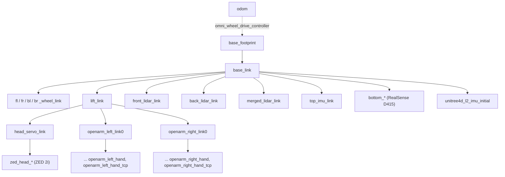

# Robot Description

Look up how the Walkie model is built: its files, xacro arguments,
ros2_control modes, controllers, frames, and joints. Secondary tables and
background are in the collapsed blocks.

The model is the `walkie_description` package in `description/`. This folder
is a git submodule, so commit changes there first (see
[Project Structure](project-structure.md#git-submodules)).

## Files

| Path (in `description/`) | Contents |
| --- | --- |
| `robots/gz_walkie.urdf.xacro` | The only entry point for the full robot. Robot name `walkie_bot`. |
| `urdf/walkie/` | Xacro macros for the base, omni wheels, lift, head servo, lidars, IMU, cameras, and `ros2_control.xacro` |
| `urdf/openarm/` | Xacro macros for the two OpenArm v10 arms and hands, and their ros2_control blocks |
| `config/ros2_controller/` | Controller manager parameter files, one per ros2_control mode |
| `config/openarm/` | Arm, arm body, and hand parameters (`arm/`, `body/`, `hand/`): joint limits, gains, inertials, kinematics. Loaded with `xacro.load_yaml` by `gz_walkie.urdf.xacro` and `urdf/openarm/robot/openarm_robot.xacro`. |
| `config/hardware_layout.yaml` | Per-joint hardware list. Not used. See [Known issues](#known-issues). |
| `meshes/` | Visual and collision meshes. The `.dae` files are in Git LFS. |
| `launch/` | `robot_state_publisher.launch.py`, two RViz preview launches, and `rviz.launch.py` |
| `rviz/robot_preview.rviz` | RViz config for the previews |
| `mujoco/` | `walkie.xml` (generated) and `scene.xml` (hand-written world) |
| `scripts/build_mjcf.py` | Generates `mujoco/walkie.xml` from the xacro |
| `test/` | Model tests. See [Tests](../guides/testing.md). |

## Entry point and xacro arguments

The Gazebo, real robot, and Isaac launch files expand
`robots/gz_walkie.urdf.xacro` directly. To expand the model by hand and check
it:

```bash
pixi run xacro description/robots/gz_walkie.urdf.xacro ros2_control:=mock > /tmp/walkie.urdf
pixi run check_urdf /tmp/walkie.urdf
```

| Argument | Default | Effect |
| --- | --- | --- |
| `ros2_control` | `gazebo` | Which ros2_control hardware to declare. See [ros2_control modes](#ros2_control-modes). |
| `dual_lidar` | `True` | Front and back lidars. `False` gives one 360 degree `single_lidar_link`, only in `gazebo` mode. Every other mode always has two lidars. |
| `use_arm` | `True` | Declared, but has no effect. The arms are always included. |
| `use_fake_arm_hardware` | `True` | Default for the two arguments below. `robot_state_publisher.launch.py` uses another default, see [Known issues](#known-issues). |
| `left_use_fake_arm_hardware` | value of `use_fake_arm_hardware` | `real_robot` mode only: `True` uses `mock_components/GenericSystem` for the left arm, `False` uses the OpenArm CAN plugin |
| `right_use_fake_arm_hardware` | value of `use_fake_arm_hardware` | Same for the right arm |
| `right_joint2_fixed` | `False` | Makes `openarm_right_joint2` a fixed joint and removes it from ros2_control |
| `sim_controllers_yaml` | `$(find walkie_description)/config/ros2_controller/sim_controllers.yaml` | `gazebo` mode only: controller file read by the Gazebo ros2_control plugin |
| `left_can_interface` | `can1` | CAN interface of the left arm (`real_robot` with real arm hardware) |
| `right_can_interface` | `can0` | CAN interface of the right arm |
| `mujoco_model` | `$(find walkie_description)/mujoco/scene.xml` | `mujoco` mode only: scene loaded by the MuJoCo hardware plugin |
| `mujoco_headless` | `false` | `mujoco` mode only: run without the MuJoCo window |

??? info "Arguments declared by included files"
    `urdf/walkie/head/servo_camera.urdf.xacro` declares a few more arguments.
    The useful ones:

    | Argument | Default |
    | --- | --- |
    | `camera_name` | `zed_head` (from `zed_${prefix}`) |
    | `camera_model` | `zed2i` |
    | `use_zed_localization` | `false` |

??? info "Why `sim_controllers_yaml` exists"
    Gazebo reads the controller file from a path inside the URDF, not from a
    launch argument. For example, with `hardware_type:=gazebo` and
    `right_joint2_fixed:=true`, `moveit_demo.launch.py` writes a copy of
    `sim_controllers.yaml` without `openarm_right_joint2` and passes its path
    through this argument.

??? info "Other top-level xacro files"
    - `manipulate/openarm_bimanual_moveit_config/config/openarm_bimanual.urdf.xacro`
      (in the MoveIt package) includes `gz_walkie.urdf.xacro`. It only changes
      the default of `ros2_control` to `mock` for MoveIt.
    - `urdf/openarm/robot/v10.urdf.xacro` describes the OpenArm alone. It is
      not part of the Walkie model.

## ros2_control modes

`urdf/walkie/ros2_control.xacro` declares different hardware for each value of
`ros2_control`. A value that is not in this table gives no error: the model
then has no ros2_control block at all.

| Mode | Used for | ros2_control block | Plugin |
| --- | --- | --- | --- |
| `mock` | Tests without hardware or simulator | `MockSystem` | `mock_components/GenericSystem` |
| `gazebo` | Gazebo simulation | `GazeboSimSystem` | `gz_ros2_control/GazeboSimSystem`, loaded by the `<gazebo>` plugin `gz_ros2_control::GazeboSimROS2ControlPlugin` (`libgz_ros2_control-system.so`) |
| `mujoco` | MuJoCo simulation (in progress) | `MujocoSystem` | `mujoco_ros2_control/MujocoSystemInterface` |
| `topic_base` | Isaac Sim | `TopicBaseSystem` | `topic_based_ros2_control/TopicBasedSystem`, commands on `/isaac_joint_commands`, states from `/isaac_joint_states` |
| `real_robot` | The real robot | `CubeMarsSystem` (wheels) | `cubemars_hardware/CubeMarsSystemHardware` on `can2` |
| | | `HeadServoSystem` (head) | `dynamixel_hardware_interface/DynamixelHardware` on `/dev/ttyDynamixel`, 57600 baud, servo ID 2 |
| | | `LiftSystem` (lift) | `mock_components/GenericSystem`. The real lift motor is controlled outside ros2_control by `lift_homing_node.py` in `robot_bringup`. |
| | | `openarm_left_hardware_interface`, `openarm_right_hardware_interface` | `openarm_hardware/OpenArm_v10HW`, or `mock_components/GenericSystem` when the fake arm argument is true |

- In the four non-real modes, one block holds all joints: wheels, lift, head,
  both arms, and both grippers.
- In `real_robot` mode the arms get their own blocks from
  `urdf/openarm/ros2_control/openarm.bimanual.ros2_control.xacro`.
- Wheel CAN IDs in `real_robot` mode: `fl_wheel_joint` 1, `br_wheel_joint` 2,
  `fr_wheel_joint` 3, `bl_wheel_joint` 4.

!!! warning
    The MuJoCo hardware plugin is installed, but no launch file starts it yet.
    See [Known issues](#known-issues).

??? info "Joint limits that differ between modes"
    | Mode | Wheel velocity limit (rad/s) | `lift_joint` command range (m) | `lift_joint` initial (m) | `head_servo_joint` command range (rad) |
    | --- | --- | --- | --- | --- |
    | `mock` | ±3.14 | 0.000 to 0.7435 | 0.7435 | ±1.54 |
    | `gazebo` | ±3.14 | 0.000 to 0.743 | 0.51 | ±1.54 |
    | `mujoco` | ±3.14 | 0.000 to 0.743 | 0.51 | ±1.54 |
    | `topic_base` | ±16 | 0.000 to 0.743 | not set | ±1.54 |
    | `real_robot` | ±16 | 0.08 to 0.7435 | 0.7435 | ±0.7854 |

    The URDF joint limits are `lift_joint` 0.080 to 0.7435 m and
    `head_servo_joint` -0.785 to 1.047 rad. Several modes allow more than this.

??? info "`mujoco` mode interfaces and IMU"
    In `mujoco` mode the wheels have only a velocity command interface and
    every other joint has only a position command interface. The block also
    declares the IMU sensor `top_imu`. Its plugin parameters
    `odom_free_joint_name` (`floating_base_joint`) and `odom_topic`
    (`/mujoco_ground_truth/odom`) ask for ground-truth odometry of the base.

## Controller files

Each file in `config/ros2_controller/` is loaded together with one ros2_control
mode. `CONTROLLER_PAIRINGS` in `test/test_description.py` records this pairing
and checks every file against its mode.

| Mode | Controller file | Loaded by |
| --- | --- | --- |
| `gazebo` | `sim_controllers.yaml` | The Gazebo plugin, through the `sim_controllers_yaml` argument. Started from `simulation/gazebo/launch/gzsim_omnibot.launch.py`. |
| `mujoco` | `mujoco_controllers.yaml` | `ros2_control_node` of `mujoco_ros2_control` (no launch file yet) |
| `topic_base` | `isaac_controllers.yaml` | `bringup/launch/isaac_omnibot.launch.py` |
| `real_robot` | `real_controllers.yaml` | `bringup/launch/real_omnibot.launch.py` |
| `mock` | `real_controllers.yaml` | `bringup/launch/test_zed.launch.py` |

!!! note
    The `mock` + `real_controllers.yaml` pairing does not work. See [Known issues](#known-issues).

??? info "Controller manager settings per file"
    | File | `update_rate` (Hz) | `use_sim_time` |
    | --- | --- | --- |
    | `sim_controllers.yaml` | 60 | true |
    | `mujoco_controllers.yaml` | 60 | true |
    | `isaac_controllers.yaml` | 60 | false |
    | `real_controllers.yaml` | 50 | false |

### Controllers in each file

A controller is only active after a spawner starts it.

| Controller | Type | Joints | sim | mujoco | isaac | real |
| --- | --- | --- | --- | --- | --- | --- |
| `joint_broad` | `joint_state_broadcaster/JointStateBroadcaster` | all (real: all except `lift_joint`) | yes | yes | yes | yes |
| `omni_wheel_drive_controller` | `omni_wheel_drive_controller/OmniWheelDriveController` | four wheels | yes | yes | yes | yes |
| `lift_controller` | `joint_trajectory_controller/JointTrajectoryController` | `lift_joint` | yes | yes | yes | yes |
| `head_servo_controller` | `position_controllers/JointGroupPositionController` | `head_servo_joint` | yes | yes | yes | yes |
| `left_joint_trajectory_controller`, `right_joint_trajectory_controller` | `joint_trajectory_controller/JointTrajectoryController` | joints 1 to 7 of one arm | yes | yes | yes | yes |
| `left_gripper_controller`, `right_gripper_controller` | `position_controllers/GripperActionController` | `openarm_*_finger_joint1` | yes | yes | yes | yes |
| `left_forward_position_controller`, `right_forward_position_controller` | `forward_command_controller/ForwardCommandController` (position) | joints 1 to 7 of one arm | yes | yes | yes | yes |
| `left_forward_velocity_controller`, `right_forward_velocity_controller` | `forward_command_controller/ForwardCommandController` (velocity) | joints 1 to 7 of one arm | yes | no | yes | yes |
| `left_arm_controller`, `right_arm_controller` | `joint_trajectory_controller/JointTrajectoryController` | joints 1 to 7 of one arm | yes | yes | yes | no |
| `arm_controller` | `joint_trajectory_controller/JointTrajectoryController` | both arms and both `finger_joint1` | yes | yes | yes | no |
| `imu_sensor_broadcaster` | `imu_sensor_broadcaster/IMUSensorBroadcaster` | sensor `top_imu`, frame `top_imu_link` | no | yes | no | no |

??? info "Spawners, lift state relay, MuJoCo differences, and unused parameters"
    - Spawners: for example, `gzsim_omnibot.launch.py` spawns
      `omni_wheel_drive_controller`, `joint_broad`, `lift_controller`, the two
      `*_joint_trajectory_controller`, and the two `*_gripper_controller`.
    - In `real_controllers.yaml`, `joint_broad` lists its joints and leaves out
      `lift_joint`. The lift state comes from the lift homing node through a
      `topic_tools` relay in `real_omnibot.launch.py`. The comment in the file
      explains why: a second publisher would make RViz flicker.
    - `mujoco_controllers.yaml` has no forward velocity controllers, because
      the MuJoCo arm joints have only a position command interface. Its header
      says that `imu_sensor_broadcaster` publishes on `~/imu`, so a launch file
      must remap it.
    - `sim_controllers.yaml`, `isaac_controllers.yaml`, and
      `real_controllers.yaml` contain parameters for a
      `forward_velocity_controller` that no controller manager entry registers.
      These parameters are unused.

### Omni wheel controller parameters

All four files use the same `omni_wheel_drive_controller` parameters, except
`robot_radius`. The values must match the URDF.

| Parameter | Value | Meaning |
| --- | --- | --- |
| `wheel_names` | `[fl_wheel_joint, bl_wheel_joint, br_wheel_joint, fr_wheel_joint]` | Wheels in counterclockwise order, starting at front left |
| `wheel_offset` | 0.7853981633974485 (pi/4) | Angle of the first wheel. Each next wheel is 90 degrees further. |
| `robot_radius` | 0.185 (sim, mujoco, isaac), 0.18518136649782 (real) | Distance from the center of `base_footprint` to each wheel, in m |
| `wheel_radius` | 0.076 | Wheel radius in m |
| `odom_frame_id` | `odom` | Parent frame of the odometry TF |
| `base_frame_id` | `base_footprint` | Child frame of the odometry TF |
| `open_loop` | true | Odometry comes from the commanded velocity, not from wheel feedback |
| `position_feedback` | false | |
| `enable_odom_tf` | true | The controller publishes `odom` to `base_footprint` |
| `cmd_vel_timeout` | 0.5 | Seconds without a command before the wheels stop |
| `publish_limited_velocity` | true | |

??? info "How the values follow from the URDF, and the test tolerances"
    The wheels sit at (±0.130943, ±0.130943) m in `base_link`, so the distance
    to each wheel is 0.130943 × √2 ≈ 0.18518 m. The wheel collision cylinder
    has radius 0.075 m.

    `test_omni_wheel_geometry_matches_urdf` allows 0.001 m for
    `robot_radius`, 1 degree for the wheel angles, and 0.002 m for
    `wheel_radius`.

## Frames and joints

`base_footprint` is the root link. It sits on the floor. `base_link` is
rotated 90 degrees about z (`base_link_joint`, z = 0.0312 m).

!!! warning "Forward is +x in `base_footprint` but -y in `base_link`"
    Use `base_footprint` for anything that moves the robot.



### Main frames

With `ros2_control:=gazebo`, the model has 56 links. The main ones:

| Frame | Parent | Notes |
| --- | --- | --- |
| `base_footprint` | none (root) | Robot origin on the floor. MuJoCo puts its free joint `floating_base_joint` here. |
| `base_link` | `base_footprint` | Rotated 90 degrees about z |
| `fl_wheel_link`, `fr_wheel_link`, `bl_wheel_link`, `br_wheel_link` | `base_link` | Omni wheels, at 45, 315, 135, and 225 degrees around `base_footprint` |
| `lift_link` | `base_link` | Moves up and down with `lift_joint` |
| `front_lidar_link`, `back_lidar_link` | `base_link` | 0.235 m in front of and behind the center, 0.28232 m above `base_link`. Field of view ±2.09333333 rad, range 0.18 to 10 m in Gazebo. |
| `merged_lidar_link` | `base_link` | Frame of the merged scan, at the center and the lidar height |
| `single_lidar_link` | `base_link` | Only with `ros2_control:=gazebo dual_lidar:=False` |
| `top_imu_link` | `base_link` | IMU, 0.17 m above `base_link` |
| `bottom_link`, `bottom_color_optical_frame`, `bottom_depth_optical_frame` | `base_link`, via `bottom_bottom_screw_frame` | RealSense D415 camera (prefix `bottom`) at the front of the base, about 0.22 m above the floor. In the URDF its optical axis points forward and 50 degrees up. |
| `unitree4d_l2_imu_initial`, `unitree4d_l2_imu` | `base_link`, then `unitree4d_l2_imu_initial` | Unitree lidar frames, near the top of the robot |
| `head_servo_link` | `lift_link` | Turns with `head_servo_joint` |
| `zed_head_camera_link`, `zed_head_left_camera_frame_optical` | `head_servo_link` (the optical frame via `zed_head_camera_link`) | ZED 2i head camera |
| `openarm_left_link0` to `openarm_left_link7`, `openarm_right_link0` to `openarm_right_link7` | `lift_link` | The two arms. `link0` is fixed to the lift. |
| `openarm_left_hand_tcp`, `openarm_right_hand_tcp` | `openarm_*_hand` | Tool center points, 0.08 m from the hand |

### Joints that ros2_control drives

| Joint | Type | Limits | Notes |
| --- | --- | --- | --- |
| `fl_wheel_joint`, `fr_wheel_joint`, `bl_wheel_joint`, `br_wheel_joint` | continuous | none | Velocity command |
| `lift_joint` | prismatic | 0.080 to 0.7435 m, 0.1 m/s | Position command |
| `head_servo_joint` | revolute | -0.785398163 to 1.04719755 rad | Position command |
| `openarm_left_joint1` to `openarm_left_joint7`, `openarm_right_joint1` to `openarm_right_joint7` | revolute | from `config/openarm/` | Position command. `openarm_right_joint2` is left out when `right_joint2_fixed` is true. |
| `openarm_left_finger_joint1`, `openarm_right_finger_joint1` | prismatic | 0 to 0.044 m | Gripper. `openarm_*_finger_joint2` copies it as a mimic joint and is not commanded. |

??? info "Initial arm positions in the `mock`, `gazebo`, `mujoco`, and `topic_base` modes"
    - 0.2618 rad: `openarm_left_joint1`, `openarm_left_joint4`, and
      `openarm_right_joint4`
    - -0.2618 rad: `openarm_right_joint1`
    - All other arm joints start at 0.

## Meshes and Git LFS

The `.dae` meshes are stored in Git LFS (`description/.gitattributes` has
`*.dae filter=lfs`). STL meshes are normal git files.

If git-lfs was not installed when you cloned, the `.dae` files are small text
pointers instead of meshes, and RViz and Gazebo cannot load them. Fetch the
real files:

```bash
git submodule foreach --recursive git lfs pull
```

??? info "The 13 files in Git LFS"
    | Path (in `description/`) | Used for |
    | --- | --- |
    | `meshes/openarm/arm/v10/visual/link0.dae` to `link7.dae` | Arm visuals |
    | `meshes/openarm/body/v10/visual/body_link0.dae` | Not used by the Walkie model, which has no OpenArm body link |
    | `meshes/openarm/ee/openarm_hand/visual/hand.dae`, `finger.dae` | Hand visuals |
    | `meshes/walkie/omni_wheel_optimize.dae` | Omni wheel visual |
    | `urdf/walkie/depth_camera/d415/visual/d435.dae` | Not used by the model. The D415 macro uses `d415.stl`. |

## Launch files

### robot_state_publisher.launch.py

`launch/robot_state_publisher.launch.py` runs `xacro` on `robot_model` and
starts `robot_state_publisher`.

| Argument | Default | Passed to xacro |
| --- | --- | --- |
| `robot_model` | `share/walkie_description/robots/gz_walkie.urdf.xacro` | It is the file |
| `ros2_control` | `gazebo` | yes |
| `dual_lidar` | `true` | yes |
| `use_zed` | `false` | yes, but no xacro file declares it, so it has no effect |
| `use_arm` | `true` | yes, but it has no effect in the xacro |
| `use_fake_arm_hardware` | `false` | yes. The xacro default is `True`. See [Known issues](#known-issues). |
| `left_can_interface` | `can1` | yes |
| `right_can_interface` | `can0` | yes |
| `right_joint2_fixed` | `false` | yes |
| `use_sim_time` | `false` | no, it is a robot_state_publisher parameter |

It does not pass `mujoco_model`, `mujoco_headless`, or `sim_controllers_yaml`,
so the xacro defaults apply.

??? info "Which launch files include it"
    The Gazebo, real robot, Isaac, `test_zed`, OpenArm joint state reader, Nav2
    loopback, and the two preview launches include it. Three launches start
    their own `robot_state_publisher` node instead: `moveit_demo.launch.py`,
    `moveit_demo_with_commander.launch.py`, and
    `bringup/launch/openarm.bimanual.launch.py`.

### Preview in RViz

Show the model in RViz without a simulator:

```bash
pixi run ros2 launch walkie_description robot_preview_rviz.launch.py dual_lidar:=False
```

With the default `ros2_control:=gazebo`, pass `dual_lidar:=False` or
`dual_lidar:=True`. Without it, xacro fails with `name 'true' is not defined`
(see [Gazebo Simulation: Known issues](../guides/simulation-gazebo.md#known-issues)).

| Launch file | What it starts |
| --- | --- |
| `robot_preview_rviz.launch.py` | robot_state_publisher, `joint_state_publisher_gui` (sliders for every joint), and RViz with `rviz/robot_preview.rviz` |
| `robot_preview_lift_rviz.launch.py` | robot_state_publisher, `joint_state_publisher` that reads `/lift/joint_states` at 30 Hz with `lift_joint` starting at 0.7435, and RViz |

Both declare `rviz_config_file` (default `rviz/robot_preview.rviz`) and
`use_rviz` (default `True`). They also pass `robot_model`, `ros2_control`
(default `gazebo`), and `use_sim_time` to `robot_state_publisher.launch.py`,
so you can set these on the command line, for example `ros2_control:=mock`.
`use_sim_time` defaults to `true` in `robot_preview_rviz.launch.py` and to
`false` in `robot_preview_lift_rviz.launch.py`.

??? info "Why `--show-args` shows other defaults"
    `--show-args` also prints the arguments of the included launch files, with
    their own defaults (for example `use_sim_time` `false` from
    `robot_state_publisher.launch.py`). The preview launch files pass their
    own values to the include, so those are the values that apply.

`launch/rviz.launch.py` starts RViz only. The preview launches pass
`robot_preview.rviz` to it. Do not start it alone with its default config. See
[Known issues](#known-issues).

## MuJoCo model

The MuJoCo model is generated from the same xacro, so the URDF stays the
single source of truth.

```bash
pixi run mjcf        # regenerate walkie.xml after a change to the description
pixi run mjcf-view   # open scene.xml in the MuJoCo viewer at the home keyframe
```

Neither command needs a colcon build. `build_mjcf.py` reads the xacro files
from the source tree, not from `install/`, so an old install cannot leak into
the model.

!!! warning "Regenerate after every description change"
    `walkie.xml` is checked in. `test_generated_model_is_up_to_date` in
    `test/test_mjcf.py` fails when the file differs from a fresh generation.
    Run `pixi run mjcf` and commit the new `walkie.xml` together with the
    xacro change.

| File | Edit it? | Contents |
| --- | --- | --- |
| `scripts/build_mjcf.py` | yes | Expands `gz_walkie.urdf.xacro` with `ros2_control:=mujoco` from the source tree, then adds what URDF cannot describe |
| `mujoco/walkie.xml` | no, generated | The robot. It has no floor. |
| `mujoco/scene.xml` | yes | Default world: floor, light, and the four wheel-floor contact pairs |

??? info "What the generator adds, and what the file headers document"
    - `build_mjcf.py` adds the free joint, wheel contact capsules, actuators,
      IMU, cameras, lidars, collision classes, and the `home` keyframe.
    - The header comment of `walkie.xml` lists the collision classes, lidars,
      cameras, and IMU.
    - The header of `scene.xml` explains how to write a custom world.

The full story of the MuJoCo model is in
[2. Add MuJoCo Simulation](../migrations/02-mujoco/index.md).

## Known issues

| Issue | Effect | Workaround |
| --- | --- | --- |
| `joint_broad` in `real_controllers.yaml` asks for states the `mock` block does not declare | `test_zed.launch.py` cannot activate `joint_broad` | None yet. When you fix it, remove the entry from `KNOWN_PAIRING_MISMATCHES`. |
| No launch file starts the `mujoco` mode | `mujoco_ros2_control` 0.1.2 is in the pixi environment, and its `ros2_control_node` runs the `mujoco` mode, but only when started by hand | Start it by hand, see [MuJoCo Simulation: Run with ROS 2](../guides/simulation-mujoco.md#run-with-ros-2). To check the model alone, use `pixi run mjcf-view`. |
| `use_fake_arm_hardware` defaults to `false` in `robot_state_publisher.launch.py` and to `True` in the xacro | With `ros2_control:=real_robot`, the launch file uses the real OpenArm CAN plugin. A plain `xacro` call uses mock arms. | Always pass `use_fake_arm_hardware` explicitly |
| `use_arm` is declared in the xacro but not used. No xacro file declares `use_zed`. | Setting either changes nothing. The arms are always in the model. | None |
| `launch/rviz.launch.py` defaults to `rviz/turtlebot3_rviz.rviz`, which does not exist in this package | Started alone, RViz cannot load its config | Pass `rviz_config:=<path>`, or use a preview launch |
| `config/hardware_layout.yaml` uses old joint names (`left_joint1`, ...) | None. No launch file or xacro reads it. | Ignore it. See [ros2_control modes](#ros2_control-modes). |

??? info "Causes and test details for these issues"
    - `joint_broad` and `mock`: `joint_broad` in `real_controllers.yaml` asks
      for wheel effort states and `head_servo_joint` velocity and effort
      states. The `mock` block does not declare them. This breaks
      `test_zed.launch.py`, which pairs `mock` with `real_controllers.yaml`.
      The pairing is listed in `KNOWN_PAIRING_MISMATCHES`, and its test is a
      strict expected failure. See [Tests](../guides/testing.md).
    - `mujoco` mode: the xacro expands and is tested in this mode. Only a
      launch file that starts `mujoco_ros2_control` is missing.
    - `hardware_layout.yaml`: the hardware of each joint is set in the
      ros2_control xacro files instead.
